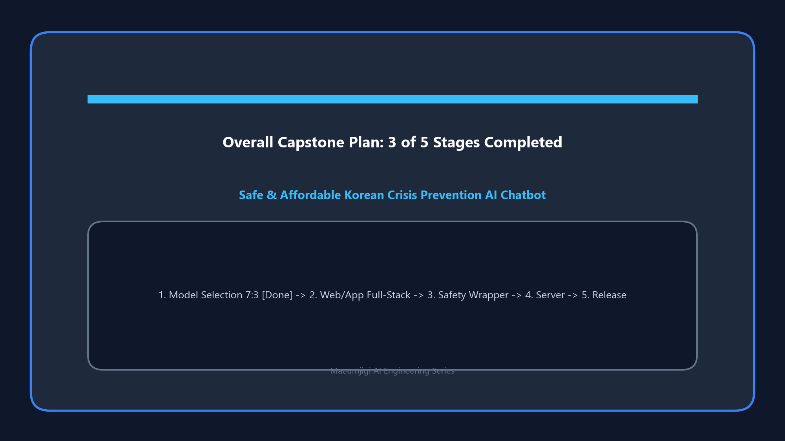

This is the record of March 31, when we conducted the Android build test of the MND Convention reservation alarm app, which was the initial direction of the Maeumjigi project, while simultaneously starting the **Llama 3.1 fine-tuning data preprocessing**, hinting at a full transition into an AI-based project.

{/* truncate */}
