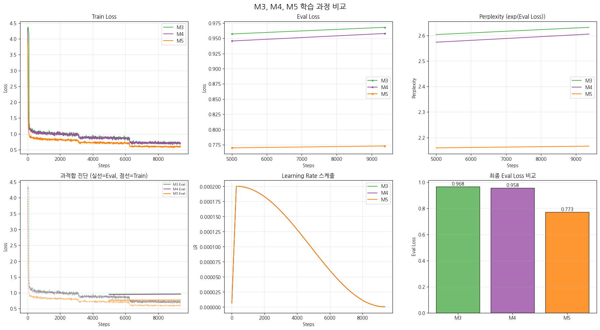

This is the record of April 1, when we began processing a massive amount of conversation data into a format suitable for training the Llama 3.1 model, which will become the core engine of the Maeumjigi project.

{/* truncate */}
