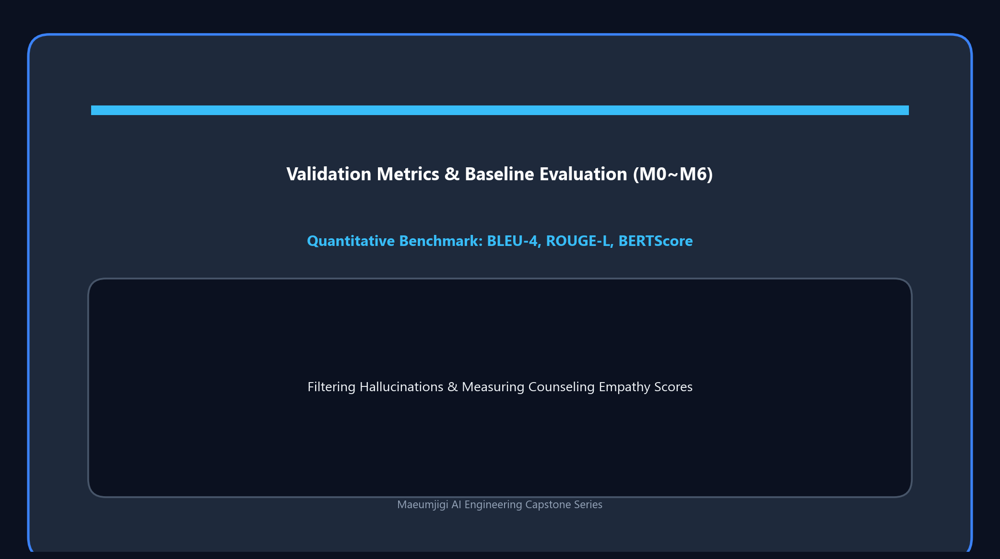

This is the record of April 3, the day we began in earnest the task of refining the training conversation data to feed into the deep learning model (Llama 3.1).
It was also the day we ran a massive pipeline that makes the Artificial Intelligence (AI) read the text and judge the emotion on its own, going beyond simple data merging.

{/* truncate */}
