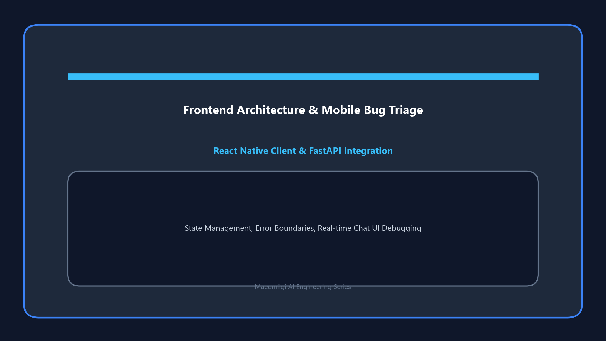

April 5th marks the day we wrapped up the arduous data preprocessing journey (v1~v4) by generating a final report, 
while simultaneously kicking off the frontend project that will become the face of the Maeumjigi web service.

{/* truncate */}
