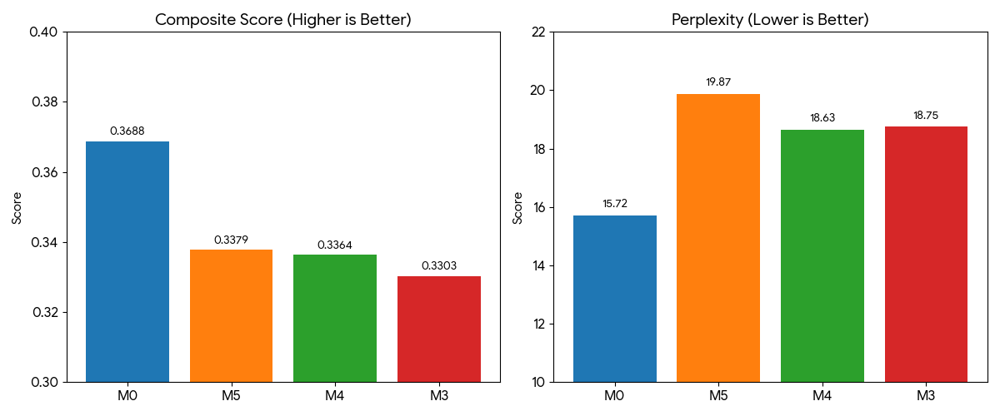

April 7 was the day we attempted integration by running the frontend code built by a teammate in a local environment, 
and also the day we launched a massive script using Artificial Intelligence (AI) to 'synthesize' 60,000 new counseling data points to fill our dataset gaps.

{/* truncate */}

### Filling in the Blanks: Generating AI Synthetic Data (v5)

- **Problem**: The previously refined data (v4) alone lacked specific emotions or detailed counseling scenarios. To solve this, we wanted to use the Claude Application Programming Interface (API) to generate 60,000 virtual, high-quality counseling conversations that fit the Llama 3.1 training format (System, User, Assistant).
- **Process**: 
  > "We want to create a v5 dataset entirely generated by Claude. Please make a plan."
  > "I want to obtain 60,000 dataset records generated by Claude in jsonl format."
- **Result**: We established `v5_plan.md` and started generating data. However, the API call cost quickly became a stumbling block again.

### The Never-ending War with Costs: Prompt Optimization

- **Problem**: While trying to make the AI author 60,000 data points, the cost issue we experienced a few days ago resurfaced. During the script execution, $10 in credits evaporated in an instant.
- **Process**:
  > "Will token usage decrease if we proceed exactly like step8_generate_v5_optimized.py?"
  > "We have already consumed $10 of our credit and are only at this progress level."
- **Result**: We instructed the AI to perform prompt engineering and code optimization (`step8_generate_v5_optimized.py`) to reduce costs, preventing the waste of output tokens and adding logic to safely save generation progress.

### Handover and Execution of Teammate's Frontend Code

- **Process**: 
  > "This project was created by a teammate; what should I do to run it?"
  > "Error occurred during Database (DB) migration..."
  > "Execution up to frontend step 6 complete. Please tell me how to shut it down and the simple procedure to run it again."
- **Result**: We took over the `mental-health` repository written by a teammate, ran it locally, and resolved DB migration errors. Now, the backend AI model and the frontend are ready to meet.

Today was a meaningful day where, moving beyond simple data preprocessing, we directly implemented the latest deep learning trend of **Synthetic Data Generation**, making an AI write the textbooks (data) to teach another AI.
It was a day of achieving optimization amidst the horror of pouring bills and safely launching the frontend server!

---

## Summary & Key Takeaways

- **Massive Synthetic Data (v5) Generation**: Initiated synthesis of 60,000 multi-turn counseling dialogues using Claude API to enrich training distribution across complex emotional scenarios.
- **Aggressive Token & Cost Optimization**: Refactored prompt templates and execution script (`step8_generate_v5_optimized.py`) to eliminate output redundancy and curb billing burn rate.
- **Persistent Progress Checkpointing**: Added incremental state persistence to safeguard against API dropouts and prevent duplicate generation overhead.
- **Frontend Handoff & Database Migration**: Successfully ran the teammate's repository locally, resolving database migration errors and aligning backend AI endpoints with frontend UI.