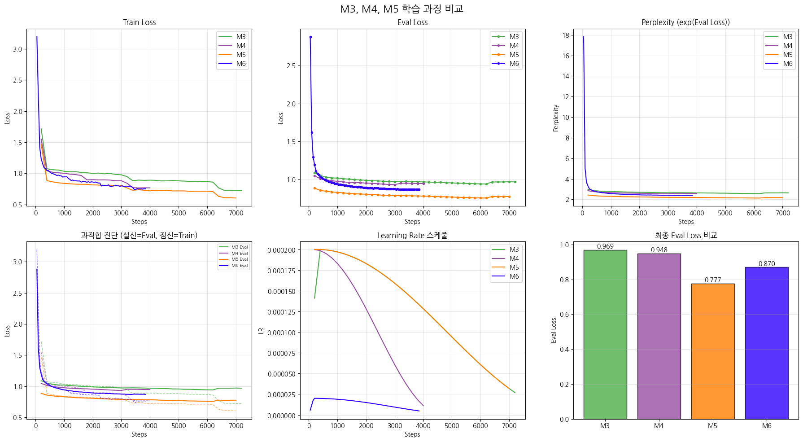

April 8th was the day we experienced the biggest crisis and a 'laugh-and-cry' happening while working on the Maeumjigi project. It was the **Claude API monthly limit exceeded & bill bomb incident**.

{/* truncate */}
