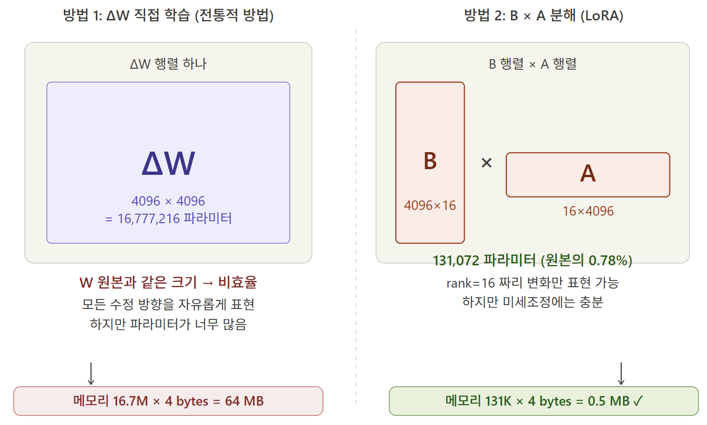

April 14 is the day we resumed the synthetic data (v5) generation work, which had been temporarily halted since the bill bomb incident. We increased the API billing limit (lifted the restriction) and ran the system, but once again, it didn't go smoothly.

{/* truncate */}
