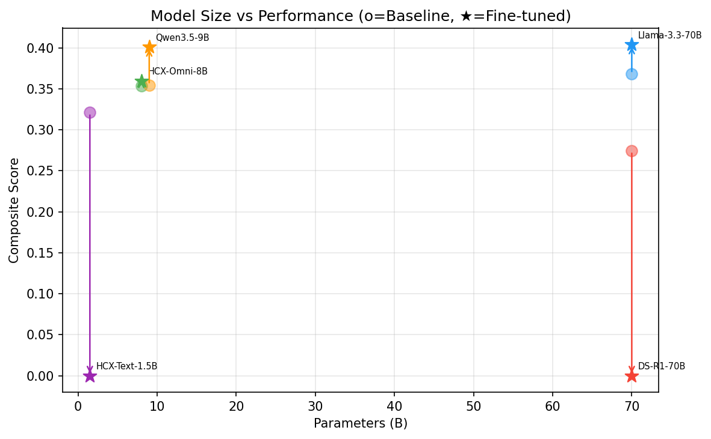

May 7th was the day we synthesized the fine-tuning results of our 5 models (Llama3.3-70B, DSR1-70B, HCX-Omni-8B, Qwen35-9B, HCX-Text-1.5B) and proceeded with full-scale visualization and local environment setup.

{/* truncate */}
