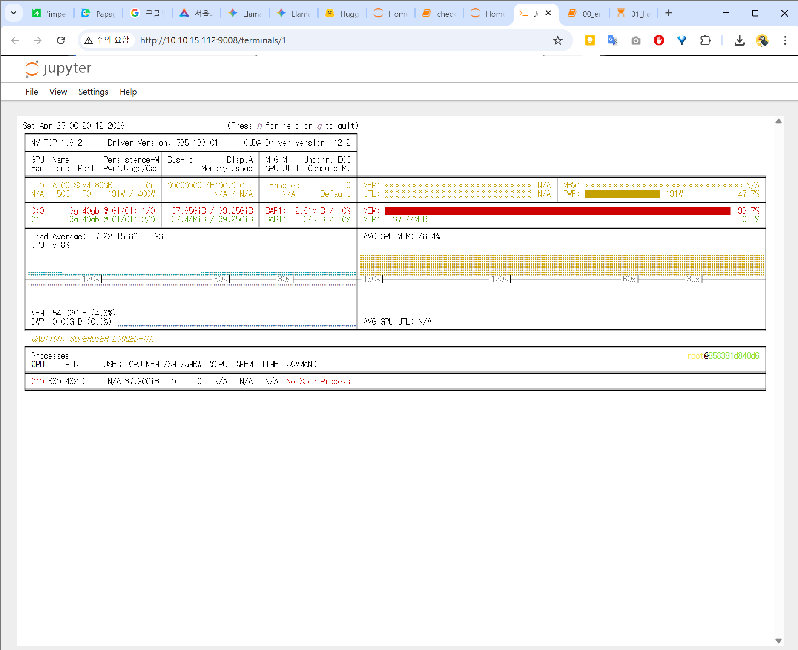

May 8th was the day we were building our capstone design mid-term presentation (PPT) based on the fine-tuning results. However, while happily filling in the slides, I discovered a massive, chilling mistake.

{/* truncate */}
