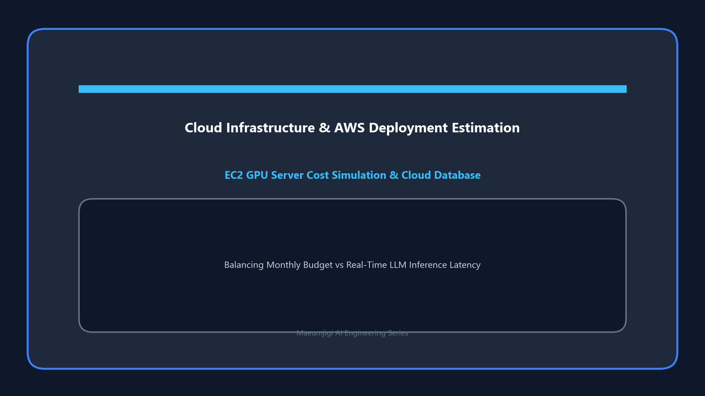

I must correct my previous assumption that "May 13th was the last of Maeumjigi's May development"! On May 17th, a massive wave of backend integration testing and report drafting hit us.

{/* truncate */}
