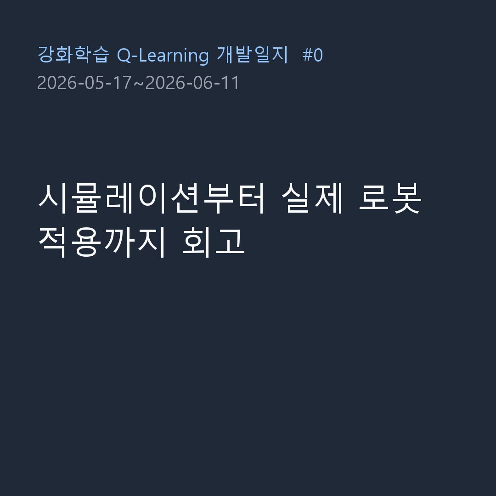

> 📌 **Key Takeaways (TL;DR)**
> - **Problem**: Continuous sensor readings (distance & heading) cause a state-space explosion for tabular Q-learning, and synchronous IPC with the Webots simulator requires low-latency coordination.
> - **Solution**: Designed a geometrically partitioned 5-dimensional continuous sensor mapper producing 3 × 8 × 3 × 3 × 3 = 648 discrete states (`discretizer.py`) and a line-delimited JSON IPC socket pipeline over TCP port 5000.
> - **Result**: Achieved $O(1)$ fast Q-Table indexing and reliable 32ms physics synchronization between the simulator and Python agent.

{/* truncate */}

---

## 1. Project Background: Why Webots and Q-Learning?

Enabling an autonomous differential-drive robot to navigate an unknown indoor arena and reach a target while avoiding obstacles is a foundational robotics challenge. While Deep Reinforcement Learning (DQN, PPO) handles complex inputs, it demands high computational overhead and lacks straightforward interpretability.

In this project, we apply **classical Tabular Q-Learning (Off-policy TD(0))** to a mobile robot in the Webots 3D physics engine. Our objective is to establish an optimal, mathematically verifiable navigation and obstacle avoidance policy in a 1.2m × 1.2m indoor arena.

---

## 2. System Architecture: Webots Controller ↔ Python RL Engine

The system is decoupled into two clean tiers: the **Webots simulation server** and the **Python RL client**.

```mermaid
flowchart LR
    subgraph Webots["Webots 3D Simulator (localhost:5000)"]
        Robot["Supervisor Robot<br>(Ultrasonic Sensor + Wheels)"]
        HeadScan["Head-scan Mechanism<br>(Left/Right 1.1 rad servo)"]
        Server["TCP Socket Server<br>(Line-delimited JSON)"]
        Robot -→ HeadScan -→ Server
    end

    subgraph Python["Python RL Engine (Client)"]
        Env["WebotsEnv (gym-like)<br>reset() / step()"]
        Disc["Discretizer<br>(Continuous → 0~647 Bin)"]
        Agent["QLearningAgent<br>(Q-Table 648x4)"]
        Env -→ Disc -→ Agent
    end

    Server <-→|"request: {type: step, action: 0..3}<br>response: {state: [...], reward, done}"| Env
```

* **Webots Controller (`RL_controller.py`)**: Executes action commands for 480ms (15 simulation ticks $×$ 32ms) and rotates a head-mounted ultrasonic sensor left and right by 1.1 rad ($\approx 63°$) to eliminate blind spots.
* **Socket Protocol**: Lightweight line-delimited JSON over TCP localhost:5000:
  * Request: `{"type": "step", "action": 0}` (0: Forward, 1: Backward, 2: Turn Left, 3: Turn Right)
  * Response: `{"state": [0.45, 0.12, 0.35, 0.28, 0.40], "reward": 0.05, "done": false, "info": {...}}`

---

## 3. Discretizing Continuous Sensors into 648 States

To apply tabular Q-learning, continuous floats must be mapped into finite discrete states. We selected 5 crucial observation variables based on kinematic relevance:

| Feature | Bins | Thresholds | Semantic Meaning |
| :--- | :---: | :--- | :--- |
| **`goal_distance`** | **3** | `[0.6m, 1.2m]` | Near, Mid, Far |
| **`goal_heading`** | **8** | $[-π, π]$ (8 sectors, $45°$ each) | Front, Front-Right, Right, Back-Right, Back, Back-Left, Left, Front-Left |
| **`front_distance`** | **3** | `[0.15m, 0.30m]` | Danger/Collision, Caution, Safe |
| **`left_distance`** | **3** | `[0.15m, 0.30m]` | Danger, Caution, Safe |
| **`right_distance`** | **3** | `[0.15m, 0.30m]` | Danger, Caution, Safe |

Total State Count:
**N_states = 3 × 8 × 3 × 3 × 3 = 648**

The resulting Q-Table requires only **$648 × 4 = 2,592$ floating-point entries**, allowing sub-millisecond memory updates and zero GPU overhead.

### 💻 State Discretization Code (`discretizer.py`)

```python
import numpy as np

# Dimension boundaries
N_GOAL_D, N_GOAL_H, N_FRONT, N_LEFT, N_RIGHT = 3, 8, 3, 3, 3
N_STATES = N_GOAL_D * N_GOAL_H * N_FRONT * N_LEFT * N_RIGHT  # 648

_HEADING_BINS = np.linspace(-np.pi, np.pi, 9)[1:-1]
_NEAR_BINS    = np.array([0.15, 0.30])
_DIST_BINS    = np.array([0.6, 1.2])

def discretize(state_dict: dict) → int:
    """Maps 5-tuple continuous sensor readings to an integer in [0, 647]."""
    gd = int(np.digitize(state_dict["goal_distance"], _DIST_BINS))
    gh = int(np.digitize(state_dict["goal_heading"], _HEADING_BINS))
    df = int(np.digitize(state_dict["front_distance"], _NEAR_BINS))
    dl = int(np.digitize(state_dict["left_distance"], _NEAR_BINS))
    dr = int(np.digitize(state_dict["right_distance"], _NEAR_BINS))

    # Compute flattened 1D index
    index = ((((gd * N_GOAL_H + gh) * N_FRONT + df) * N_LEFT + dl) * N_RIGHT + dr)
    return int(index)
```

---

## 4. Head-Scan Mechanism & Collision Logic



A fixed forward-facing sensor leaves lateral blind spots. We implemented an active **Head-Scan routine**:

1. **Step Execution**: Drive motors at 3.0 rad/s for 480ms.
2. **Head Rotation**: Sweep head servo +1.1 rad to read left distance, then -1.1 rad for right distance.
3. **Re-center**: Return head to 0 rad and refresh front distance.
4. **Terminal Conditions**:
   * **Goal Reached**: Euclidean distance $`<= 0.10m` \rightarrow$ success (`done = True`, reward $+1.0$)
   * **Collision**: Any distance $`<= 0.08m` \rightarrow$ failure (`done = True`, reward $-1.0$)

---

## 5. What's Next?

With the simulator environment, TCP socket IPC, and 648-bin state discretization established, our agent is ready for reinforcement learning.

In Episode #2, we will cover the **mathematical implementation of Tabular Q-Learning, $\epsilon$-greedy exploration decay, and reward function tuning**!
