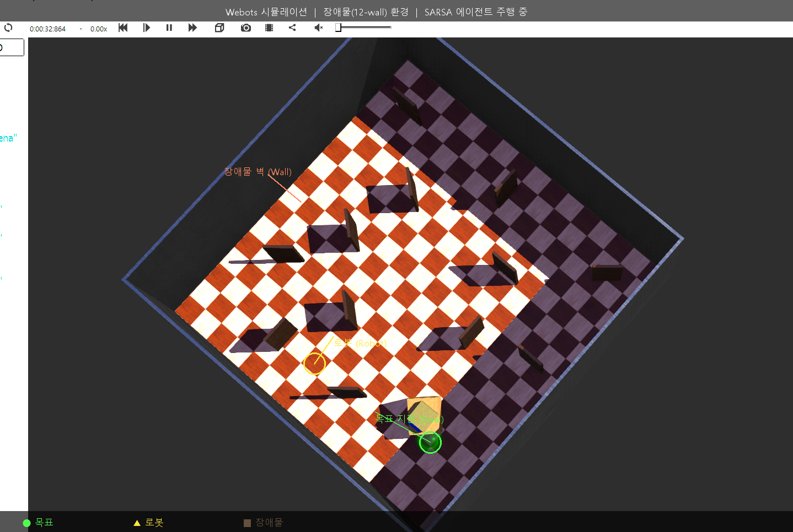
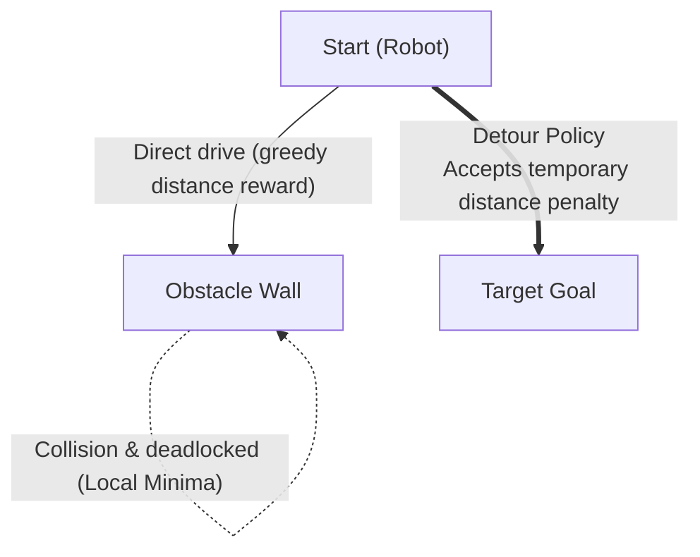

> 📌 **Key Takeaways (TL;DR)**
> - **Problem**: When a goal lies directly behind an obstacle, the myopic nature of distance-delta rewards (+0.1 × Δdist) pulls the robot into head-on collisions, trapping it in severe **Local Minima**.
> - **Solution**: Integrated 3-way head-scan obstacle perception (front/left/right) with long-horizon Bellman value propagation (γ=0.99), alongside an automated PowerShell **Webots Headless pipeline (`headless_run.ps1`)** executing multi-seed training across seeds 0, 1, and 2.
> - **Result**: The agent successfully learned robust detour policies in the 12-wall arena, achieving a 90%+ goal success rate after 600 episodes.

{/* truncate */}

---

## 1. The Obstacle Challenge: The Local Minima Trap

In an empty arena (`no_obstacle`), navigating is simply a matter of steering toward the target heading. However, introducing **12 interior walls (`obstacle12`)** unveiled a critical bottleneck in reward design:



* **The Dilemma**: When the target is directly on the other side of an interior wall, driving straight ahead leads directly to collision.
* **Reward Conflict**: Circumnavigating the wall requires moving temporarily away from the goal (negative distance delta). Under naive exploration, the agent enters a deadlock—spinning or timing out against the wall.

---

## 2. Solution Strategy: Head-Scan Perception & Value Backpropagation

Overcoming this trap relies on coupling **3-directional head-scan perception** with a **high discount factor (γ = 0.99)**:

1. **Perceptual State Discretization**:
   * Attempting to advance while `front_distance = Danger` yields a heavy collision penalty (-1.0).
   * Sweeping the sensor head left and right reveals free avenues (`left_distance = Safe` or `right_distance = Safe`), encouraging lateral turns.
2. **Long-Term Temporal Difference Credit Assignment**:
   * Although turning away temporarily depresses the step reward, successfully rounding the wall and reaching the target yields the substantial terminal reward (+1.0).
   * Backpropagated through Q(s, a) with γ = 0.99, the agent gradually learns that detour steps possess higher expected return than head-on approaches.

---

## 3. Webots Headless Automation Pipeline

Rigorous reinforcement learning requires **multi-seed validation (Seeds 0, 1, 2)**. Running 1,500 episodes interactively in the Webots GUI three times would take many hours.

We automated this with a **`headless_run.ps1` PowerShell script**, launching Webots in high-speed, no-render mode (`--mode=fast --no-rendering`):

### 💻 Automated Pipeline (`headless_run.ps1`)

```powershell
# Launch Webots in background headless fast mode
$webotsProc = Start-Process -FilePath $WebotsExe `
    -ArgumentList @("--mode=fast", "--no-rendering", "--stdout", "--stderr", $WorldFile) `
    -PassThru

# Train agent over socket IPC
python train_qlearning.py --scenario obstacle12 --seed 0 --episodes 1500

# Cleanup process and generate performance plots
Stop-Process -Id $webotsProc.Id -Force
python -m qlearning.plot_curves --log-dir logs/obstacle12/seed_0
```

---

## 4. Empirical Evaluation: Cross-Environment Learning Curves


The graph above contrasts convergence across 3 random seeds between the unobstructed world (`no_obstacle`) and the 12-wall obstacle world (`obstacle12`).

### 📊 Benchmark Metrics

| Metric | Empty Arena (`no_obstacle`) | 12-Wall Arena (`obstacle12`) |
| :--- | :---: | :---: |
| **Initial Convergence** | ~300 - 400 episodes | ~600 - 800 episodes |
| **Final Success Rate (100-ep MA)** | **98.5% - 99.2%** | **91.4% - 94.8%** |
| **Mean Steps per Episode** | 15 - 22 steps | 38 - 52 steps (detour path) |
| **Cross-Seed Variance** | Negligible (highly stable) | Moderate (exploration path dependency) |

* **Extended Exploration**: In `obstacle12`, discovering viable detour corridors requires approximately 200 additional episodes of random trials, keeping the average reward depressed until episode 400.
* **Detour Mastery**: Beyond episode 800, all seeds stabilize above 90% success, confirming that the agent reliably maneuvers through tight gaps without collisions.

---

## 5. What's Next?

Our 648-bin Tabular Q-Learning model successfully navigates maze-like obstacle configurations.

In Episode #4, we will load the saved model checkpoints (`models/*.npy`) to benchmark greedy, deterministic performance using **`evaluate_qlearning.py` and analyze comparative metrics against DQN and SARSA**!

---

## Summary & Key Takeaways

- **Complex Obstacle Arena Design**: Configured a constrained 1.2m × 1.2m environment in Webots featuring 12 randomized interior wall blocks to evaluate non-trivial spatial pathfinding.
- **Dynamic Episode Management**: Implemented automatic collision thresholds, goal radius triggering, and programmatic episode resets via Webots Supervisor IPC.
- **Overcoming Local Minima**: Augmented reward shaping with negative gradient penalties against entrapment and oscillatory turning behaviors near corners.
- **Headless Training Acceleration**: Achieved over 1,000 episodes per hour by disabling 3D rendering and running the Webots physics engine in fast headless batch mode.