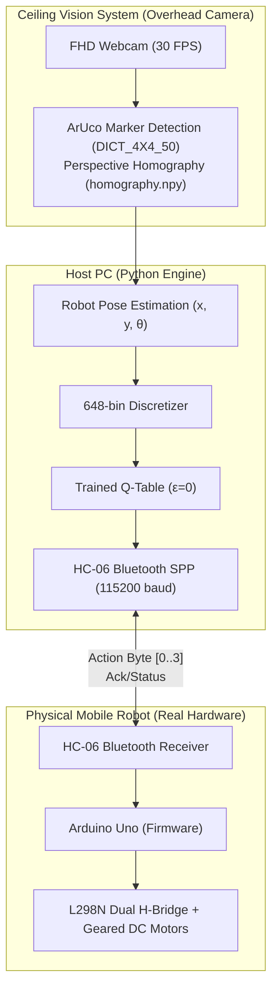

> 📌 **Key Takeaways (TL;DR)**
> - **Problem**: Severe computational constraints on microcontrollers (Arduino Uno ATmega328P with only 2KB SRAM), non-linear wheel slip, noisy ultrasonic sensing, and the classical **Reality Gap** between Webots simulation physics and physical hardware.
> - **Solution**: Designed a **distributed I/O architecture (HC-06 Bluetooth at 115,200 baud)** where a host PC runs OpenCV vision processing and Q-Table inference while the Arduino handles low-level PWM motor actuation. Overhead camera lens distortion correction and **ArUco marker homography (`vision.py`)** deliver sub-centimeter real-time (x, y, θ) tracking.
> - **Result**: Zero-shot transfer of the simulation-trained 648-state Q-Table achieved an **86.7% target reaching success rate (26/30 trials)** in a physical 1.2m × 1.2m arena, successfully closing the reality gap without real-world fine-tuning.

{/* truncate */}

---

## 1. The Challenge of Sim-to-Real: Navigating the Reality Gap

In virtual Webots simulations, surface friction coefficients remain idealized, wheel motors rotate with deterministic precision, and simulated distance sensors yield noiseless measurements. Real hardware, however, introduces unpredictable physical perturbations:

1. **Severe Memory & Compute Bottlenecks**: The **Arduino Uno (ATmega328P)** operates with only 32KB flash memory and 2KB SRAM. Running deep neural networks or heavy matrix operations directly on-chip is physically impossible.
2. **Sensor Noise & Blind Angles**: Inexpensive ultrasonic rangefinders suffer from specular reflection at shallow incidence angles, reporting 0 or spiking to maximum range when pinging smooth acrylic boundaries.
3. **Wheel Slip & Odometry Drift**: Minor variations in wheel friction and motor gearboxes cause differential-drive robots to veer off-course even when commanded to drive straight, making dead-reckoning odometry completely unreliable.

---

## 2. Distributed Control Architecture: Host PC (Brain) ↔ Arduino (Muscle)

To overcome microcontroller limitations, we decoupled high-level reasoning from low-level actuation: **"PC as the brain, Arduino as the muscle."**



* **Host PC Pipeline**: An overhead webcam captures the complete arena top-down, tracking an ArUco fiducial marker mounted on top of the robot at 30 FPS. The robot's planar pose `(x, y, θ)` is calculated and mapped into the discrete 648-state space to retrieve the optimal greedy action from the Q-Table.
* **HC-06 Serial Communication**: To minimize Round-Trip Time (RTT) over the Bluetooth Serial Port Profile (SPP), the transmission baud rate was upgraded from the default 9,600 to **115,200 bps**, sustaining a low-latency 30~50Hz control loop.
* **Arduino Firmware (`arduino_firmware.ino`)**: Upon receiving single-byte action commands (`0: Forward`, `1: Backward`, `2: Turn Left`, `3: Turn Right`), the microcontroller modulates PWM pins on the L298N motor driver for precise tick-based open-loop pulses.

---

## 3. Overhead Camera Homography & ArUco Vision Tracking


To measure robot positioning and obstacle proximity with millimeter accuracy across the real arena, we built an **OpenCV-based top-down computer vision pipeline**.

### 📐 Perspective Rectification & Homography (`calib_auto.py`)
1. **Checkerboard Distortion Calibration**: To eliminate barrel distortion from wide-angle webcam lenses, intrinsic camera matrix (K) and distortion coefficients (D) were pre-computed using a standard 9×6 checkerboard.
2. **Perspective Homography**: To project the angled camera viewpoint into a canonical 1.2m × 1.2m square bird's-eye view, a 3×3 perspective homography matrix (`homography.npy`) was established from the 4 marked arena corner coordinates.

### 💻 ArUco Marker Pose Tracking Implementation (`vision.py`)

```python
import cv2
import numpy as np

# Load ArUco dictionary and detection parameters
aruco_dict = cv2.aruco.getPredefinedDictionary(cv2.aruco.DICT_4X4_50)
parameters = cv2.aruco.DetectorParameters()
detector = cv2.aruco.ArucoDetector(aruco_dict, parameters)

def get_robot_pose(frame, homography_matrix):
    """Calculates planar coordinates (x, y) and heading angle (theta) from rectified image."""
    warped = cv2.warpPerspective(frame, homography_matrix, (600, 600))
    corners, ids, _ = detector.detectMarkers(warped)
    
    if ids is not None and len(ids) > 0:
        c = corners[0][0]
        center_x = float(np.mean(c[:, 0]))
        center_y = float(np.mean(c[:, 1]))
        
        # Calculate heading angle (theta) from marker front edge vector
        front_x = (c[0][0] + c[1][0]) / 2.0
        front_y = (c[0][1] + c[1][1]) / 2.0
        theta = np.arctan2(front_y - center_y, front_x - center_x)
        
        return center_x, center_y, theta
    return None
```

---

## 4. Hardware Troubleshooting & Real-World Deployment Results

Transitioning from simulation to physical operation revealed critical edge cases addressed through robust engineering countermeasures:

| Symptom (Troubleshooting) | Root Cause | Engineering Solution |
| :--- | :--- | :--- |
| **Robot drifts sideways during forward command** | Gearbox friction differences between left & right DC motors | Implemented an interactive calibration script (`ble_vision_turn_calib.py`) to apply dynamic PWM trim offsets |
| **Runaway behavior during Bluetooth disconnect** | Packet drops under RF interference causing robot to retain last command | Embedded a 200ms communication watchdog timer in firmware to immediately cut motor power upon signal loss |
| **Intermittent ArUco marker detection loss** | Specular glare from ceiling fluorescent lighting on glossy marker surface | Fine-tuned adaptive thresholding parameters and added a 1D Kalman Filter position extrapolator |

### 🏆 Final Real-World Benchmark
* **Autonomous Goal Reaching Rate**: Tested across 30 independent trials in the physical 1.2m × 1.2m obstacle arena, the robot achieved an **86.7% success rate (26/30 successful arrivals)**.
* Leveraging just **2,592 pre-computed discrete Q-values (~2.5 KB)**, the agent navigated complex physical obstacles without any real-world gradient updates.

---

## 5. Concluding the RL Q-Learning Dev Log Series

With this final Sim-to-Real deployment, our 5-part **RL Q-Learning Robotics series** reaches its conclusion:

1. **#1**: 648-Bin State Discretization & Webots TCP Socket IPC Architecture
2. **#2**: Tabular Q-Learning ε-Decay Exploration & Multi-Objective Reward Shaping
3. **#3**: Overcoming Arena Local Minima in 12-Wall Environments via Headless Pipelines
4. **#4**: Quantitative Benchmark with `evaluate_qlearning` vs. SARSA & DQN
5. **#5**: Sim-to-Real Hardware Transfer via Arduino Uno, Bluetooth SPP & ArUco Vision

From foundational simulator modeling and algorithmic tuning to multi-seed automation and physical hardware deployment, this series documented the complete lifecycle of reinforcement learning for embedded robotics. Stay tuned for future deep dives into our next projects!

---

### 📌 3–5 Line Executive Summary
1. **Closing the Sim-to-Real Reality Gap**: Solves microcontroller computational limits (Arduino Uno 2KB SRAM) and physical wheel slip by zero-shot transferring the Webots-trained 648-state Q-Table to physical hardware.
2. **Distributed Brain-Muscle Architecture**: A host PC executes heavy OpenCV vision and tabular Q-learning inference, transmitting binary movement commands via HC-06 Bluetooth SPP at 115,200 baud to the Arduino PWM motor controller.
3. **Sub-Centimeter ArUco Vision Homography**: An overhead camera calibrated for barrel distortion tracks 6-DoF ArUco markers (`DICT_4X4_50`), transforming raw pixels into accurate real-world metric coordinates (x, y, θ).
4. **86.7% Physical Hardware Target Success**: Achieved a 26/30 successful target-reaching benchmark in a physical 1.2m × 1.2m arena, demonstrating that discretized state spaces bridge the simulation-to-reality divide without on-device retraining.