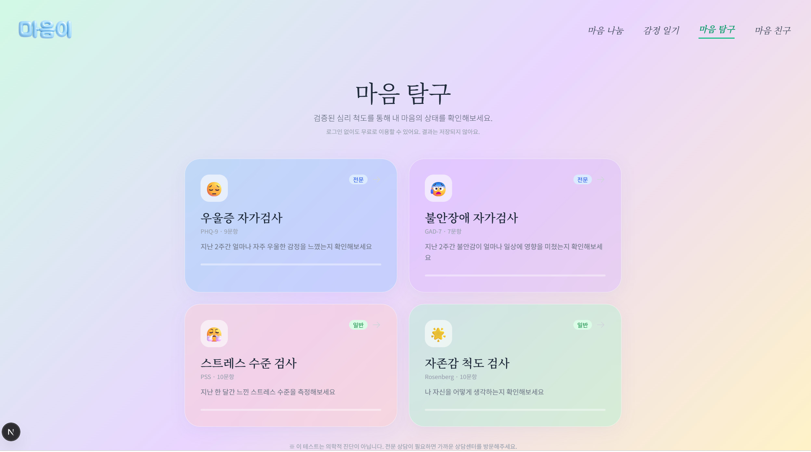

In the final week of May (27th-30th), we dedicated our efforts to wrapping up the results of the highly anticipated **4th Fine-Tuning (fine_tuning_4)** and solidifying the system's framework.

{/* truncate */}
