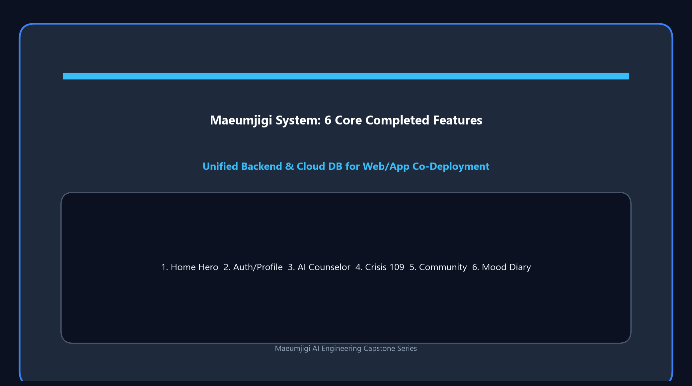

As we entered June, the Maeumjigi team completed the major developments of the 1st semester Capstone project and focused entirely on building **safety nets** and preparing for the **final presentation**.

{/* truncate */}
