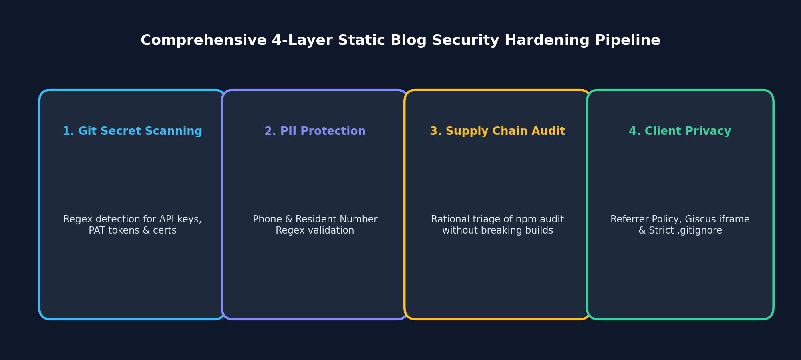

Every modern frontend developer has experienced this sudden spike of adrenaline: you run `npm audit` on your clean documentation or blog repository, and the terminal screams back in alarming red text:

```text
45 vulnerabilities (15 moderate, 15 high, 15 critical)
To address all issues (including breaking changes), run:
  npm audit fix --force
```

Seeing words like **Critical**, **Remote Code Execution (RCE)**, and **Prototype Pollution** triggers an immediate instinct: type `npm audit fix --force` to make the scary red warnings go away. 

However, in the world of **Static Site Generators (SSG)** like Docusaurus, Next.js, or Hugo deployed to GitHub Pages or AWS S3, doing so is often an engineering mistake that breaks production builds without improving your actual security posture.

In this article, we dissect the **static site threat model**, explain why bundler vulnerabilities differ fundamentally from server vulnerabilities, and share a production-tested **4-Layer Security Hardening Blueprint** to protect what actually matters: your secrets, client privacy, and repository integrity.

{/* truncate */}

---


---

## 1. Executive Summary: The Core Engineering Trade-off

1. **Build-Time Tools != Production Runtime**: Packages flagged in `npm audit` (such as `tinypool`, `serialize-javascript`, `postcss-selector-parser`) are node worker and bundler dependencies executed locally on your machine during `npm run build`. 
2. **Zero Live Server on CDN**: Once compiled, GitHub Pages serves static, immutable HTML, CSS, and client-side JavaScript. There is **no running Node.js daemon**, no backend port listening, and no database connection in production.
3. **The Danger of `--force`**: Running `npm audit fix --force` blindly downgrades core frameworks (e.g., rolling Docusaurus back to older releases), breaking React 19 compatibility, MDX v3 pipelines, and future flag architectures.
4. **Where Real Static Risks Lie**: The genuine security risks of static blogs are **credential/API key leakage in public Git history**, **PII exposure in datasets**, and **client-side cross-origin leakage**.

---

## 2. Anatomy of the 45 Vulnerabilities: Build vs Runtime

Let's examine the actual CVEs reported in our audit log:

### A. Tinypool Prototype Pollution (`GHSA-5gmw-xhrv-c9v3` - Critical)
- **Vulnerability**: If untrusted user input is passed into the worker initialization options of `tinypool`, an attacker can pollute `Object.prototype`.
- **Reality in SSG**: `tinypool` is used internally by `@docusaurus/faster` to parallelize bundling tasks across CPU cores during build time. The input parameters come solely from your own `docusaurus.config.ts`. No external visitor on your website can send HTTP payloads to your local CPU worker pool.

### B. Serialize-JavaScript RCE (`GHSA-5c6j-r48x-rmvq` - High)
- **Vulnerability**: Remote Code Execution via crafted RegExp flags or serialized dates.
- **Reality in SSG**: Webpack uses this to serialize internal compilation chunks into static `.js` bundles. Once written to the `build/` directory, JavaScript files are passive assets served over HTTPS. No server-side deserialization takes place.

### C. PostCSS Selector Parser CPU Exhaustion (`GHSA-rj75-hqrm-r3gf` - Moderate)
- **Vulnerability**: Quadratic complexity in flat selector parsing allows Denial of Service (DoS) via maliciously crafted CSS strings.
- **Reality in SSG**: The CSS files being parsed are your own theme stylesheets (`custom.css`). Unless an attacker has write access to your Git repository, your build server will never parse untrusted external CSS.

Running `npm audit fix --force` in this situation attempts to downgrade `@docusaurus/core` from `3.10.2` to `3.7.0`. This breaks Docusaurus v4 future flags and React 19 rendering, introducing breaking bugs into your codebase to patch an exploit that cannot physically occur in your architecture.

---

## 3. What Actually Matters: The 4-Layer Static Security Blueprint

If npm bundler vulnerabilities are low risk, where should static site engineers invest their security budget? Here is the multi-layered defense pipeline implemented in this blog.



### Layer 1: Automated Pre-Commit Secret Scanning

The single greatest catastrophic risk for public technical blogs is accidentally committing an OpenAI key (`sk-...`), a GitHub Personal Access Token (`ghp_...`), or an AWS access credential (`AKIA...`).

We created an automated audit script (`tools/audit_security.py`) that utilizes Git's object database to scan every tracked file against high-entropy regex patterns:

```python
PATTERNS = [
    (r'(?i)(api[_-]?key|secret|token|password|auth|bearer)\s*[:=]\s*["\']([^"\']{8,})["\']', "Potential Key Assignment"),
    (r'ghp_[a-zA-Z0-9]{36}', "GitHub Personal Access Token"),
    (r'sk-[a-zA-Z0-9]{32,}', "OpenAI API Key"),
    (r'AIzaSy[a-zA-Z0-9_-]{33}', "Google API Key"),
    (r'AKIA[0-9A-Z]{16}', "AWS Access Key"),
    (r'-----BEGIN\s+(RSA\s+)?PRIVATE\s+KEY-----', "Private Key Certificate"),
]
```

Running this audit script before every release ensures zero hardcoded tokens ever reach the remote repository.

### Layer 2: Personally Identifiable Information (PII) Scrubbing

When publishing engineering articles on AI datasets (such as our 23-part Maeumjigi clinical counseling series or 5-part ANPR Vision AI series):
- **Synthetic Data First**: All counseling records were synthetically generated via LLM pipelines (`synth_gen`) rather than using real clinical transcripts, guaranteeing zero medical privacy breach.
- **Regex PII Audit**: Our scanner automatically validates markdown text against Korean national identity numbers (`\d{6}-[1-4]\d{6}`) and phone numbers (`010-\d{4}-\d{4}`).

### Layer 3: Hardened `.gitignore` Configuration

A standard `.gitignore` often ignores `.env.local` while leaving `.env` exposed. We hardened `.gitignore` to comprehensively block sensitive files, private certificates, and raw analytics dumps:

```gitignore
# Environment & Secret Protection
.env
.env.*
*.pem
*.key
*.pfx
*.cert
*credential*
*.secret

# Analytics & CSV dumps
*.csv

# Archived template files
_old/
```

### Layer 4: Client-Side Privacy & Iframe Sandboxing

Even without a backend server, static sites must respect user privacy and prevent data leakage:

1. **Strict Referrer Policy**: In `docusaurus.config.ts`, we inject a strict referrer header into `<head>`:
   ```typescript
   themeConfig: {
     metadata: [
       { name: 'referrer', content: 'strict-origin-when-cross-origin' },
     ],
   }
   ```
   This ensures that when a reader clicks an external documentation link, your blog's specific full URL parameters are truncated, preventing path leakage.

2. **Giscus Discussion Sandboxing**: We host comments via GitHub Discussions. In `BlogPostItem/index.tsx`, Giscus is configured with:
   - `emitMetadata="0"`: Prevents post-message iframe broadcasts from exposing discussion details to third-party browser scripts.
   - `loading="lazy"`: Prevents iframe resource execution until the reader scrolls to the bottom of the article.

---

## 4. Key Takeaways for Developers

- **Do Not Panic at `npm audit`**: Always distinguish between **Build-Time Bundler Dependencies** and **Production Runtime Dependencies**.
- **Beware of `--force`**: Automated downgrades often introduce real, breaking application bugs while solving theoretical vulnerabilities that cannot be triggered on a static CDN.
- **Focus on the Real Attack Surface**: Automate secret detection, scrub sensitive data from datasets, enforce strict client-side referrer policies, and protect your Git history.
