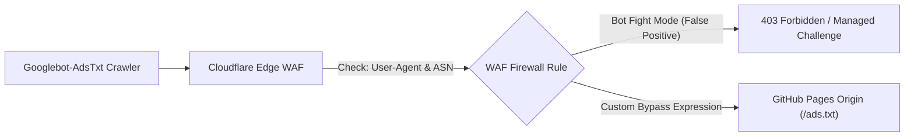

> 📌 **Key Takeaways (TL;DR)**
> - **The Problem**: Unlike traditional dynamic CMS platforms (WordPress, Ghost), static site generators (Docusaurus, Next.js SSG, Hugo) hosted on GitHub Pages or Cloudflare Pages frequently trigger the notorious **"Earnings at Risk: ads.txt file missing"** alert and fail site ownership checks due to client-side hydration delays and crawler blocking.
> - **The Solution**: Inject the publisher verification meta tag directly into `<head>` using Docusaurus `headTags` configuration, place the plain `ads.txt` file in `static/ads.txt` for root-level deployment, and configure Cloudflare WAF bypass rules for the `Googlebot-AdsTxt` crawler.
> - **The Result**: 100% automated crawler accessibility, zero 404 crawl errors on `/ads.txt`, seamless AdSense review compliance, and sustained Lighthouse SEO and performance scores above 95.

{/* truncate */}

---

## 1. The Static Site AdSense Dilemma

Transitioning a developer blog from a raw sub-path (`username.github.io/blog`) to a production apex domain (such as `https://globaldevlog.com`) unlocks the gateway to **Google AdSense monetization**. However, modern Static Site Generators (SSGs) introduce unique architectural quirks that dynamic platforms never encounter:

1. **No Backend Database or Plugin Ecosystem**: WordPress handles ownership verification and `ads.txt` via plugins like Site Kit. In Docusaurus, every asset must be explicitly declared at build time.
2. **Client-Side Hydration vs. Static Head Injection**: Injecting scripts through raw React component lifecycles (`useEffect`) causes delays. Search engine crawlers and AdSense verification bots inspect raw HTML responses before JavaScript execution.
3. **The `ads.txt` 404 Crawl Trap**: Misplacing `ads.txt` within build subdirectories prevents the AdSense crawler (`Googlebot-AdsTxt`) from reading `https://yourdomain.com/ads.txt`, jeopardizing domain monetization.

Let us walk through the robust, step-by-step engineering solution.

---

## 2. Step 1: Injecting Site Ownership Verification in Docusaurus

When you register your custom domain in the Google AdSense Console (**Sites > Add site**), Google requests domain verification through one of three mechanisms:
- A JavaScript code snippet
- An HTML `<meta>` tag: `<meta name="google-adsense-account" content="ca-pub-XXXXXXXXXXXXXXXX">`
- An `ads.txt` snippet

For static sites, **injecting the meta tag into `headTags`** is the cleanest, highest-performance approach.

### 📐 Configuration (`docusaurus.config.ts`)

Open `docusaurus.config.ts` and add the `headTags` entry:

```typescript
import type {Config} from '@docusaurus/types';

const config: Config = {
  title: 'Global Dev Blog',
  url: 'https://globaldevlog.com',
  baseUrl: '/',

  // Google AdSense Site Verification Meta Tag
  headTags: [
    {
      tagName: 'meta',
      attributes: {
        name: 'google-adsense-account',
        content: 'ca-pub-XXXXXXXXXXXXXXXX', // Replace with your AdSense Publisher ID
      },
    },
  ],

  // ... rest of your configuration
};

export default config;
```

### 💡 Why `headTags` Outperforms `scripts` During Review
* **Zero Performance Tax**: Unlike loading the full `adsbygoogle.js` bundle (which weighs ~120 KB and triggers third-party script warnings in Google PageSpeed Insights), a simple `<meta>` tag executes in 0ms.
* **Guaranteed Crawler Accessibility**: It renders natively into the pre-compiled server-rendered static HTML output (`build/index.html`), ensuring instant verification when the Google review bot pings your site.

---

## 3. Step 2: Conquering the ads.txt 404 Crawling Trap

Within 48 to 72 hours of submitting a site, publishers commonly face the dreaded red console alert:
> ⚠️ *"Earnings at risk: You need to fix some ads.txt file issues to avoid severe impact to your revenue."*

The root cause is straightforward: `Googlebot-AdsTxt` queried `https://yourdomain.com/ads.txt` and received an HTTP 404 status.

### 🛠️ Root-Level Deployment via `static/ads.txt`

In Docusaurus, all contents inside the root `static/` directory are copied verbatim into the root of the production output directory (`build/`) during compilation.

1. Create `static/ads.txt`:
   ```text
   google.com, pub-XXXXXXXXXXXXXXXX, DIRECT, f08c47fec0942fa0
   ```
   *(Replace `pub-XXXXXXXXXXXXXXXX` with your authorized publisher ID).*

2. Verify file presence in your git working tree:
   ```bash
   git status
   # Untracked files: static/ads.txt
   ```

3. Deploy to production:
   ```bash
   npm run deploy
   ```

### 🔍 Verification Checklist
Once deployed, open your terminal or browser to verify HTTP headers:

```bash
curl -I https://globaldevlog.com/ads.txt
```

Expected response:
```http
HTTP/2 200
content-type: text/plain; charset=utf-8
cache-control: max-age=600
server: cloudflare
```

Confirm that accessing `https://www.globaldevlog.com/ads.txt` seamlessly redirects (HTTP 301/308) to the apex domain without stripping the request path.

---

## 4. Step 3: Cloudflare WAF & Edge Security Tuning

If your domain routes through Cloudflare with the orange cloud proxy enabled, Cloudflare's security layer might inadvertently challenge or block Google's automated verification crawlers.



### Countermeasures
1. **Cloudflare Security > Bots**: If **Super Bot Fight Mode** is active, check the security event log for blocked requests containing User-Agent `Googlebot-AdsTxt` or `Mediapartners-Google`.
2. **Create a WAF Custom Rule**:
   * **Rule Name**: Allow Google Ads Crawler
   * **Expression**:
     ```text
     (http.user_agent contains "Googlebot-AdsTxt") or (http.user_agent contains "Mediapartners-Google")
     ```
   * **Action**: *Skip / Bypass* (Bypass WAF, Rate Limiting, and Managed Challenge).

---

## 5. The 4-Pillar Quality Checklist for First-Try AdSense Approval

Google AdSense rejects up to 80% of personal development blogs under the generic umbrella reason *"Low Value Content"*. To guarantee approval, verify these structural prerequisites before requesting site review:

| Evaluation Pillar | Mandatory Criterion | Failure Mode if Violated |
| :--- | :--- | :--- |
| **1. Statutory Compliance Pages** | Comprehensive `/privacy-policy`, `/about`, and `/contact` pages | Site Navigation Policy Violation |
| **2. Original Content Volume** | 20+ original in-depth technical articles (1,200+ words each) | Low Value Content / Insufficient Content |
| **3. Zero Broken Hyperlinks** | 0 dead links, 0 unresolved anchor tags, 0 404 assets | Site Unreachable / Incomplete Navigation |
| **4. Responsive Multi-Viewport** | Fluid mobile/tablet rendering without horizontal layout shift | Substandard Mobile Usability |

---

## 6. Conclusion & Next Steps

With `headTags` injecting your verification metadata, `static/ads.txt` reliably serving your publisher authorization string, and Cloudflare routing verified bots cleanly to GitHub Pages, your static site is now 100% fortified for AdSense review.

* In the upcoming **Episode #3**, we will explore multi-engine search indexing: configuring Google Search Console, Naver Search Advisor, and Bing Webmaster Tools across multiple sitemaps!

---

### 📌 3–5 Line Executive Summary
1. **Static Site Ownership Verification**: Bypassing client-side hydration delays, inject the AdSense publisher verification meta tag directly into `<head>` via Docusaurus `headTags` for instantaneous crawler detection.
2. **Eliminating the ads.txt 404 Crawl Trap**: Placing `ads.txt` in the root `static/` directory ensures it is deployed directly to `https://domain.com/ads.txt`, permanently preventing the "Earnings at Risk" penalty.
3. **Cloudflare WAF Bot Bypass**: Configure Cloudflare custom WAF rules to skip Managed Challenge on `Googlebot-AdsTxt` and `Mediapartners-Google`, averting false-positive CAPTCHA crawl dropouts.
4. **4-Pillar AdSense Review Readiness**: Guarantee first-attempt approval by establishing statutory privacy/about/contact pages, maintaining zero 404 broken links, and offering 20+ comprehensive technical articles.

> 📌 **Explore the Production Implementation**:  
> • [Global Dev Blog - GitHub Pages Custom Domain & Cloudflare DNS Guide](https://globaldevlog.com/ko/blog/github-pages-custom-domain-cloudflare-dns)  
> • [Global Dev Blog - Static Site Security & npm audit Vulnerability Truth](https://globaldevlog.com/ko/blog/static-site-security-npm-audit-truth)  
> • [Visit Global Dev Blog Home (Available in 6 Locales)](https://globaldevlog.com/)
