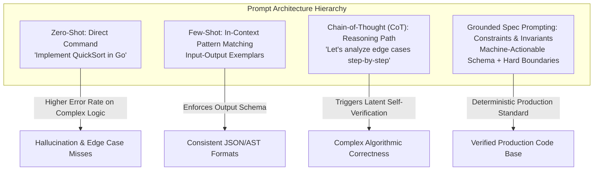
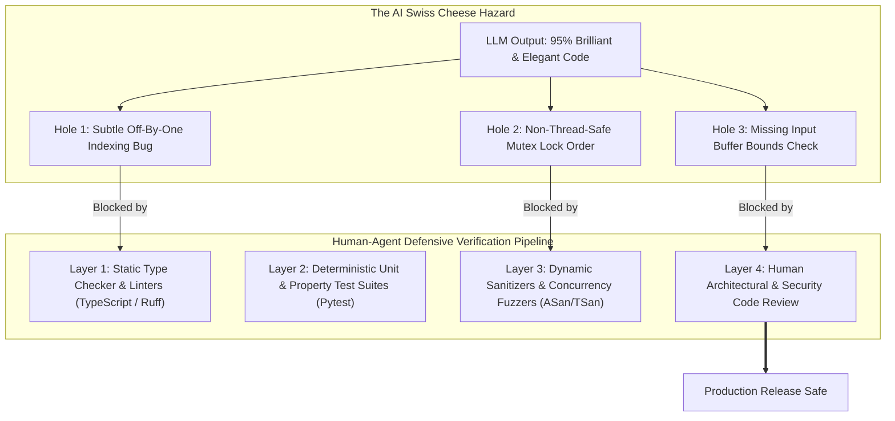

Welcome back to the technical deep-dive series covering **Stanford University's CS146S: The Modern Software Developer**. 

In Lecture 1, we established the macro architectural perspective: how modern software engineers are pivoting from manual syntax typists into conductors presiding over autonomous agent squads. In **Lecture 2 (Week 1)**, the curriculum dives directly into the underlying computational engine powering this revolution: **Coding Large Language Models (LLMs)** and the engineering discipline of **Prompt Engineering**.

Drawing directly from foundational works by Andrej Karpathy (*Deep Dive into LLMs*), OpenAI (*How OpenAI Uses Codex*), and Google Cloud/DAIR.AI prompt engineering research, this lecture demystifies how neural networks acquire coding fluency, why they remain statistical simulators rather than conscious reasoning entities, and how software engineers must implement the **"Trust but Verify"** doctrine to overcome the treacherous **Swiss Cheese Model** of automated code generation.

{/* truncate */}

---

### 1. The Anatomy of an LLM: The Three-Stage Training Pipeline

To effectively prompt, orchestrate, and debug an AI coding assistant, a software engineer must understand how the model's weights were forged. As Andrej Karpathy emphasizes, modern LLMs are not monolithic rule engines; they are the culmination of a rigorous **three-stage training pipeline**:

```mermaid
flowchart LR
    subgraph Stage1 ["Stage 1: Pre-training"]
        D1[Raw Web & GitHub Code<br/>Trillions of Tokens] --> N1[Transformer Base Model<br/>Next-Token Probability P(w_t | w_{<t})]
    end

    subgraph Stage2 ["Stage 2: Supervised Fine-Tuning (SFT)"]
        N1 --> D2[High-Quality Instruction Pairs<br/>Prompt & Gold-Standard Response]
        D2 --> N2[Instruction-Tuned Assistant<br/>Conversational Protocol]
    end

    subgraph Stage3 ["Stage 3: RLHF & Alignment"]
        N2 --> D3[Human Preference Ranking<br/>Reward Model Scoring]
        D3 --> N3[Production Coding LLM<br/>Safe, Aligned & Deterministic]
    end
```

#### 1.1. Pre-training: Self-Supervised Knowledge Ingestion
During pre-training, a dense decoder-only Transformer model processes petabytes of raw text and source code. The model does not understand words in a human linguistic sense; instead, text is chunked into sub-word tokens via **Byte-Pair Encoding (BPE)**:
- A typical token represents roughly 3–4 characters or common code fragments (e.g., `def `, `return `, `const `).
- The loss objective is deceptively simple: **Next-Token Prediction**. Given a context window of tokens $w_1, w_2, \dots, w_{t-1}$, the network computes a softmax probability distribution over the entire vocabulary $V$:
  $$P(w_t \mid w_1, \dots, w_{t-1}) = 	ext{Softmax}(W_v \cdot h_{t-1})$$
- By minimizing cross-entropy loss across trillions of code tokens, the network implicitly encodes syntax trees, algorithmic idioms, API conventions, and typing relationships. However, a purely pre-trained base model is merely an autocomplete engine—it will continue code blindly without following conversational intent.

#### 1.2. Supervised Fine-Tuning (SFT): The Dialogue Protocol
To transform an unruly autocomplete engine into a docile pair-programmer, AI labs perform **Supervised Fine-Tuning (SFT)**. 
- Human software engineers and expert annotators curate tens of thousands of high-fidelity `<User Query, Assistant Response>` pairs.
- The model is fine-tuned to adopt a helpful persona, structure code within markdown blocks, explain edge cases, and follow formatting constraints.

#### 1.3. Reinforcement Learning from Human Feedback (RLHF) & Direct Preference Optimization (DPO)
Even after SFT, models frequently generate code that is plausible yet inefficient, subtly insecure, or verbose. 
- In **RLHF**, human reviewers evaluate multiple candidate responses generated by the model for the same programming prompt and assign relative preference rankings.
- A **Reward Model (RM)** is trained to predict human preference scores.
- Using algorithms like PPO (Proximal Policy Optimization) or modern DPO (Direct Preference Optimization), the LLM's weights are steered to maximize reward while penalizing drift (via KL-divergence penalties) from the original policy.

> **Key Takeaway**: When a coding LLM answers your architecture prompt, it is performing a **statistical simulation** of what an elite human engineer would generate based on the statistical priors encoded across its training weights.

---

### 2. How Codex Understands Code: ASTs and Token Sequences

In the seminal literature *How OpenAI Uses Codex*, researchers revealed why LLMs excel so remarkably at programming languages compared to natural language:

1. **Deterministic Syntax & Formal Grammars**: Unlike human languages riddled with ambiguity, idioms, and slang, programming languages adhere strictly to formal context-free grammars. Code can be parsed into unambiguous **Abstract Syntax Trees (ASTs)**.
2. **Local and Global Invariants**: A variable declared in line 5 must match the reference in line 84. The Transformer's multi-head self-attention mechanism is mathematically ideal for tracking these long-range syntactic dependencies.
3. **Pervasive GitHub Pre-training**: Modern coding LLMs have ingested hundreds of millions of public repositories, exposing them to virtually every standard library, framework API, and design pattern in existence.

However, Codex and its descendants do not execute code internally during token generation. They predict tokens based on syntactic co-occurrence. If a library was deprecated after the model's knowledge cutoff, or if an API signature takes four arguments instead of three, the model will effortlessly generate syntactically flawless code that fails catastrophically at runtime.

---

### 3. Prompt Engineering as a Software Engineering Discipline

Prompt engineering is often trivialized as "crafting clever chat messages." In Stanford CS146S, prompt engineering is treated as a rigorous software engineering discipline: designing structured, deterministic inputs to guide probabilistic models toward invariant outputs.



#### 3.1. Zero-Shot vs. Few-Shot In-Context Learning
- **Zero-Shot**: Passing an instruction with zero examples. Effective for trivial, boilerplate tasks (`"Convert this JSON schema to TypeScript interface"`).
- **Few-Shot**: Providing 2–3 canonical exemplars within the prompt. Few-shot prompting leverages the Transformer's **in-context learning** capability without updating model weights. It is indispensable for enforcing strict JSON return types, custom logging wrappers, or proprietary API calling conventions.

#### 3.2. Chain-of-Thought (CoT) & Reasoning Elicitation
When prompted with: *"Write a lock-free concurrent ring buffer in C++,"* a zero-shot prompt forces the model to synthesize the final code tokens immediately, leading to race conditions.

By injecting the prompt directive:
> *"Before writing any code, analyze the memory model constraints, identify potential thread contention points step-by-step, and state the memory barrier invariants (std::memory_order_acquire / release)."*

We force the model to allocate token bandwidth to **intermediate reasoning**. Because Transformer attention is auto-regressive, each subsequent token is conditioned on the explicit reasoning steps generated in preceding tokens, dramatically reducing logical errors.

#### 3.3. Defensive Prompting & Hallucination Mitigation
To prevent the model from inventing non-existent packages or methods:
1. **Explicit Negative Constraints**: *"Do NOT import external third-party libraries; use standard library only."*
2. **Confidence Thresholding**: *"If the required database schema cannot be determined from the provided DDL, output `SCHEMA_ERROR` and list the missing columns. Do not guess."*
3. **Sandboxed Role Definition**: Restrict the model's operational scope to a specific subsystem (e.g., *"You are a static code security auditor examining this function for OWASP Top 10 vulnerabilities"*).

---

### 4. The "Swiss Cheese Model" of AI Code Generation

The most critical mental model introduced in Week 1 is Andrej Karpathy's adaptation of the **Swiss Cheese Model** to coding LLMs.

In safety engineering (aviation, medicine), James Reason's Swiss Cheese Model posits that catastrophic accidents occur when flaws (holes) in multiple independent defensive layers momentarily align. In AI software engineering, the reverse hazard is true:



#### Why Coding LLMs Have Holes
An LLM can write 200 lines of mathematically stunning, cleanly formatted code that solves a complex dynamic programming problem—yet leave a critical off-by-one boundary vulnerability on line 187, or use a non-reentrant system call inside a multithreaded loop.

Because the code looks impeccably written, human engineers suffer from **Automation Bias**: the psychological tendency to uncritically trust automated systems. If developers merge AI-generated PRs after a superficial glance, those latent holes will inevitably puncture production systems.

---

### 5. The "Trust but Verify" Engineering Architecture

To safely harness coding LLMs at scale, Stanford CS146S mandates the **"Trust but Verify"** engineering architecture. Software teams must construct an impenetrable harness around the AI generator:

```mermaid
sequenceDiagram
    autonumber
    actor Dev as Software Engineer (Architect)
    participant Spec as SPEC.md & Invariant Rules
    participant LLM as Coding LLM (Claude Code / Cursor)
    participant Harness as Automated Verification Gate
    participant Prod as Production Main Branch

    Dev->>Spec: Write Formal Constraints & Invariants
    Dev->>LLM: Dispatch Task with Spec & Context
    LLM->>LLM: Chain-of-Thought Synthesis
    LLM->>Harness: Commit Generated Code & Tests

    rect rgb(30, 41, 59)
        note over Harness: Automated Verification Gate
        Harness->>Harness: 1. Strict Typing & Linting (Zero Warnings)
        Harness->>Harness: 2. Unit & Integration Test Execution
        Harness->>Harness: 3. Property-Based Invariant Fuzzing
    end

    alt Any Gate Fails
        Harness-->>LLM: Re-feed Error Trace (Loop Engineering)
        LLM->>Harness: Synthesize Fix Patch
    else All Gates Pass
        Harness-->>Dev: Clean Diff with 100% Passing Gate Metrics
        Dev->>Dev: High-Level Architectural & Security Review
        Dev->>Prod: Merge to Main Branch
    end
```



#### The Four Hardened Gates:
1. **Gate 1: Strict Static Analysis**: The code must compile with zero compiler warnings, pass strict static type checking (e.g., `tsc --strict`, `mypy --strict`), and pass zero-tolerance linting rules (Ruff, ESLint).
2. **Gate 2: Deterministic Test Contracts**: The LLM must not only generate implementation code but also write matching unit tests. These tests are executed in isolated sandboxes to verify edge cases ($N=0$, $N=1$, negative inputs, concurrent requests).
3. **Gate 3: Property-Based Fuzzing**: For algorithmic modules, invariant fuzzers (e.g., Hypothesis for Python, fast-check for TypeScript) feed thousands of randomized edge-case inputs to prove that invariants hold under extreme boundaries.
4. **Gate 4: The Human Signature**: No AI code reaches production without human review focusing on business logic, architectural alignment, data migration safety, and cryptographic integrity.

---

### 6. Comparative Matrix: Prompting Paradigms

| Dimension | Naive Conversational Prompting | Few-Shot Schema Prompting | Spec-Driven Prompting (Stanford CS146S) |
| :--- | :--- | :--- | :--- |
| **Input Format** | Casual natural language chat (`"Fix this bug"`) | System prompt + 2–3 input/output JSON exemplars | Formal Markdown specification (`SPEC.md`) + invariant contracts |
| **Model Cognition** | Unconstrained single-shot token generation | Constrained token distribution matching exemplar schema | Step-by-step reasoning (CoT) + sandboxed tool calling via MCP |
| **Hallucination Risk** | **High** (30–45% on novel edge cases) | **Low** for syntax, **Moderate** for business logic | **Extremely Low** (guarded by automated verification harness) |
| **Reproducibility** | Non-deterministic, sensitive to minor phrasing | High schema consistency | Fully reproducible and machine-versioned in Git |
| **Primary Use Case** | Brainstorming, simple bash scripts, syntax lookup | Data transformation, structured API parsers | Production features, microservice refactoring, infrastructure code |

---

### 7. Stanford CS146S Deep Q&A: Lecture 2 Insights

During the interactive session of Lecture 2, the discussion centered on how LLMs behave when integrated into large enterprise repositories:

> **Q. Professor, why does a coding LLM work brilliantly on a small LeetCode problem, but start hallucinating and making breaking changes when working on a 100,000-line enterprise repository?**

**Faculty Response:**
This is the fundamental problem of **Context Saturation & Attention Dilution**. 
1. When you feed thousands of lines of repository code into an LLM's context window, the model's self-attention weights become dispersed across non-essential tokens. 
2. As context grows beyond 30,000–50,000 tokens, models suffer from the **"Lost in the Middle"** phenomenon: they attend strongly to the very beginning (system prompt) and very end (latest query), while ignoring subtle architectural invariants buried in the middle files.
3. In modern software engineering, the solution is **Repo Mapping & Precise Context Retrieval**: feeding the model only the relevant Abstract Syntax Tree symbols, interfaces, and direct dependencies rather than dumping the entire repository into the prompt. (We explore this extensively in Lecture 3).

---

### 8. Lecture 2 Summary & Series Roadmap

1. **Understand the Machine**: Coding LLMs are statistical token simulators trained via Pre-training, SFT, and RLHF. They predict patterns; they do not possess innate verification capabilities.
2. **Engineer the Prompt**: Deploy Chain-of-Thought (CoT) and structured constraints to unlock intermediate reasoning states.
3. **Beware the Swiss Cheese**: Plausible code is not correct code. Never trust AI-generated code without automated linters, deterministic unit tests, and property fuzzers.
4. **Embrace "Trust but Verify"**: Automate the verification loop so human engineers can focus exclusively on architectural integrity and security review.

In **Lecture 3**, we will tackle **Context Management & Repository Architecture**: how to navigate massive codebases using Tree-sitter AST parsing, vector embeddings, and the Model Context Protocol (MCP) without exceeding token limits or causing hallucination cascades. Stay tuned to GlobalDevLog!

---

### References & Course Materials
- **Official Course Video Playlist**: [Stanford CS146S: The Modern Software Development (YouTube Playlist)](https://www.youtube.com/playlist?list=PLxpwjSdVZQ95OWe3QvkVEcU1f1X-6NDj9)
- **Primary Literature**: Andrej Karpathy, *Deep Dive into LLMs*; OpenAI, *How OpenAI Uses Codex*; Google Cloud & DAIR.AI, *Prompt Engineering Guide*.
- **Academic Institution**: Stanford University, Department of Computer Science
