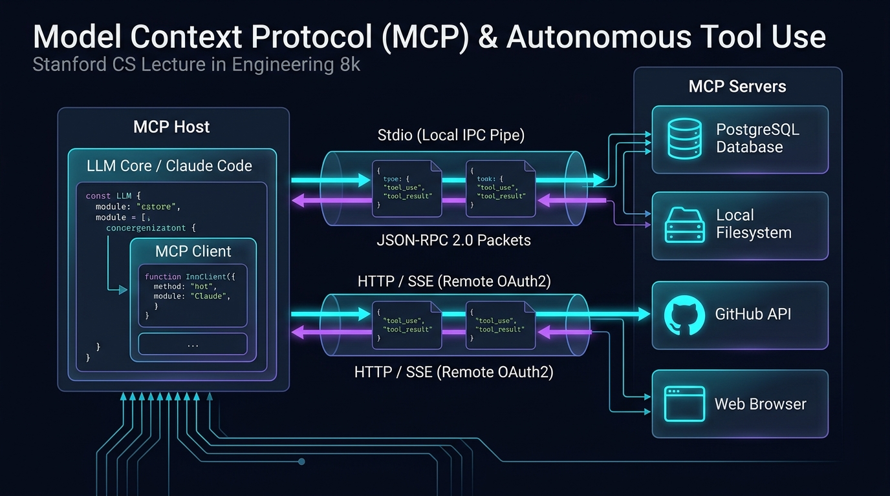
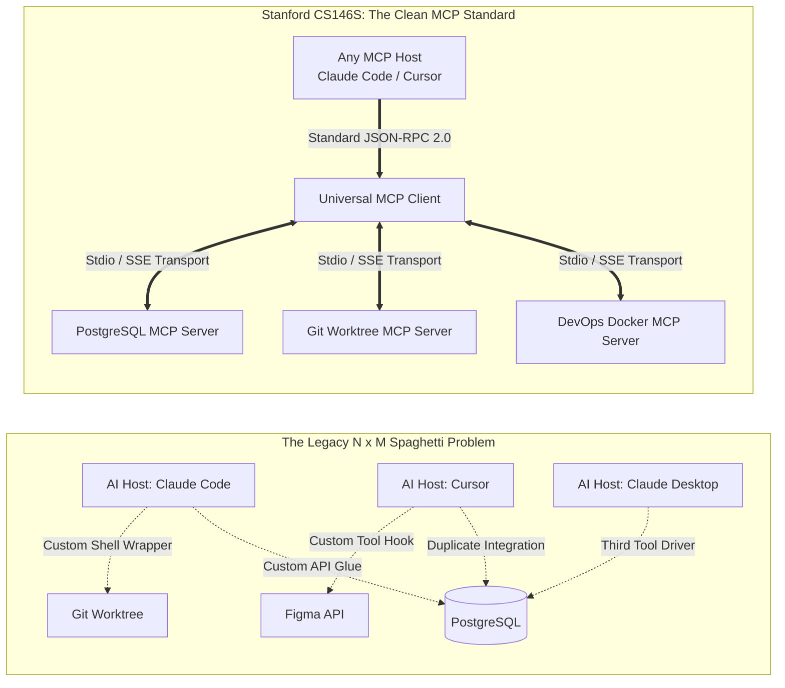
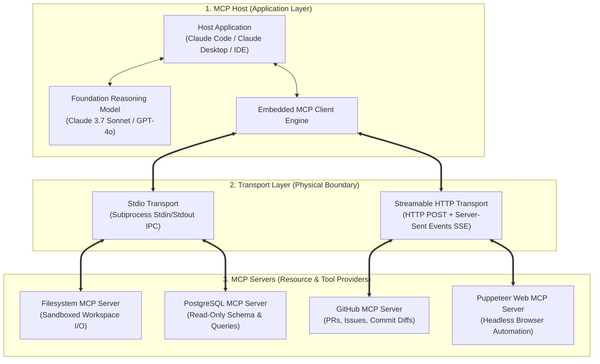
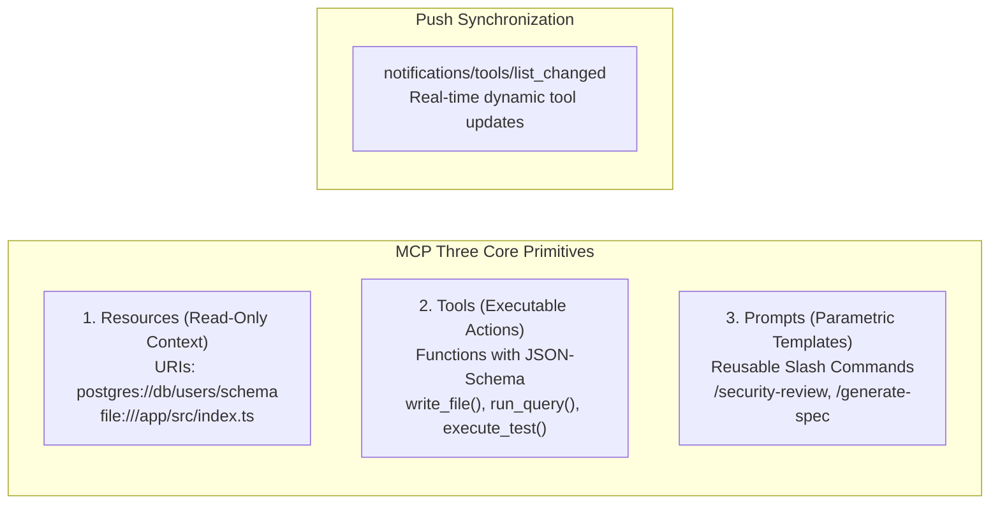

Welcome to the third installment of our deep-dive engineering series on **Stanford University's CS146S: The Modern Software Developer**.

In Lecture 1, we established the paradigm shift from syntax typist to agent conductor. In Lecture 2, we examined the probabilistic nature of coding LLMs and the defensive "Trust but Verify" harness. In **Lecture 3 (Week 2)**, the curriculum addresses the single greatest architectural bottleneck in modern AI systems: **How do isolated foundation models safely and modularly interact with the external world?**

Before 2024, connecting an LLM to a database, terminal, or GitHub API required fragile, bespoke integration glue. Drawing directly from Anthropic's open standard specification and Stanford's distributed systems analysis, this lecture unpacks the **Model Context Protocol (MCP)**—the universal adapter that is doing for autonomous AI agents what the **Language Server Protocol (LSP)** did for modern code editors.

{/* truncate */}

---

### 1. The Fragmentation Crisis: Why We Needed an "LSP for AI"

Historically, every new AI IDE or coding tool (Cursor, Claude Code, GitHub Copilot, Devin) attempted to connect to identical enterprise resources: Git repositories, PostgreSQL clusters, Slack channels, and AWS infrastructure.

In the compiler and editor ecosystem of the 2010s, Microsoft solved the $N \times M$ complexity crisis by introducing the **Language Server Protocol (LSP)**. Instead of every editor writing a custom parser for TypeScript, Rust, and Go, language teams built a single LSP server, and editors built a single LSP client.

**Model Context Protocol (MCP)** represents the exact same architectural breakthrough for artificial intelligence. By decoupling model reasoning from tool execution, MCP establishes a vendor-neutral, plug-and-play communication protocol over JSON-RPC 2.0.

---

### 2. The 3-Tier MCP System Architecture

An MCP-compliant ecosystem is comprised of three distinct participants operating across two decoupled layers:

#### 2.1. MCP Host
The parent application that orchestrates the user experience, controls LLM context windows, and holds user permissions. Examples include **Claude Code CLI**, Claude Desktop, and modern agentic development environments.

#### 2.2. MCP Client
An internal protocol handler embedded inside the Host. The client maintains a strict 1:1 stateful connection with an MCP server, handles lifecycle initialization, negotiates protocol capabilities, and serializes tool calls.

#### 2.3. MCP Server
A lightweight, purpose-built process that exposes specific data resources and executable functions. A server can be written in TypeScript, Python, or Go, and runs either locally as a child process or remotely behind a secure reverse proxy.

---

### 3. Dual Transport Layers: Stdio vs. Streamable HTTP/SSE

The MCP specification decouples message semantics from the physical wire format:

| Transport Dimension | Stdio Transport (Local IPC) | Streamable HTTP Transport (Remote SSE) |
| :--- | :--- | :--- |
| **Communication Channel** | Standard input (`stdin`) and standard output (`stdout`) of a spawned child process | HTTP POST for client requests, Server-Sent Events (SSE) for server streams |
| **Latency & Overhead** | **Near-zero latency** (direct OS pipe, no TCP/TLS handshake) | Network roundtrip latency + TLS encryption overhead |
| **Security Boundary** | Local OS user permissions and filesystem sandboxes | OAuth 2.0 Bearer tokens, mTLS, and network firewalls |
| **Typical Use Cases** | Local workspace file editing, git operations, local SQLite/PostgreSQL | Cloud SaaS APIs, enterprise database clusters, shared company knowledge bases |

---

### 4. The Three Core Primitives of MCP

An MCP server exposes its capabilities to the model via three foundational primitives:

1. **Resources (Context Ingestion)**: Analogous to GET endpoints. Resources expose static or dynamic data (files, system logs, database schemas) via URI schemes (e.g., `git://repo/diff/HEAD`). The LLM reads resources to ground its context without side effects.
2. **Tools (State Mutations & Execution)**: Executable functions callable by the model. Each tool definition includes an `inputSchema` formatted in strict JSON Schema. When the model invokes a tool, the Host asks the human for authorization before dispatching the execution payload to the MCP server.
3. **Prompts (Structured Workflows)**: Pre-engineered prompt templates stored on the server. They allow engineering teams to version-control standard operational workflows (e.g., `/refactor-test` or `/audit-cve`).

---

### 5. The Tool-Calling Loop in Action: Inside Claude Code

How does the MCP tool execution loop work under the hood? The sequence diagram below maps the complete round-trip lifecycle:

```mermaid
sequenceDiagram
    autonumber
    actor Dev as Developer
    participant Host as Claude Code (Host)
    participant Model as Claude 3.7 Sonnet (LLM)
    participant Client as MCP Client
    participant Server as PostgreSQL MCP Server

    Dev->>Host: "Diagnose why user checkout failed for ID 8492"
    Host->>Client: Request available tools (tools/list)
    Client->>Server: JSON-RPC tools/list
    Server-->>Client: Returns [query_orders, inspect_logs]
    Client-->>Host: Tool schemas injected into LLM system prompt

    Host->>Model: Prompt + Tool Definitions + User Query
    Model->>Model: Chain-of-Thought: Need order record first
    Model-->>Host: Stop Reason: tool_use (query_orders, args: {id: 8492})

    rect rgb(30, 41, 59)
        note over Host,Dev: Human-in-the-Loop Guardrail
        Host->>Dev: Authorize tool: query_orders(id=8492)? [Y/n]
        Dev-->>Host: Confirmed: Yes
    end

    Host->>Client: Execute tool_use
    Client->>Server: JSON-RPC tools/call (query_orders)
    Server-->>Client: Returns JSON: {status: 'failed', error: 'insufficient_funds'}
    Client-->>Host: Tool Result payload

    Host->>Model: Re-feed Tool Result into Context Window
    Model->>Model: Synthesize root cause analysis
    Model-->>Host: "The checkout failed due to an insufficient funds exception on Stripe webhook."
    Host-->>Dev: Final diagnostic report presented
```

---

### 6. Security & Trust: The Model Isolation Boundary

In traditional prompt hacking, an adversarial injection could trick an LLM into deleting files or exfiltrating API secrets. MCP implements a strict **Principle of Least Privilege**:

1. **Explicit User Consent**: An MCP Host must never execute a state-mutating tool (`rm`, `write_patch`, `drop_table`) without explicit human confirmation.
2. **Schema Invariant Sanitization**: The MCP Client enforces type validation on all arguments before passing them to the server, preventing command injection at the transport level.
3. **Scoped OAuth 2.0 Tokens**: For remote HTTP servers, tokens carry granular scopes (e.g., `read:repo_metadata` without `write:code`).

---

### 7. Stanford CS146S Deep Q&A: Lecture 3

> **Q. Professor, how does MCP differ from OpenAI Function Calling or LangChain tools?**

**Faculty Response:**
Function calling is simply an **LLM API feature**: a model emits JSON arguments matching a schema. 

However, before MCP, **who executed that function? Where did the server live? How was it authenticated? How did another developer reuse your tool?** Every company wrote custom spaghetti code to bridge that gap.

MCP is not an LLM feature; it is an **Open Industry Protocol**. It standardizes the entire transport, schema negotiation, permission model, and lifecycle management. A single PostgreSQL MCP server written today can be used identically by Claude Code, Cursor, a custom internal enterprise agent, or any future AI host without altering a single line of server code.

---

### 8. Lecture 3 Summary & Series Roadmap

1. **Adopt Open Standards**: Avoid proprietary, hard-coded tool wrappers. Standardize tool integrations on MCP.
2. **Decouple Brain from Hands**: Keep the LLM focused on reasoning, while delegating I/O and state mutations to sandboxed MCP servers.
3. **Enforce Human-in-the-Loop**: Safeguard production environments by requiring explicit authorization gates on state-mutating tools.

In **Lecture 4**, we will explore **Spec-Driven Code Generation & Test Harnesses in Practice**: how to configure Claude Code and Cursor with automated regression loops that write, debug, and verify production features autonomously. Stay tuned to GlobalDevLog!

---

### 📌 3–5 Line Executive Summary
1. **The MCP Standardization Paradigm**: Model Context Protocol (MCP) serves as the "LSP for AI Agents", replacing brittle $N \times M$ custom wrappers with an open, bidirectional JSON-RPC 2.0 protocol across AI hosts and tools.
2. **Decoupling Brain from Hands**: The LLM context window remains strictly dedicated to high-level logical reasoning, delegating physical I/O and state mutations to sandboxed, isolated MCP servers.
3. **Dual Transport Architecture**: High-speed, local low-latency workflows execute via sub-millisecond Stdio pipes, while enterprise distributed agents scale via Streamable HTTP/SSE secured with OAuth 2.0.
4. **Human-in-the-Loop Security Guardrails**: Mission-critical agent deployments enforce the Principle of Least Privilege—blocking destructive disk and database state mutations until explicit developer confirmation is granted.

### References & Course Materials
- **Official Course Video Playlist**: [Stanford CS146S: The Modern Software Development (YouTube Playlist)](https://www.youtube.com/playlist?list=PLxpwjSdVZQ95OWe3QvkVEcU1f1X-6NDj9)
- **Primary Literature**: Model Context Protocol Specification (modelcontextprotocol.io); Anthropic Claude Tool Use Architecture; Microsoft Language Server Protocol (LSP).
- **Academic Institution**: Stanford University, Department of Computer Science
