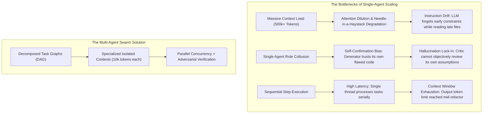
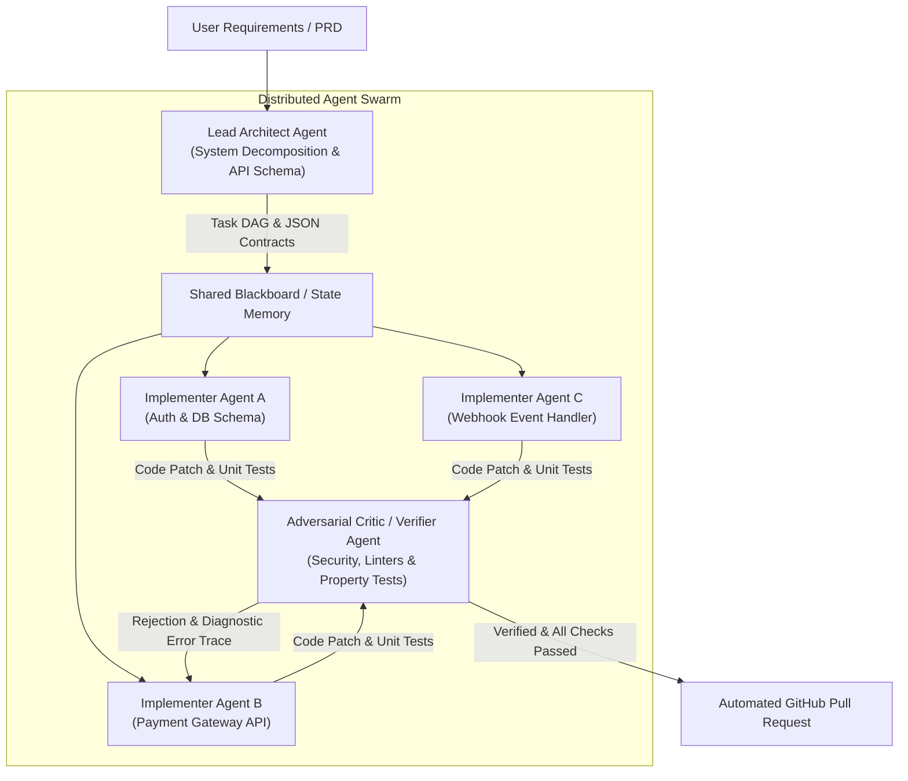

Welcome to Lecture 5 of our deep-dive series covering **Stanford University’s CS146S: The Modern Software Developer**. 

In our previous lectures, we mastered developer prompt engineering, dissected the internal transformer mechanics of coding models, explored tool-use with the Model Context Protocol (MCP), and constructed self-healing spec-driven test harnesses. Each of these paradigms operated under a common implicit assumption: a **single primary LLM session** interacting with a single developer or IDE workspace.

However, once a software project scales beyond a few thousand lines of code across distributed microservices, the single-agent paradigm fractures. Monolithic agents suffer from **context window saturation, attention dilution, and cognitive thrashing**.

In today’s lecture, Stanford faculty unveil the future of AI-native engineering: **Multi-Agent Systems (MAS) and Swarm Orchestration**. We will explore how separating concerns across specialized **Architect, Implementer, and Critic** roles—coordinated over structured message buses and Directed Acyclic Graphs (DAGs)—delivers order-of-magnitude gains in software generation accuracy and codebase scale.

{/* truncate */}

---

### 1. The Scaling Limits of Single-Context Monolithic LLMs

Why can’t we simply hand an entire 500,000-line enterprise repository to a model with a 1-million-token context window and ask it to "refactor the payment billing pipeline"?

Stanford researchers identify three fundamental architectural bottlenecks:



1. **Attention Dilution & 'Lost in the Middle'**: As context windows expand beyond 100k tokens, attention mechanisms exhibit non-uniform retrieval fidelity. Subtle API constraints or database invariants buried in middle files are routinely neglected.
2. **Role Collusion & Confirmation Bias**: When a single LLM acts simultaneously as system designer, coder, and quality assurance tester, it suffers from severe confirmation bias. It rarely invents edge cases that expose its own subtle implementation bugs.
3. **Context Window Thrashing**: Modifying 15 files sequentially in a single chat session pollutes the context buffer with intermediate bash diffs, compiler errors, and discarded hypotheses, quickly exhausting output token budgets.

---

### 2. The Tripartite Swarm Architecture: Architect, Implementer, and Critic

To achieve industrial robustness, Stanford CS146S formalizes the **Tripartite Agent Swarm Pattern**. Instead of generalist chatbots, we deploy specialized autonomous agents with strictly isolated responsibilities:



#### Role Breakdown:
1. **The Lead Architect Agent**:
   - **Inputs**: User PRD, repository dependency tree, high-level business goals.
   - **Outputs**: A Directed Acyclic Graph (DAG) of decoupled implementation subtasks, strict JSON Schema interfaces, and contract definitions.
   - **Key Constraint**: The Architect writes zero implementation code. Its entire cognitive budget is dedicated to task breakdown and API interface stability.
2. **The Implementer Agents (Swarm Workers)**:
   - **Inputs**: A single task slice from the DAG, the API schema contracts, and the localized file tree.
   - **Outputs**: Modular source code, unit test cases, and dependency declarations.
   - **Execution**: Multiple Implementers operate completely concurrently in sandboxed branches or ephemeral containers.
3. **The Adversarial Critic & Verifier Agent**:
   - **Inputs**: The candidate code diff, the original Architect specification, and automated test logs.
   - **Outputs**: Static analysis metrics, security vulnerability scans (AST audit, secret leaks), and a definitive Pass/Fail judgment.
   - **Feedback Mechanism**: Upon failure, the Critic generates an explicit diagnostic diff with stack traces and returns it directly to the offending Implementer for a targeted self-healing cycle.

---

### 3. Inter-Agent Communication Topologies

Multi-agent coordination requires strict communication protocols to prevent swarm hallucinations and infinite message loops. CS146S highlights two dominant orchestration topologies:

#### A. Centralized Blackboard Pattern
In the Blackboard pattern, agents do not message each other directly. Instead, they read from and write to a centralized, validated JSON state store:

```json
{
  "task_id": "TASK-402-AUTH",
  "status": "in_review",
  "dependencies": ["TASK-401-DB-SCHEMA"],
  "assigned_agent": "worker-claude-code-01",
  "contract_schema_hash": "sha256:7f8a92...",
  "artifacts": {
    "patch_path": "/workspace/patches/auth_service.patch",
    "test_coverage": 94.2
  },
  "critic_feedback": null
}
```

#### B. Directed Acyclic Graph (DAG) Execution Flow
Rather than unrestricted conversation, agent tasks are modeled as nodes in a DAG where edges denote data dependencies. If Module B depends on Module A's data contract, Implementer B cannot spawn until Implementer A passes Critic verification.

---

### 4. Implementation: Building an Asynchronous Swarm Orchestrator in Python

Below is a production-grade asynchronous multi-agent orchestrator implementing the Architect-Implementer-Critic loop using Pydantic structured validation:

```python
# swarm_orchestrator.py - Production Multi-Agent Swarm Engine
import asyncio
from typing import List, Dict, Optional
from pydantic import BaseModel, Field

class SubTaskContract(BaseModel):
    task_id: str
    description: str
    file_targets: List[str]
    interface_schema: Dict[str, str]

class ArchitectPlan(BaseModel):
    plan_title: str
    subtasks: List[SubTaskContract]

class PatchResult(BaseModel):
    task_id: str
    code_diff: str
    unit_tests: str

class CriticAudit(BaseModel):
    passed: bool
    score: float = Field(ge=0.0, le=100.0)
    diagnostic_trace: Optional[str] = None

class SwarmOrchestrator:
    def __init__(self, architect_llm, coder_llm, critic_llm):
        self.architect = architect_llm
        self.coder = coder_llm
        self.critic = critic_llm

    async def execute_task(self, user_prd: str):
        print("[ORCHESTRATOR] Step 1: Synthesizing Architecture Plan...")
        plan: ArchitectPlan = await self.architect.generate_plan(user_prd)
        
        print(f"[ORCHESTRATOR] Architect decomposed PRD into {len(plan.subtasks)} subtasks.")
        
        # Concurrently execute subtasks across parallel Implementer workers
        tasks = [self._worker_critic_loop(task) for task in plan.subtasks]
        results = await asyncio.gather(*tasks)
        
        print("[ORCHESTRATOR] All swarm subtasks successfully verified and integrated!")
        return results

    async def _worker_critic_loop(self, task: SubTaskContract, max_retries: int = 3) -> PatchResult:
        attempt = 0
        error_context = None

        while attempt < max_retries:
            attempt += 1
            print(f"[{task.task_id}] Implementer working (Attempt {attempt}/{max_retries})...")
            
            patch: PatchResult = await self.coder.implement_task(task, feedback=error_context)
            
            print(f"[{task.task_id}] Critic auditing patch...")
            audit: CriticAudit = await self.critic.verify(task, patch)
            
            if audit.passed:
                print(f"[{task.task_id}] PASSED verification (Score: {audit.score}/100)!")
                return patch
            
            print(f"[{task.task_id}] REJECTED by Critic: {audit.diagnostic_trace}")
            error_context = audit.diagnostic_trace

        raise RuntimeError(f"Task {task.task_id} failed to pass Critic review after {max_retries} cycles.")
```

---

### 5. Key Lecture Takeaways & Next Steps

1. **Monolithic Agents Don't Scale**: Context window saturation and self-confirmation bias necessitate decomposing software development into modular multi-agent swarms.
2. **Tripartite Specialization**: Strictly decouple the **Architect** (system decomposition and interface schemas), the **Implementer** (sandboxed concurrent coding), and the **Critic** (adversarial verification and AST auditing).
3. **Structured Coordination**: Rely on Directed Acyclic Graphs (DAGs) and validated JSON Blackboard state stores rather than chaotic free-form conversational chatter.

In **Lecture 6**, we will explore **AI-Assisted Debugging and Profiling: Leveraging eBPF, Dynamic Tracing, and LLMs for Runtime Incident Mitigation**.

---

### 📌 3–5 Line Executive Summary
1. **Multi-Agent Scaling Imperative**: Solved monolithic LLM failure modes—attention dilution, instruction drift, and confirmation bias—by replacing single-session prompts with multi-agent swarms.
2. **Tripartite Agent Separation**: Formalized the Architect (DAG planning & API contracts), Implementer (concurrent modular coding), and Critic (adversarial testing & security auditing) tripartite workflow.
3. **Deterministic Communication Protocols**: Prevented swarm hallucinations through structured Pydantic JSON schemas, centralized Blackboard state stores, and DAG-constrained execution graphs.
4. **Resilient Self-Healing Loops**: Architected asynchronous retry loops where Critic diagnostic traces automatically guide Implementer patch refinement until full regression test clearance.

### References & Stanford CS146S Materials
- **Course**: Stanford CS146S (The Modern Software Developer), Spring/Fall 2026.
- **Instructors**: Dept. of Computer Science, Stanford University.
- **Related Frameworks**: LangGraph, AutoGen, CrewAI, Anthropic Multi-Agent Orchestration Protocols.