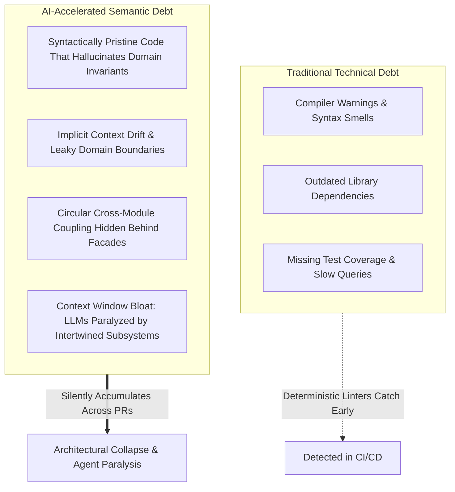
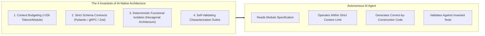
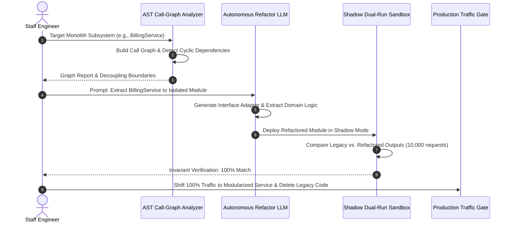

Welcome to the eighth installment of our comprehensive engineering series analyzing **Stanford University's CS146S: The Modern Software Developer**.

In the prior sessions, we evaluated how individual developers prompt coding LLMs (Lecture 2), integrate external tools via the Model Context Protocol (Lecture 3), engineer self-healing test harnesses (Lecture 4), coordinate multi-agent swarms (Lecture 5), profile runtime anomalies with eBPF (Lecture 6), and automate PR code reviews using AST linters and taint analysis (Lecture 7). 

In **Lecture 8**, the curriculum confronts the systemic, long-term consequence of deploying high-velocity AI agents into production repositories: **How do we design software architectures that AI agents can navigate, reason about, and modify without collapsing under the weight of runaway complexity? And how do we employ AI agents to safely refactor and decouple legacy monolithic codebases?**

As engineering teams scale AI agent adoption, they quickly discover that traditional software architectures—characterized by massive shared mutable states, implicit cyclic dependencies, and sprawling 100,000-line monoliths—severely bottleneck LLM reasoning. In this lecture, Stanford computer scientists formalize the concept of **Semantic Debt**, define the foundational tenets of **AI-Native Architecture**, and provide a battle-tested blueprint for **AST-guided automated monolith decoupling**.

{/* truncate */}

---

### 1. The Velocity Paradox: Technical Debt vs. Semantic Debt

Traditional software engineering metrics evaluate codebase health through the lens of **Technical Debt**: outdated library dependencies, unoptimized database queries, missing unit test coverage, and code smells. Compilers, static linters, and runtime APMs detect technical debt with deterministic precision.

When autonomous AI coding agents enter the development lifecycle, velocity explodes: features that once took days are implemented in minutes. However, this unchecked velocity introduces an insidious failure mode: **Semantic Debt**.



#### What is Semantic Debt?
Semantic debt occurs when code generated by an LLM is syntactically flawless and satisfies local unit tests, but silently violates global system invariants, creates implicit coupling, or fragments domain logic across disconnected files:
1. **Context Window Saturation**: An agent refactoring an order processing service cannot reason about side effects because order cancellation logic is subtly intertwined across billing, inventory, and notification modules through cyclic database calls.
2. **Concept Fragmentation**: Three different LLM-assisted developers implement user status validation in three distinct ways across the codebase (e.g., enum comparison, bitmask flag, and boolean helper), creating conceptual divergence.
3. **Ghost Abstractions**: AI agents frequently introduce shallow wrapper classes or leaky abstractions to satisfy immediate prompt instructions without understanding the underlying domain boundary.

Left unchecked, semantic debt degrades the codebase until even advanced reasoning models (Claude 3.7 Sonnet, GPT-4.5) experience context paralysis, generating hallucinated patches that break adjacent services.

---

### 2. The Four Invariants of AI-Native Software Architecture

To make a software repository permanently maintainable by both human engineers and autonomous AI agents, Stanford CS146S proposes **AI-Native Architecture**. 

An AI-native architecture is not simply a system that *uses* AI; it is a system **designed from the ground up to be observed, modified, and verified by autonomous AI agents**.



#### Invariant 1: Strict Context Budgeting
Human working memory is limited to roughly $7 \pm 2$ concepts; an LLM’s effective attention degrades when reasoning across millions of tokens with high needle-in-haystack distraction. An AI-native architecture enforces **Strict Context Budgeting**:
- Every cohesive module, service, or bounded context must be fully understandable within **32k tokens** of context, including its interfaces, models, and tests.
- If an agent requires reading more than 32k tokens to reliably implement a feature or fix a bug in a component, that component violates architectural boundaries and must be decomposed.

#### Invariant 2: Explicit Machine-Readable Contracts
Human developers tolerate ambiguous natural language documentation; AI agents do not. AI-native systems replace free-text API docs with strict, machine-enforceable schemas:
- **TypeScript / Zod** or **Python / Pydantic** models for all internal data exchange.
- **Protocol Buffers (Protobuf)** or **OpenAPI 3.1** specifications defining immutable boundaries.
- Pre-conditions, post-conditions, and invariant assertions baked into data structures.

#### Invariant 3: Hexagonal Isolation (Ports & Adapters)
AI agents excel at algorithmic logic and pure data transformation, but frequently introduce regressions when handling side-effectful external I/O (raw database connections, third-party REST APIs, global singletons). 
- **Core Domain Logic** must remain pure and free from I/O dependencies.
- **Adapters** isolate database queries, message queues, and external APIs behind strongly typed interfaces ("Ports").
- When refactoring domain logic, the AI agent operates strictly within the pure functional core, leaving external adapters untouched.

#### Invariant 4: Characterization Test Harnesses (Golden Masters)
Before allowing an AI agent to refactor a mission-critical subsystem, the system must generate a **Golden Master Characterization Test Harness**. By capturing thousands of real-world inputs and recording deterministic output snapshots, the harness establishes an empirical truth that prevents semantic drift during autonomous migration.

---

### 3. AST-Guided Monolith Decoupling: The Strangler Fig Pattern Reimagined

How do engineering organizations transition massive, 10-year-old enterprise monoliths into clean, AI-native modular systems? Stanford CS146S rejects manual human rewrites—which take years and usually fail—in favor of **AST-Guided Autonomous Decoupling**.



#### Step 1: AST Call-Graph Analysis & SCC Decomposition
Before touching any code, an automated tool parses the Abstract Syntax Tree (AST) of the repository to construct a directed dependency graph $G = (V, E)$, where vertices $V$ represent functions and classes, and edges $E$ represent invocations and import statements.

Using **Tarjan's Strongly Connected Components (SCC) algorithm**, the analyzer detects cyclic dependencies that bind subsystems together. Cyclic loops (e.g., `Module A -> Module B -> Module A`) must be broken first by introducing event buses or inversion-of-control dependency injection.

#### Step 2: Automated Facade & Interface Extraction
The autonomous LLM generates an explicit Interface Facade between the monolithic core and the target extraction candidate. All direct function invocations are routed through the facade.

#### Step 3: Shadow Dual-Run Verification
In high-reliability engineering environments, refactored code is never deployed directly to live users. Instead, a **Shadow Proxy** duplicates incoming production read requests, executing both the legacy monolithic code path and the AI-refactored modular path concurrently:
- If outputs match across $100,000$ live requests with identical latency characteristics, the refactored module is promoted.
- If a discrepancy occurs, the runtime difference is captured as a regression test case, and the LLM receives the diff to self-heal its implementation.

---

### 4. Executable Implementation: AST Dependency Graph & Cycle Detector

Below is a production-grade Python utility implementing AST call-graph extraction, cycle detection, and context token estimation. This tool serves as the foundational scanner used by AI refactoring agents to identify decomposition candidates in monolithic repositories.

```python
"""
ast_dependency_analyzer.py
Stanford CS146S - Autonomous Architectural Refactoring Toolkit
Analyzes Python codebases, extracts module dependency call graphs,
detects cyclic coupling via Tarjan's SCC algorithm, and calculates
token context budgets for AI-native modularity.
"""

import ast
import os
import sys
from typing import Dict, Set, List, Tuple
from collections import defaultdict


class DependencyVisitor(ast.NodeVisitor):
    def __init__(self, current_module: str):
        self.current_module = current_module
        self.dependencies: Set[str] = set()

    def visit_Import(self, node: ast.Import):
        for alias in node.names:
            self.dependencies.add(alias.name.split('.')[0])
        self.generic_visit(node)

    def visit_ImportFrom(self, node: ast.ImportFrom):
        if node.module:
            self.dependencies.add(node.module.split('.')[0])
        self.generic_visit(node)


class CodebaseGraphAnalyzer:
    def __init__(self, root_dir: str):
        self.root_dir = root_dir
        self.graph: Dict[str, Set[str]] = defaultdict(set)
        self.module_token_estimates: Dict[str, int] = {}

    def scan_codebase(self) -> None:
        """Traverse directory, parse ASTs, and map dependency graph."""
        for root, _, files in os.walk(self.root_dir):
            for file in files:
                if file.endswith('.py') and not file.startswith('__'):
                    filepath = os.path.join(root, file)
                    rel_path = os.path.relpath(filepath, self.root_dir)
                    module_name = rel_path.replace(os.path.sep, '.').replace('.py', '')

                    try:
                        with open(filepath, 'r', encoding='utf-8') as f:
                            content = f.read()
                            # Rough token approximation: 1 token ~ 4 characters
                            self.module_token_estimates[module_name] = len(content) // 4
                            tree = ast.parse(content, filename=filepath)

                        visitor = DependencyVisitor(module_name)
                        visitor.visit(tree)

                        for dep in visitor.dependencies:
                            # Filter only internal module dependencies
                            if dep != module_name and os.path.exists(os.path.join(self.root_dir, dep + '.py')):
                                self.graph[module_name].add(dep)
                    except Exception as err:
                        print(f"Warning: Failed to parse {filepath}: {err}", file=sys.stderr)

    def find_strongly_connected_components(self) -> List[List[str]]:
        """Tarjan's algorithm for detecting cyclic dependency clusters."""
        index = 0
        indices: Dict[str, int] = {}
        lowlinks: Dict[str, int] = {}
        on_stack: Dict[str, bool] = defaultdict(bool)
        stack: List[str] = []
        sccs: List[List[str]] = []

        nodes = list(self.graph.keys())
        for node in self.graph:
            for dep in self.graph[node]:
                if dep not in nodes:
                    nodes.append(dep)

        def strongconnect(node: str):
            nonlocal index
            indices[node] = index
            lowlinks[node] = index
            index += 1
            stack.append(node)
            on_stack[node] = True

            for successor in self.graph.get(node, []):
                if successor not in indices:
                    strongconnect(successor)
                    lowlinks[node] = min(lowlinks[node], lowlinks[successor])
                elif on_stack[successor]:
                    lowlinks[node] = min(lowlinks[node], indices[successor])

            if lowlinks[node] == indices[node]:
                scc = []
                while True:
                    w = stack.pop()
                    on_stack[w] = False
                    scc.append(w)
                    if w == node:
                        break
                if len(scc) > 1:
                    sccs.append(scc)

        for node in nodes:
            if node not in indices:
                strongconnect(node)

        return sccs

    def evaluate_ai_native_readiness(self, max_context_tokens: int = 8000) -> None:
        """Report modularity metrics and semantic debt risks."""
        print("=" * 70)
        print("STANFORD CS146S - AI-NATIVE ARCHITECTURE READINESS REPORT")
        print("=" * 70)

        sccs = self.find_strongly_connected_components()
        if sccs:
            print(f"⚠️  WARNING: Detected {len(sccs)} Cyclic Dependency Cluster(s)!")
            for idx, cycle in enumerate(sccs, 1):
                print(f"   Cluster #{idx} (Must decouple before agent refactoring):")
                print(f"   --> {' <---> '.join(cycle)}")
        else:
            print("✅ Clean Architecture: Zero cyclic dependencies detected.")

        print("\n📊 Context Budget Analysis (Target: < 8,000 tokens per module):")
        oversized_modules = []
        for mod, tokens in sorted(self.module_token_estimates.items(), key=lambda x: x[1], reverse=True):
            status = "✅ PASS" if tokens <= max_context_tokens else "❌ OVERBUDGET (Semantic Debt Risk)"
            print(f" - {mod:<35} : ~{tokens:>5} tokens [{status}]")
            if tokens > max_context_tokens:
                oversized_modules.append((mod, tokens))

        if oversized_modules:
            print(f"\n🚨 Recommendation: {len(oversized_modules)} module(s) exceed single-prompt context budgets.")
            print("   Decompose using Strangler Fig Pattern before delegating autonomous edits.")
        print("=" * 70)


if __name__ == "__main__":
    current_workspace = os.path.dirname(os.path.abspath(__file__))
    analyzer = CodebaseGraphAnalyzer(current_workspace)
    analyzer.scan_codebase()
    analyzer.evaluate_ai_native_readiness()
```

---

### 5. Key Lecture Takeaways & Next Steps

1. **Beware the Velocity Trap**: Generating fast code without architectural invariants leads directly to **Semantic Debt**, where LLM agents eventually hallucinate and stall due to context saturation.
2. **Design for Agent Cognition**: Restructure codebases into AI-native modules bounded by strict context budgets (< 32k tokens), machine-readable contracts (Pydantic/Protobuf), and pure functional cores.
3. **Automate Monolith Decomposition with AST Graphs**: Never attempt monolithic refactoring blindly. Parse AST dependency trees, eliminate cyclic SCC loops, and use shadow dual-run sandboxes to verify behavioral equivalence.

In **Lecture 9**, we will explore **Autonomous Test-Driven Development (ATDD) & Formal Verification: Synthesizing Z3 SMT Solver Constraints and Property-Based Invariant Suites for LLM-Engineered Systems**.

---

### 📌 3–5 Line Executive Summary
1. **The Emergence of Semantic Debt**: Identified how unchecked AI coding velocity silently compromises architectural invariants, creates hidden coupling, and saturates LLM context windows.
2. **The 4 Invariants of AI-Native Architecture**: Established strict design standards—context budgeting (< 32k tokens), explicit schema contracts, hexagonal functional isolation, and golden master test harnesses.
3. **AST-Guided Monolith Decoupling**: Replaced risky manual rewrites with automated AST call-graph decomposition, Tarjan cyclic dependency detection, and zero-downtime shadow dual-run verification.
4. **Autonomous Refactoring Toolkit**: Provided an executable Python analyzer that scans repositories, isolates cyclic clusters, and calculates token context budgets for agent-driven refactoring.

### References & Stanford CS146S Materials
- **Course**: Stanford CS146S (The Modern Software Developer), Fall 2026.
- **Instructors**: Dept. of Computer Science, Stanford University.
- **Related Tools**: Python AST, Tarjan SCC Algorithm, ArchUnit, Pydantic, Zod, OpenTelemetry, Docusaurus MDX.