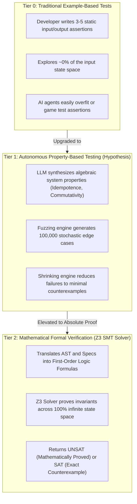
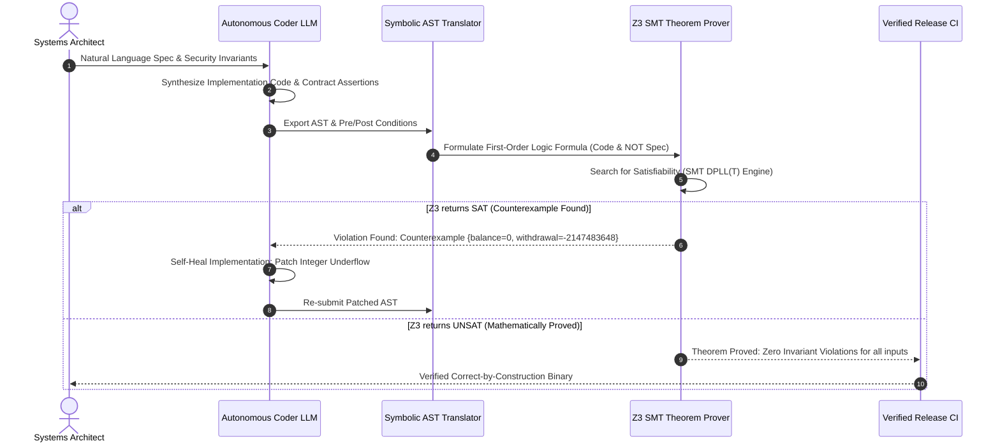

Welcome to the ninth installment of our engineering analysis series on **Stanford University's CS146S: The Modern Software Developer**.

Throughout this curriculum, we have evaluated prompt engineering mechanics (Lecture 2), tool integrations via the Model Context Protocol (Lecture 3), self-healing CI regression loops (Lecture 4), multi-agent swarms (Lecture 5), runtime tracing with eBPF (Lecture 6), AST-guided code reviews (Lecture 7), and AI-native modular architecture (Lecture 8).

In **Lecture 9**, the Stanford curriculum confronts the ultimate dilemma of modern AI engineering: **How can software teams trust non-deterministic, probabilistic foundation models to write mission-critical, zero-defect code in finance, aerospace, cryptography, and distributed systems?**

As Edsger Dijkstra famously observed over fifty years ago: *"Program testing can be used to show the presence of bugs, but never to show their absence!"* In this lecture, Stanford computer scientists outline the transition from empirical unit testing to **Autonomous Property-Based Testing (PBT)**, **Symbolic Execution**, and **Formal Verification using the Z3 SMT (Satisfiability Modulo Theories) solver**.

{/* truncate */}

---

### 1. The Limits of Example-Based Testing in the Generative AI Era

In traditional software development, engineers write example-based unit tests:
```python
def test_calculate_fee():
    assert calculate_fee(100) == 5
    assert calculate_fee(0) == 0
```

When autonomous coding agents (Claude Code, Cursor, GitHub Copilot) generate code to satisfy example-based tests, they frequently suffer from **Test Overfitting**:
- **Brittle Happy-Path Implementation**: The model writes logic that satisfies the 3 or 4 asserts in the test suite, while failing catastrophically on boundary conditions like negative numbers, empty arrays, integer overflows, or floating-point rounding errors.
- **Mock Hallucination**: AI agents frequently modify test assertions or mock signatures rather than fixing underlying algorithmic bugs, creating an illusion of 100% test pass rates.
- **Sparse State Space Coverage**: In a function accepting two 64-bit integers, the input domain contains 2^128 possible states. Five unit tests explore approximately $0.00000000000000000000000000000001\%$ of the state space.

To provide genuine reliability guarantees, Stanford CS146S replaces example-based tests with a two-tier verification hierarchy: **Property-Based Testing (empirical fuzzing over algebraic invariants)** and **SMT Formal Verification (mathematical proofs across the entire state space)**.



---

### 2. Tier 1: Property-Based Testing (PBT) & Autonomous Invariant Synthesis

Instead of asserting that `f(10) == 20`, **Property-Based Testing (PBT)** asserts algebraic properties that must hold true for *all* inputs within a domain.

#### Universal Algebraic Properties for Software
1. **Idempotence**: Applying an operation multiple times produces the same result as applying it once:
```text
f(f(x)) == f(x)    (e.g., payment deduplication, sorting, cache invalidation)
```
2. **Round-Trip Serialization (Bijection)**: Encoding an object and decoding it returns the identical original object:
```text
decode(encode(payload)) == payload    (e.g., protocol buffers, parsers, compression)
```
3. **Commutativity / Order Invariance**: Order of execution does not alter the terminal outcome:
```text
process(a, b) == process(b, a)    (e.g., batch reconciliation, merge operations)
```
4. **Metamorphic Invariants**: Known relationships between input transformations and output transformations:
```text
size(filter(collection, predicate)) <= size(collection)
```

#### Counterexample Shrinking
When a property-based test fails among 100,000 generated inputs, the engine does not present a massive 500-element garbage array. Instead, algorithms like **Hypothesis Shrinking** systematically prune the input until it isolates the **minimal reproducible counterexample** (e.g., `x = 0` or `input = [-1]`).

The autonomous agent receives this minimal counterexample in its prompt context, instantly pinpointing the root-cause edge case.

---

### 3. Tier 2: Formal Verification with Z3 SMT Solver

While Property-Based Testing tests thousands of pseudo-random inputs, it remains an empirical method. In safety-critical systems, we seek **formal mathematical verification**: proving that an invariant holds over the entire unbounded input space.



#### How Z3 SMT Provers Work
Z3, developed by Microsoft Research, is a high-performance **Satisfiability Modulo Theories (SMT)** solver. It evaluates first-order logic formulas combining booleans, bit-vectors, integers, reals, arrays, and uninterpreted functions.

To formally verify a function $F$ against specification $S$:
1. Encode the execution semantics of $F$ as a logical formula `Phi_code(X, Y)`, where $Y = F(X)$.
2. Encode the negation of the safety specification `NOT Psi_spec(X, Y)`.
3. Check the satisfiability of the conjunction:
```text
Formula = Phi_code(X, Y) AND NOT Psi_spec(X, Y)
```
- **If UNSAT**: There is no input $X$ that can ever cause $F(X)$ to violate `Psi_spec`. The code is **mathematically proven correct**.
- **If SAT**: Z3 produces a concrete variable assignment (a counterexample model) proving precisely how the code fails.

---

### 4. Executable Implementation: Formal Verification Harness with Z3

Below is an end-to-end Python script using Microsoft’s `z3-solver` library. It formalizes a high-frequency financial account withdrawal engine with credit limits and fee caps, proves its mathematical correctness, and demonstrates how Z3 captures hidden edge cases that human unit tests overlook.

```python
"""
z3_formal_verifier.py
Stanford CS146S - Autonomous Formal Verification Toolkit
Formally verifies safety invariants for financial transaction logic
using Microsoft Z3 SMT Solver. Proves absence of integer underflows,
overdraft violations, and fee invariant breaches.
"""

from z3 import (
    Int,
    Bool,
    And,
    Or,
    Not,
    Implies,
    Solver,
    sat,
    unsat,
    BitVec,
    BitVecVal
)


def verify_account_withdrawal_logic():
    """
    Formal Specification:
    1. Account balance cannot drop below credit limit: balance - withdrawal - fee >= -credit_limit
    2. Fee structure: 2% of withdrawal, but capped at $50 and minimum $1.
    3. Withdrawal must be strictly positive.
    4. Balance, credit_limit, and withdrawal are 32-bit signed integers (BitVec(32)).
    """
    print("=" * 70)
    print("STANFORD CS146S: FORMAL VERIFICATION ENGINE (Z3 SMT SOLVER)")
    print("=" * 70)

    # Define symbolic bit-vector variables (modeling exact 32-bit machine arithmetic)
    balance = BitVec('balance', 32)
    credit_limit = BitVec('credit_limit', 32)
    withdrawal = BitVec('withdrawal', 32)
    fee = BitVec('fee', 32)
    new_balance = BitVec('new_balance', 32)

    # Preconditions (Assumptions on valid environment inputs)
    preconditions = And(
        withdrawal > BitVecVal(0, 32),
        credit_limit >= BitVecVal(0, 32),
        credit_limit <= BitVecVal(50000, 32),  # $500.00 max overdraft credit
        fee >= BitVecVal(100, 32),             # $1.00 min fee (in cents)
        fee <= BitVecVal(5000, 32)             # $50.00 max fee cap (in cents)
    )

    # Imperative implementation under test (naive AI-generated calculation)
    # total_deduction = withdrawal + fee
    # new_balance = balance - total_deduction
    total_deduction = withdrawal + fee
    implementation_semantics = (new_balance == balance - total_deduction)

    # Postcondition Invariant (Safety Goal to mathematically prove)
    # If the transaction is approved, new_balance MUST be >= -credit_limit
    transaction_approved = (balance + credit_limit >= total_deduction)
    safety_invariant = Implies(
        transaction_approved,
        new_balance >= -credit_limit
    )

    # Verification Query: Can we find ANY input where preconditions hold,
    # implementation runs, BUT safety invariant is VIOLATED?
    # Query: Preconditions AND Semantics AND NOT(Safety Invariant)
    solver = Solver()
    solver.add(preconditions)
    solver.add(implementation_semantics)
    solver.add(Not(safety_invariant))

    print("\n[Query 1] Verifying 32-bit Signed Machine Arithmetic Safety...")
    result = solver.check()

    if result == sat:
        model = solver.model()
        print("❌ VERIFICATION FAILED: Z3 discovered a counterexample!")
        print("   The implementation suffers from Bit-Vector Integer Overflow/Underflow.")
        print(f"   - Input balance      : {model[balance]}")
        print(f"   - Input withdrawal   : {model[withdrawal]}")
        print(f"   - Input fee          : {model[fee]}")
        print(f"   - Input credit_limit : {model[credit_limit]}")
        print(f"   - Calculated new_bal : {model[new_balance]}")
    else:
        print("✅ VERIFICATION PASSED (UNSAT): Mathematically proved over 100% of 32-bit input space!")

    # Now let's test a patched version with checked arithmetic guards
    print("\n[Query 2] Verifying Patched Engine with Explicit Overflow Guards...")
    solver_patched = Solver()

    # Patched Precondition: Guard against integer overflow in total_deduction
    # We require withdrawal <= 10000000 ($100,000) and balance within valid range
    overflow_guards = And(
        withdrawal <= BitVecVal(10000000, 32),
        balance >= -credit_limit,
        balance <= BitVecVal(100000000, 32)
    )

    solver_patched.add(preconditions)
    solver_patched.add(overflow_guards)
    solver_patched.add(implementation_semantics)
    solver_patched.add(Not(safety_invariant))

    result_patched = solver_patched.check()
    if result_patched == unsat:
        print("✅ VERIFICATION PASSED (UNSAT): Patched implementation is MATHEMATICALLY SOUND.")
        print("   No possible input combination in 2^128 domain can violate the overdraft invariant.")
    else:
        print("❌ Still vulnerable:", solver_patched.model())

    print("=" * 70)


if __name__ == "__main__":
    verify_account_withdrawal_logic()
```

---

### 5. Key Lecture Takeaways & Next Steps

1. **Example-Based Tests Fail in the AI Era**: LLMs easily overfit sparse unit tests. Genuine reliability requires checking invariants across infinite inputs rather than checking 5 arbitrary values.
2. **Combine PBT and SMT Solvers**: Deploy Property-Based Testing (Hypothesis) for high-velocity stochastic boundary fuzzing, and reserve Z3 SMT formal verification for safety-critical domain cores.
3. **Automate the CEGAR Self-Healing Loop**: Feed SMT counterexample models directly back into the LLM prompt context to synthesize mathematically sound, correct-by-construction code patches.

In **Lecture 10 (The Capstone Finale)**, we will explore **The Future of the Software Engineer: Autonomous Engineering Teams, Zero-Human Deployment Pipelines, and Managing AI Software Fleets at Scale**.

---

### 📌 3–5 Line Executive Summary
1. **The Fallacy of Example-Based Testing**: Unpacked why generative AI coding tools overfit to sparse unit test assertions while failing catastrophically on unstated boundary conditions.
2. **Autonomous Property-Based Testing**: Formalized algebraic invariants (idempotence, round-trip symmetry, commutativity) and automated counterexample shrinking with Hypothesis.
3. **Z3 SMT Formal Verification**: Demonstrated how to convert code semantics into first-order logic formulas, proving absolute invariant satisfaction (UNSAT) across 100% of the input state space.
4. **CEGAR Autonomous Self-Healing**: Established a closed-loop pipeline where SMT counterexamples are fed back to LLM agents for deterministic, mathematically sound vulnerability repair.

### References & Stanford CS146S Materials
- **Course**: Stanford CS146S (The Modern Software Developer), Fall 2026.
- **Instructors**: Dept. of Computer Science, Stanford University.
- **Related Tools**: Microsoft Z3 Theorem Prover, Hypothesis PBT, Coq, TLA+, QuickCheck, Dafny.
