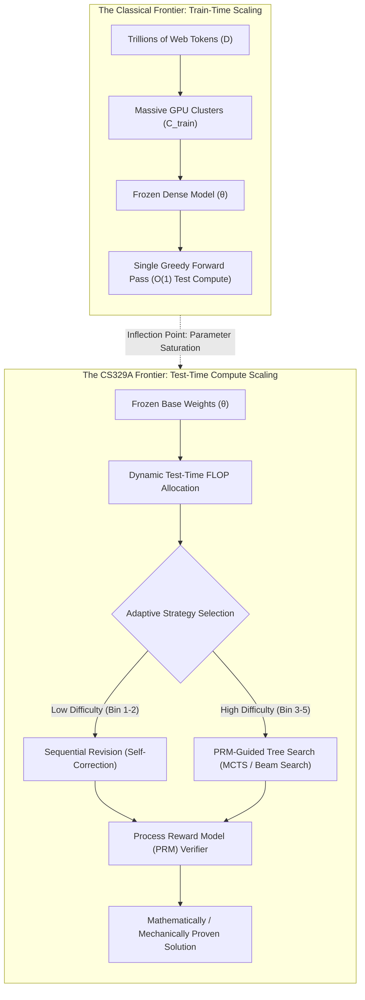
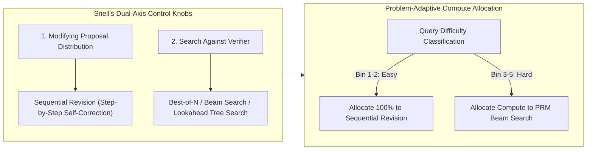
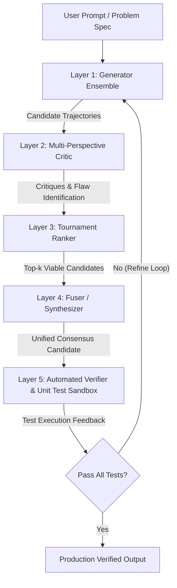

Welcome to the second installment of our definitive engineering breakdown of **Stanford University's CS329A: Self-Improving AI Agents (Autumn 2025)**.

In our inaugural lecture, we traced the macroeconomic paradigm shift from static, autoregressive next-token predictors to autonomous self-improving agentic loops. Today, we confront the technical foundation that makes this autonomy computationally viable: **Test-Time Compute Scaling (Inference-Time Scaling)**.

For over half a decade, the predominant scaling doctrine across the AI industry was dictated by train-time laws (Kaplan et al., Chinchilla): *allocate larger clusters, expand parameter footprints, and absorb tens of trillions of tokens*. Yet, once a model’s parameters θ are frozen, what happens if we refuse to accept a 50-millisecond greedy response? What if an agent spends 10 seconds, 1 minute, or 10 minutes deliberately exploring reasoning trees, checking intermediate steps, and revising its hypotheses before committing to an action?

Through the foundational empirical discoveries of *Large Language Monkeys* (Brown et al., 2024), Snell et al.'s *Compute-Optimal Scaling* (Stanford/UC Berkeley, 2024), and the *Archon* modular architecture framework, we will mathematically formalize how trading test-time FLOPs for parameter capacity reshapes modern artificial intelligence.



{/* truncate */}

---

### 1. Classical Scaling vs. Test-Time Compute: The Paradigm Shift

Modern machine learning was established on the empirical observation that validation loss decays as a power-law function of training compute:

```text
L(N, D) = E + A / N^α + B / D^β
```

where N is the number of non-embedding parameters and D is the dataset size in tokens. However, this classical formulation treats inference compute as a trivial, static constant: exactly 2 FLOPs per parameter per token generated during autoregressive decoding.

#### The Fundamental Limits of Train-Time Scaling
As the industry scaled models beyond 10^26 FLOPs (GPT-4 class), pre-training hit hard physical and informational constraints:
1. **The Web Token Depletion Boundary:** High-quality human text on the public internet is finite (estimated at ~10^14 tokens). Synthetic data generation without verifiers introduces model collapse and entropy degeneration.
2. **Exponential Cost Scaling:** Improving benchmark accuracy by 1% on the flat tail of a power-law curve requires a 10x multiplier in pre-training FLOPs, translating to hundreds of millions of dollars in capital expenditure.
3. **The Static Forward Pass Fallacy:** Regardless of whether a model has 7B or 1T parameters, standard autoregressive decoding generates each token t_i in a fixed number of matrix multiplications:

```text
t_i ~ Softmax( W_u · LayerNorm( h_L(t_{1:i-1}) ) )
```

Complex NP-complete problems, multi-file software engineering bugs, and formal mathematical proofs cannot be resolved in a linear sequence of forward passes without backtracking, speculation, and verification.

---

### 2. The Return of the Infinite Monkey Theorem: Large Language Monkeys

In classical probability theory, Émile Borel's *Infinite Monkey Theorem* posits that a monkey hitting keys at random on a typewriter keyboard for an infinite duration will almost surely produce the complete works of William Shakespeare.

In late 2024, researchers from UC Berkeley and Google Research evaluated this hypothesis across modern frontier LLMs in their seminal work: **《Large Language Monkeys: Scaling Inference Compute with Repeated Sampling》** (Brown et al., 2024).

```
Coverage (Pass@k %)
 ▲
100│                                     ┌────────────── Pass@k Coverage Upper Bound
 90│                                ┌────┘ (Reaches 99% on MATH & CodeContests)
 80│                           ┌────┘
 70│                      ┌────┘
 60│                 ┌────┘ ◄── SWE-bench Lite: DeepSeek-Coder-V2 (k=250 -> 56.0%)
 50│            ┌────┘
 40│       ┌────┘   ◄── Claude 3.5 Sonnet Single-Run (43.0%)
 30│  ┌────┘
 20│ ┌┘
 10│┌┘  ◄── Gemma-2B Pass@1 (0.02%)
  0└┴──────┬──────────┬──────────┬──────────┬──────────►
    k=1    k=10       k=100      k=1,000    k=10,000   (Number of Samples)
```

#### Mathematical Formulation of the Unbiased pass@k Estimator
When sampling N candidate completions from a language model, with exactly C completions passing an automated verification harness (e.g., unit tests), the unbiased minimum-variance estimator for pass@k is defined as:

```text
Pass@k = (1 / P) · ∑_{i=1}^P [ 1 - C(N - C_i, k) / C(N, k) ]
```

where P is the total problem set, C_i is the count of successful solutions for problem i, and C(n, r) represents the binomial coefficient. To prevent floating-point underflow and overflow when scaling to N = 10,000, production evaluation harnesses calculate this recursively:

```text
Pass@k = 1 - ∏_{j=0}^{k-1} ( 1 - C_i / (N - j) )
```

#### Empirical Breakthroughs: Small Models Outperforming Titans
The empirical findings of the Large Language Monkeys paper fundamentally challenged conventional model evaluation:
* **SWE-bench Lite (Real-World GitHub Bug Resolution):**
  * `DeepSeek-Coder-V2-Instruct` at k=1 achieved a modest **15.9%** pass rate.
  * When scaled to k=250 samples, its pass@250 skyrocketed to **56.0%**.
  * This surpassed the ensemble of GPT-4o and Claude 3.5 Sonnet (43.0%) by **13 percentage points**.
* **CodeContests (Competitive Programming Benchmarks):**
  * The ultra-lightweight `Gemma-2B` model had a single-attempt pass@1 of **0.02%** (virtually zero).
  * Scaled to k=10,000, pass@10,000 rose to **7.1%**—a **355x performance explosion** solely through test-time sampling.
* **The Economic Inversion:**
  * Achieving 29.62% on SWE-bench using DeepSeek-Coder-V2 (k=5) cost **$10.80**.
  * Achieving comparable accuracy with single-shot GPT-4o (24.0%) cost **$39.00 (3.6x more expensive)**.
  * Claude 3.5 Sonnet single-shot (26.7%) cost **$51.00 (4.7x more expensive)**.

```text
┌───────────────────────────────┬──────────┬────────────┬─────────────┐
│ Model & Strategy              │ SWE-bench│ Cost ($)   │ Multiplier  │
├───────────────────────────────┼──────────┼────────────┼─────────────┤
│ DeepSeek-Coder-V2 (k=5)       │ 29.62%   │ $10.80     │ 1.0x (Base) │
│ GPT-4o (k=1 Greedy)           │ 24.00%   │ $39.00     │ 3.6x Cost   │
│ Claude 3.5 Sonnet (k=1)       │ 26.70%   │ $51.00     │ 4.7x Cost   │
│ DeepSeek-Coder-V2 (k=250)     │ 56.00%   │ $540.00    │ State-of-Art│
└───────────────────────────────┴──────────┴────────────┴─────────────┘
```

#### The Coverage-Precision Gap: The Verifier Wall
However, repeated sampling exposes a structural vulnerability known as the **Coverage-Precision Gap**.

In closed formal domains with deterministic oracles (such as Python compilers, unit tests, or Lean 4 formal provers), **Coverage equals Success**: if 1 out of 250 trajectories passes all unit tests, that candidate is mechanically extracted.

In open-ended or informal domains lacking external compilers:
* On the MATH dataset, `Llama-3-8B-Instruct` achieved a coverage of **98.44%** at k=10,000 (meaning 98% of the candidate pools contained the correct proof).
* However, when applying standard **Majority Voting**, accuracy increased from 40.5% to only **41.41%** (a meager 0.9% gain).
* Applying an Outcome Reward Model (ORM) for **Best-of-N selection** plateaued at roughly k=100, failing to extract the remaining 57% of correct solutions due to verifier reward hacking and false-positive saturation.

> **Engineering Principle:** Expanding repeated sampling without an equally precise verifier is merely expanding the size of the haystack. While the probability that the needle exists inside the haystack approaches 100%, finding the needle becomes intractable without high-precision verification.

---

### 3. Snell's Compute-Optimal Scaling: Trading Parameters for FLOPs

If brute-force repeated sampling hits a verifier bottleneck, how should an engineer optimally spend a fixed budget of inference FLOPs?

In late 2024, Charlie Snell, Jaehoon Seo, Hao Liu, Aviral Kumar, and Sergey Levine (Stanford University & UC Berkeley) published the landmark paper: **《Scaling LLM Test-Time Compute Optimally can be More Effective than Scaling Model Parameters》**.



#### The Two Control Knobs of Inference Compute
Snell et al. formalized all test-time compute mechanisms into two orthogonal dimensions:
1. **Modifying Proposal Distribution (Proposer):** Condition the model to generate higher-quality trajectories upfront through sequential revision:
   ```text
   y_{t+1} ~ P_θ( y | x, y_1, ..., y_t, Critique_t )
   ```
2. **Search Against Verifier (Verifier):** Systematically explore the proposal distribution using Process-Supervised Reward Models (PRMs) to evaluate intermediate reasoning nodes:
   ```text
   Score(Node_t) = PRM_ψ( x, y_{1:t} )
   ```

#### Problem-Adaptive Allocation: The Inversion Principle
The defining contribution of Snell's research is that the optimal test-time strategy strictly inverts depending on problem difficulty:

```text
Difficulty Bin 1-2 (Easy Problems)    ───>  Sequential Revision Dominates
Difficulty Bin 3-5 (Hard Problems)    ───>  PRM-Guided Beam Search Dominates
```

1. **Easy Problems (Bins 1–2):** 
   * When problems are easy, the base model's first attempt is already near the correct manifold. 
   * Applying complex tree search or Best-of-N introduces verifier noise: reward model inaccuracies cause the search to select over-optimized, verbose, incorrect trajectories.
   * **Optimal Strategy:** Sequential Revision (asking the model to refine its own reasoning and fix minor arithmetic slips) achieves optimal accuracy with minimal compute.
2. **Hard Problems (Bins 3–5):**
   * On challenging competition-grade mathematical problems, linear self-correction fails because the initial trajectory veers into an irrecoverable logic trap.
   * **Optimal Strategy:** Beam Search guided by a step-level PRM explores diverse solution branches and prunes degenerative lines of thought before they consume context window tokens.
3. **The Compute Efficiency Dividend:**
   * A compute-optimal policy that dynamically assigns Revision to easy queries and PRM Beam Search to difficult queries achieves identical accuracy to brute-force Best-of-N while consuming **4x less compute**.

#### The 14x Parameter Equivalence
The most celebrated empirical finding of Snell et al. was the head-to-head comparison between **expanding pre-training parameter scale by 14x** versus **scaling test-time compute on a smaller model**:

```text
14x Parameter Model (Greedy Decode)   vs.   1x Base Model + 14x Test-Time Compute
```

* For easy-to-medium problems across MATH and GSM8K, the smaller model equipped with optimal test-time compute completely matched or outperformed the 14x larger dense model.
* For extreme-difficulty problems (Bin 5), pre-trained parameter scale remained indispensable: if a base model lacks the foundational semantic representations to formulate even a partial hypothesis, test-time search degenerates into ungrounded hallucination.

---

### 4. System Engineering: Archon Modular Multi-Agent Architecture

Translating theoretical inference scaling laws into production software requires modular system engineering. How do we systematically compose generators, critics, rankers, and execution sandboxes without hardcoding brittle prompts?

The **Archon** framework (arxiv:2409.15254) solves this by abstracting LLM functional operations into composable software pipeline layers:



#### The Five Architectural Layers of Archon
1. **Generator Layer:** Instantiates diverse candidate solutions by varying temperatures (T=0.2 to T=0.8), prompt scaffolds, or heterogeneous model families (e.g., mixing Claude 3.5 Sonnet and DeepSeek-V2).
2. **Critic Layer:** Analyzes generated trajectories specifically to isolate edge-case vulnerabilities, mathematical omissions, or API contract mismatches.
3. **Ranker Layer:** Conducts pair-wise tournament evaluations among candidates using structured rubric evaluation.
4. **Fuser Layer:** Re-synthesizes the strongest logical insights from the top-k ranked candidates into a single unified output (+8.9% benchmark gain).
5. **Verifier Layer:** Prompts an LLM to generate 5–10 unit tests covering edge cases, executes the candidate code inside an isolated Docker / gVisor sandbox, and feeds execution traces back into the pipeline (+56% benchmark gain on coding tasks).

Through **Bayesian Optimization**, Archon traverses an architectural search space of **9,576 distinct pipeline configurations**, automatically discovering the Pareto-optimal agent architecture for any target latency and monetary cost budget.

---

### 5. Architectural Case Study: Demystifying OpenAI o1 & Reasoning Models

The theoretical principles articulated in Stanford CS329A Lecture 2 directly demystify the internal mechanics of frontier reasoning models such as OpenAI o1 and DeepSeek-R1.

```
┌────────────────────────────────────────────────────────────────────────┐
│                   Inside the "Thinking" Trace                          │
├────────────────────────────────────────────────────────────────────────┤
│ 1. Hidden Deliberation (Test-Time Tokens):                              │
│    Model generates thousands of hidden chain-of-thought tokens before  │
│    returning the first visible character.                              │
│                                                                        │
│ 2. Integrated PRM & Value Guidance:                                    │
│    Trained with reinforcement learning (RL) on process reward feedback │
│    to recognize dead ends and back up to previous branch nodes.        │
│                                                                        │
│ 3. Automated Error Correction (Snell Revision):                        │
│    Phrases like "Wait, that doesn't seem right, let me re-evaluate"   │
│    represent learned sequential revision policies triggered by self-   │
│    consistency checks.                                                 │
└────────────────────────────────────────────────────────────────────────┘
```

The visible "Thinking" trace is not a black-box novelty: it is an end-to-end learned neural implementation of **Inference-Time Scaling**, unifying sequential revision, process reward verification, and tree search into a single autoregressive loop.

---

### 6. Summary and Core Technical Takeaways

1. **Dual Scaling Frontiers:** AI capability is no longer bottlenecked solely by pre-training compute. Test-time compute scaling provides an independent, orthogonal scaling axis that enables lightweight models to rival industrial frontier models.
2. **The Coverage-Precision Principle:** Repeated sampling ($pass@k$) expands solution coverage dramatically (e.g., DeepSeek-Coder-V2 rising from 15.9% to 56.0% on SWE-bench Lite). However, harvesting this coverage requires high-precision verifiers to avoid the verifier wall.
3. **Snell's Law of Optimal Allocation:** Adaptive compute allocation beats brute-force sampling by 4x: deploy Sequential Revision for easy queries and PRM-guided Beam Search for hard queries.
4. **Modular Agentic Pipelines:** Systems like Archon demonstrate that software architecture—combining generators, critics, rankers, and test sandboxes—is as vital to final accuracy as the underlying model weights.

---

### What's Coming Next in Stanford CS329A:
In **Lecture 3**, we will enter the critical engine of autonomous agents: **《Robust Verification: Process Reward Models (PRM), Ensembles, and Scalable Oversight》**. We will explore how to build verifiers that resist reward hacking, evaluate mathematical steps without human supervision, and establish verified ground truth. Stay tuned!