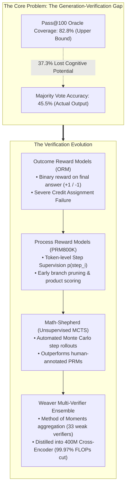
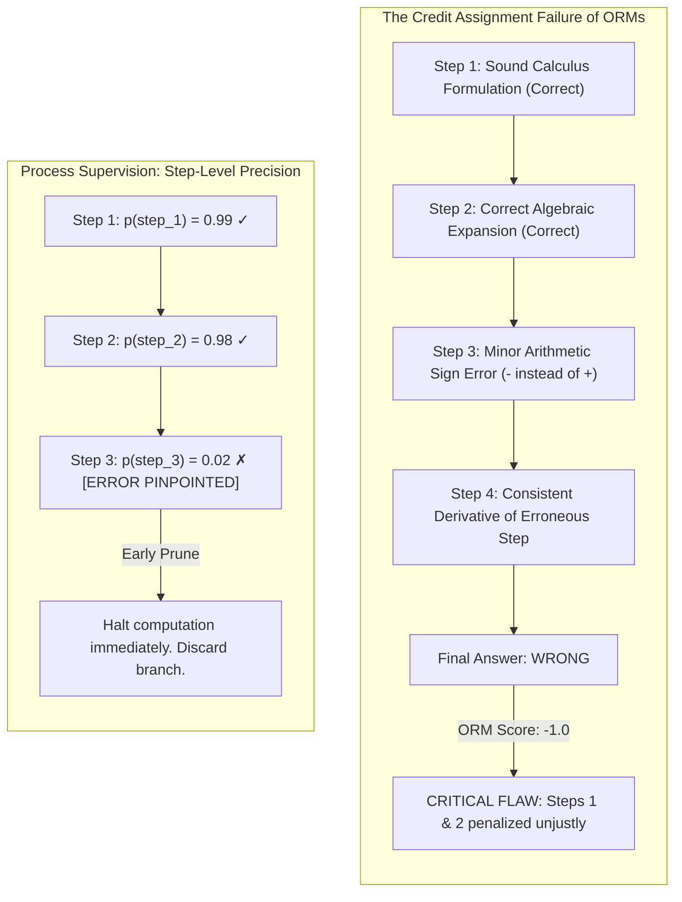
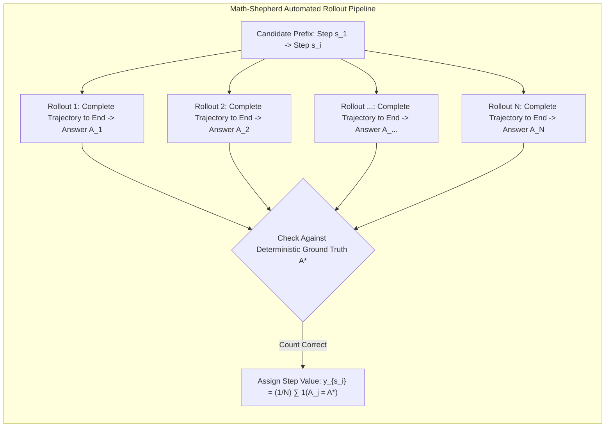
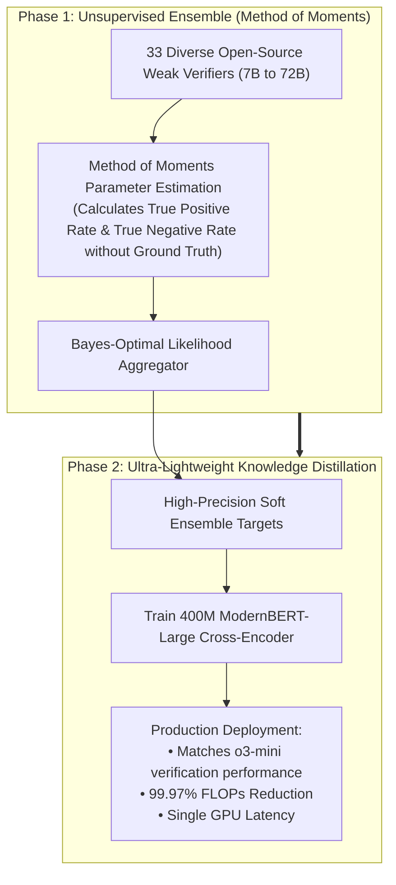

Welcome to the third installment of our definitive engineering breakdown of **Stanford University's CS329A: Self-Improving AI Agents (Autumn 2025)**.

In Lecture 2, we examined the mechanics of test-time compute scaling and reached a sobering conclusion: while generating thousands of candidate trajectories ($pass@k$) pushes theoretical solution coverage above 99%, this raw potential remains fundamentally unusable without a high-precision verifier. When evaluated with crude heuristics like majority voting, model accuracy hits an insurmountable plateau.

Today, we confront the core architectural engine that breaks through this bottleneck: **Robust Verification**.

Human mathematicians and software engineers rarely solve complex problems in an unthinking, single-shot stream of consciousness; they write down a step, verify its algebraic consistency, catch subtle arithmetic slips, and backtrack before committing to subsequent derivations. Conversely, standard autoregressive language models operate strictly forward in time. Once an early token wanders off course, the model hallucinates increasingly convoluted rationalizations to justify its initial error.

How do we design independent verifier models capable of inspecting intermediate reasoning steps, diagnosing logical fallacies, and guiding autonomous agents to ground-truth solutions without requiring millions of dollars in human annotation?

Through the foundational research of Cobbe et al. (GSM8K, OpenAI, 2021), Lightman et al. (PRM800K, 2023), automated Monte Carlo step annotation (*Math-Shepherd*, Yu et al., 2023), and the state-of-the-art *Weaver* ensemble framework (NeurIPS 2025), we will dismantle and rebuild the state of the art in **Verifier Engineering**.



{/* truncate */}

---

### 1. The Generation-Verification Gap: Defining the Bottleneck

Before analyzing specific verifier architectures, we must mathematically formalize the discrepancy between what a model can generate versus what an agent can reliably extract:

```text
Gap(K) = Pass@K - Actual_Success_Rate
```

On frontier benchmarks such as GPQA Diamond, open-weights reasoning models like `Llama-3.3-70B-Instruct` exhibit a $Pass@100$ of **82.8%**. This indicates that in over 8 out of 10 problems, at least one mathematically sound solution exists within a pool of 100 candidate completions.

However, when deploying standard **Majority Voting** across the 100 candidates, the realized accuracy collapses to **45.5%**. 

```
Accuracy (%)
 ▲
100│                                     ┌────────────── Pass@100 Oracle Frontier (82.8%)
 90│                                ┌────┘
 80│                           ┌────┘
 70│                      ┌────┘
 60│                 ┌────┘
 50│            ┌────┘ ◄── 37.3%p Lost Intelligence
 40│  ──────────┴──────────────────────── Majority Voting Plateau (45.5%)
 30│
 20│
 10│
  0└┴────────────────────────────────────────────────► Sample Budget K
```

A staggering **37.3 percentage points of latent cognitive capability are incinerated** purely due to flawed selection. When multiple degenerate trajectories converge on the same plausible distractor, frequency-based heuristics actively select false positives.

#### The Origin of Independent Verifiers: Cobbe et al. (GSM8K, 2021)
To bridge this divide, Karl Cobbe and the OpenAI research team introduced the seminal **GSM8K** benchmark alongside the concept of an independent, dedicated verifier network:

1. **Decoupled Architecture:** The generator and verifier models do not share active forward weights during inference. The generator is trained for only 2 epochs to maintain sample entropy, while the verifier is trained on generator completions.
2. **Token-Level Value Heads:** Rather than evaluating solely at the end of the sequence, the verifier attaches a scalar linear head to every transformer token position:
   ```text
   V(t_i) = W_v · h_L(t_i) + b_v
   ```
   The network is optimized via a joint loss balancing language modeling cross-entropy and mean squared error (MSE) against completion correctness:
   ```text
   L_total = L_LM(θ) + λ · || V(t_end) - y_true ||^2
   ```
3. **The 30x Parameter Dividend:**
   * Attaching a compact **6B-parameter verifier** to select the top candidate among 100 completions matched the accuracy of an unguided **175B-parameter dense model**.
   * Simply decoupling generation from verification delivered an effective **30x multiplier in parameter efficiency**.

---

### 2. Outcome vs. Process Supervision: Lightman et al. (PRM800K)

While Cobbe's verifier represented a major advance, it remained bound to **Outcome Supervision (Outcome Reward Models, ORMs)**. 

In May 2023, Hunter Lightman and his OpenAI team published the foundational study: **《Let's Verify Step by Step》** (Lightman et al., 2023).



#### The Credit Assignment Problem in Reasoning
Consider a 10-step mathematical proof:
* **The False Negative Dilemma:** The model executes flawless mathematical reasoning across Steps 1 through 6. In Step 7, it makes a minor arithmetic slip, resulting in an incorrect final numerical answer.
  * *ORM Assessment:* Assigns a punitive score of $-1$. The brilliant logical deductions in Steps 1–6 are actively penalized, contaminating the training signal.
* **The False Positive Dilemma (Lucky Error):** In Step 3, the model commits an egregious logical blunder. In Step 8, it commits a second canceling error, accidentally arriving at the correct final integer.
  * *ORM Assessment:* Assigns a perfect score of $+1$. The model is reinforced for fraudulent reasoning, compounding reward hacking.

This failure of temporal credit assignment severely limits the scaling of outcome-based verification.

#### The Mathematics of PRMs
Lightman et al. constructed **PRM800K**, a dataset consisting of 800,000 step-level human annotations across 75,000 solutions to MATH problems. Annotators evaluated each individual reasoning step (delimited by newline characters `\n\n`) as positive, negative, or neutral.

To optimize annotation throughput, OpenAI instituted the **First-Error Termination Rule**: annotators halted labeling the moment a solution exhibited its first logical fallacy, as subsequent steps in an invalid derivation are epistemically meaningless.

The Process Reward Model predicts the probability that step $s_i$ is logically sound:

```text
p(s_i) = σ( W_p · h_L( Token_{\text{newline}, i} ) )
```

The composite score for an entire candidate trajectory $S = (s_1, s_2, ..., s_M)$ is calculated via the **Product Rule**:

```text
Score_PRM(S) = ∏_{i=1}^M p(s_i \text{ is correct})
```

#### Empirical Superiority of PRMs
When benchmarked on the competition-grade MATH dataset under Best-of-N search up to $N = 1,860$:

```text
┌───────────────────────────────┬──────────────┬──────────────┬─────────────┐
│ Selection Strategy            │ Best-of-1    │ Best-of-100  │ Best-of-1860│
├───────────────────────────────┼──────────────┼──────────────┼─────────────┤
│ Majority Voting               │ 52.4%        │ 68.3%        │ 69.6%       │
│ Outcome Reward Model (ORM)    │ 52.4%        │ 70.1%        │ 72.4%       │
│ Process Reward Model (PRM)    │ 52.4%        │ 74.8%        │ 78.2%       │
└───────────────────────────────┴──────────────┴──────────────┴─────────────┘
```

1. **Diverging Scaling Trajectories:** While majority voting and ORMs flatline near $N = 100$, PRM accuracy continues scaling monotonically out to thousands of candidates.
2. **Negative Alignment Tax:** Unlike traditional safety fine-tuning (RLHF), which often degrades raw mathematical problem-solving capability (the "alignment tax"), process supervision improves safety and interpretability while concurrently expanding reasoning accuracy.

---

### 3. Automated Step Supervision: Math-Shepherd Monte Carlo Rollouts

Despite its empirical brilliance, PRM800K suffered from an obvious commercial vulnerability: **human step-level labeling is economically unsustainable** at the scale required for frontier foundation models.

In late 2023, Yu, Shen, Zhou, et al. introduced **Math-Shepherd**, an automated step-level annotation pipeline inspired by Monte Carlo Tree Search (MCTS).



#### Core Algorithmic Intuition
Instead of paying human mathematicians, Math-Shepherd leverages the generative capability of language models to evaluate intermediate states:
> If an intermediate reasoning step $s_i$ is mathematically valid, continuing the derivation from that prefix should frequently yield the correct final ground truth $A^*$. If $s_i$ contains a fatal flaw, subsequent rollouts should almost never reach $A^*$.

#### Hard vs. Soft Step Estimation
Math-Shepherd formalizes two distinct supervisory labeling objectives:

1. **Hard Estimation (HE):** A binary indicator assigning $+1$ if at least one of the $N$ stochastic rollouts reaches the correct answer, and $0$ otherwise:
   ```text
   y^{HE}_{s_i} = 1( ∃ j \in {1, ..., N} : A_j = A^* )
   ```
2. **Soft Estimation (SE):** A continuous probability representing the empirical pass rate among the $N$ independent rollouts:
   ```text
   y^{SE}_{s_i} = (1 / N) · ∑_{j=1}^N 1( A_j = A^* )
   ```

#### The Breakthrough: Machine Annotations Outperform Humans
By executing automated rollouts across massive unlabeled problem corpora, the researchers synthesized a dataset of **1.7 million annotated steps** (more than double the size of PRM800K) at zero human annotation cost.

* **Human vs. Machine Labeling:** When evaluated on the MATH benchmark using open-weight LLaMA backbones, a PRM trained on Math-Shepherd machine labels **outperformed the human-labeled PRM800K**.
* **Root Cause of the Performance Inversion:** Human annotators in PRM800K evaluated solutions generated exclusively by GPT-4. Consequently, the resulting verifier failed to generalize to the idiosyncratic error modes of open-source models. Math-Shepherd, by contrast, samples rollouts directly from the target model's native distribution.
* **RL with Process Rewards:** When utilizing Math-Shepherd step rewards within a PPO reinforcement learning loop, `Mistral-7B` surged from a baseline accuracy of 28.6% to **43.5% on MATH**.

---

### 4. Ensemble Theory: The Weaver Framework (NeurIPS 2025)

While automated PRMs like Math-Shepherd eliminate human labeling costs, deploying a single 7B or 13B verifier introduces a new vulnerability: **verifier fallibility**. Smaller reward models suffer from false positives and reward hacking. Yet, deploying an ensemble of massive 70B+ verifiers in production incurs prohibitive inference latency and cost.

At NeurIPS 2025, researchers from Stanford University and UW-Madison published a breakthrough resolution: **《Weaver: Shrinking the Generation-Verification Gap with Weak Verifiers》** (Zhang et al., 2025).



#### Unsupervised Verifier Aggregation via the Method of Moments
Weaver considers a consortium of $K$ diverse, imperfect verifiers ($K = 33$, ranging from 7B to 72B parameters). In an uncurated test environment without ground-truth labels, **how do we determine which verifier to trust?**

Weaver models verification as a **Latent Variable Naive Bayes Problem**:
* Let `Y in {0, 1}` represent the true, unobserved correctness of a solution candidate.
* Each verifier `k` emits a binary prediction `S_k in {0, 1}`, characterized by unknown sensitivity (True Positive Rate, ``w_{k,1}``) and specificity (True Negative Rate, ``w_{k,0}``):
  ```text
  `w_{k,1}` = P(S_k = 1 | Y = 1), \quad `w_{k,0}` = P(S_k = 0 | Y = 0)
  ```
* Under the conditional independence assumption given $Y$, the joint probability that verifiers $i$ and $j$ both output positive classifications expands to:
  ```text
  P(S_i = 1, S_j = 1) = π · w_{i,1} · w_{j,1} + (1 - π) · (1 - w_{i,0}) · (1 - w_{j,0})
  ```
  where $\pi = P(Y=1)$ is the unknown base rate.

By formulating a system of second- and third-order observable moment equations, Weaver uses the **Method of Moments** to analytically invert this covariance tensor, recovering the exact individual accuracies ``(`w_{k,1}`, `w_{k,0}`)`` of all 33 verifiers **without requiring a single ground-truth label**.

Once these parameters are recovered, Bayes' theorem yields the optimal posterior consensus score:

```text
P( Y=1 | S_1, ..., S_K ) = 1 / ( 1 + exp( - ( l_0 + ∑_{k=1}^K l_k(S_k) ) ) )
```

#### Results: Rivaling Frontier Proprietary Models
1. **Beating OpenAI o3-mini:**
   * Coupling `Llama-3.3-70B-Instruct` with the Weaver ensemble on difficult STEM competition benchmarks yielded a final accuracy of **87.7%**.
   * This completely surpassed standalone frontier models, including **OpenAI o3-mini (86.7%) and GPT-4o (69.0%)**.
2. **The 400M Cross-Encoder Distillation:**
   * Running 33 large models in parallel during production inference is financially non-viable.
   * The authors distilled Weaver's ensemble posterior probabilities into a compact **400M-parameter `ModernBERT-Large` cross-encoder**.
   * The 400M student model retained **98.7% of the full 33-verifier ensemble's precision** while reducing inference compute (FLOPs) by an astounding **99.97%**.

---

### 5. Architectural Case Study: Designing an Industrial Production Verifier

Based on Stanford CS329A Lecture 3, how should an enterprise engineer design a verification pipeline for critical software, legal, or financial AI agents?

```text
┌────────────────────────────────────────────────────────────────────────┐
│             Production Verifier Architecture Checklist                │
├────────────────────────────────────────────────────────────────────────┤
│ 1. Formal Closed Domains (Code, Math Proofs):                          │
│    • Deploy Compiler / Unit-Test Execution Oracles (Deterministic).    │
│    • Use ORMs with execution sandboxes (e.g., Docker / gVisor).        │
│                                                                        │
│ 2. Semi-Formal / Reasoning Domains (Financial Logic, Strategy):        │
│    • Deploy Process Reward Models (PRMs) trained via automated rollouts │
│      (Math-Shepherd methodology).                                      │
│    • Evaluate candidate solutions using the Product Rule.              │
│    • Prune low-scoring intermediate branches (p < 0.2) early.          │
│                                                                        │
│ 3. Inference Cost Optimization:                                        │
│    • Train a weak-verifier ensemble offline via Method of Moments.     │
│    • Distill ensemble logits into a sub-1B cross-encoder (Weaver).     │
│    • Serve the distilled verifier on a single edge GPU.                │
└────────────────────────────────────────────────────────────────────────┘
```

---

### 6. Summary and Core Technical Takeaways

1. **The Verification Bottleneck:** The primary constraint on reasoning capability is no longer generation, but selection. Bridging the 30%+ Generation-Verification Gap requires specialized, decoupled verifiers.
2. **Credit Assignment Superiority:** Outcome Reward Models (ORMs) fail on complex multi-step reasoning due to credit assignment breakdown. Process Reward Models (PRMs) evaluate intermediate derivations, enabling exponential scaling during Best-of-N search.
3. **Autonomous Supervision:** Human annotation of reasoning steps is obsolete. Automated Monte Carlo rollouts (Math-Shepherd) generate domain-specific step-level supervision that outperforms human labeling.
4. **Ensemble & Distillation Synergy:** Aggregating diverse weak verifiers via the Method of Moments (Weaver) surpasses monolithic frontier models, and distilling the ensemble into a 400M cross-encoder slashes computational overhead by 99.97%.

---

### What's Coming Next in Stanford CS329A:
In **Lecture 4**, we move from pure text-based verifiers to external environmental ground truth: **《Tool Use & Code Feedback: Compilers, Execution Sandboxes, and Autonomous Self-Correction Loops》**. We will explore how agents interact with Python interpreters, bash environments, and unit test harnesses to achieve self-healing code synthesis. Stay tuned!