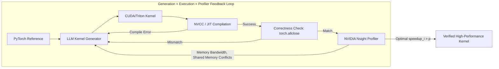

# Stanford CS329A (Ep 10): SWE-Agents — Autonomous Software Engineering, CodeMonkeys, KernelBench, and Agent-System Interface

Real-world production software engineering bears virtually no resemblance to isolated competitive programming puzzles or academic toy problems. A single GitHub bug report does not arrive neatly packaged with pre-extracted unit tests; it is entangled across hundreds of files, legacy dependencies, and millions of lines of distributed production code. Furthermore, software in production cannot merely be functionally correct — it must be computationally performant, memory-efficient, and tightly aligned with low-level parallel hardware architectures.

In this kickoff to **Part 3: Agent Engineering (Lectures 10 through 12)** of **Stanford CS329A: Self-Improving AI Agents**, we transition from fundamental model training clusters into the engineering trenches of production software development:
> **"How do autonomous AI agents navigate multi-million-token enterprise repositories, isolate elusive regression bugs, synthesize reproducible test harnesses, and write custom GPU kernels that out-accelerate human-crafted PyTorch baselines?"**

This post investigates the modern frontier of **SWE-Agent Autonomous Coding**, exploring three landmark breakthroughs: **CodeMonkeys Automated Refactoring** on the **SWE-bench Benchmark GitHub**, **KernelBench GPU Performance Tuning** using hardware profiler loops, and Stanford’s **Agent-Computer Interface ACI** (Agent-System Interface, ASI) designed to eliminate semantic misalignment between high-level agent intent and physical parallel hardware.

{/* truncate */}


---

## 1. The Realities of Autonomous Software Engineering

Solving real GitHub issues requires solving three monumental systems engineering challenges:
1. **The Context Explosion Dilemma:** An average industrial repository spans 3,000,000+ tokens. Feeding raw repositories into frontier LLMs causes severe financial bankruptcy and extreme attention degradation (needle-in-a-haystack failure).
2. **The Verification Dilemma:** Agents frequently write "lazy patches" that alter tests rather than solving underlying architectural bugs, creating false positive passes.
3. **The Hardware Wall:** Moving beyond Python glue code to low-level GPU acceleration (CUDA, Triton) requires understanding memory coalescing, thread block synchronization, and hardware register pressure.

```
┌─────────────────────────────────────────────────────────────────────────┐
│               The 3 Pillars of Production SWE-Agents                    │
└────────────────────────────────────┬────────────────────────────────────┘
                                     │
       ┌─────────────────────────────┼─────────────────────────────┐
       ▼                             ▼                             ▼
┌──────────────────────────┐  ┌──────────────────────────┐  ┌──────────────────────────┐
│  CodeMonkeys SWE-bench   │  │   KernelBench Profiler   │  │  Agent-System Interface  │
├──────────────────────────┤  ├──────────────────────────┤  ├──────────────────────────┤
│ • 50.5x Context Squeeze  │  │ • fast_p Metric (Wall-Clk)│  │ • 14x DSL Code Squeeze   │
│ • Two-Sided Debugging    │  │ • E+P Profiler Feedback  │  │ • AutoGuide Log Parser   │
│ • Discriminator Testing  │  │ • Fusion & Shared Memory │  │ • Semantic Alignment     │
│ • 57.4% SWE-bench Verif. │  │ • 13x GPU Acceleration   │  │ • 3.8x Speedup over Tuner│
└──────────────────────────┘  └──────────────────────────┘  └──────────────────────────┘
```

---

## 2. Solving Production GitHub Issues: CodeMonkeys (2025)

The premier gold standard for evaluating autonomous software engineering agents is **SWE-bench Verified** (curated from 500 real pull requests across major open-source repositories like Django, SymPy, and scikit-learn). 

Published in early 2025, **CodeMonkeys** achieved a world-class 57.4% resolution rate by decomposing agentic software engineering into three disciplined stages:

```
                  [Raw GitHub Issue & 3M Token Repository]
                                     │
                                     ▼
           1. Context Pipeline (Full-Repo Scan & 50.5x Compression)
              (Qwen2.5-Coder-32B local scan -> Summarize -> Rank -> 128k)
                                     │
                                     ▼
           2. Generation State Machines (Two-Sided Debugging Loop)
              ┌────────────────────────────────────────────────────────┐
              │ Testing Machine: Synthesizes Reproduce Test (Exit 2)   │
              │                       │                                │
              │                       ▼                                │
              │ Editing Machine: Patches Source Code -> Test (Exit 0)  │
              └────────────────────────────────────────────────────────┘
                                     │
                                     ▼
           3. Selection State Machine (Discriminator Test Synthesis)
              (Generates differential edge-case tests to prune false patches)
                                     │
                                     ▼
                      [Submit Final Verified Patch]
                   (57.4% Resolved on SWE-bench Verified)
```

### Stage 1: The Context Pipeline (50.5x Compression)
Directly querying frontier models (Claude 3.5 Sonnet) across entire multi-million-token repositories is cost-prohibitive. CodeMonkeys separates context discovery from patch synthesis:
- Employs a low-cost, locally hosted model (`Qwen2.5-Coder-32B`) to scan every Python file in the repository.
- Extracts relevant class definitions, function signatures, and docstrings.
- A secondary ranking pass prioritizes the top candidate files, compressing a 3,000,000-token codebase into a dense **128,000-token working context window (a 50.5x reduction)**.
- Because this context artifact is shared across parallel generation trajectories, context discovery accounts for less than **15% of the total resolution budget**.

### Stage 2: Two-Sided Debugging State Machines
A classic failure mode of autonomous coding agents is "self-deceptive patching" — modifying code without verifying that the bug was actually reproduced. CodeMonkeys couples two distinct state machines:
1. **Testing State Machine:** Before touching source code, the agent drafts an isolated reproduction script (`reproduce_issue.py`). Crucially, this script must execute against the unmodified codebase and return **Exit Code 2 (Reproduced Failure)**. If it passes, the test is invalid and regenerated.
2. **Editing State Machine:** Guided by the failing test, the editing machine patches the repository. It iterates up to 8 times against compiler errors, tracebacks, and assertion failures until the test returns **Exit Code 0 (Success)**.

### Stage 3: The Selection State Machine (Discriminator Tests)
Generating 10 parallel trajectories yields a solution coverage of **69.8%** (at least one valid patch exists). However, picking a patch at random drops accuracy to **45.8%** because many candidate patches break auxiliary regression suites.

To close this gap, CodeMonkeys introduced the **Discriminator Selection Machine**:
- It identifies subtle behavioral divergences between candidate patches $P_A$ and $P_B$.
- It prompts the LLM to write a **differential discriminator test** specifically designed to pass on $P_A$ and fail on $P_B$.
- By executing these discriminator suites against isolated candidate sandboxes, invalid patches are eliminated sequentially, driving final submission accuracy to **57.4%**.

---

## 3. Beyond Correctness to Performance: KernelBench (2025)

Correctness is only half the battle. In modern machine learning infrastructure, custom GPU operators determine the latency and financial viability of training and inference clusters. Human engineers took nearly five years after the initial Transformer paper to invent and optimize FlashAttention in CUDA. Can autonomous agents synthesize high-performance GPU kernels directly from PyTorch definitions?

Introduced in February 2025, **KernelBench** evaluates agents across 250 diverse PyTorch operators, assessing both mathematical correctness and raw hardware acceleration.

```text
The fast_p Speedup Frontier Metric:
========================================================================================
fast_p = (1 / N) * Σ_{i=1}^N  1[ correct_i  AND  speedup_i > p ]

Where:
  • fast_0 : Functional Correctness (Tensor output matches PyTorch baseline)
  • fast_1 : Correctness + Faster than native PyTorch (Speedup > 1.0x)
  • fast_2 : Correctness + Twice as fast as native PyTorch (Speedup > 2.0x)
========================================================================================
```



### The Profiler Feedback Revolution
In naive single-shot generation, even elite models like OpenAI o1 or DeepSeek-R1 fail dramatically: **less than 20% of generated CUDA kernels achieve any speedup over standard PyTorch ($fast_1 < 20\%$)**, frequently crashing with out-of-bounds memory accesses or shared memory bank conflicts.

However, when KernelBench connects the agent to a three-tier closed loop:
1. **Generation:** Generates initial Triton/CUDA implementation.
2. **Execution:** Feeds back compiler diagnostics and PyTorch tensor discrepancy tolerances (`torch.allclose`).
3. **Profiler Feedback (E+P):** Instruments the kernel with NVIDIA Nsight telemetry, providing exact bottleneck analysis (e.g., *"Memory bound: global memory stall at line 42; 8-way bank conflict in shared memory tile"*).

Under this loop, DeepSeek-R1's Level-2 compound operator optimization success rate surged from **36% to 72%**, autonomously synthesizing fused attention, register tiling, and warp-shuffle reductions that accelerated execution by up to **13x over standard PyTorch**.

---

## 4. Semantic Alignment: Agent-System Interface (ASI, Stanford 2025)

When agents attempt to optimize complex, low-level distributed C++ systems, an architectural impedance mismatch arises. Presenting an LLM with raw, low-level C++ pointers, thread synchronization primitives, and cryptic compiler assertions is akin to asking a high-level software architect to debug machine microcode.

Presented at ICML 2025 by Alex Aiken’s research group at Stanford University, the **Agent-System Interface (ASI)** bridges this divide:
> **"Instead of forcing LLMs to write fragile low-level C++ or decipher raw stack traces, we must construct an intermediate abstraction layer: a declarative Domain-Specific Language (DSL) that bounds the search space, and an AutoGuide translator that converts hardware assertion failures into actionable natural language advice."**

```text
┌─────────────────────────────────────────────────────────────────────────┐
│                          LLM Reasoning Agent                            │
│           (High-Level Declarative Intent & Algorithmic Strategy)        │
└────────────────────────────────────▲────────────────────────────────────┘
                                     │
          ┌──────────────────────────┴──────────────────────────┐
          │ High-Level DSL           ▲ Actionable Natural       │
          │ Optimization Directives  │ Language Advice          │
          ▼                          │                          │
┌────────────────────────────────────┴────────────────────────────────────┐
│                    Agent-System Interface (ASI Layer)                   │
│  • Domain-Specific Language (DSL): 14x Code Complexity Compression      │
│  • AutoGuide Diagnostic Translator: Transforms Segfaults to Action Hints │
└────────────────────────────────────▲────────────────────────────────────┘
                                     │
          │ Low-Level C++ Code       ▲ Raw Hardware Faults      │
          │ & Memory Allocations     │ & Compiler Assertions    │
          ▼                          │                          │
┌────────────────────────────────────┴────────────────────────────────────┐
│                  Physical Parallel Hardware Execution                   │
│                (Distributed Memory, GPU Cores, Shared VRAM)             │
└─────────────────────────────────────────────────────────────────────────┘
```

### The Two Components of ASI
1. **Domain-Specific Language (DSL):** Abstracting data tiling, loop unrolling, and memory hierarchy mappings into declarative primitives compresses system code **14-fold**, completely eliminating syntax hallucinations.
2. **AutoGuide Translator:** When a kernel triggers a low-level assertion (e.g., `Assertion failed: stride mismatch at dim 1; invalid warp alignment`), AutoGuide intercepts the fault and delivers contextual guidance:
   > *"Hardware Diagnostic: Stride alignment failed because tensor dimension 1 is not padded to a multiple of 32. Adjust the row-major memory layout directive to include 32-byte alignment."*

### Empirical Results: 10 Iterations Beats 1,000
Equipped with ASI, an autonomous LLM agent required only **10 iterations** to discover a parallel tensor schedule that was **3.8x faster** than the schedule found by **OpenTuner running for 1,000 iterations**. Complex circuit simulation tuning that previously consumed days of senior engineering effort was resolved in **10 minutes**.

---

## 5. Architectural Comparison: Software Engineering Paradigms

```text
=========================================================================================================
Dimension             Standard Coding Assistant      CodeMonkeys (SWE-bench)  KernelBench + ASI
---------------------------------------------------------------------------------------------------------
Target Artifact       Single Functions / Snippets    Full Multi-File Patches  High-Performance CUDA/Triton
Context Management    Local Active File (4k-8k)      50.5x Squeezed 128k      Declarative DSL (14x Squeeze)
Verification Loop     Unit Test Execution            Two-Sided State Machine  Nsight Profiler (fast_p Metric)
Feedback Signal       Traceback Error Strings        Exit 2 -> Exit 0 Toggle  AutoGuide Hardware Hints
Core Objective        Functional Correctness         Production Regression Fix Wall-Clock Hardware Speedup
=========================================================================================================
```

---

## 6. Deep Technical Q&A

### Q1: Why must CodeMonkeys synthesize a reproduction test BEFORE writing code?
If an agent edits code before establishing a test harness, it inevitably falls into "self-deceptive verification" — it writes a flawed patch, and subsequently writes a flawed test designed to pass on its flawed implementation. 

By requiring the **Testing State Machine** to first generate an independent script that produces **Exit Code 2 (Reproduced Failure)** on the unmodified repository, the system guarantees an immutable objective oracle. Only when the subsequent **Editing State Machine** flips that exact script to **Exit Code 0** is mathematical bug resolution proven.

### Q2: What causes LLMs to fail when generating CUDA kernels in one-shot, and how does the profiler loop solve it?
Language models understand high-level tensor operations conceptually, but struggle with low-level GPU concurrency:
- **Thread Index Mappings:** Calculating `int idx = blockIdx.x * blockDim.x + threadIdx.x` often misses boundary conditions, triggering out-of-bounds memory segfaults.
- **Shared Memory Conflicts:** Multi-threaded shared memory accesses that collide on the same bank serialize execution, destroying throughput.

Raw compiler errors only indicate syntax validity, not runtime bottlenecks. The **Profiler Feedback Loop (E+P)** injects runtime occupancy, memory stall analysis, and warp divergence metrics directly into the context window, allowing the agent to perform targeted algorithmic refactoring (such as shared memory padding and register reuse).

---

## Summary & What's Next

Software engineering agents have matured beyond conversational code autocomplete. Through **CodeMonkeys**, we observed how hierarchical context pipelines and two-sided state machines conquer real-world GitHub repositories on SWE-bench. Through **KernelBench** and **ASI**, we demonstrated how closing the loop with hardware profilers and declarative abstractions allows AI to optimize high-performance computing infrastructure.

In **Lecture 11**, we tackle the fundamental limitation of multi-day engineering agents: **Agent Memory — Hierarchical Memory Systems, Cartridges, CacheBlend, and Long-Horizon Context Persistence (MemGPT)**.

---

### Key Takeaways
- **Amortized Context Discovery:** Pre-filtering massive codebases with lightweight local models (50.5x compression) makes whole-repo engineering economically viable.
- **Two-Sided Debugging Eliminates Hallucinated Fixes:** A bug is only solved if verified against a pre-constructed reproduction script that flips from Exit 2 to Exit 0.
- **Performance is an Optimization Loop:** Single-shot generation cannot produce competitive CUDA code; coupling execution feedback with hardware profilers (fast_p) is mandatory for high-performance computing.