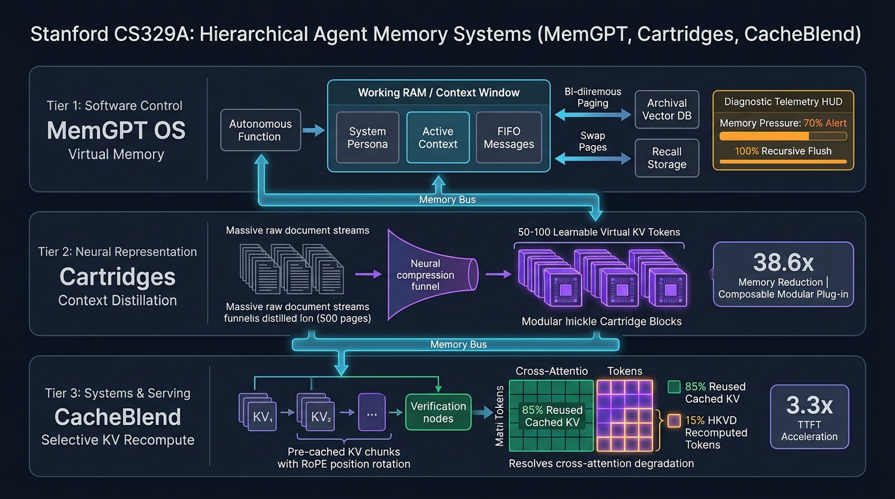

# Stanford CS329A (Ep 11): Agent Memory — MemGPT, Cartridges, CacheBlend, and Long-Horizon Context Architecture

When developers deploy autonomous AI agents as long-term collaborators or autonomous engineering partners, they inevitably run into three frustrating architectural bottlenecks:
1. *"The agent forgets critical architectural decisions agreed upon in yesterday's session."*
2. *"Stuffing a 100,000-line enterprise codebase into a million-token context window causes severe attention degradation (the Lost-in-the-Middle phenomenon) and inflates inference bills into thousands of dollars."*
3. *"Combining multi-document retrieval chunks in RAG serving invalidates prefix key-value caches, sending Time-To-First-Token (TTFT) soaring into several seconds."*

Human cognition solves this effortlessly. Biological brains possess a severely constrained working memory (holding only about 4 to 7 discrete chunks), yet effortlessly retrieve memories from decades ago and rapidly integrate cross-domain knowledge without retraining or cognitive paralysis.

In this continuation of **Part 3: Agent Engineering** of **Stanford CS329A: Self-Improving AI Agents**, we explore **Agent Memory Architecture** — how modern artificial intelligence grants autonomous systems persistent, hierarchical memory across three distinct abstraction tiers:
- **The Software Control Tier (MemGPT, UC Berkeley 2023):** OS-inspired hierarchical virtual memory paging.
- **The Neural Representation Tier (Cartridges, 2025):** Self-Study context distillation compressing massive documents into modular, plug-and-play continuous KV vectors.
- **The Systems Infrastructure Tier (CacheBlend, EuroSys 2025):** Selective KV cache recomputation restoring cross-attention and slashing RAG latency by 3.3x.

{/* truncate */}



---

## 1. The Long-Horizon Context Dilemma

Simply extending an LLM's physical context window (e.g., from 8k to 1M+ tokens) does not solve agent memory. In fact, brute-force context scaling introduces severe thermodynamic and algorithmic failure modes:
- **Attention Dissipation & Lost-in-the-Middle:** Transformer self-attention scales quadratically in compute $O(N^2)$ without optimizations, and attention distribution flattens, causing models to misplace subtle factual needles buried in the middle of massive prompts.
- **Economic Infeasibility:** Continuously resending 500k-token prompts on every single conversational turn burns through compute budgets exponentially.
- **Static Invariance:** When a prompt ends, the model's transient activations vanish. The agent cannot autonomously update its internal state without external intervention.

To achieve persistent autonomy, we must decouple **Working Context** from **Long-Term Storage** through structured **Hierarchical Context Management**.

```
┌─────────────────────────────────────────────────────────────────────────┐
│              The 3-Tier Agent Memory Abstraction Stack                  │
└────────────────────────────────────┬────────────────────────────────────┘
                                     │
       ┌─────────────────────────────┼─────────────────────────────┐
       ▼                             ▼                             ▼
┌──────────────────────────┐  ┌──────────────────────────┐  ┌──────────────────────────┐
│   Software Control Tier  │  │ Neural Representation Tier│  │  Systems Infrastructure  │
│         (MemGPT)         │  │       (Cartridges)       │  │       (CacheBlend)       │
├──────────────────────────┤  ├──────────────────────────┤  ├──────────────────────────┤
│ • OS-Style Virtual Paging│  │ • Self-Study Distillation│  │ • Multi-Chunk RAG Merging│
│ • Main Context (RAM)     │  │ • Continuous KV Embeddings│ │ • Selective KV Recompute │
│ • Archival Vector (Disk) │  │ • 38.6x Memory Reduction │  │ • Top 15% HKVD Recompute │
│ • Autonomous Eviction    │  │ • 26.4x Throughput Boost │  │ • RoPE Alignment Matrix  │
│ • Deep Memory Recall 92% │  │ • Modular Composability  │  │ • 3.3x TTFT Latency Drop │
└──────────────────────────┘  └──────────────────────────┘  └──────────────────────────┘
```

---

## 2. Software Control Tier: MemGPT (UC Berkeley 2023)

Operating systems mastered memory constraints decades ago. A modern operating system provides programmers with the illusion of unlimited RAM by transparently swapping virtual memory pages between high-speed physical DRAM and high-capacity storage disks via the Memory Management Unit (MMU).

Developed by Packer et al. at UC Berkeley, **MemGPT Long-Term Memory** brings classic OS virtual memory management directly into language agent architectures:
> **"The LLM's prompt window is physical RAM. External vector databases and relational message logs are the hard drive. By equipping the model with function-calling primitives to inspect, edit, flush, and recall memory, the agent becomes its own operating system."**

```
    ┌────────────────── [Main Context (RAM: 8k~128k Token Window)] ────────────────┐
    │ 1. System Instructions : Core agent identity and memory management manual   │
    │ 2. Working Context     : Static facts, persona traits, and user profile (R/W)│
    │ 3. FIFO Message Queue  : Recent dialogue + Recursive Summary Header          │
    └─────────────────────────────────────────────────────────────────────────────┘
                               ▲                      │
                (Swap-In / Search)                    │ (Swap-Out / Evict & Flush)
                               │                      ▼
    ┌───────────────── [External Context (Disk: Infinite Storage)] ───────────────┐
    │ 1. Recall Storage   : Timestamped raw conversation history (PostgreSQL)     │
    │ 2. Archival Storage : Deep knowledge repository & document embeddings (HNSW) │
    └─────────────────────────────────────────────────────────────────────────────┘
```

### Autonomous Memory Paging Mechanics
Unlike standard RAG architectures where hardcoded Python scripts prepend search snippets, MemGPT grants the agent **self-directed memory control**:
1. **Memory Pressure Warning (70% Threshold):**
   - When incoming dialogue occupies 70% of the active context window, a system interrupt is queued:
   > *"System Alert: Context window at 70% capacity. Review recent history and persist critical facts into working_context before eviction."*
2. **Recursive Summarization & Eviction (100% Flush):**
   - Upon reaching 100% capacity, the FIFO queue manager evicts the oldest 50% of the conversation.
   - Crucially, raw messages are not discarded. MemGPT invokes a **Recursive Summarization** routine, blending the existing historical summary with newly evicted tokens to create an updated, high-density summary block at the queue head.
   - The evicted raw message objects are moved to permanent `Recall Storage`.
3. **Autonomous Heartbeat Recall:**
   - When a user asks about an event from months ago, the model queries `recall_storage.search()` and sets `request_heartbeat=true`. This allows the agent to chain multiple tool calls autonomously, pulling disk records into working RAM before delivering a final answer.

### Empirical Benchmarks
On the **Deep Memory Recall (DMR)** benchmark spanning dozens of extended conversational sessions:
- Standard GPT-4 with a static context window plummeted to **32.1% accuracy**.
- MemGPT achieved **92.5% accuracy**, maintaining zero performance degradation regardless of how many sessions elapsed.
- In **Nested Key-Value Retrieval**, where agents must follow multi-hop associative chains ($K_1 \to V_1 / K_2 \to V_2$), baseline models collapsed to 0% beyond 3 hops, while MemGPT sustained 100% precision.

---

## 3. Neural Representation Tier: Cartridges (2025)

While MemGPT manages memory at the token level, moving thousands of text tokens back and forth remains computationally expensive. If an enterprise agent must reference a 500-page financial disclosure or an entire SDK codebase, loading raw text consumes massive memory and incurs extreme prefill latency.

Introduced in 2025, **Cartridges Modular Agent Memory** asks a radical question:
> **"Why represent knowledge with bulky text tokens? What if an LLM could study a 500-page document offline and distill it into 50 to 100 continuous, learnable Key-Value cache vectors that can be plugged into the model like a physical ROM cartridge?"**

```
[500-Page Document / Codebase]
             │
             ▼ (Self-Study Pipeline)
1. Synthetic Dialogue Synthesis (Summary, Questions, Use-Cases, Constraints)
             │
             ▼
2. Context Distillation via KL-Divergence:
   Teacher Model (Raw 500-Page Document + Query) ──► P_Teacher(y)
                                                        │ (D_KL Loss)
   Student Model (Cartridge Z [50 KV Tokens] + Query) ─► P_Student(y)
             │
             ▼
[Plug-and-Play Cartridge Z (50~100 Continuous KV Vectors)]
(38.6x Memory Compression, 26.4x Throughput Acceleration, Modular Composability)
```

### Why Naive Next-Token Prediction Fails
When researchers initially attempted to optimize continuous KV tokens using standard Next-Token Prediction (NTP) on raw text, the model suffered from **"Rote Memorization Syndrome"**:
- It could recite exact paragraphs verbatim from start to finish.
- However, when prompted to answer conceptual or analytical questions about the text, accuracy collapsed to zero. The representations were memorized surface tokens, not accessible semantic knowledge.

### The Self-Study & Context Distillation Architecture
To overcome this, the authors engineered a two-stage **Self-Study** training regimen:
1. **Diverse Synthetic Dialogue Generation:** The model generates thousands of multi-turn Q&A pairs across five archetypes: structural outlines, deep thematic questions, edge-case use cases, and creative synthesis.
2. **Context Distillation:**
   - **Teacher Model:** Receives the entire 500-page raw text in its context window and outputs target probability distributions `P_Teacher(y | Doc, x)`.
   - **Student Model:** Receives *only* the compact Cartridge parameters $Z$ (50-100 virtual KV tokens) and query $x$.
   - The cartridge parameters $Z$ are trained via gradient descent to minimize the **Kullback-Leibler (KL) Divergence** between Student and Teacher:

```text
========================================================================================
Cartridge Context Distillation Loss Formulation:
========================================================================================
min_Z  Σ  D_KL( F( · | Document ⊕ x )  ||  F_Z( · | x ) )

Where:
  • F( · | Document ⊕ x ) : Full-context Teacher model output logits
  • F_Z( · | x )          : Student model parameterized only by Cartridge Z
  • Z                     : Continuous Key-Value cache tensors injected into layers
========================================================================================
```

### Empirical Results & Lego-Brick Composability
- **38.6x Memory Reduction:** On the LongHealth and QASPER long-context benchmarks, Cartridges matched full-context in-context learning (ICL) accuracy while slashing memory usage by 38.6x.
- **26.4x Inference Throughput:** Removing thousands of text tokens from the prefill stage increased generation throughput by 26.4x.
- **Zero-Shot Modular Composability:** Cartridges function as modular units. When an agent was plugged with both an *AMD 10-K Cartridge* and a *PepsiCo 10-K Cartridge*, it successfully executed cross-company comparative financial analysis without any joint retraining!

---

## 4. Systems Infrastructure Tier: CacheBlend (EuroSys 2025)

Moving deeper into hardware infrastructure, we confront the operational realities of Retrieval-Augmented Generation (RAG) and multi-agent communications.

When a RAG agent retrieves 10 distinct document chunks to answer a user prompt, existing serving engines face an impossible architectural dilemma:
- **Prefix Caching (vLLM / RadixAttention):** Only the first chunk matches the pre-cached prefix. If chunk ordering changes or intermediate chunks are spliced, the entire downstream KV cache is invalidated, forcing a full prefill from scratch (TTFT takes 3 to 6 seconds).
- **Naive Chunk Concatenation (PromptCache):** Pre-computing each chunk independently and simply gluing KV caches together ignores **Cross-Attention Interactions** between chunks. Because tokens in Chunk B cannot attend to tokens in Chunk A, reasoning accuracy collapses by up to 50%.

Presented at EuroSys 2025, **CacheBlend KV Cache Merging** resolves this fundamental trade-off through **Selective KV Recomputation**:

```
[Retrieved Document Chunks A, B, and C Pre-computed KV Caches]
                               │
                               ▼
┌─────────────────────────────────────────────────────────────────────────┐
│              CacheBlend Layer-by-Layer Selective Recompute              │
├─────────────────────────────────────────────────────────────────────────┤
│ 1. Identify Top 15% High-deviation KV (HKVD) Cross-Attention Tokens    │
│ 2. Recompute Self-Attention ONLY for the 15% HKVD Tokens                │
│ 3. Directly Blend Remaining 85% Tokens from Pre-cached Storage          │
│ 4. Apply RoPE (Rotary Position Embedding) Matrix Rotation Transformation│
└────────────────────────────────────┬────────────────────────────────────┘
                                     │
                                     ▼
        [Ultra-Fast Prefill Complete: 3.3x TTFT Speedup, ΔF1 < 0.01]
```

### The Attention Sparsity Insight
By examining transformer attention distributions across concatenated text chunks, the CacheBlend authors uncovered a critical mathematical phenomenon:
> **"When multiple text chunks are spliced into a single prompt, fewer than 15% of tokens experience significant attention shifts due to neighboring chunks. Over 85% of tokens remain virtually invariant to surrounding context."**

1. **High-Deviation KV Detection (HKVD):** In each transformer layer, CacheBlend dynamically flags the top 15% of tokens exhibiting the greatest cross-chunk attention divergence and recomputes only their states.
2. **Latency Hiding via Pipelined Overlap:** While the GPU calculates the 15% recomputation (taking ~2ms), a background asynchronous I/O thread streams the next layer's pre-computed KV tensors from NVMe SSDs directly into GPU memory. The compute latency is completely hidden behind the I/O transfer window.
3. **RoPE Coordinate Transformation:** Concatenating chunks changes their absolute token positions. CacheBlend applies a closed-form 2D Givens rotation matrix to pre-cached keys, rotating them to their new offsets in microseconds without re-evaluating attention.

### Benchmarks
- **3.3x Lower TTFT:** First-token latency dropped from 3,450ms down to 1,050ms on complex multi-chunk RAG benchmarks.
- **5x System Throughput:** GPU serving clusters supported 5x higher concurrent agent queries.
- **Zero Accuracy Degradation:** Compared to ground-truth full recomputation, CacheBlend maintained an F1 discrepancy of less than **0.01**.

---

## 5. Comparative Architecture Matrix across Memory Paradigms

```text
=============================================================================================================
Dimension             MemGPT (UC Berkeley)          Cartridges (2025)             CacheBlend (EuroSys 2025)
-------------------------------------------------------------------------------------------------------------
Abstraction Layer     Software Control / OS Paging  Neural Representation         Inference Infrastructure
Primary Unit          Text Tokens & JSON Functions  Continuous KV Vectors         Pre-computed KV Tensors
Capacity Horizon      Infinite (External DB)        50-100 Tokens per Document    Dynamic Multi-Chunk RAG
Update Mechanism      Autonomous Tool Calls         Self-Study Distillation (KL)  Selective HKVD (15% Recompute)
Key Hardware Impact   Eliminates Context Overflow   38.6x VRAM Footprint Cut      3.3x TTFT Prefill Speedup
Composability         Relational Query Joins        Plug-and-Play Matrix Stacking RoPE Rotation Blending
=============================================================================================================
```

---

## 6. Deep Technical Q&A

### Q1: How does MemGPT autonomously decide WHEN to query external memory without human prompting?
MemGPT relies on in-context system specifications coupled with structured function-calling schemas. At the top of the working context, the `System Instructions` define an explicit cognitive contract:
> *"You are an autonomous intelligence equipped with long-term memory. When answering queries regarding historical events, user preferences, or deep facts not present in your working context, you MUST NOT guess or state inability. You MUST invoke `recall_storage.search()` or `archival_storage.search()`."*

When the model processes a prompt requiring missing facts, the attention heads attend to the system instructions and function definitions. Generating a tool invocation JSON becomes the highest-probability path over outputting a conversational apology. By returning `request_heartbeat=true`, the system immediately feeds the tool execution result back into the agent context, enabling uninterrupted autonomous recall loops.

### Q2: Why doesn't concatenating arbitrary pre-cached KV chunks break Rotary Position Embeddings (RoPE)?
In legacy absolute positional embedding schemes, shifting a token's index from position 0 to position 500 requires recalculating all embedding layers from scratch. 

However, **RoPE (Rotary Position Embedding)** encodes positions by rotating Query and Key vectors in 2D coordinate planes:
```text
R_{Theta, m}^d = diag(R_{m*theta_1}, ..., R_{m*theta_{d/2}})
```
Because the inner product `<R_m*q, R_n*k>` depends strictly on the relative distance $(m - n)$, CacheBlend shifts a pre-cached token from original position `p_old` to new concatenated position `p_new` simply by multiplying the Key vector by the delta rotation matrix:
```text
K_new = R_{Theta, (p_new - p_old)} * K_cached
```
This closed-form tensor multiplication runs in negligible time (under 10 microseconds), completely restoring mathematical positional validity without touching model weights.

---

## Summary & What's Next

True agent autonomy cannot exist with a fleeting, forgetful context window. Through **MemGPT**, we witnessed how operating system paging principles provide agents with an infinite cognitive lifespan. Through **Cartridges**, we observed how continuous vector distillation compresses encyclopedic knowledge into lightweight, composable modules. Through **CacheBlend**, we proved that multi-document serving latency can be slashed by 3.3x through selective attention recomputation.

In **Lecture 12**, we conclude Part 3 (Agent Engineering) with the ultimate benchmark of autonomous software intelligence: **Agent Evaluation & Long Tasks — Measuring Multi-Hour Trajectories, GDPVal, and DeepScholar-Bench**.

---

### Key Takeaways
- **Hierarchical Decoupling:** Long-term memory must be split into fast Working RAM (active prompt) and high-capacity Disk storage (Recall & Archival).
- **Distillation Beats Token Ingestion:** Converting documents into continuous Cartridges compresses memory footprint by 38.6x while preserving zero-shot composability.
- **Attention Sparsity Enables Instant Prefill:** Only 15% of tokens shift across RAG chunks; selective recomputation (CacheBlend) delivers near-instantaneous TTFT.