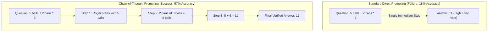
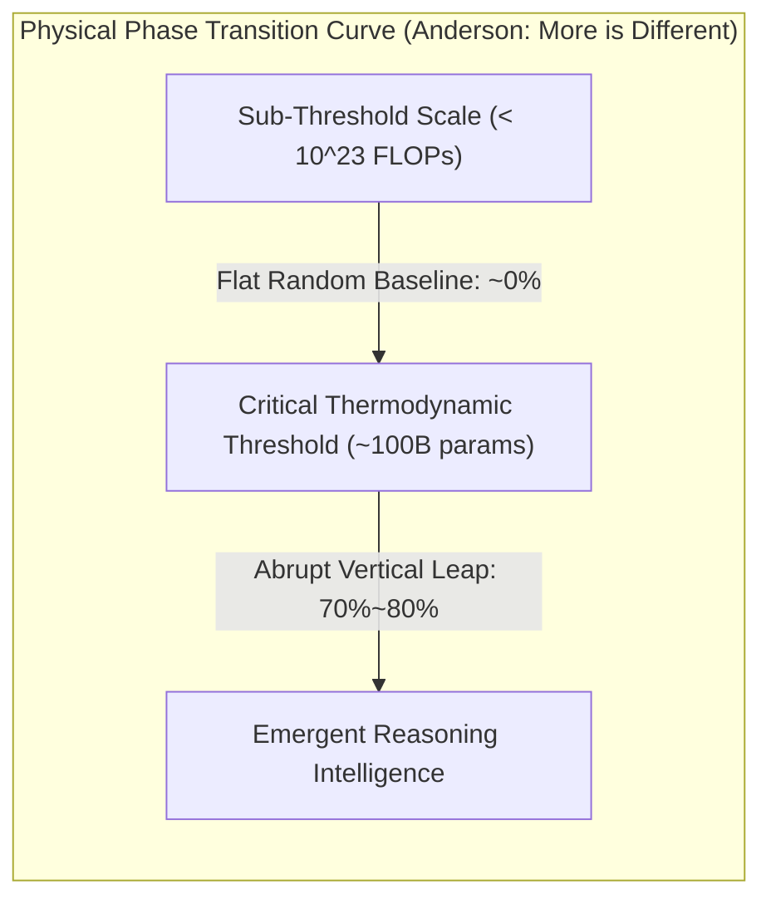

# Stanford CS329A (Ep 13): LLM Reasoning — Denny Zhou, Chain-of-Thought (CoT), Self-Consistency, and Emergent Abilities

For decades, artificial intelligence researchers operated under a deeply entrenched skepticism regarding connectionist neural networks:
> *"A deep language model is merely a statistical next-token auto-completer. When tasked with multi-step arithmetic, formal logic, or intricate causal reasoning, it produces superficial hallucinations because statistical sequence modeling is fundamentally incapable of genuine logical deduction."*

When presented with complex grade-school math problems, early frontier models immediately blurted out incorrect numbers, failing simple addition and subtraction across multi-hop word problems.

In this kickoff to **Part 4: Frontiers (Lectures 13 through 17)** of **Stanford CS329A: Self-Improving AI Agents**, we venture into the intellectual summit of artificial intelligence: **LLM Reasoning Foundations**. Guided by the pioneering research of **Dr. Denny Zhou** (Head of Reasoning at Google DeepMind), we investigate how the mysterious spark of cognitive reasoning ignites within large language models:
- **Chain of Thought CoT Prompting (NeurIPS 2022):** How decomposing tasks into natural language reasoning trajectories vaulted PaLM 540B's math accuracy from 18% to 57% without altering a single model weight.
- **Self-Consistency Decoding LLM (ICLR 2023):** Grounded in Tolstoy's Anna Karenina principle — *"Valid reasoning paths converge toward singular truth, while errors disperse into chaos"* — sampling diverse cognitive trajectories and voting out hallucinated noise.
- **Emergent Cognitive Abilities AI (2022):** Exploring physical phase transitions ("More is Different") and dissecting the historic debate: Is emergence a genuine physical breakthrough or a mathematical illusion created by non-linear metrics?

{/* truncate */}


---

## 1. The Myth of the "Stochastic Parrot"

Early critiques characterized language models as mindless "stochastic parrots" that merely re-assembled surface text patterns without internal conceptual models. When early models were prompted with standard Few-Shot Exemplars:

```text
[Standard Few-Shot Prompting (Failure Mode)]
-----------------------------------------------------------------------------------------
Q: Roger has 5 tennis balls. He buys 2 more cans of tennis balls. 
   Each can has 3 tennis balls. How many tennis balls does he have now?
A: The answer is 11.
-----------------------------------------------------------------------------------------
```

The model was forced to map the entire computational graph into a single next-token generation step. For multi-step problems requiring intermediate state tracking, this single-step bottleneck led to catastrophic mathematical failure.

By altering a single line in the demonstration prompt, Denny Zhou and Jason Wei completely altered the course of AI history:

```text
[Chain-of-Thought Prompting (Cognitive Ignition)]
-----------------------------------------------------------------------------------------
Q: Roger has 5 tennis balls. He buys 2 more cans of tennis balls. 
   Each can has 3 tennis balls. How many tennis balls does he have now?
A: Roger started with 5 tennis balls. 
   2 cans of 3 tennis balls each is 6 tennis balls. 
   5 + 6 = 11. 
   Therefore, the answer is 11.
-----------------------------------------------------------------------------------------
```

```
┌─────────────────────────────────────────────────────────────────────────┐
│                 The 3 Pillars of Cognitive Machine Reasoning            │
└────────────────────────────────────┬────────────────────────────────────┘
                                     │
       ┌─────────────────────────────┼─────────────────────────────┐
       ▼                             ▼                             ▼
┌──────────────────────────┐  ┌──────────────────────────┐  ┌──────────────────────────┐
│ Chain-of-Thought (CoT)   │  │ Self-Consistency Voting  │  │   Emergent Abilities     │
├──────────────────────────┤  ├──────────────────────────┤  ├──────────────────────────┤
│ • <Q, Steps, A> Triples  │  │ • Sample-and-Marginalize │  │ • Anderson's Phase Trans.│
│ • Zero Weight Updates    │  │ • Tolstoyan Convergence  │  │ • Threshold > 10^23 FLOPs│
│ • GSM8K: 18% -> 57% Jump │  │ • Majority Vote (T=0.7)  │  │ • The Mirage Hypothesis  │
│ • Natural Language Logic │  │ • Accuracy: 56% -> 74%   │  │ • Token Accuracy p^L     │
│ • Disproves Equation/Dots│  │ • Self-Uncertainty Metric│  │ • Macroscopic Reasoning  │
└──────────────────────────┘  └──────────────────────────┘  └──────────────────────────┘
```

---

## 2. Chain-of-Thought (CoT) Prompting (Wei, Zhou et al., NeurIPS 2022)

Published in late 2022, **《Chain-of-Thought Prompting Elicits Reasoning in Large Language Models》** fundamentally restructured inference-time computation.

Prior to CoT, the prevailing assumption was that unlocking higher reasoning required fine-tuning models on thousands of labeled examples or training complex external verifiers.
- On the primary elementary mathematical reasoning benchmark, **GSM8K**, the world-leading **PaLM 540B** achieved a meager **18% accuracy** with standard prompting.
- When researchers simply provided **8 chain-of-thought exemplars** containing natural language intermediate steps, accuracy vaulted to **57%**!
- This 39-percentage-point surge exceeded OpenAI’s prior state-of-the-art (33%) — which had required fine-tuning a 175B model on thousands of math problems and attaching an external verification reward model — **without updating a single model weight**.



### The Definitive Ablation Studies: What Powers CoT?
Skeptics questioned whether CoT simply provided more compute time (spending more tokens) or whether mathematical syntax was doing the heavy lifting. Denny Zhou’s team conducted rigorous ablation experiments:
1. **Equation-Only Ablation:** Providing mathematical formulas without natural language explanations (e.g., `5 + (2 * 3) = 11`) caused accuracy to collapse back down to **18%**.
2. **Variable Compute Simulation (Dots Only):** Replacing intermediate reasoning steps with filler dots (`......`) to grant the model extra feedforward compute cycles yielded **zero performance gain**.
3. **Reasoning after Answer:** Forcing the model to output the final number first, followed by an explanation, resulted in complete failure.
- **Conclusion:** The cognitive engine driving CoT is neither raw token count nor algebraic equations; it is **sequential natural language reasoning** — allowing the model's auto-regressive attention heads to condition each successive deduction on explicitly generated antecedent premises.

---

## 3. The Democracy of Diverse Thoughts: Self-Consistency (Wang, Zhou et al., ICLR 2023)

While CoT proved revolutionary, it was constrained by a brittle vulnerability inherent in **Greedy Decoding**:
> *"Greedy decoding greedily selects the single highest-probability token at each step. In a 10-step deduction, if the model makes a minor arithmetic slip at Step 3, Steps 4 through 10 will follow that flawed trajectory off a logical cliff."*

In 2023, Denny Zhou and Xuezhi Wang introduced **Self-Consistency Decoding LLM**, replacing greedy determinism with an elegant statistical aggregation framework.

### The Tolstoyan Convergence Principle
Leo Tolstoy famously opened *Anna Karenina* with:
> *"Happy families are all alike; every unhappy family is unhappy in its own way."*

Zhou observed that complex problem-solving exhibits an identical topological dynamic:
- A complex math or coding puzzle has many valid problem-solving avenues (algebraic substitution, geometric coordinates, recursive backward induction). Despite differing journeys, **all valid logical paths converge on the exact same singular truth ($Answer = 42$)**.
- Conversely, invalid deductions stumble over diverse missteps (sign errors, invalid square roots, off-by-one loops), **scattering chaotically across an infinite space of discordant erroneous answers (e.g., $-14, 108, 3.14$)**.

```text
                                [Problem Prompt]
                                       │
        ┌──────────────┬───────────────┼───────────────┬──────────────┐
        ▼              ▼               ▼               ▼              ▼
   [Path 1: Alg.] [Path 2: Geom.] [Path 3: Error] [Path 4: Ind.] [Path 5: Slip]
    ... steps ...  ... steps ...   ... steps ...   ... steps ...  ... steps ...
        │              │               │               │              │
        ▼              ▼               ▼               ▼              ▼
     Ans: 42        Ans: 42        Ans: -14         Ans: 42        Ans: 108
     (Vote!)        (Vote!)                         (Vote!)
        │              │                               │
        └──────────────┴───────────────┬───────────────┘
                                       ▼
                       [Majority Consensus Vote: 42]
                      (Selected as Final Ground Truth)
```

### The Sample-and-Marginalize Formulation
Self-Consistency samples $m$ diverse reasoning paths by introducing a slight temperature ($T = 0.7$) and selects the marginal mode of the final answer space:

```text
========================================================================================
Self-Consistency Majority Voting Formulation:
========================================================================================
Final Answer = argmax_a  Σ_{i=1}^m  1[ a_i = a ]

Where:
  • m   : Number of sampled reasoning paths (typically 5 to 40)
  • a_i : The discrete final answer parsed from the i-th reasoning trajectory
  • 1[·]: Indicator function returning 1 if the trajectory answer equals candidate a
========================================================================================
```

### Empirical Results & Intrinsic Uncertainty Calibration
- Applying Self-Consistency to PaLM 540B on GSM8K pushed accuracy from **56.5% to 74.4% (+17.9%p)**, setting a new world record.
- **Unsupervised Uncertainty Calibration:** The proportion of votes captured by the winning answer (e.g., 38 out of 40 votes vs. 12 out of 40 votes) correlates almost perfectly with empirical accuracy. This equips autonomous agents with an **intrinsic confidence metric** without requiring external discriminators or reward models.

---

## 4. "More is Different": Emergent Abilities & The Great Mirage Debate

Why did Chain-of-Thought and Self-Consistency work exclusively on giant models while failing completely on smaller 7B networks?

In 1977, Nobel laureate physicist Philip Anderson penned his seminal essay *"More is Different"*, arguing that complex systems cannot be understood by merely extrapolating the properties of microscopic constituents. One cannot understand liquid water turbulence by examining isolated hydrogen atoms.

In **《Emergent Abilities of Large Language Models》**, Jason Wei and Denny Zhou demonstrated that deep neural networks undergo identical macroscopic **Phase Transitions**:
> **"An emergent ability is an intellectual capability that is completely absent in smaller models (performing near random guess), but abruptly leaps into existence once computational scale crosses a sharp threshold (typically $10^{23}$ FLOPs or ~100B parameters)."**



### The Great Intellectual Debate: Is Emergence a Mirage?
In 2024, researchers from Stanford University (Schaeffer, Miranda, and Sanjeev Arora) published a provocative counter-thesis: **《Are Emergent Abilities of Large Language Models a Mirage?》**

#### The Counter-Argument: The Metric Distortion Hypothesis
Arora's team pointed out that common evaluation benchmarks employ discontinuous, non-linear **Exact Match (Accuracy)** metrics:
- Suppose a multi-step reasoning task requires generating $L$ tokens correctly, where each token has probability $p$ of being predicted.
- As model parameter scale grows, the underlying token-level prediction probability $p$ increases **smoothly and linearly** (e.g., $0.6 \to 0.7 \to 0.8 \to 0.9$).
- However, if the benchmark demands 100% exact match across all $L=5$ consecutive tokens, the reported metric scales as $p^L$:
  $$0.6^5 = 0.07 \; (7\%) \quad \longrightarrow \quad 0.9^5 = 0.59 \; (59\%)$$
- **The Mirage Claim:** The underlying capabilities grow smoothly and predictably; the apparent "sudden phase transition" is merely a mathematical artifact produced by non-linear, step-function evaluation metrics.

```text
========================================================================================
The Non-Linear Metric Mirage Equation:
========================================================================================
Accuracy_ExactMatch = ( p_token )^L

Where:
  • p_token : Underlying token prediction probability (grows linearly with scale)
  • L       : Sequence length of interdependent reasoning steps
  • As L increases, linear gains in p_token create an apparent step-function jump!
========================================================================================
```

#### Denny Zhou's Rebuttal & Intellectual Synthesis
Denny Zhou’s team responded with compelling empirical counter-evidence:
1. Tracking continuous **Cross-Entropy Loss** directly on challenging logical tasks shows that loss remains flat before abruptly dropping at specific scales — confirming genuine phase transitions.
2. Even under continuous semantic metrics (BLEU, ROUGE) or multiple-choice evaluations, sharp performance discontinuities persist across diverse reasoning tasks.

**The Balanced Synthesis:**
> *"While non-linear metrics can exaggerate the visual sharpness of emergence, human logical deduction is inherently sequential: premise B cannot hold unless premise A is mathematically valid. In complex causal graphs, marginal improvements in synaptic precision inevitably trigger macroscopic phase transitions in system-level intelligence."*

---

## 5. Comparative Matrix of Cognitive Reasoning Paradigms

```text
=============================================================================================================
Dimension             Direct Few-Shot Prompting     Chain-of-Thought (CoT)        Self-Consistency Voting
-------------------------------------------------------------------------------------------------------------
Reasoning Trajectory  None (Monolithic Q -> A)      Sequential Natural Language   Multiple Diverse Paths (m paths)
Decoding Strategy     Greedy argmax                 Greedy argmax                 Sample-and-Marginalize Mode
Computational Cost    1x Baseline FLOPs             ~3x Tokens per Query          ~15x to 30x Compute Overhead
GSM8K Pass Rate       18% (PaLM 540B)               57% (+39%p Gain)              74.4% (+17.4%p Further Gain)
Failure Mode          Immediate Hallucination       Single Slip Cascading Error   Consensus on Shared Flaws
Uncertainty Metric    None (Overconfident Softmax)  None                          Normalized Mode Vote Tally
Model Scale Threshold Universal across all sizes    Emerges at >100B / 10^23 FLOPsEmerges alongside CoT
=============================================================================================================
```

---

## 6. Deep Technical Q&A

### Q1: Can smaller open-source models (e.g., 7B or 8B) perform Chain-of-Thought reasoning today?
In 2022, base pre-trained models under 50B parameters failed completely with CoT, outputting rambling pseudo-logic.

However, modern algorithmic post-training has dramatically lowered the emergence threshold:
- Through **Knowledge Distillation**, lightweight models (such as `DeepSeek-R1-Distill-Qwen-7B` and `Llama-3.1-8B-Instruct`) are trained directly on millions of high-quality CoT traces synthesized by frontier models.
- Paired with **Reinforcement Learning with Verifiable Rewards (RLVR)**, today’s 7B and 8B models achieve over 85% on GSM8K — vastly outperforming the original PaLM 540B.
- The physical threshold of cognitive emergence is not an immutable constant; algorithmic purity continuously lowers the parameter barrier.

### Q2: How many trajectories should an engineer sample for Self-Consistency to balance compute cost and accuracy?
Empirical scaling curves show that accuracy climbs log-linearly with sample size $m$, but exhibits diminishing returns:
- Sampling **5 to 10 trajectories** captures over **80% of the total potential accuracy gain**.
- Increasing $m$ from 10 to 40 yields only marginal gains (1-2%) while quadrupling inference API costs.
- **Engineering Recommendation:** For real-world production agents, **$m = 5 \sim 8$ diverse samples at temperature $T = 0.7$** represents the optimal Pareto sweet spot between accuracy and operational cost.

---

## Summary & What's Next

Cognitive reasoning is not an elusive ghost in the machine requiring impossible neural architectures. Through **Chain-of-Thought (CoT)**, Denny Zhou proved that structured natural language reasoning activates latent logical capacities without fine-tuning. Through **Self-Consistency**, we observed how democratic consensus prunes catastrophic reasoning errors. Through the **Emergence Debate**, we explored the profound physical phase transitions governing machine intelligence.

However, natural language CoT reasoning remains probabilistic; it can still produce subtle, seductive hallucinations. What happens when we demand mathematical perfection where even a single logical leap is intolerable, such as the **International Mathematical Olympiad (IMO)**?

In **Lecture 14**, we investigate: **《AlphaProof & Mathematical Reasoning: Lean 4, Formal Verification, and IMO Gold-Medal Theorem Proving》**.

---

### Key Takeaways
- **Language is the Medium of Thought:** Decomposing problems into natural language intermediate steps (CoT) unlocked a 39% accuracy jump on PaLM 540B without training.
- **Truth Converges, Errors Diverge:** Self-Consistency majority voting harnesses mathematical topology to filter out stochastic errors, boosting accuracy to 74.4%.
- **Phase Transitions are Real:** As scaling crosses computational thresholds, macro-level cognitive deduction emerges, transforming statistical models into reasoning engines.