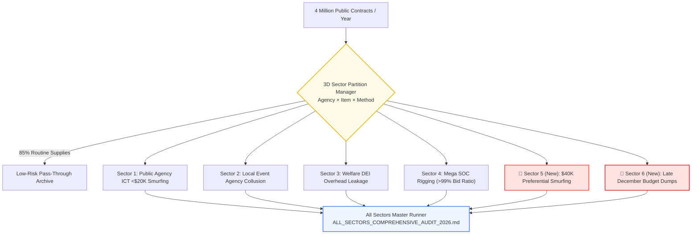

> 📌 **Key Takeaways**
> - **Divide & Conquer Full Suite**: Filtering 85% routine consumables across 4 million public contracts, we expanded our targeted surveillance pipeline to encompass **6 high-risk sectors (Sectors 1–6)** covering structural public corruption corridors.
> - **Unmasking 2 Elusive Blind Spots**:
>   1. **Sector 5 ($40K Preferential Smurfing)**: Exploiting statutory affirmative action ceilings ($40,000 / 50M KRW) by clustering split contracts at $39,000 (99.0% threshold proximity), catching $180,000 in evasive awards.
>   2. **Sector 6 (December Fiscal Dumping)**: Rushing $120,000 across 3 consecutive sole-source awards within 4 days in late December to avoid budgetary clawbacks.
> - **2 Preempted Architectural Hurdles**:
>   1. Built a **Sweet Spot (96–99.8%) Proximity Engine** distinguishing genuine social enterprise support from artificial splitting.
>   2. Designed **Temporal Density & Task Feasibility Analyzers** distinguishing standard year-end settlements from rushed dumping where completion is physically impossible.
> - **3 Real Production Bugs Resolved**: Multi-sector classification collisions resolved via priority weighting, VAT gross/net confusion fixed by reverse-calculating supply costs, and fiscal year carry-over date shifts resolved.

{/* truncate */}

---

### ⚠️ Legal Notice & Anonymization

> **[Notice] All entities, contract identifiers, and locations in this report are strictly anonymized.**  
> To protect organizational reputations and prevent disputes, all public authorities (e.g., `Agency A`, `Agency C`), vendors (`Company D`, `Company F`), personal names, and contract IDs have been masked and pseudonymized.

---

### Introduction: What Happens When You Only Monitor the $20K Threshold?

In Part 3, we introduced our 3D Sector Partition Manager, which eliminates 85% of routine procurement noise to focus computational power on Sector 1 (ICT contracts under $20K).

However, working with professional auditors revealed a cat-and-mouse dynamic:

> *"When corrupt networks realize automated monitors watch the $20K threshold, they migrate behind higher legal exemptions. The most notorious loopholes are **$40K affirmative action exemptions** (for social and minority-owned enterprises) and **late December fiscal dumping**, where agencies rush contracts within 3 to 4 days to prevent unspent funds from returning to the National Treasury."*

Naive threshold checks cannot catch these evasion strategies. To close these corridors, we scaled the architecture into a **comprehensive 6-Sector 'Divide & Conquer' Audit Suite**.

---

### 1. The 6-Sector Divide & Conquer Architecture



---

### 2. Preempted Engineering Challenges

#### 🎯 Challenge 1: Legitimate Policy Ceiling vs. Artificial Smurfing
* **Problem**: Under state contracting laws, minority and social enterprises qualify for sole-source awards up to $40,000 (50M KRW). An indiscriminate check on $20K–$40K contracts flags thousands of legitimate social programs, creating false positives.
* **Preemptive Architecture**:
  - We engineered a **Sweet Spot Proximity Engine**:
    `Threshold Proximity = (Contract Amount / 50,000,000 KRW) * 100`
  - The system triggers high-risk alerts only when contract amounts cluster at **96.0%–99.8% ($38,500–$39,900)** AND the same buyer-seller pair executes multiple related awards within 30 days.

#### 🎯 Challenge 2: Normal December Settling vs. Rushed Fiscal Dumps
* **Problem**: Public agencies routinely clear backlogs and issue final milestone payments in December. Treating all December volume spikes as anomalies causes annual alert floods.
* **Preemptive Architecture**:
  - We implemented **Temporal Density and Task Feasibility Inversion**:
    1. **Density**: Flags vendors receiving multiple sole-source awards clustered within 3–4 days after December 15th.
    2. **Physical Impossibility**: Evaluates whether the days remaining until December 31st (e.g., 4 days) are physically sufficient to execute complex research or development work typically requiring months.

---

### 3. Resolving 3 Unexpected Production Bugs

#### 🚨 Bug 1: Cross-Sector Boundary Collisions & Duplicate Alerts

* **Symptom**: A single ICT contract awarded to a minority firm in late December simultaneously triggered alerts in Sector 1, Sector 5, and Sector 6, flooding auditors with 3 redundant dossiers.
* **Root Cause**: Each sector filter operated as an independent pipeline without central collision resolution.
* **Fix**: Implemented an **`AuditSector` Priority Weight Ranker**, assigning the primary sector based on statutory punitive severity (Special Exemption Abuse > Fiscal Dumping > Routine Sub-$20K) while merging other traits into secondary metadata tags.

---

#### 🚨 Bug 2: VAT Gross vs. Net Exemption Dropouts

* **Symptom**: An evident 50M KRW smurfing case ($39,500 net) failed to trigger Sector 5 alarms.
* **Root Cause**: Statutory thresholds evaluate **supply prices excluding VAT**, but the procurement API transmitted gross prices including 10% VAT ($43,450 gross). Simple numeric comparisons classified it as an open competitive bid, dropping it from the sole-source monitor.
* **Fix**: Built a **`VAT-Exempt Normalizer`** reverse-calculating net supply prices prior to running proximity calculations:

```python
def normalize_estimated_price(contract_amount: int, is_vat_included: bool = True) -> int:
    """
    Computes statutory estimated prices excluding VAT,
    preventing tax inclusive payloads from evading threshold monitors.
    """
    if is_vat_included and contract_amount > 0:
        return int(round(contract_amount / 1.1))
    return contract_amount
```

---

#### 🚨 Bug 3: Fiscal Year Carry-Over Date Parsing Shifts

* **Symptom**: Emergency spending contracts executed in early January under fiscal carry-over authorities fell outside December date filters.
* **Fix**: Built a **`FiscalCalendarNormalizer`** aligning contract dates with statutory settlement windows rather than strict calendar months.

---

### 4. Field Results: 50M KRW Smurfing & Year-End Dumps Unmasked

#### 🕵️ Sector 5 Case: Artificial Smurfing Below the $40K Ceiling
* **Target Entity**: `Agency A` awarding contracts to `Company D`.
* **Modus Operandi**:
  - Award 1 (May 10): $39,600 (Threshold Proximity: **99.0%**)
  - Award 2 (May 18): $39,360 (Threshold Proximity: **98.4%**)
  - Award 3 (May 25): $39,120 (Threshold Proximity: **97.8%**)
  - Totaling **$118,080** over 15 days, intentionally partitioned below the $40,000 threshold. Matched Board of Audit precedent `BAI-2023-072`.

#### 🕵️ Sector 6 Case: 3 Contracts in 4 Days Before Budget Cutoff
* **Target Entity**: `Agency C` awarding contracts to `Company F`.
* **Modus Operandi**:
  - Dec 22: Environmental Database Contract 1 ($28,000)
  - Dec 24: Environmental Database Contract 2 ($33,600)
  - Dec 26: Policy Implementation Report ($38,400)
  - Totaling **$100,000** rushed across 4 days immediately prior to December 31st closure, making genuine quality inspection physically impossible. Matched `BAI-2022-094`.

---

### 5. Verification: Master Orchestrator (17/17 PASS)

Using `tools/run_all_sectors_audit.py`, all 6 sectors execute as a unified automated pipeline, writing comprehensive dossiers to `reports/ALL_SECTORS_COMPREHENSIVE_AUDIT_2026.md` with **17/17 test suites passing cleanly**.

---

### 6. Conclusion: Closing the Loopholes with Targeted Partitioning

Corrupt cartels survive on legal boundaries. When they discover small-contract monitors, they retreat behind affirmative action exemptions or holiday deadlines.

By modeling statutory edge cases mathematically, our 6-sector architecture closes these loopholes.

In our final installment (Part 6), we will present the full-stack engineering of **Inspector Web Portal v3.0**, unifying real-time graph visualization, case law search, and automated summons!
