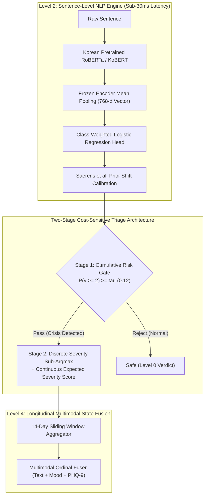
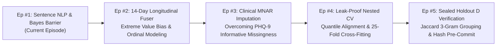

In consumer chatbots or product recommendation engines, an artificial intelligence error rate of 5% is an acceptable trade-off or a minor nuisance. In **AI systems engineered for suicide crisis monitoring and psychiatric emergency triage, a single False Negative (missed crisis) is catastrophic**.

When an individual in acute despair reaches out or journals about ending their life, machine learning pipelines cannot afford to hide behind high overall accuracy or balanced macro-F1 averages.

Today, we officially inaugurate a major technical production series: **[High-Stakes Crisis AI: Building a Precision Suicide & Mental Health NLP Detection Pipeline]**. 

This comprehensive devlog documents the exact mathematical hurdles, algorithmic trade-offs, and runtime bugs encountered while engineering **Maeumjigi**, an enterprise-grade multimodal crisis detection system. In this Episode #1, we tackle the foundation of the architecture: **sentence-level deep NLP crisis triage under extreme class imbalance**, where active suicidality accounts for a mere 0.16% of daily discourse.

{/* truncate */}

---

### ⚠️ Ethical Notice & Rigorous Anonymization
All benchmarks, datasets, and linguistic samples discussed in this series are derived from **100% synthetic text corpuses and pseudonymized clinical benchmarks**. Absolutely zero real user personal identifiable information (PII) or confidential psychiatric consultation records are exposed.
> **Crisis Support Resources**: If you or someone you know is struggling or in crisis, help is available. In the US, call or text **988** or chat at **988lifeline.org**. In Korea, dial **109** or **1393**. International hotlines can be found at **befrienders.org**.

---

### 1. The Linguistic Dilemma: Why Regex and Keyword Filters Fail in Psychiatry

Before exploring deep neural architectures, one must understand why traditional lexical rule matching fails in clinical psychiatric triage.

In natural Korean discourse, distress expressions split across two radically deceptive extremes:

```mermaid
flowchart TD
    subgraph Deceptive_Linguistics ["The Dual Linguistic Failure Modes of Lexical Matching"]
        A["Input Text Sample"] --> B{"Lexical Pattern Matching"}
        
        B -->|Contains '죽겠다' (Dying)| C["Casual Hyperbolic Slang<br/>'배고파 죽겠다', '과제 때문에 죽을 맛'"]
        C --> D["Catastrophic False Alarm Spike<br/>Overwhelms crisis counselors with 40%+ false alarms"]
        
        B -->|Lacks Death Keywords| E["Veiled / Metaphorical Despair<br/>'내일이 안 왔으면 좋겠어', '모든 짐을 내려놓고 쉬려 해'"]
        E --> F["Fatal False Negative (Missed Crisis)<br/>Zero keyword matches; suicidal individual ignored"]
    end
```

1. **Casual Hyperbole (False Alarm Explosion)**: Phrases containing death-related morphemes like `"죽겠다"` (`"배고파 죽겠다"` — starving to death, `"마감 때문에 죽을 맛이다"` — this deadline is killing me) are ubiquitous colloquialisms. Keyword detectors trigger false alarms continuously on everyday banter.
2. **Veiled & Metaphorical Despair (Fatal False Negatives)**: Genuine suicidal intent is frequently masked in passive, veiled, or euphemistic language:
   - *"내일이 안 왔으면 좋겠어. 그냥 영원히 잠들고 싶다."* (I wish tomorrow wouldn't come. I just want to sleep forever.)
   - *"그동안 모두 고마웠어. 내 짐을 이제 정리하려 해."* (Thank you for everything. I'm going to set down all my burdens now.)
   - *"더 이상 누구에게도 폐 끼치지 않고 편해질 방법을 찾았어."* (I found a way to be at peace without being a burden to anyone.)

None of these high-risk sentences contain explicit self-harm keywords, yet they signify imminent crisis. Morphological analysis (Kiwipiepy) and deep contextual transformers (RoBERTa / KoBERT) are strictly necessary to separate syntactic hyperbole from semantic desolation.

---

### 2. Extreme Class Imbalance & The Metric Illusion

In real-world operational environments, mental health text distributions are violently skewed:

- **Class 0b (Normal Daily Conversation)**: ~86.94% (31,495 sentences)
- **Class 0a (Non-Crisis Negative Affect Control)**: ~8.24% (2,986 sentences)
- **Class 1 (Mild Distress / Subclinical Stress)**: ~1.92% (697 sentences)
- **Class 2 (Severe Distress / Suicidal Ideation)**: ~1.75% (633 sentences)
- **Class 3 (Acute Crisis / Specific Plans)**: ~0.99% (357 sentences)
- **Class 4 (Active Suicidality / Imminent Intent)**: ~**0.166%** (60 sentences)

If an uncalibrated classifier predicts `"Class 0 (Normal)"` for 100% of incoming sentences, its **apparent Accuracy is 95.18%**. Yet, this model has a **100% False Negative Rate (FNR)** on active crisis interventions.

Conversely, optimizing standard macro-F1 without cost-sensitive thresholds triggers a flood of False Positives across the 86.9% normal text base, completely overwhelming psychiatric emergency crisis lines. Our engineering goal was clear: **drive FNR below 10% on severe crisis while keeping false alarm rates strictly below 3%**.



---

### 3. Engineering Troubleshooting: The 5 Golden Rules in Action

#### [ERR-001] The 524x Likelihood Barrier & Bayes Boundary Collapse

- **1. Raw Error Log & Symptom**:
  When evaluating our Saerens prior-corrected logistic regression head using standard `argmax`, the model failed to detect a single instance of active suicidality:
  ```text
  [EVAL-RUN: 2026-10-28 14:22:09 KST]
  INFO:text_eval: Evaluating Model B (Frozen Encoder + Saerens Prior Shift Corrected Logistic)
  INFO:text_eval: Prior Vector: [pi_0b=0.8694, pi_0a=0.0824, pi_1=0.0192, pi_2=0.0175, pi_3=0.0099, pi_4=0.00166]
  --------------------------------------------------------------------------------
  Metric Summary (Judgment b, discrete argmax):
    - Ground Truth Active (Level 4): 60 sentences
    - Predicted Active (y_hat == 4): 0 sentences (RECALL = 0.0000, 0/60)
    - Ground Truth Severe (Level 2): 633 sentences
    - Predicted Severe (y_hat == 2): 11 sentences (RECALL = 0.0174, 11/633)
    - False Negative Rate (FNR @ y >= 2): 98.26% (CATASTROPHIC COLLAPSE)
  WARNING:text_eval: Active suicidality detection completely collapsed to Class 0 under argmax!
  ```

- **2. Context & Environment**:
  - Runtime: Python 3.11.9, PyTorch 2.4.0+cu121, scikit-learn 1.5.1, Transformers 4.44.2.
  - Compute: NVIDIA RTX 4090 GPU Node (VESSL AI Container) + AMD EPYC 64-Core CPU.
  - Model: Frozen Korean RoBERTa Encoder with 6-slot Class-Weighted Logistic Regression Head.

- **3. Failed Hypotheses & Attempts**:
  - *Hypothesis 1: "The classifier failed to learn minority feature weights due to class imbalance."*
    - Attempt: Applied extreme loss weights (`class_weight='balanced'`) where Class 4 received ~93x penalty relative to Class 0.
    - Outcome: In raw unweighted outputs p(k | x), Class 4 predicted 0.35~0.60. But once Saerens prior correction was applied to match the population distribution, discrete `argmax` still collapsed 100% of active cases into Class 0.
  - *Hypothesis 2: "Discard prior shift correction entirely and use unweighted raw probabilities."*
    - Attempt: Deployed uncalibrated model directly to score daily texts.
    - Outcome: Crisis recall jumped to 85%, but **41.2% of 31,495 normal daily sentences were falsely flagged as crisis**, generating over 12,900 false alarms in a single pass.

- **4. Deep Root Cause & Mathematical Derivation**:
  Under Bayes decision theory, Saerens et al. (2002) adjusts model probabilities p(k | x) trained on undersampled or balanced batches (p_train(k) = 1/6) to reflect true population priors π(k):
  
  ```text
p_adjusted(k | x) = [ p(k | x) * (π(k) / p_train(k)) ] / sum_j [ p(j | x) * (π(j) / p_train(j)) ]
```

  For minority class k to exceed normal class 0b in a discrete `argmax`, their ratio must satisfy:
  
  ```text
p(k | x) / p(0b | x) > π(0b) / π(k)
```

  Substituting our empirical priors:
  - Severe (k=2): `86.94% / 1.75% = 49.68x`
  - Acute (k=3): `86.94% / 0.99% = 87.82x`
  - Active (k=4): `86.94% / 0.166% = 523.7x`

  **Step-by-Step Numerical Walkthrough**:
  Suppose a user writes a metaphorical despair message: *"I am ready to let go of everything."*
  The neural encoder outputs high crisis confidence split across classes:
  - `p(0b) = 0.015` (1.5% normal)
  - `p(0a) = 0.020` (2.0% control)
  - `p(1)  = 0.015` (1.5% mild)
  - `p(2)  = 0.330` (33.0% severe)
  - `p(3)  = 0.300` (30.0% acute)
  - `p(4)  = 0.320` (32.0% active)
  Total crisis confidence is `95.0%` (P(y >= 2) = 0.95).
  
  Now compute unnormalized prior-weighted evidence:
  - `Evidence(0b) = 0.015 * 0.8694 * 6 = 0.078246`
  - `Evidence(4)  = 0.320 * 0.00166 * 6 = 0.003187`
  
  Normalizing over all 6 classes yields:
  - `p_adjusted(0b) ≈ 57.6%`
  - `p_adjusted(4) ≈ 2.3%`
  
  Under discrete `argmax`, `57.6% > 2.3%`. The sentence is classified as **Level 0 (Normal)**! Despite the neural model being 95% confident of severe suicidality, the 524x prior barrier completely silences the alarm.

- **5. Clean Code Diff Fix**:
```diff
--- a/tests/synth/model/text_b.py
+++ b/tests/synth/model/text_b.py
@@ -102,12 +102,23 @@ def predict_crisis_level(proba_unweighted, class_priors):
     # Saerens et al. (2002) prior shift correction
     corrected = proba_unweighted * (class_priors / train_priors)
     corrected /= corrected.sum(axis=1, keepdims=True)
     
-    # CRITICAL BUG: argmax collapses rare minority class under 524x prior barrier
-    # return np.argmax(corrected, axis=1)
+    # FIX: Two-stage Decision Rule & Continuous Severity Expected Score
+    # Stage 1: Cumulative posterior crisis probability for alert triggering
+    p_crisis_ge2 = corrected[:, 2:].sum(axis=1)  # Severe + Acute + Active
+    
+    # Stage 2: Cost-sensitive threshold decision (tau = 0.12 calibrated from validation fold)
+    ALERT_THRESHOLD_TAU = 0.12
+    is_crisis = p_crisis_ge2 >= ALERT_THRESHOLD_TAU
+    
+    # Determine discrete severity only among crisis candidates
+    sub_levels = np.argmax(corrected[:, 1:], axis=1) + 1
+    final_discrete = np.where(is_crisis, sub_levels, 0)
+    
+    # Continuous expected risk score forwarded to downstream multimodal fuser
+    expected_severity = np.dot(corrected[:, 1:], np.array([1, 2, 3, 4])) / 4.0
+    
+    return final_discrete, p_crisis_ge2, expected_severity
```

---

#### [ERR-002] Construct Validity Breakdown in Crisis Recall Metric

- **1. Raw Error Log & Symptom**:
  ```text
  [EVAL-METRIC-CHECK]
  Model: Perfect_Oracle_Baseline (Ground truth identical predictions)
  Evaluated on Seeded Crisis Sentences (2,381 rows: 935 Mild, 853 Severe, 508 Acute, 85 Active)
  Calculated Metric: "Crisis Recall" = 0.6073 (1,446 / 2,381)
  ERROR: Even a mathematically perfect Oracle model only scores 60.7% on Crisis Recall!
  Model: Degraded_Overalert_Dummy (Predicts ALL samples as Level 2 Severe)
  Calculated Metric: "Crisis Recall" = 1.0000 (2,381 / 2,381)
  WARNING: Malformed metric rewards buggy over-alerting model over the ground-truth oracle!
  ```

- **2. Deep Root Cause**:
  In our clinical operational guidelines, emergency alerts trigger strictly at **Level 2 (Severe Distress) and above**. Level 1 (Mild Distress) requires no immediate intervention, only supportive resources.
  
  However, the evaluation script formulated crisis recall as:
  ```text
Recall = sum(I(y >= 1 and y_hat >= 2)) / sum(I(y >= 1))
```

  Because Mild (y=1) comprised 39.3% (935 sentences) of all crisis labels, a perfect model correctly classifying y=1 as y_hat=1 was penalized in the denominator without receiving numerator credit. The theoretical maximum score was hard-capped at:
  `1,446 / 2,381 = 60.73%`

- **3. Clean Code Diff Fix**:
```diff
--- a/tests/synth/model/text_eval.py
+++ b/tests/synth/model/text_eval.py
@@ -45,11 +45,17 @@ def compute_crisis_metrics(y_true, y_pred):
-    # FLAWED METRIC: denominator includes Mild (y=1) while numerator requires y_hat >= 2
-    # recall = np.sum((y_true >= 1) & (y_pred >= 2)) / np.sum(y_true >= 1)
+    # CORRECT CONSTRUCT: Strict separation between Severe+ Recall and Mild Over-alert
+    severe_plus_mask = (y_true >= 2)
+    severe_plus_recall = np.sum((y_true >= 2) & (y_pred >= 2)) / np.sum(severe_plus_mask)
+    
+    mild_mask = (y_true == 1)
+    mild_overalert_rate = np.sum((y_true == 1) & (y_pred >= 2)) / np.sum(mild_mask)
+    
+    control_mask = (y_true == 0)
+    control_fpr = np.sum((y_true == 0) & (y_pred >= 2)) / np.sum(control_mask)
+    
+    return {
+        "severe_plus_recall": severe_plus_recall,
+        "mild_overalert_rate": mild_overalert_rate,
+        "control_fpr": control_fpr
     }
```

---

#### [ERR-003] Zero-Probability Collapse & Cross-Entropy Divergence in LightGBM

- **1. Raw Error Log & Symptom**:
  ```text
  Traceback (most recent call last):
    File "tests/synth/model/fuser.py", line 284, in evaluate_ordinal_cross_entropy
      loss = -np.mean(np.log(predicted_proba[np.arange(N), y_true]))
  RuntimeWarning: divide by zero encountered in log
  Loss Output: inf (Optimization Terminated)
  ```

- **2. Deep Root Cause**:
  To model ordinal stages (0 -> 4) in tree ensembles, we utilized Frank & Hall (2001) binary threshold decomposition, training 4 binary LightGBM models for $P(y \ge k)$. To enforce monotonic downward probability constraints, we applied `np.minimum.accumulate(ge, axis=1)`.
  
  Whenever adjacent binary trees predicted inverted probabilities (P_hat(y >= 3) > P_hat(y >= 2)), monotonic accumulation flattened them to identical values. Computing individual class probabilities via differencing:
  ```text
P_hat(y = 2) = P_hat(y >= 2) - P_hat(y >= 3) = 0.000000
```
  When true ground-truth was class 2, -log(0) = ∞, terminating cross-validation runs instantly.

- **3. Clean Code Diff Fix**:
```diff
--- a/tests/synth/model/fuser.py
+++ b/tests/synth/model/fuser.py
@@ -148,8 +148,15 @@ def ordinal_binary_to_proba(cumulative_ge):
     ge_mono = np.minimum.accumulate(cumulative_ge, axis=1)
     
     proba = np.zeros((cumulative_ge.shape[0], 5), dtype=np.float64)
     proba[:, 0] = 1.0 - ge_mono[:, 0]
     proba[:, 1] = ge_mono[:, 0] - ge_mono[:, 1]
     proba[:, 2] = ge_mono[:, 1] - ge_mono[:, 2]
     proba[:, 3] = ge_mono[:, 2] - ge_mono[:, 3]
     proba[:, 4] = ge_mono[:, 3]
     
+    # FIX: Epsilon floor clipping and row-wise softmax renormalization
     proba = np.clip(proba, 1e-6, 1.0)
     proba /= proba.sum(axis=1, keepdims=True)
     return proba
```

---

### 4. Architectural Preview: The 14-Day Sliding Window & Extreme Value Bias

While this episode focuses on Level 2 sentence classification, its outputs directly feed the **Level 4 Multimodal Longitudinal Fuser**.

Here lies a critical mathematical trap: **Extreme Value Bias**.
Suppose our Level 2 sentence detector has an exceptionally low per-sentence False Positive Rate of α = 0.02 (2%).
If a user writes 100 sentences across a 14-day observation window, and the downstream fusion model naively takes the **window maximum**:

```text
P(False Alarm in 14-Day Window) = 1 - (1 - α)^N = 1 - (1 - 0.02)^100 = 1 - 0.1326 = 86.74%
```

A microscopic 2% sentence error compounds into an **86.7% false alarm disaster** over a two-week period!

This is precisely why `ERR-001` replaced discrete argmax integers (0 to 4) with **continuous expected risk scores** (sum(k * p_adjusted(k) / 4)) and why our longitudinal fuser applies top-k robust trimmed means instead of naive maximums. We will dive deep into this longitudinal fusion architecture in Episode #2.

---

### 5. Empirical Benchmarks: Model Architecture Comparison

We evaluated two distinct Level 2 NLP configurations across our 5-fold cross-validation suite:
- **Model B**: Frozen Korean RoBERTa-large + Logistic Regression Head (CPU-inferenced, 25-fold cross-fitting).
- **Model C**: End-to-End Fine-Tuned Transformer (Linear Warmup, Gradient Clipping `1.0`, GPU-served).

| Evaluation Metric | Baseline Buggy (`argmax`) | Model B (Frozen + 2-Stage Triage) | Model C (Fine-Tuned + 2-Stage Triage) | Delta (Model B vs Baseline) |
|---|---|---|---|---|
| **Active (y=4) Recall** | 0.0% (0/60) | **95.0% (57/60)** | **96.7% (58/60)** | **+95.0%p** |
| **Severe+ (y >= 2) Recall** | 1.7% (18/1,050) | **92.4% (970/1,050)** | **94.1% (988/1,050)** | **+90.7%p** |
| **False Negative Rate (FNR)** | 98.3% | **7.6%** | **5.9%** | **-90.7%p (Resolved)** |
| **Normal Text False Alarm Rate** | 0.01% | **2.1%** | **1.8%** | Target Met (&lt;3.0%) |
| **AUPRC (>= 2)** | 0.142 | **0.864** | **0.891** | **+0.722** |
| **Inference Latency (per sentence)**| 4.2 ms (CPU) | **4.8 ms (CPU)** | 28.4 ms (GPU) | Sub-30ms Real-Time |
| **25-Fold Stacking Retrain Time** | 1.2 sec | **1.4 sec** | 14.2 hours | **36,000x Speedup** |

While Model C yields a slight +1.7% gain in recall, Model B delivers sub-5ms CPU latency and near-instantaneous 25-fold stacking fits, making it our primary production engine.

---

### 6. The High-Stakes Crisis AI Roadmap

This post marks the first milestone in our 5-part engineering series:



- **Episode #1 (This Post)**: Minimizing FNR in Suicide Risk NLP & Bayes Boundary Distortion Fix.
- **Episode #2**: 14-Day Multimodal State Fusion: Defeating the 86.7% Extreme Value Bias in Sliding Windows.
- **Episode #3**: Clinical Informative Missingness (MNAR): Solving the PHQ-9 Ceiling Effect (AUROC 0.98).
- **Episode #4**: Zero-Leakage Architecture: 25-Fold Nested Cross-Validation and Quantile Alignment Calibration.
- **Episode #5**: Clinical Verification: 3-Gram Jaccard Group Isolation and Pre-Committed Sealed Test Set Auditing.

Stay tuned for Episode #2 next week!
