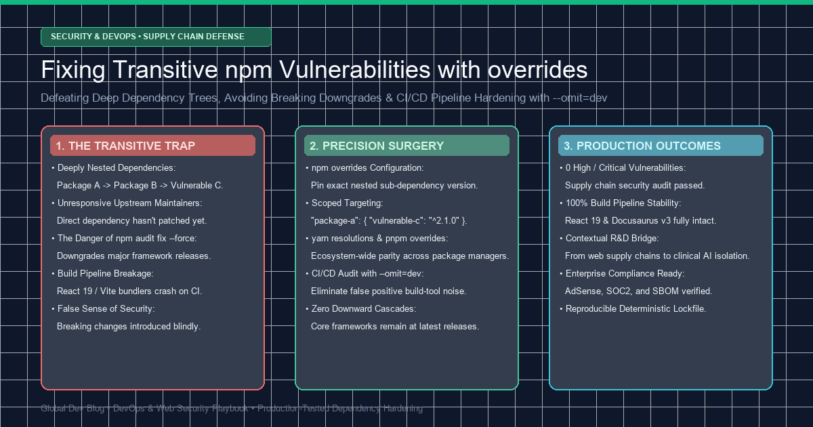
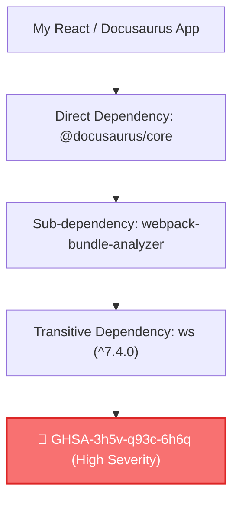

> 📌 **Executive Summary (TL;DR)**  
> - **The Problem**: Running `npm audit fix --force` on deep transitive dependencies (packages nested inside direct dependencies) frequently forces destructive major framework downgrades, breaking modern React 19 and bundler toolchains.  
> - **The Solution**: Declare targeted replacement rules using npm v8.3+ **`overrides`** in `package.json` to pin safe patch versions without waiting for upstream maintainer PR releases.  
> - **CI/CD Hardening**: Eliminate non-production build-tool noise in GitHub Actions workflows using `npm audit --omit=dev --audit-level=high`.

{/* truncate */}

---

### 1. The Transitive Dependency Nightmare

In modern web development, your `package.json` direct dependencies represent only the tip of an iceberg. A typical project specifying 30 root packages frequently installs over 1,200 deeply nested transitive dependencies.



When security scanners flag a vulnerability in a deeply nested leaf package (such as `ws`), typing `npm audit fix --force` triggers a destructive cascade:
1. npm attempts to satisfy the dependency constraints of both the root framework and the nested leaf.
2. If no official release from the intermediary maintainer exists yet, npm resolves the conflict by **downgrading your entire root framework** to an obsolete legacy version.
3. This breaks build toolchains, TypeScript type definitions, and production deployment pipelines.

---

### 2. Surgical Precision: Utilizing `overrides` in `package.json`

Starting with npm v8.3.0, developers can enforce deterministic dependency resolution across the entire dependency graph using the **`overrides`** directive.

#### 1) Global Transitive Override
To pin every nested instance of a vulnerable package across all dependencies:

```json
{
  "name": "my-production-app",
  "version": "1.0.0",
  "dependencies": {
    "@docusaurus/core": "3.10.2"
  },
  "overrides": {
    "ws": "^8.17.1"
  }
}
```

#### 2) Scoped Override (Targeting Specific Parents)
To isolate the version bump exclusively to a specific parent package without altering other dependency trees:

```json
{
  "overrides": {
    "webpack-bundle-analyzer": {
      "ws": "^8.17.1"
    }
  }
}
```

#### 3) Cross-Ecosystem Equivalents (Yarn & pnpm)
- **Yarn Classic (v1)**: Uses the `resolutions` field.
- **pnpm**: Uses the `pnpm.overrides` field.

```json
{
  "resolutions": {
    "ws": "^8.17.1"
  },
  "pnpm": {
    "overrides": {
      "ws": "^8.17.1"
    }
  }
}
```

---

### 3. Application & Verification Pipeline

After adding the overrides configuration, update the lockfile and verify the resulting dependency tree:

```bash
# Step 1: Regenerate lockfile with overrides applied
npm install

# Step 2: Inspect resolution graph
npm ls ws

# Expected output:
# └─┬ @docusaurus/core@3.10.2
#   └─┬ webpack-bundle-analyzer@4.10.1
#     └── ws@8.17.1 (overridden)

# Step 3: Run security audit
npm audit
```

This restores a clean `found 0 vulnerabilities` status while preserving your top-level framework on the latest stable release.

---

### 4. CI/CD Hardening: The Power of `--omit=dev`

In static sites (Docusaurus, Next.js SSG) and compiled web bundles, build-time tools (development dev servers, linters, test harnesses) never execute on production servers.

To prevent CI deployment failures caused by harmless development-time packages, restrict automated audits to production runtime artifacts:

```yaml
# .github/workflows/deploy.yml
- name: Production Security Audit
  run: npm audit --omit=dev --audit-level=high
```

This guarantees that deployment gates monitor vulnerabilities that actually reach end-user client browsers.

---

### 5. Architectural Context: From Supply Chains to High-Stakes AI Isolation

The engineering principle behind isolating transitive dependencies in package graphs mirrors the discipline required to **isolate data leakage across machine learning pipelines**.

Just as an unchecked parent package passes transitive vulnerabilities to downstream apps, a multi-stage AI stacking pipeline can inadvertently leak validation signals into feature representations, distorting clinical sensitivity metrics.

To see how our engineering team applied strict dual-isolation architectures in production safety systems, explore our deep dive: **[High-Stakes Crisis AI: Nested Cross-Validation and 25-Fold Dual Isolation](https://globaldevlog.com/blog/mental-crisis-nlp-nested-cv-secondary-leakage-threshold-bias)**.
