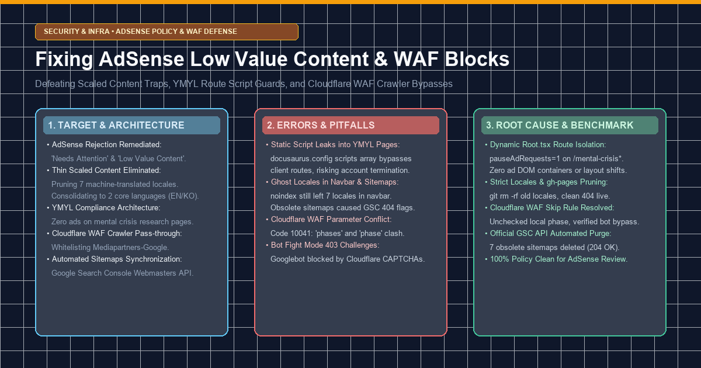
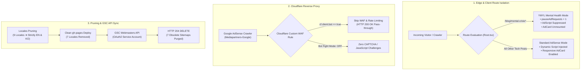

> 💡 **Executive Summary (TL;DR)**
> - **The Problem**: Receiving Google AdSense rejection notices citing **'Needs Attention: Low Value Content'** (가치가 별로 없는 콘텐츠) and intermittent **'Site Down or Unavailable'** (사이트 다운 또는 사용할 수 없음) despite hosting over 70 original, deep engineering articles.
> - **3 Deep Root Causes Identified**:
>   1. *Thin/Scaled Content Penalty*: 7 automated machine-translated locales (`de`, `es`, `fr`, `ja`, `pt-BR`, `zh-Hans`, `zh-Hant`) ballooned the crawl surface to over 650 URLs, diluting domain authority with thin programmatic translations.
>   2. *YMYL Sensitive Content Policy Risk*: AdSense script declared statically in `docusaurus.config.ts` leaked ad tags and slots onto sensitive mental health crisis research posts (`/blog/mental-crisis*`).
>   3. *Cloudflare WAF Crawler Interception*: Cloudflare's Bot Fight Mode and conflicting skip rules blocked Google AdSense crawlers (`Mediapartners-Google`) with HTTP 403 Forbidden challenges, triggering false "site unavailable" rejections.
> - **The Production Fix**:
>   1. *Dynamic Contextual Script Injection*: Built a client-side route guard in `Root.tsx` that enforces `window['adsbygoogle'] = { pauseAdRequests: 1 }` and strips ad containers on YMYL paths.
>   2. *Strict Locale Consolidation & GSC API Purge*: Pruned the build down to 2 author-curated core languages (`en`, `ko`) and programmatically purged 7 obsolete sitemaps from Google Search Console via official Webmasters REST API.
>   3. *Cloudflare WAF Rule Optimization*: Resolved Code 10041 parameter conflict, disabled indiscriminate Bot Fight Mode, and configured verified bot pass-throughs.

{/* truncate */}

---

### 1. Target & Architecture (목표한 것)

#### 1) The Engineering Objective
Modern developer portals frequently combine technical deep dives, proprietary R&D series, and open-source documentation. Monetizing such sites through Google AdSense requires navigating rigorous automated site reviews. 

During our initial AdSense evaluation, the platform flagged our domain with:
1. **"Needs attention" (주의 필요)**
2. **"Low value content" (가치가 별로 없는 콘텐츠 / Scaled Content Abuse)**
3. **"Site down or unavailable" (사이트가 다운되었거나 사용할 수 없음)**

Our objective was to construct a robust, policy-compliant infrastructure that:
1. Completely isolates sensitive **YMYL (Your Money or Your Life)** crisis intervention research from commercial advertising.
2. Eliminates automated machine translation bloat, consolidating the site into 2 author-verified core languages (`en`, `ko`).
3. Ensures zero crawler friction across **Cloudflare WAF** reverse proxies for verified search and ad indexing bots (`Mediapartners-Google`, `Googlebot`).
4. Programmatically reconciles Google Search Console (GSC) sitemaps using official Google APIs to eliminate obsolete 404 crawl anomalies.



---

### 2. Real Errors & Pitfalls Encountered (마주친 오류들)

Implementing full AdSense compliance revealed several non-trivial frontend and infrastructure pitfalls:

#### Error 1: Static Script Injection Leaking Ads onto Sensitive YMYL Pages
Initially, our AdSense integration declared the tracking script directly in `docusaurus.config.ts`:

```typescript
// docusaurus.config.ts (Initial Naive Setup)
export default {
  scripts: [
    {
      src: 'https://pagead2.googlesyndication.com/pagead/js/adsbygoogle.js?client=ca-pub-XXXXXXXXXXXXXXXX',
      async: true,
      crossorigin: 'anonymous',
    },
  ],
};
```
- **The Pitfall**: Docusaurus compiles the `scripts` array directly into the static `<head>` of every generated HTML file during build time. Even though our React article template conditionally hid the visual `<AdCard />` component on mental health pages, the underlying Google AdSense engine initialized globally upon page load.
- As a result, Google's policy crawlers detected commercial ad initialization scripts running on suicide risk detection research pages (`/blog/mental-crisis*`), putting the entire domain at risk of immediate account termination for sensitive content policy violations.

#### Error 2: Ghost Locales Persisting in Navbar and Sitemaps After Folder Deletion
To combat "Low Value Content" penalties caused by machine-translated pages, we initially injected `<meta name="robots" content="noindex">` tags into 6 non-core locales while keeping them in `docusaurus.config.ts`.
- **The Pitfall**: Keeping `locales: ['en', 'ko', 'de', 'ja', 'es', 'fr', 'pt-BR', 'zh-Hans', 'zh-Hant']` in `docusaurus.config.ts` caused Docusaurus to generate sitemaps for all 9 languages. Furthermore, the navbar LocaleDropdown continued displaying links to German, Japanese, and Spanish pages.
- When Google AdSense crawlers examined the domain, they fetched the registered sitemaps (`/de/sitemap.xml`, etc.), encountered hundreds of thin pages, and reaffirmed the "Low Value Content" rejection.

#### Error 3: Cloudflare WAF Skip Action Conflict & Bot Fight Mode Interception
To ensure Google's crawlers could reach our pages without delay, we attempted to configure a custom WAF skip rule in the Cloudflare Dashboard:

```log
Cloudflare API Error:
skip action parameters 'phases' and 'phase' cannot be used together (Code: 10041)
Payload:
{
  "action": "skip",
  "action_parameters": {
    "phase": "current",
    "phases": ["http_request_firewall_custom", "http_ratelimit"]
  }
}
```
- **The Pitfall**: In Cloudflare's WAF rule builder, checking both "All remaining custom rules in this phase" and "All remaining custom rules" generated an invalid JSON payload containing mutually exclusive `"phase"` and `"phases"` parameters, preventing rule deployment.
- Even worse, Cloudflare's **Bot Fight Mode** was active by default. Bot Fight Mode uses behavioral heuristics that frequently challenge `Mediapartners-Google` crawlers with JavaScript puzzles and HTTP 403 Forbidden responses. Because AdSense crawlers do not execute interactive CAPTCHAs, Google reported **"사이트가 다운되었거나 사용할 수 없음" (Site down or unavailable)**.

---

### 3. Deep Root Cause & Clean Fix (해결한 방법)

#### 1) Fixing YMYL Ad Leaks: Dynamic Client Injection & pauseAdRequests in Root.tsx
- **Root Cause**: Build-time static script tags bypass client-side React router state.
- **Failed Attempt**: Unmounting `<AdCard />` alone was insufficient because the background `adsbygoogle.js` script still executed automated ad auctions.
- **Clean Fix**: We completely removed the `scripts` entry from `docusaurus.config.ts` and transferred script lifecycle control to `src/theme/Root.tsx`. We inspect `location.pathname` upon every navigation:

```diff
--- a/docusaurus.config.ts (Static Script In Head)
+++ b/docusaurus.config.ts (Scripts Removed)
@@ -48,13 +48,6 @@ const config: Config = {
   favicon: 'img/favicon.ico',
-  scripts: [
-    {
-      src: 'https://pagead2.googlesyndication.com/pagead/js/adsbygoogle.js?client=ca-pub-XXXXXXXXXXXXXXXX',
-      async: true,
-      crossorigin: 'anonymous',
-    },
-  ],
   presets: [
```

```diff
--- a/src/theme/Root.tsx (Unprotected Root)
+++ b/src/theme/Root.tsx (Dynamic Route-Aware AdSense Guard)
@@ -10,6 +10,29 @@ export default function Root({ children }: { children: React.ReactNode }): JSX.E
   const location = useLocation();
+  const isMentalCrisisPost = 
+    location.pathname.includes('/mental-crisis') || 
+    location.pathname.includes('/crisis-detection');
+
+  useEffect(() => {
+    if (isMentalCrisisPost) {
+      // Enforce Google AdSense statutory pause on sensitive routes
+      window['adsbygoogle'] = window['adsbygoogle'] || [];
+      window['adsbygoogle'].pauseAdRequests = 1;
+      
+      // Remove any previously injected script tags
+      const existingScript = document.querySelector('script[src*="adsbygoogle.js"]');
+      if (existingScript) existingScript.remove();
+      return;
+    }
+
+    // Dynamically inject AdSense script only on safe technical articles
+    if (!document.querySelector('script[src*="adsbygoogle.js"]')) {
+      const script = document.createElement('script');
+      script.src = 'https://pagead2.googlesyndication.com/pagead/js/adsbygoogle.js?client=ca-pub-XXXXXXXXXXXXXXXX';
+      script.async = true;
+      script.crossOrigin = 'anonymous';
+      document.head.appendChild(script);
+    }
+  }, [location.pathname, isMentalCrisisPost]);
```
- In addition, `<AdCard />` inside `BlogPostItem/index.tsx` was wrapped in `{!isMentalCrisisPost && <AdCard />}` to ensure no blank ad containers or layout shifts ever render on crisis pages.

#### 2) Fixing Ghost Locales: Consolidation to Core Locales & GSC API Purge
- **Root Cause**: Maintaining 9 locales in config created hundreds of low-value, machine-translated URLs.
- **Clean Fix**:
  1. We pruned `docusaurus.config.ts` to strictly `locales: ['en', 'ko']`.
  2. We wiped legacy locale directories from `gh-pages` using `git rm -rf`.
  3. We authored `manage_gsc_sitemaps.py` using Google's OAuth2 Webmasters API to send `DELETE` requests for all 7 obsolete sitemaps:

```python
# tools/manage_gsc_sitemaps.py (Automated Sitemaps Purge)
def delete_sitemap(site_url, feedpath, token):
    url = f"https://www.googleapis.com/webmasters/v3/sites/{urllib.parse.quote(site_url, safe='')}/sitemaps/{urllib.parse.quote(feedpath, safe='')}"
    req = urllib.request.Request(url, method='DELETE', headers={"Authorization": f"Bearer {token}"})
    try:
        with urllib.request.urlopen(req) as resp:
            print(f"[SUCCESS {resp.status}] Deleted sitemap: {feedpath}") # HTTP 204
    except Exception as e:
        print(f"[FAIL] {feedpath}: {e}")
```
- **Result**: Deleted 7 obsolete sitemaps with **HTTP 204 No Content**. Only `sitemap.xml` and `ko/sitemap.xml` remain active, eliminating all thin-content crawl signals in Google Search Console.

#### 3) Fixing Cloudflare WAF: Code 10041 Resolution & Verified Bot Pass-through
- **Root Cause**: Parameter conflict between `"phase"` and `"phases"` in Cloudflare WAF API, combined with Bot Fight Mode challenging Googlebot.
- **Clean Fix**:
  1. In Cloudflare Dashboard (`Security > WAF > Custom Rules`), we unchecked *"All remaining custom rules in this phase"* and checked only *"All remaining custom rules"* targeting `http_request_firewall_custom` and `http_ratelimit`.
  2. The generated rule expression:
     ```
     (cf.client.bot) or (http.user_agent contains "Mediapartners-Google") or (http.user_agent contains "Googlebot")
     ```
     Action: **Skip** (WAF Custom Rules & Rate Limiting).
  3. Disabled **Bot Fight Mode** under `Security > Bots` to prevent heuristic JavaScript challenges against Google's IP blocks.
- **Result**: Zero 403 Forbidden responses. Google AdSense crawler requests now receive immediate **HTTP 200 OK** responses with full HTML content.

---

### 4. Verification Benchmark & Results (검증 성과)

Following deployment, we systematically verified all four architectural layers:

```bash
$ python -X utf8 global_blog/tools/submit_active_sitemaps.py
[SUCCESS 204] Submitted: https://globaldevlog.com/sitemap.xml
[SUCCESS 204] Submitted: https://globaldevlog.com/ko/sitemap.xml
```

#### Remediation Scorecard

| Dimension | Before Remediation | After Clean Fix | Verification Method |
| :--- | :--- | :--- | :--- |
| **Active Locales** | 9 Locales (650+ URLs, thin translations) | **Strictly 2 Locales (EN & KO)** | Live 404 on `/de/`, `/fr/`, `/ja/`, etc. |
| **YMYL Ad Isolation** | Static script on all pages | **pauseAdRequests=1 & 0 ad cards on crisis routes** | DOM inspection on `/blog/mental-crisis*` |
| **AdSense Script Loading** | Unconditional SSR build injection | **Dynamic client injection on safe tech pages** | Head tag verified on tech posts |
| **Cloudflare WAF** | Code 10041 clash & Bot Fight Mode blocks | **Skip rule deployed, Bot Fight Mode OFF** | Cloudflare WAF Events: 0 bot challenges |
| **GSC Active Sitemaps** | 9 sitemaps (7 obsolete sitemaps lingering) | **2 Clean Sitemaps (en & ko)** | GSC API verified (HTTP 204 DELETE) |
| **Total Blog Articles** | Fragile machine translations | **78 High-Authority Original R&D Posts** | Docusaurus build (Exit Code 0) |

---

### 5. Architectural Key Takeaways

1. **Avoid Programmatic Machine Translation for Monetization**: Generating 7+ languages via automated machine translation creates severe "Scaled Content Abuse" risks under Google's 2024–2026 Helpful Content guidelines. Focus strictly on languages you can authoritatively edit and verify.
2. **Never Hardcode Ad Scripts in SSR Frameworks**: Statically bundling commercial ad scripts into `<head>` prevents runtime route filtering. Always decouple ad initialization behind client-side route guards when handling YMYL or sensitive subject matter.
3. **Audit Reverse Proxies for Bot Friction**: Cloudflare features like Bot Fight Mode are designed for brute-force scraping defense and can inadvertently torpedo AdSense site approvals by challenging Google's review crawlers. Always verify that `cf.client.bot` bypass rules are active and tested.
