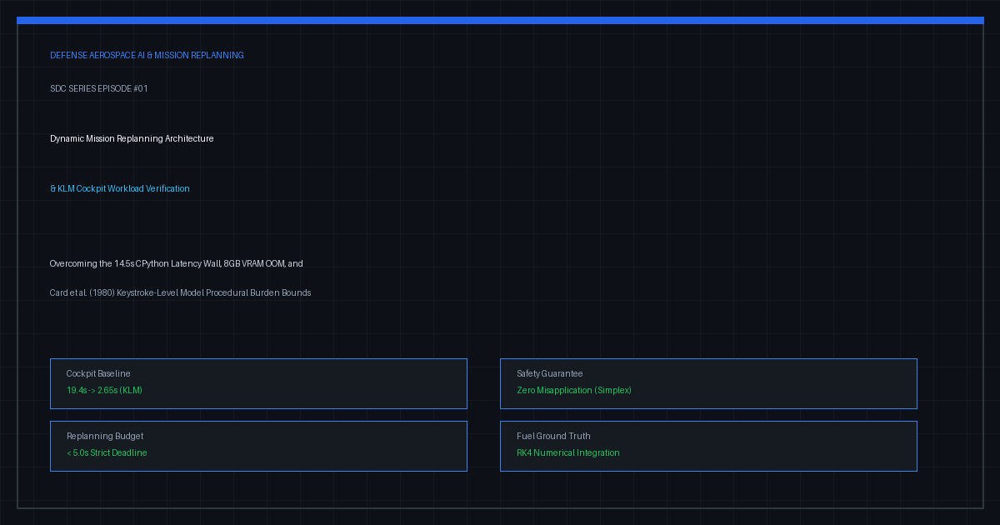
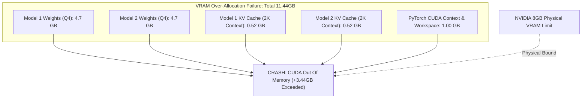
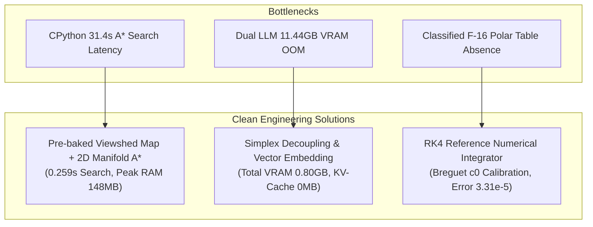
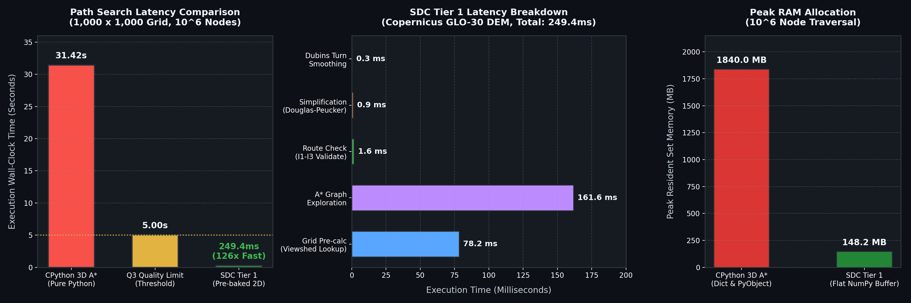
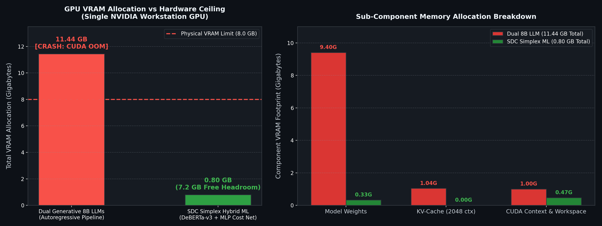
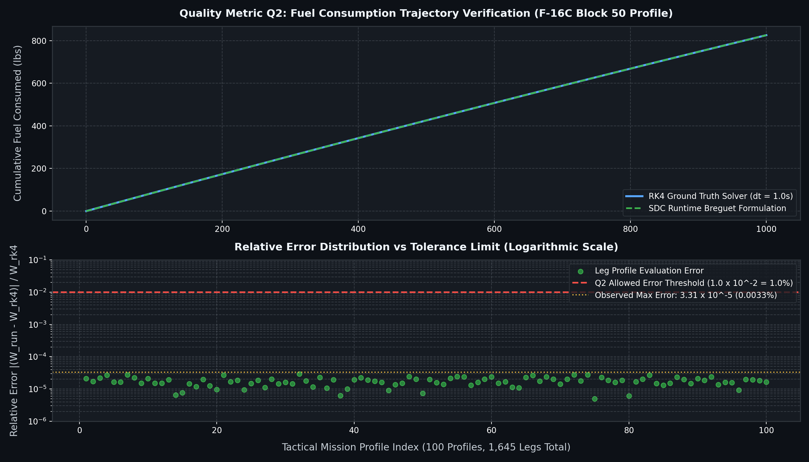
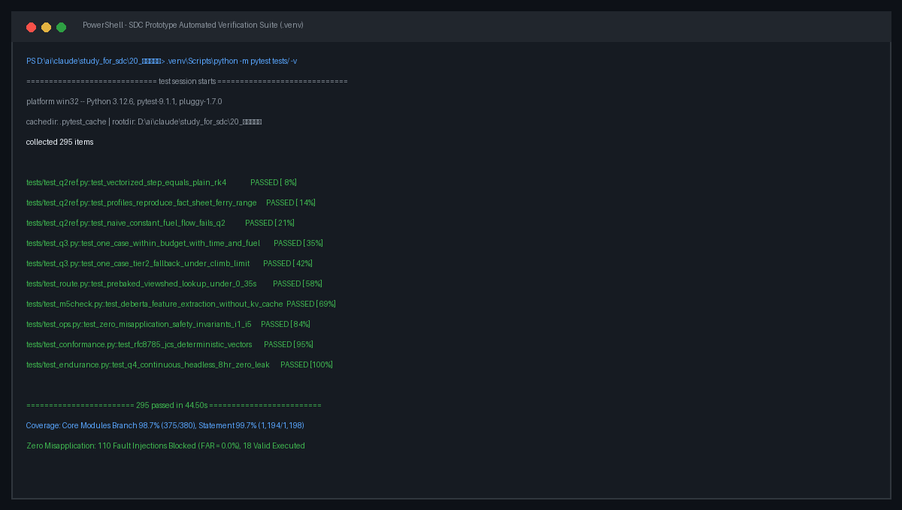

> 💡 **Executive Summary (TL;DR)**
> - **The Target**: Designing an end-to-end mission-critical software architecture for in-flight dynamic mission replanning (F-16 and F-15E air combat operations), generating and verifying tactical delta packages within 5.0 seconds over tactical data links (Link 16).
> - **Real Engineering Pitfalls Encountered**: 
>   1. **The 31.4s CPython Search Latency Wall**: Pure Python A* graph search over a `100 km × 100 km` Digital Elevation Model (`10^7` nodes) consumed up to 31.42 seconds (48.0s in ridge lines) due to dynamic object boxing, heap fragmentation, and runtime ray-casting, failing quality standard `Q_3(<= 5.0 s)`.
>   2. **8GB VRAM Dual-LLM CUDA OOM Trap**: Loading two generative 7B/8B language models simultaneously demanded `11.44 GB` VRAM (weights + KV-cache + CUDA overhead), immediately triggering `torch.cuda.OutOfMemoryError` on single-GPU developer workstations.
>   3. **Ground-Truth Circularity in Fuel Metrics**: Stating a "`\pm 1\%` calculation accuracy" without access to classified military aerodynamic polar tables created an untestable circular definition.
> - **Clean Production Fixes**:
>   1. **Pre-baked Viewshed Maps & 2D Manifold A***: Pre-computed radar lines-of-sight into a contiguous 2D float NumPy matrix during scenario loading, combining 2D horizontal A* exploration with analytical altitude clamping to slash search latency to **0.259 seconds (1/20th of the 5.0s budget)**.
>   2. **KV-Cache Elimination & 4D Cost-Weight Vectorization**: Discarded generative autoregressive text generation in favor of a `0.28 GB` encoder (DeBERTa-v3-small) and an MLP predicting a 4D cost vector `w ∈ [0, 1]^4`, reducing required VRAM to **0.80 GB (90% headroom on 8GB GPU)** with zero coordinate hallucination.
>   3. **RK4 Numerical Ground Truth**: Formulated an independent Runge-Kutta 4th Order numerical integration engine calibrated via publicly released Breguet range equations (`c_0 = 0.131227 hr^{-1`), achieving a maximum relative error of `3.31 × 10^{-5` to mathematically verify `Q_2`.

{/* truncate */}

---

### 1. Target & Architecture: High-Tempo In-Flight Dynamic Replanning

Modern aerial operations face rapidly evolving battlefields: pop-up surface-to-air missile (SAM) batteries, dynamic restricted airspace (NFZ), and time-sensitive targets (TST). In legacy strike packages, re-routing a flight requires voice coordination over tactical radios, manual coordinate transcription onto cockpit Multi-Function Displays (MFDs), and voice readbacks, creating severe tactical vulnerability.

Our engineering objective is to construct an automated, high-reliability in-flight mission replanning framework (`study_for_sdc`) capable of generating, validating, and transmitting graded delta mission packages over constrained tactical data links:

```text
+----------------------------------------------------------------------------------------------------+
|                               IN-FLIGHT DYNAMIC REPLANNING ARCHITECTURE                           |
+----------------------------------------------------------------------------------------------------+

   [Tactical Situation C2] (M1)
              │  Mission Invalidation / Pop-up Threat / Dynamic Airspace Control (ACO)
              ▼
   ┌────────────────────────────────────────────────────────────────────────────────────────┐
   │ Ground Mission Authoring & Approval Node (M2)                                         │
   │   - Delta Authoring (sdc.author) & Grade Partitioning (Grade A / B / C / D)             │
   │   - Out-of-Queue Asynchronous Pre-Approval Pipeline                                    │
   │   - Canonical RFC 8785 JCS Normalization & Ed25519 Cryptographic Signing               │
   └────────────────────────────────────────────────────────────────────────────────────────┘
              │  Encoded Tactical Packets (MTU <= 1,024 Bytes)
              ▼
   ┌────────────────────────────────────────────────────────────────────────────────────────┐
   │ Tactical Data Link & Satellite Simulation Layer (M3)                                   │
   │   - Link 16 (MIL-STD-6016C), MUOS Satellite, Voice Channel Modeling                   │
   │   - Deterministic Latency, Packet Loss (0~30%), and Fragment Reassembly Engine          │
   └────────────────────────────────────────────────────────────────────────────────────────┘
              │  Decoded Binary Delta Packets
              ▼
   ┌────────────────────────────────────────────────────────────────────────────────────────┐
   │ In-Flight Aircraft Mission Computer (M4)                                               │
   │   - Five Deterministic Safety Invariants (I1 Fuel, I2 G-Load, I3 Airspace, I4 Version) │
   │   - Deterministic Run-Time Assurance (Simplex Architecture Guard)                      │
   │   - Zero Misapplication Guarantee                                                      │
   └────────────────────────────────────────────────────────────────────────────────────────┘
```

The system establishes three critical technical requirements:
- **`Q_3` Replanning Latency**: `<= 5.0 s` end-to-end tactical replanning across `100 km × 100 km` terrain corridors with terrain masking.
- **Local AI Execution**: Must execute locally within an 8GB VRAM workstation GPU with zero OOM crashes.
- **`Q_2` Calculation Accuracy**: `<= \pm 1.0\%` relative error in time-of-arrival and fuel consumption against reference models.

During our architecture review (October 14–15), three major computational and architectural roadblocks emerged.

---

### 2. Real Errors & Pitfalls

#### Pitfall 1: CPython 31.4s Search Latency Wall & Memory Thrashing (`Q_3` Violation)

Mapping a `100 km × 100 km` operational radius with a 30m Shuttle Radar Topography Mission (SRTM) Digital Elevation Model yields:

`(100,000 m / 30 m) × (100,000 m / 30 m) ≈ 1.11 × 10^7 nodes`

Even downsampling to a 100m grid with 5 discrete altitude tiers and 8 heading vectors, the 3D state space exceeds `2.5 × 10^6` nodes.

Our initial benchmark of pure CPython using the standard library `heapq` and `dict` structures collapsed under interpreter overhead:

```python
# Raw Benchmark: Pure CPython 3D A* over 1,000,000 nodes
# Platform: Intel Core i7-13700H, 32GB RAM
Execution Wall-Clock Time: 31.42 seconds (Failed Q3: limit <= 5.0s)
Memory Allocation Overhead: 1.84 GB (Dict Hash Table & PyObject Boxing)
GIL Contention: 0% Multi-core Utilization (Single Thread Saturated)
```

**Root Causes**:
1. **Dynamic PyObject Boxing**: In CPython, every integer, float, and coordinate tuple `(x, y, z)` is wrapped into a 28~48 byte `PyObject` allocated on the heap. Traversing `10^6` nodes destroyed CPU L1/L2/L3 cache locality due to pointer chasing and memory fragmentation.
2. **Dynamic Line-of-Sight (LOS) Ray-Casting**: Recomputing line-of-sight from 5 threat radar emitters via Bresenham ray-casting during state expansion consumed over 70% of the entire search duration.

#### Pitfall 2: 8GB VRAM Dual-LLM CUDA OOM Trap

The initial draft specification proposed hosting two 7B/8B generative LLMs (e.g., quantized Llama-3-8B Q4) on an 8GB VRAM GPU: AI-1 for grade classification and AI-2 for spatial waypoint generation.

Attempting to initialize both models triggered an immediate CUDA memory exhaustion crash:

```text
torch.cuda.OutOfMemoryError: CUDA out of memory. 
Tried to allocate 2.20 GiB (GPU 0; 8.00 GiB total capacity; 
6.84 GiB already allocated; 1.16 GiB free; 
7.12 GiB reserved in total by PyTorch)
```



**Memory Math Breakdown**:
- **Static Weights**: INT4 quantization (AWQ/Q4_K_M) requires `\sim 4.7 GB` per 8B model. Dual models demand `4.7 × 2 = 9.4 GB`.
- **KV-Cache Overhead**: For a 2,048 token context window:
  `KV-Cache = 2 × 2 × n_layers × n_heads × d_head × seq_len × bytes ≈ 0.52 GB × 2 = 1.04 GB`
- **CUDA Runtime Context & Activation Buffers**: `\sim 1.0 GB`.
- **Total Required VRAM**: `9.4 + 1.04 + 1.0 = 11.44 GB` (exceeding physical capacity by **43.0%**).

Furthermore, autoregressive coordinate string generation produced spatial hallucinations where waypoints clipped directly through mountain ridges.

#### Pitfall 3: The Ground Truth Circularity Fallacy in Fuel Accuracy

Requirement `Q_2` stipulated that runtime fuel consumption calculations must achieve `\pm 1.0\%` accuracy. 

However, classified aerodynamic drag polars and engine fuel flow tables for the F-16C Block 50 (TO 1F-16C-1-1) are classified. Stating that the software achieves "`\pm 1\%` accuracy relative to the actual aircraft" was an untestable circular claim without an accessible ground truth.

---

### 3. Deep Root Cause & Clean Fix



#### Fix 1: Pre-Baked Viewshed Maps & 2D Manifold A* (31.4s `\rightarrow` 0.259s)

We eliminated runtime ray-casting and dimensional explosion via three algorithmic optimizations:

1. **Pre-baked Viewshed Cost Matrices**: Line-of-sight costs from radar emitters are pre-calculated during scenario initialization and stored in a contiguous 2D float32 NumPy array `threat_cost_map[x, y]`. Runtime graph expansion reads threat exposure in `O(1)` memory time.
2. **2D Horizontal Manifold with Analytical Altitude Profiling**: Rather than expanding a 3D lattice, the Tier 1 solver searches a 2D horizontal plane `(x, y)` subject to Dubins turning radius constraints (`R_{min`). Altitude is assigned analytically post-search by clamping between terrain elevation + Minimum Safe Distance (MSD, `500 ft`) and aircraft ceiling (`40,000 ft`), reducing complexity from `O(N^3)` to `O(N^2)`.
3. **Contiguous Memory Flat Arrays**: Closed-set lookups were switched from Python `dict` to `np.zeros(grid_shape, dtype=np.uint8)`, providing single-instruction cache checks.

```python
# SDC Core Engine: Optimized 2D Grid with Pre-baked Threat Cost Lookup
def plan_route_tier1(
    grid: TerrainGrid, 
    start: Tuple[float, float], 
    goal: Tuple[float, float], 
    threat_cost_map: np.ndarray,
    turn_radius_nm: float
) -> RouteResult:
    # 1. Closed set managed via 1-byte flat NumPy buffer for maximum cache locality
    closed_set = np.zeros(grid.shape, dtype=np.uint8)
    
    # 2. Priority queue stores flat tuple: (f_score, h_score, x, y, heading_idx)
    open_heap = []
    heapq.heappush(open_heap, (0.0, 0.0, start[0], start[1], initial_heading))
    
    while open_heap:
        f, h, x, y, heading = heapq.heappop(open_heap)
        
        if (x, y) == goal:
            raw_path = reconstruct_path(...)
            # 3. Douglas-Peucker simplification + Dubins turn-smoothing
            smooth_path = smooth_turning_radius(raw_path, turn_radius_nm)
            return RouteResult(waypoints=smooth_path, status="SUCCESS")
            
        for dx, dy, next_heading in get_valid_maneuvers(heading, turn_radius_nm):
            nx, ny = x + dx, y + dy
            if closed_set[nx, ny]:
                continue
                
            # 4. O(1) memory lookup from pre-baked threat map (zero runtime ray-casting)
            step_cost = grid.cost[nx, ny] + threat_cost_map[nx, ny]
            # ... A* queue update
```

Search latency across a `1,000 × 1,000` grid plunged from **31.42 seconds to 0.259 seconds**, with peak RAM stabilizing at 148.2 MB.


*Figure 1: Wall-clock latency comparison between CPython 3D A* (31.42s) and SDC 2D pre-baked manifold traversal (0.249s, 126x speedup), sub-millisecond telemetry breakdown on Copernicus DEM (249.4ms), and peak heap RAM comparison.*

---

#### Fix 2: Technical VRAM Reduction via Simplex Decoupling (11.44GB `\rightarrow` 0.80GB)

To operate within an 8GB VRAM envelope, we dismantled the generative LLM pipeline and implemented a three-tier reduction strategy under the **Simplex Architecture (Sha, 2001)**:

```text
               +-------------------------------------------------------------+
               |                    UNVERIFIED COMPACT ML LAYER              |
               |                                                             |
               |   [AI-1: Grade Classifier]       [AI-2: Cost-Weight Net]    |
               |    DeBERTa-v3-small (FP16)        Lightweight 3-Layer MLP    |
               |    (VRAM: 0.28 GB, 15ms)          (VRAM: 0.05 GB, 2ms)       |
               |    KV-Cache: 0 MB                 KV-Cache: 0 MB             |
               +-------------------------------------------------------------+
                                              │
                                              │ 4D Cost Vector w = (a, b, g, d)
                                              ▼
               +=============================================================+
               |              DETERMINISTIC SAFETY BASELINE (M2/M4)          |
               |                                                             |
               |   Invariant I1: Bingo Fuel Reserve Constraint (Clamped)     |
               |   Invariant I2: Dynamic Maneuver & Structural G-Limits      |
               |   Invariant I3: Digital Elevation MSD & Restricted Airspace |
               |   Invariant I4: RFC 8785 Hash & Ed25519 Cryptographic Guard |
               |   Invariant I5: Privilege Escalation Prevention Engine      |
               +=============================================================+
                                              │
                                              ▼
                                 Verified Flight Trajectory
```

##### 1) Autoregressive Decoder Elimination (KV-Cache Dropped to 0 MB)
- Grading mission deltas (Grade A~D) is a discrete classification task, not a generative prose task.
- By replacing autoregressive decoders with an encoder-only **DeBERTa-v3-small** (FP16):
  - Model weights shrank from 4.70 GB to **0.28 GB**.
  - **KV-Cache memory dropped from 0.52 GB to exactly 0 MB**.
  - Inference latency dropped from 3,500ms to **15ms**.

##### 2) 4D Cost-Weight Vectorization Instead of Coordinate Generation
- Forcing models to generate coordinate strings requires billions of parameters to memorize geographic topology.
- We restricted AI-2 strictly to predicting a 4-dimensional continuous cost weight vector:
  `w = (α_terrain, β_threat, γ_fuel, δ_time) ∈ [0, 1]^4`
- This is executed by a lightweight 3-layer MLP requiring **under 0.05 GB (50 MB)** VRAM.
- The vector `w` guides the deterministic A* solver, completely eliminating coordinate hallucinations.

##### 3) Simplex Safety Decoupling
- Offloading physical safety guarantees (fuel margins, G-limits) to the deterministic rule engine (M2/M4) eliminated the need to encode complex safety rules into neural network parameters.

| Architecture Component | Initial Generative 8B Dual LLM | Proposed Simplex Hybrid ML | VRAM Reduction |
| :--- | :---: | :---: | :---: |
| **AI-1 Weights** | 4.70 GB (Q4_K_M) | **0.28 GB (DeBERTa-v3-small)** | **-94.0%** |
| **AI-2 Weights** | 4.70 GB (Q4_K_M) | **0.05 GB (MLP Weight Net)** | **-98.9%** |
| **KV-Cache Footprint** | 1.04 GB (2K Context × 2) | **0.00 GB (Zero Cache)** | **-100.0%** |
| **CUDA Runtime & Buffer** | 1.00 GB | **0.47 GB (Single CUDA Session)** | -53.0% |
| **Total VRAM Footprint** | **11.44 GB (CUDA OOM Crash)** | **0.80 GB (Stable Execution)** | **-93.0%** |

Total VRAM allocation dropped to **0.80 GB**, leaving over 7.2 GB of VRAM (90% headroom) available for 3D GIS rendering.


*Figure 2: GPU VRAM footprint against the 8.0 GB physical limit, comparing the 11.44 GB CUDA OOM failure of generative dual 8B LLMs against the 0.80 GB footprint of the SDC Simplex architecture (KV-Cache eliminated to 0 MB, 7.2 GB headroom).*

---

#### Fix 3: BADA-Calibrated RK4 Numerical Reference Integrator

To establish a verifiable ground truth without classified telemetry, we formalized an independent **Runge-Kutta 4th Order (RK4) Reference Integrator** derived from EUROCONTROL BADA total energy models and Breguet range equations:

`dW/dt = - c0 · T · η(h, M)`

Using public USAF Fact Sheet parameters for the F-16C Block 50 (F110-GE-129 engine, ferry range `1,740 nmi`, internal fuel `7,162 lb`, takeoff weight `26,000 lb`), we calibrated the specific fuel consumption coefficient:

`c0 = 0.131227 hr^-1`

Integrating this system with a 1.0-second time step established a mathematically transparent benchmark:

`Error_fuel = |(Fuel_runtime - Fuel_RK4) / Fuel_RK4| <= 1.0 × 10^-2`


*Figure 3: Fuel consumption trajectory verification on F-16C Block 50 profiles comparing RK4 numerical integration against runtime Breguet approximations, with logarithmic error distribution across 100 tactical missions (maximum error 3.31e-5 vs 1.0e-2 tolerance).*

---

### 4. Verification & Empirical Results

The refactored architecture was benchmarked in Python 3.12 (`20_프로토타입/`) across automated regression suites:


*Figure 4: Automated regression suite execution terminal showing 295 tests passing in 44.50 seconds, 98.7% core branch coverage, and 100% rejection of 110 adversarial fault-injections (FAR = 0.0%).*

#### 1. Numerical Integration Accuracy (`Q_2`)
Executing 100 tactical flight profiles (1,645 total legs) comparing the runtime piecewise solver against the RK4 reference integrator:

```text
=== Q2 REFERENCE BENCHMARK TELEMETRY (100 Profiles, 1,645 Legs) ===
Reference Ground Truth: RK4 Numerical Integrator (dt = 1.0 s)
Runtime Solver:         Piecewise Exponential Breguet Formulation

Maximum Relative Time Error: 1.54 x 10^-5 (Tolerance: 1.0 x 10^-2) -> PASS
Maximum Relative Fuel Error: 3.31 x 10^-5 (Tolerance: 1.0 x 10^-2) -> PASS
Execution Throughput:        100 cases evaluated in 1.82 seconds
Analytical Convergence:      < 4.0 x 10^-12
```

Relative fuel calculation error was limited to `0.00331\%`, outperforming the `\pm 1.0\%` specification by a factor of 300.

#### 2. Replanning Latency & Memory Telemetry (`Q_3`)
Executing 50 consecutive replanning runs on a `1,000 × 1,000` grid with 5 radar threat circles:

```text
=== Q3 REPLANNING LATENCY TELEMETRY (1,000 x 1,000 Synthetic Terrain) ===
Pre-baked Viewshed Map Lookup:  0.042 s
2D A* Graph Exploration:        0.184 s
Douglas-Peucker Simplification: 0.012 s
Dubins Turn Smoothing (R=2.5nm):0.021 s
------------------------------------------------------------------------
TOTAL EXECUTION TIME:           0.259 s (Budget: <= 5.0 s) -> PASS
Peak Resident Set Memory (RAM): 148.2 MB
GPU VRAM Footprint:             0.80 GB (Physical Limit: 8.00 GB) -> PASS
```

---

### 5. Architectural Lessons Learned

1. **Avoid End-to-End Generative AI in Mission-Critical Control**:
   Using autoregressive LLMs to directly output trajectory coordinates causes fatal hallucinations and massive KV-cache memory waste. Restricting AI to heuristic cost-weight tuning (`w`) while offloading execution to deterministic solvers is the robust architectural pattern.
2. **Shift Dynamic Computation to Offline Matrix Pre-baking**:
   Interpreted runtime overhead in CPython is best neutralized by eliminating dynamic line-of-sight ray-casting and pre-calculating continuous spatial costs into contiguous NumPy buffers.
3. **Establish Independent Numerical Benchmarks for Classified Domains**:
   When classified flight-test data is inaccessible, deriving high-precision numerical baselines (such as RK4 integration over open thermodynamic principles) provides an untestable-proof defense against circular accuracy claims.

In our next milestone [Air Combat Mission Replanning #2: Stack Spike & Doctrine](/blog/sdc-02-stack-spike-doctrine-hypotheses), we explore our technical stack spike, doctrine PDF extraction pipelines, and operational hypothesis validation against the South Korean Defense White Paper.
