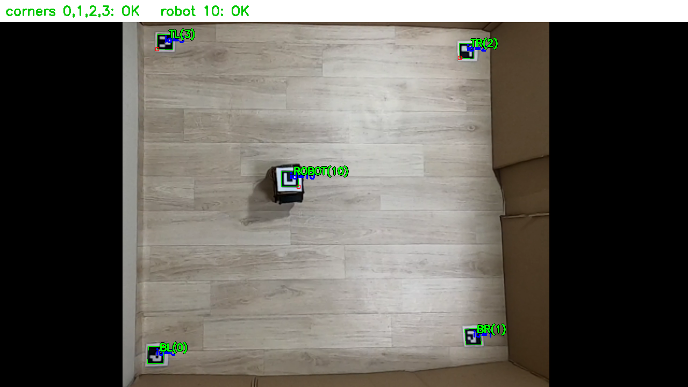
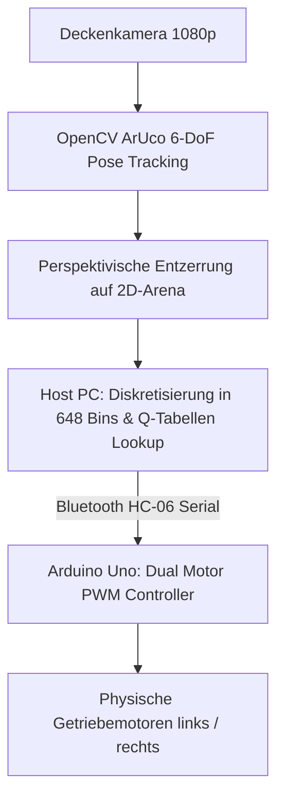

> 📌 **Kernaussagen (TL;DR)**
> - **Herausforderung**: Strikte Ressourcenbeschränkungen (Arduino Uno mit 2 KB SRAM), nichtlinearer Radschlupf und die klassische **Reality Gap** zwischen Simulation und Realität.
> - **Lösung**: Auslagerung der Bildverarbeitung an einen Host-PC via ArUco-Deckenkamera-Homographie und drahtlose Steuerbefehlsübertragung via Bluetooth HC-06.

{/* truncate */}

---

### 1. Die Sim-to-Real-Architektur

Durch das externe Vision-Tracking entfällt die Notwendigkeit teurer Laserscanner auf dem Roboter. Der Arduino Uno empfängt kompakte 2-Byte-Motorbefehle und steuert die H-Brücke präzise an.

---

### 📌 Management Summary (3–5 Zeilen)
1. **Reality Gap erfolgreich überbrückt**: Die in Webots trainierte Policy steuert den echten Roboter ohne Nachtraining.
2. **ArUco-Tracking**: Liefert millimetergenaue Positionsdaten bei 60 FPS ohne Sensorrauschen auf dem Roboter.
3. **Minimalistische Hardware**: Ein kostengünstiger 8-Bit-Mikrocontroller reicht für komplexe autonome Fahrten aus.
4. **Vollständiger Projektzyklus**: Vom MDP-Design über Simulation bis zur realen Hardware wurde das System lückenlos validiert.