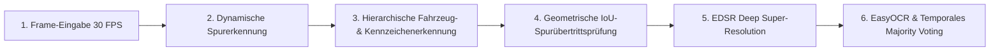

> 📌 **Kernaussagen (TL;DR)**
> - **Herausforderung**: Dashcam-Aufnahmen bei hoher Geschwindigkeit leiden unter Vibrationen, Gegenlicht und Bewegungsunschärfe. Eine direkte OCR scheitert an niedriger Bildauflösung.
> - **Lösung**: Eine modulare 6-Stufen-Pipeline mit strikter 30-FPS-Grenze, die Spurerkennung, hierarchische YOLO-Detektion, EDSR-Super-Resolution und temporales OCR-Voting kombiniert.

{/* truncate */}

---

### 1. Die 6 Stufen der Pipeline im Überblick

1. **Video-Ingestion**: Dekodierung von 1080p Dashcam-Videostreams mit OpenCV und Multithreading.
2. **Spurerkennung**: Canny-Kantenerkennung, ROI-Maskierung und Hough-Linientransformation (`HoughLinesP`).
3. **Hierarchische Lokalisierung**: Grobe Fahrzeugsuche via YOLOv3, gefolgt von präziser Kennzeichenerkennung via YOLOv5.
4. **Intrusionsmetrik**: Berechnung des Schnittstellenverhältnisses (Intersection over Union, IoU) zwischen Fahrzeug-Bounding-Box und Fahrspur-Polygon.
5. **Super-Resolution**: Hochskalierung kleiner Kennzeichen-Ausschnitte (unter 40x20 Pixel) auf das 4-fache via EDSR.
6. **OCR & Konsens**: Zeichenerkennung mit EasyOCR und temporales Glätten über 11 Frames hinweg.

---

### 📌 Management Summary (3–5 Zeilen)
1. **Modulare Architektur**: Komplexe Vision-Aufgaben werden in 6 klar getrennte Stufen unterteilt, um Engpässe isoliert zu optimieren.
2. **Echtzeitfähigkeit**: Das System hält strikt die 30-FPS-Latenzgrenze für zuverlässige Dashcam-Auswertungen ein.
3. **Robustheit bei Unschärfe**: Deep Super-Resolution (EDSR) stellt unleserliche Kennzeichenfragmente wieder her.
4. **Fehlalarm-Reduktion**: Geometrische IoU-Kriterien verhindern Fehlalarme bei Fahrbahnunebenheiten.