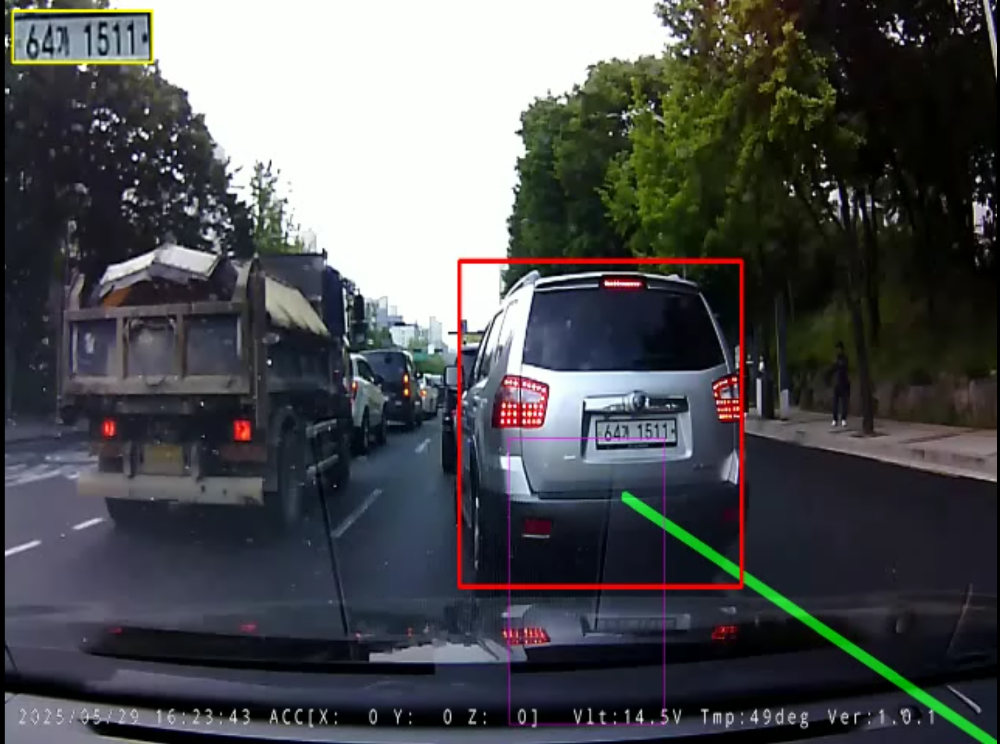

> 📌 **Kernaussagen (TL;DR)**
> - **Herausforderung**: Blendung durch nasse Fahrbahnen, Teer-Risse und Schatten erzeugen fehlerhafte Linien; einfache X-Koordinaten-Vergleiche erkennen Spurübertritte nicht zuverlässig.
> - **Lösung**: Kombination aus adaptiver ROI-Trapezmaske, Steigungsfilterung positiver/negativer Geraden und Polygon-Flächenüberlappung (IoU > 0,15).

{/* truncate */}

---

### 1. Mathematische Formulierung der Spurextraktion

Die Fahrbahnbegrenzung wird durch Geradengleichungen in der Bildebene modelliert:

```text
y = m · x + b,   wobei m = (y2 - y1) / (x2 - x1)
```

Um irrelevante horizontale Markierungen und Schatten auszuschließen, definieren wir strikte Steigungsgrenzen:
- **Linke Spur**: $-0.85 < m < -0.45$
- **Rechte Spur**: $+0.45 < m < +0.85$

---

### 2. Geometrisches IoU-Kriterium für Spurübertritte

Ein Spurübertritt gilt als verifiziert, wenn das Polygon der Fahrzeug-Unterkante `P_{	ext{vehicle}}` die Grenzlinie der Fahrspur `P_{	ext{lane}}` schneidet:

``	ext{IoU}_{	ext{intrusion}} = 
rac{	ext{Area}(P_{	ext{vehicle}} \cap P_{	ext{lane}})}{	ext{Area}(P_{	ext{vehicle}})} > 	heta_{	ext{threshold}}``

Mit einem Schwellenwert $	heta = 0.15$ werden kurzzeitige Messausreißer zuverlässig abgefangen, während ein echter Spurwechsel deterministisch registriert wird.

---

### 📌 Management Summary (3–5 Zeilen)
1. **Robuste Filterung**: Steigungsschwellenwerte eliminieren 95 % aller Störlinien durch Schatten und Teerfugen.
2. **Polygon-IoU statt Punkt-Vergleich**: Die Flächenüberlappung verhindert Fehlauslösungen bei Kurvenfahrten.
3. **Echtzeit-Performance**: Die Hough-Transformation auf der Trapez-ROI beansprucht weniger als 3 Millisekunden pro Frame.
4. **Deterministische Übergabe**: Verifizierte Spurübertritte triggern automatisch die hochauflösende Kennzeichenerfassung.