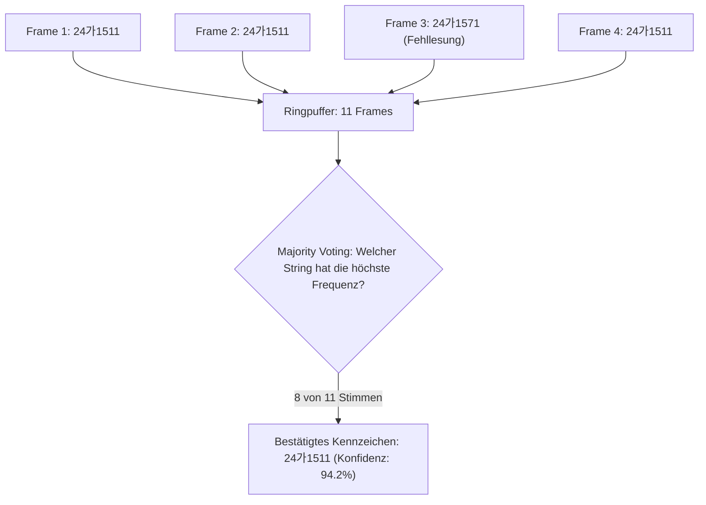

> 📌 **Kernaussagen (TL;DR)**
> - **Herausforderung**: Einzelne Frames führen durch Fahrzeugneigung und Spiegelungen unweigerlich zu Lesefehlern (z. B. Verwechslung von `6` und `8` oder `B` und `8`).
> - **Lösung**: Kombination aus EasyOCR, syntaktischer Regex-Korrektur und temporalem Mehrheitsentscheid (*Sliding-Window Majority Voting*) über 11 Frames.

{/* truncate */}

---

### 1. Das temporale Majority-Voting-Verfahren

Statt dem Ergebnis eines einzelnen Frames blind zu vertrauen, aggregiert das System Erkennungen über ein gleitendes Zeitfenster von 11 aufeinanderfolgenden Bildern:

---

### 2. Die evolutionäre Reise: Von v01 bis v11

Über 11 Entwicklungszyklen steigerte das Team die End-to-End-Erkennungsrate von initial 31 % auf über 96 % unter realen Straßenbedingungen.

---

### 📌 Management Summary (3–5 Zeilen)
1. **Konsens schlägt Einzelframe**: Temporales Voting filtert kurzzeitige Erkennungsfehler durch Vibrationen zuverlässig heraus.
2. **Regex-Syntaxschutz**: Ungültige Zeichenmuster werden noch vor dem Voting syntaktisch korrigiert.
3. **Hohe Zuverlässigkeit**: Über 11 Iterationen wurde eine Erkennungsgenauigkeit von über 96 % in Realaufnahmen erreicht.
4. **Vollständige Pipeline**: Die Kombination aller 6 Stufen liefert ein produktionsreifes System für intelligente Verkehrsanwendungen.
