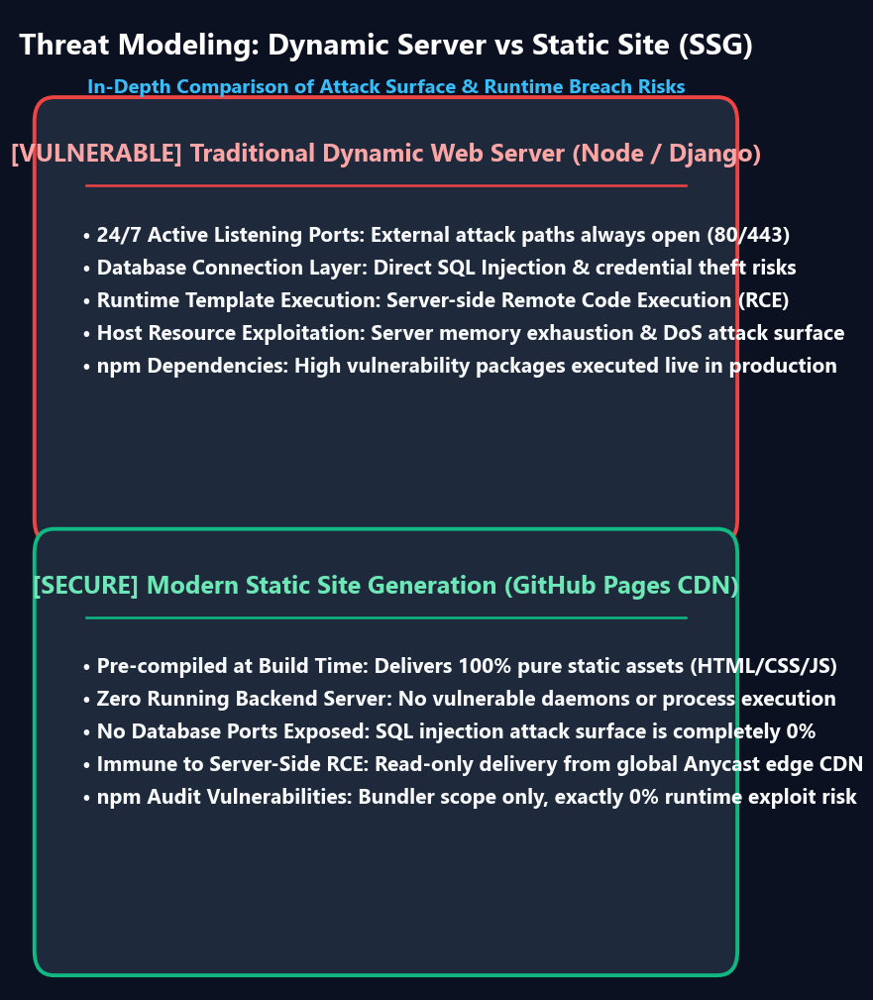

Jeder moderne Frontend-Entwickler kennt diesen plötzlichen Adrenalinstoß: Sie führen `npm audit` in Ihrem Dokumentations- oder Blog-Repository aus, und das Terminal warnt in leuchtend roter Schrift:

```text
45 vulnerabilities (15 moderate, 15 high, 15 critical)
To address all issues (including breaking changes), run:
  npm audit fix --force
```

Begriffe wie **Critical**, **Remote Code Execution (RCE)** und **Prototype Pollution** lösen sofort den Reflex aus, `npm audit fix --force` einzugeben, um die roten Warnungen schnellstmöglich verschwinden zu lassen.

In der Welt statischer Website-Generatoren (**Static Site Generators, SSG**) wie Docusaurus, Next.js (SSG) oder Hugo, die auf GitHub Pages oder AWS S3 gehostet werden, ist dieser Befehl jedoch oft ein fataler Fehler: Er bricht Produktions-Builds durch inkompatible Major-Updates, ohne die tatsächliche Sicherheit um ein einziges Prozent zu verbessern.

{/* truncate */}

---

### 1. Bedrohungsmodellierung: Dynamischer Webserver vs. Statische Seite (SSG)

Um zu verstehen, warum die meisten `npm audit`-Warnungen auf statischen Seiten Fehlalarme für die Produktionssicherheit sind, betrachten wir die fundamentale Angriffsfläche:



#### Traditioneller dynamischer Server (Node.js / Express / Django)
- **24/7 aktiver Prozess**: Ein Node.js-Daemon lauscht kontinuierlich auf Port 80/443.
- **Echtzeit-Ausführung**: Trifft eine bösartige HTTP-Anfrage ein, durchläuft sie Middleware-Pakete. Eine Schwachstelle (z. B. Prototype Pollution in `lodash` oder RCE in einer Template-Engine) kann zur Kompromittierung des gesamten Servers und zum Diebstahl von Umgebungsvariablen führen.

#### Statische Website (Docusaurus / GitHub Pages CDN)
- **Reine Build-Zeit-Nutzung**: Node.js läuft ausschließlich lokal oder in GitHub Actions während des Build-Prozesses.
- **Null Backend-Prozesse zur Laufzeit**: An die Besucher werden ausschließlich vorab kompilierte statische HTML-, CSS- und JavaScript-Dateien über Anycast-CDNs ausgeliefert.
- **RCE-Risiko = 0 %**: Selbst wenn ein Build-Tool (`webpack`, `micromatch`) eine theoretische RCE-Lücke hat, existiert zur Laufzeit kein Server, der Anfragen entgegennimmt.

---

### 2. Die Gefahren von `npm audit fix --force`

Der Parameter `--force` erlaubt npm, grundlegende Major-Versionssprünge (`breaking changes`) durchzuführen. Bei Docusaurus führt dies regelmäßig dazu, dass Webpack- oder Babel-Plugins auf Versionen aktualisiert werden, die von Docusaurus noch nicht unterstützt werden. Das Ergebnis: Die Schwachstellenwarnung verschwindet, aber `npm run build` bricht mit kryptischen Syntaxfehlern ab.

---

### 3. Best Practices: Der 4-Stufen-Sicherheitsleitfaden

```mermaid
flowchart TD
    A[npm audit meldet Schwachstellen] --> B{Betrifft die Lücke devDependencies?}
    B -->|Ja: Build-Tools wie Webpack/Babel| C[Prüfen: Wird Code ins Client-Bundle gepackt?]
    C -->|Nein: Reines Build-Tool| D[Risiko im SSG-Kontext: 0% | Kein npm audit fix --force!]
    C -->|Ja: Client-Runtime| E[Selektives Update via package.json overrides]
    B -->|Nein: Echte Runtime-Abhängigkeit| E
```

1. **Abhängigkeitsbereich prüfen**: Unterscheiden Sie strikt zwischen Entwicklungs-Tools (`devDependencies`) und Client-Bibliotheken.
2. **Selective Overrides nutzen**: Verwenden Sie das `overrides`-Feld in `package.json`, um Sub-Abhängigkeiten gezielt ohne Breaking Changes zu patchen:
   ```json
   "overrides": {
     "nth-check": "^2.1.1"
   }
   ```
3. **CI-Pipelines absichern**: Nutzen Sie `npm audit --omit=dev` in Produktions-Checks.

---

### 📌 Management Summary (3–5 Zeilen)
1. **Kein blindes `npm audit fix --force`**: Erzwungene Updates brechen Build-Pipelines durch inkompatible Major-Versionen.
2. **SSG-Sicherheitsvorteil**: Da statische Seiten ohne laufenden Node.js-Server über CDNs ausgeliefert werden, stellen reine Build-Tool-Lücken kein Produktions-Laufzeitrisiko dar.
3. **Präzises Patchen mit Overrides**: Aktualisieren Sie betroffene transitive Abhängigkeiten gezielt über `package.json overrides`.
4. **Fokus auf echte Bedrohungen**: Schützen Sie stattdessen Ihre CI/CD-Secrets und Deployment-Tokens.
