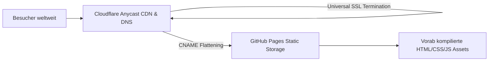

Ein Entwickler-Blog auf GitHub Pages unter `username.github.io/project` ist eine der schnellsten Möglichkeiten, technische Artikel zu veröffentlichen. Sobald Ihre Leserschaft jedoch wächst und Sie eine professionelle Monetarisierung anstreben, stoßen Sie auf eine harte Grenze: **Google AdSense verbietet kostenlose Subdomains wie `*.github.io` strikt**. Für die AdSense-Verifizierung und nachhaltigen organischen Traffic benötigen Sie eine eigene Apex-Domain.

Die Migration einer statischen Dokumentationsseite auf eine eigene Domain erfordert weit mehr als einen einfachen DNS-Eintrag: Nameserver-Delegierung, Edge-SSL-Zertifikate, kanonische Weiterleitungen, automatisches `ads.txt`-Hosting und die korrekte Indexierung in Google, Naver und Bing.

In diesem Leitfaden beschreiben wir unsere Zero-Downtime-Migration von `jbjihwan.github.io/global_blog` zu `https://globaldevlog.com`.

{/* truncate */}

---

### 1. Architektur-Übersicht: Das 3-Schichten-Modell

1. **Domain-Registrar (Porkbun)**: Verwaltet die Domain-Registrierung und delegiert Nameserver vollständig an Cloudflare.
2. **DNS & Edge-Sicherheit (Cloudflare Anycast DNS)**:
   - **CNAME Flattening**: Erlaubt es, die Apex-Domain (`globaldevlog.com`) ohne A-Record-Starrheit direkt auf GitHub Pages zu mappen.
   - **Universal SSL**: Stellt HTTPS-Zertifikate an der Edge bereit und erzwingt HTTP-zu-HTTPS-Weiterleitungen.
3. **Hosting-Plattform (GitHub Pages)**: Liefert die Docusaurus-Build-Artefakte weltweit aus.

---

### 2. Multi-Engine SEO-Indexierung: Fallen und Lösungen

Bei der Registrierung in internationalen und regionalen Suchmaschinen treten häufig typische Fehler auf:

| Suchmaschine | Typisches Problem | Technische Ursache & Lösung |
| :--- | :--- | :--- |
| **Google Search Console** | „Sitemap konnte nicht gelesen werden“ | Docusaurus generiert standardmäßig `/sitemap.xml`. Bei Domain-Wechsel muss die alte Property gelöscht und ein DNS-TXT-Eintrag verifiziert werden. |
| **Naver Search Advisor** | „Host-URL stimmt nicht überein“ | Naver verlangt strikte Übereinstimmung zwischen RSS-Link und registrierter URL (Trailing Slashes beachten). |
| **Bing Webmaster Tools** | Verzögerte Indexierung | Direkter Import über Google Search Console OAuth2 beschleunigt die Freischaltung auf wenige Minuten. |

---

### 📌 Management Summary (3–5 Zeilen)
1. **Eigene Domain zwingend erforderlich**: Google AdSense lehnt kostenlose Subdomains (`github.io`) grundsätzlich ab; eine eigene Apex-Domain ist Pflicht.
2. **Porkbun + Cloudflare-Vorteil**: CNAME Flattening und Universal SSL ermöglichen Zero-Downtime-Betrieb bei maximaler Ausfallsicherheit.
3. **Multi-Engine SEO**: Neben Google sollten Naver und Bing über saubere Sitemaps (`/sitemap.xml`) und RSS-Feeds parallel bedient werden.
4. **Kanonische Weiterleitungen**: Erzwingen Sie HTTPS und leiten Sie `www` konsistent auf die Apex-Domain weiter.