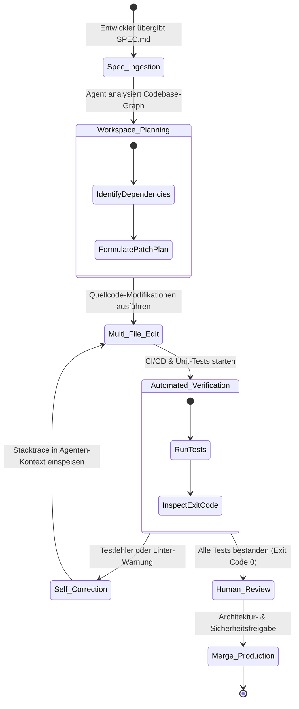
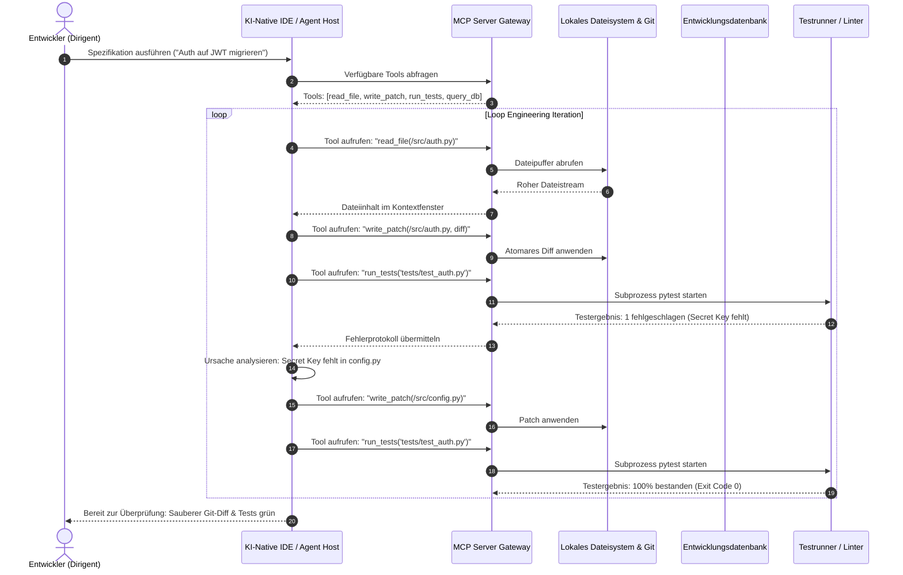

Willkommen zur umfassenden technischen Analyse der Vorlesungsreihe **CS146S: The Modern Software Developer der Stanford University**.

In den vergangenen fünf Jahrzehnten bildete die Informatikausbildung Entwickler primär dazu aus, akribische Syntax-Schreiber zu sein: das Auswendiglernen von Sprachstrukturen, das manuelle Schreiben von Algorithmen und das Erstellen tausender Zeilen Boilerplate-Code. Heute erlebt die Softwareindustrie die radikalste Transformation seit der Erfindung des Compilers: den Übergang vom **manuellen Programmieren** zum **Human-Agent Engineering**.

In dieser grundlegenden ersten Vorlesung analysieren wir, wie führende Technologieunternehmen (Google, Meta, OpenAI) die Entwicklerproduktivität neu definieren, warum der Programmierer vom Code-Typisten zum Orchesterdirigenten wird und wie **Spec-Driven Development (SDD)**, **Agentic Workflows** und das **Model Context Protocol (MCP)** das unverzichtbare Toolkit für moderne Ingenieure bilden.

{/* truncate */}

---

### 1. Der Paradigmenwechsel: Vom Syntax-Typisten zum System-Dirigenten

In traditionellen Software-Entwicklungsworkflows bestand der Hauptengpass stets im menschlichen Tastaturdurchsatz und im kognitiven Abrufen von Syntaxregeln. Ein Entwickler entwirft eine Architektur, übersetzt diese in konkrete Sprach-Tokens (Java, TypeScript, Python) und verbringt 70 % seiner Arbeitszeit mit repetitiven Aufgaben: Schnittstellendefinitionen, REST-Controllern, CRUD-Tests und Syntaxfehlern.

Mit dem Aufkommen von Reasoning-Modellen und autonomen Programmieragenten (Claude Code, Cursor, GitHub Copilot Workspace) sind die Grenzkosten für die Erzeugung syntaktisch korrekten Codes nahezu auf null gesunken.

```mermaid
flowchart TD
    subgraph Traditional_Workflow ["Traditionelles Paradigma: Entwickler als Typist"]
        A1[Menschliche Architekturidee] -->|Manuelles Tippen 70% Zeit| B1[Boilerplate-Syntax & Schnittstellen]
        B1 -->|Manuelles Schreiben von Tests| C1[Lokale Kompilierung & Debugging]
        C1 -->|Langsame lineare Geschwindigkeit| D1[Bereitstellung einzelner Features]
    end

    subgraph Modern_Agentic_Workflow ["Stanford CS146S Paradigma: Entwickler als Dirigent"]
        A2[Menschlicher Architekt: Spezifikation & Invarianten] ==>|Präzise SPEC.md| B2[Autonomes KI-Agenten-Team]
        B2 -->|Multi-File-Bearbeitung via MCP| C2[Automatisiertes Loop Engineering: Test & Self-Heal]
        C2 -->|Kontinuierliches Feedback| B2
        C2 ==>|Verifizierter Codebestand| D2[Menschliches Architektur- & Security-Review]
        D2 ==>|10-fache Skalierungsgeschwindigkeit| E2[Produktions-Deployment]
    end
```



Moderne Entwickler werden nicht mehr daran gemessen, wie viele Zeilen Code (Lines of Code, LOC) sie pro Tag schreiben. Sie agieren vielmehr als **Engineering Manager, die ein Team autonomer KI-Agenten leiten**. Wenn ein technischer Leiter Aufgaben an Nachwuchsentwickler delegiert, diktiert er nicht jeden Tastenanschlag, sondern formuliert unmissverständliche Spezifikationen, definiert Systemgrenzen und legt deterministische Abnahmekriterien fest.

---

### 2. Spec-Driven Development (SDD): „Was“ vor „Wie“

Die von Stanford CS146S propagierte Kernmethodik ist das **Spec-Driven Development (SDD)**. Bei naiver KI-Unterstützung interagieren Entwickler oft über vage Chat-Prompts wie: *„Kannst du ein Benutzer-Login-System erstellen?“*

Dieser Ansatz führt unweigerlich zu architektonischen Abweichungen, Code-Halluzinationen und fehlender Randfall-Behandlung. Im SDD ist das primäre Arbeitsergebnis nicht der rohe Quellcode, sondern ein formales, maschinell verarbeitbares **Spezifikationsdokument (`SPEC.md`)**.

```markdown
# Engineering-Spezifikationsvorlage (SPEC.md)

## 1. Kontext & Geschäftsdomäne
- Implementierung idempotenter Zahlungs-Webhook-Verarbeitung für Stripe API v2024-06.
- Datenbank: PostgreSQL 16 mit aktivierter Row-Level Security (RLS).

## 2. Invarianten & Nicht verhandelbare Vorgaben
- Alle Datenbankmutationen MÜSSEN innerhalb einer expliziten Transaktion stattfinden.
- Die Webhook-Signaturvalidierung (HMAC-SHA256) MUSS vor jedem Payload-Parsing fehlschlagen (Fail-Closed).
- Latenzgrenzwert: P99-Antwortzeit < 80 ms.

## 3. Schnittstellen & Schemata
- Input: `POST /api/v1/payments/webhook` mit unverändertem Request-Body-Buffer.
- Behandelte Ereignistypen: `payment_intent.succeeded`, `payment_intent.payment_failed`.

## 4. Verifizierungs- & Testanforderungen
- Unit-Test-Abdeckung > 95 % für Transaktions-Rollbacks bei doppelten Event-IDs.
- Nebenläufigkeitstest: 50 zeitgleiche Duplikat-Webhooks dürfen exakt 1 Datenbankeintrag erzeugen.
```

Indem Entwickler tiefen kognitiven Aufwand in die Spezifikation investieren, etablieren sie unzerbrechliche Schutzplanken. Der KI-Agent erhält vollständige Autonomie über das *„Wie“* (Synthese der Implementierung), während der Mensch die absolute Kontrolle über das *„Was“* und das *„Warum“* behält.

---

### 3. Agentic Workflows & Automatisiertes Loop Engineering

Ein zentrales Konzept der Vorlesung 1 ist das **Loop Engineering**. Foundation Models sind probabilistische Systeme; von einem LLM zu erwarten, dass es ein komplexes verteiltes System in einem einzigen Durchlauf fehlerfrei generiert, ist mathematisch unrealistisch.

Stattdessen strukturiert die moderne Softwareentwicklung den Agenten-Workflow in eine geschlossene, sich selbst korrigierende autonome Schleife:



#### Die vier Phasen der autonomen Schleife:
1. **Planung (Workspace Discovery)**: Der Agent durchläuft den Projektdateigraphen und analysiert Schnittstellenverträge.
2. **Ausführung (Multi-File Transformation)**: Der Agent wendet atomare Diffs synchron über Client-, Server- und Migrationsdateien an.
3. **Verifizierung (Deterministisches Feedback)**: Der Agent führt autonom Testrunner (`pytest`, `vitest`, `cargo test`) und Linter aus.
4. **Selbstkorrektur (Loop Iteration)**: Schlägt eine Assertion fehl, analysiert der Agent den Fehler-Trace und passt den Code iterativ an, bis alle Tests bestehen.

---

### 4. Model Context Protocol (MCP): Das universelle Protokoll für Agenten

Wie verlässt ein KI-Modell die isolierte Sandbox und interagiert mit realen Entwicklerwerkzeugen? Die Antwort ist das **Model Context Protocol (MCP)**, der offene Industriestandard für Tool-Integration.



Dank MCP können Agenten PostgreSQL-Schemata abfragen, Runtime-Logs analysieren, Browser-Tests ausführen und Git-Operationen durchführen, ohne dass menschliches Copy-Paste erforderlich ist.

---

### 5. Architektonischer Vergleich: Typist vs. Dirigent

| Dimension | Traditionelles Paradigma (Code-Typist) | Stanford CS146S Paradigma (KI-Dirigent) |
| :--- | :--- | :--- |
| **Primäre Fähigkeit** | Syntaxkenntnis, Tippgeschwindigkeit, Regex-Routinen | Systemarchitektur, Spezifikationsdesign, Bedrohungsmodellierung |
| **Entwicklungseinheit** | Funktionen, einzelne Codezeilen, isolierte Dateien | Gesamtsystem-Spezifikationen, Invarianten, Testverträge |
| **Werkzeuge** | Passive Texteditoren, manuelle Debugger | Autonome Agenten (Claude Code, Cursor), MCP-Server, CI/CD-Loops |
| **Hauptengpass** | Tipptempo, kognitive Ermüdung, manuelle Boilerplates | Vage Spezifikationen, unvollständige Testabdeckung |
| **Verifizierungsstrategie** | Manuelles Durchsteppen im Debugger, console.log | Automatisierte deterministische Testsuiten, Invarianten-Fuzzing |
| **Fehlermuster** | Syntaxfehler, fehlende Semikolons, Off-by-One-Fehler | Semantische Halluzination, subtile Sicherheitslücken |

---

### 6. Vertiefung: Warum Grundlagen heute wichtiger sind denn je

In der Stanford-Vorlesung stellten Studierende eine entscheidende Frage:

> **F: Wenn KI-Agenten 80 % unseres Codes in Sekunden schreiben können, müssen wir dann überhaupt noch Algorithmen, Speichermanagement und Datenstrukturen lernen?**

Die Antwort der Dozenten ist eindeutig: **Informatik-Grundlagen sind heute unverzichtbarer als vor zehn Jahren.**

1. **Die Bürde des Reviewers**: 1.000 Zeilen plausiblen Code generiert die KI in 15 Sekunden. Um darin eine $O(N^2)$-Laufzeitfalle, ein ungeschlossenes Datenbank-Connection-Pool-Leak oder eine Race Condition zu entdecken, ist **tiefes Systemverständnis** erforderlich.
2. **Die Verantwortung bleibt 100 % menschlich**: Ein KI-Agent haftet weder rechtlich noch professionell für Produktionsausfälle. Die Verantwortung trägt die Person, die den Pull Request freigibt.
3. **Debuggen von Randfällen**: Verfängt sich ein autonomer Agent in einer Endlosschleife, kann nur ein Ingenieur mit fundierten Betriebssystem-, Netzwerk- und Hardwarekenntnissen die Ursache beheben.

---

### 7. Fazit & Serien-Roadmap

1. **Identität neu definieren**: Begreifen Sie sich als Architekt, Spezifikationsdesigner und Agenten-Manager.
2. **Spec-Driven Development beherrschen**: `SPEC.md` ist Ihr wirkungsvollstes Artefakt.
3. **Loop Engineering etablieren**: Bauen Sie geschlossene Feedbackschleifen mit deterministischen Tests.

In **Vorlesung 2** behandeln wir **Context Management & Prompt-Architektur**: Wie Kontextfenster optimal strukturiert, Repository-Maps genutzt und Kontextüberlastungen vermieden werden.

---

### 📌 Management Summary (3–5 Zeilen)
1. **Paradigmenwechsel**: Softwareentwickler wandeln sich von manuellen Tastatur-Tippern zu Dirigenten autonomer KI-Agententeams.
2. **Spec-Driven Development (SDD)**: Hochwertiges Engineering konzentriert sich auf maschinell lesbare Invarianten in `SPEC.md`-Dateien.
3. **Loop Engineering & MCP**: Effektive KI-Entwicklung basiert auf iterativen, selbstheilenden Testschleifen und dem Model Context Protocol (MCP).
4. **Bürde des Reviewers**: Bei Grenzkosten von null für die Codegenerierung sind fundamentale Informatikkenntnisse (Nebenläufigkeit, Datenstrukturen, Betriebssysteme) essenziell für die Sicherheitsüberprüfung.

### Referenzen & Kursmaterialien
- **Offizielle Vorlesungs-Playlist**: [Stanford CS146S: The Modern Software Development (YouTube Playlist)](https://www.youtube.com/playlist?list=PLxpwjSdVZQ95OWe3QvkVEcU1f1X-6NDj9)
- **Institution**: Stanford University, Department of Computer Science