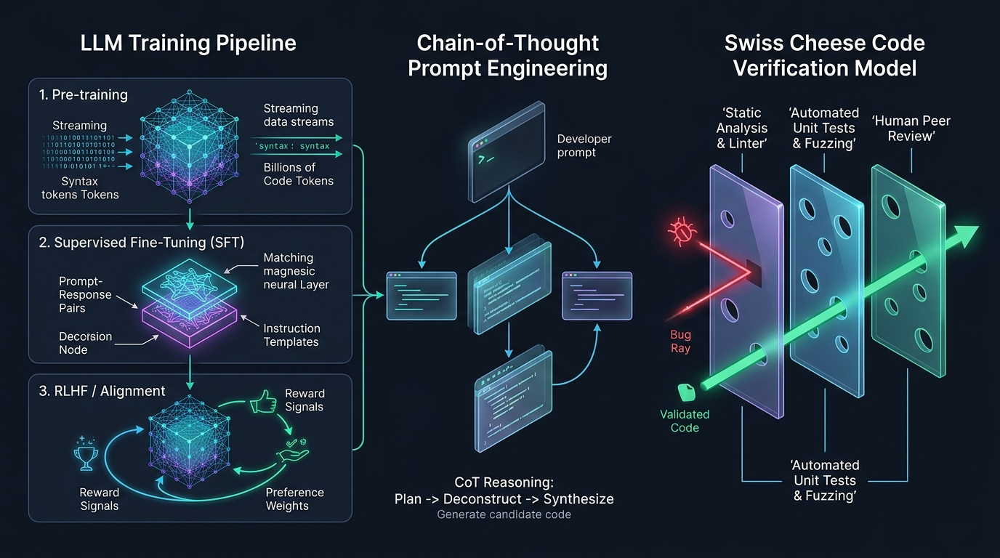
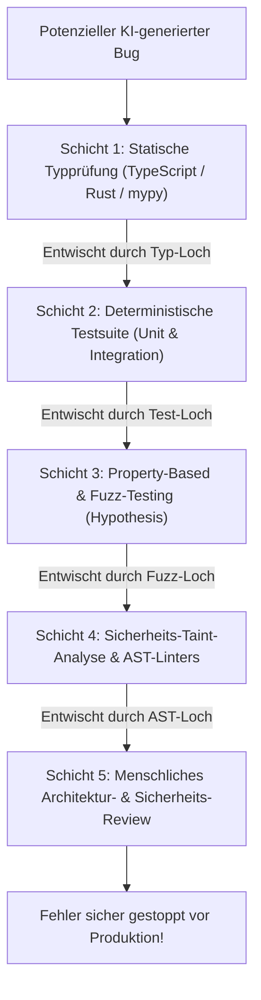

Willkommen zurück zur technischen Analyse der Stanford-Vorlesungsreihe **CS146S: The Modern Software Developer**.

In Vorlesung 1 haben wir den übergeordneten Paradigmenwechsel vom Tastatur-Typisten zum System-Dirigenten etabliert. In **Vorlesung 2 (Woche 1)** widmet sich das Curriculum dem rechnerischen Fundament dieser Revolution: **großen Sprachmodellen für Code (Coding-LLMs)** und der Disziplin des **Prompt Engineerings**.

Basierend auf Pionierarbeiten von Andrej Karpathy (*Deep Dive into LLMs*), OpenAI (*How OpenAI Uses Codex*) sowie aktuellen Prompt-Engineering-Forschungen beleuchtet diese Vorlesung, wie neuronale Netze Programmierfähigkeiten erlernen, warum sie statistische Simulatoren und keine bewussten Wesen bleiben und wie Softwareingenieure das Prinzip **„Trust but Verify“** etablieren müssen, um das trügerische **Schweizer-Käse-Modell** KI-generierten Codes abzusichern.

{/* truncate */}

---

### 1. Die Anatomie eines LLMs: Die dreistufige Trainingspipeline

Um einen KI-Programmierassistenten effektiv zu steuern und zu debuggen, muss ein Ingenieur verstehen, wie dessen Modellgewichte entstanden sind. Wie Andrej Karpathy darlegt, sind moderne LLMs keine statischen Regelsysteme, sondern das Ergebnis einer **dreistufigen Trainingspipeline**:

```mermaid
flowchart LR
    subgraph Stage1 ["Stufe 1: Pre-training (Unüberwacht)"]
        D1[Billionen Tokens aus Web & GitHub] --> N1[Transformer-Basismodell<br/>Next-Token-Wahrscheinlichkeit P(w_t | Context)]
    end

    subgraph Stage2 ["Stufe 2: Supervised Fine-Tuning (SFT)"]
        N1 --> D2[Hochwertige Instruktionspaare<br/>Prompt & Gold-Standard-Antwort]
        D2 --> N2[Instruktionsoptimierter Assistent<br/>Konversationsprotokoll]
    end

    subgraph Stage3 ["Stufe 3: RLHF & Alignment"]
        N2 --> D3[Menschliches Präferenz-Ranking<br/>Reward-Modell-Scoring]
        D3 --> N3[Produktionsreifes Coding-LLM<br/>Sicher, zielgerichtet & deterministisch]
    end
```

#### Phase 1: Pre-training (Das Wissensfundament)
- **Ziel**: Nächstes Token vorhersagen (`P(w_t | w_<t)`) über Billionen von Codezeilen (Python, C++, Rust, JavaScript, Dokumentationen).
- **Rechenaufwand**: Tausende GPUs über Monate hinweg.
- **Ergebnis**: Ein gigantischer statistischer Code-Vervollständiger. Ein Basismodell versteht jedoch noch keine dialogischen Arbeitsanweisungen.

#### Phase 2: Supervised Fine-Tuning (SFT)
- **Ziel**: Dem Modell beibringen, wie ein professioneller Software-Assistent zu antworten.
- **Daten**: Hunderttausende manuell kuratierte Frage-Antwort-Paare (z. B. „Schreibe einen Thread-Pool in C++“ $
ightarrow$ sauberer, fehlerfreier Code mit Erläuterung).

#### Phase 3: Reinforcement Learning from Human Feedback (RLHF)
- **Ziel**: Das Modell belohnen, wenn es Hilfsbereitschaft, Korrektheit und Sicherheitsrichtlinien einhält.
- **Mechanismus**: Ein separates Reward-Modell bewertet Modellantworten, woraufhin die Parameter mittels PPO (Proximal Policy Optimization) feinjustiert werden.

---

### 2. Prompt Engineering: Chain-of-Thought (CoT) & Systemkontexte

Ein häufiger Fehler bei Entwicklern ist es, LLMs wie Suchmaschinen mit einzelnen Schlagworten zu füttern. LLMs sind **autoregressive Transformer**: Jedes generierte Token wird sofort Teil des nächsten Kontexts. Wenn Sie das Modell zwingen, sofort Code auszugeben, fehlt ihm der Rechenraum zum logischen Nachdenken.

#### Chain-of-Thought (CoT) Prompting
Indem Sie das Modell anweisen, schrittweise vorzugehen (*„Think step-by-step before writing code“*), reservieren Sie Tokens für logische Zwischenschritte im Inferenzpfad:

```markdown
### Empfohlenes CoT-Prompt-Muster

1. **Rolle & Mandat**: Du bist ein Senior Distributed Systems Engineer.
2. **Architektur-Analyse**: Analysiere potenzielle Race Conditions bei nebenläufigen Schreibzugriffen.
3. **Schrittweiser Entwurf**:
   - Schritt 1: Definiere das Speichermodell und atomare Primitiven.
   - Schritt 2: Formuliere das Invarianten-Protokoll.
   - Schritt 3: Implementiere die C++20-Klasse mit std::atomic und std::memory_order.
4. **Fehlerbehandlung**: Führe alle Randfälle explizit auf.
```

Durch das explizite Generieren dieser Denk-Tokens erhöht sich die Wahrscheinlichkeit, dass die finale Code-Generierung mathematisch und semantisch korrekt ist, dramatisch.

---

### 3. Das Schweizer-Käse-Modell der KI-Code-Sicherheit

Ein Höhepunkt der Vorlesung 2 ist die Übertragung des **Schweizer-Käse-Modells** (bekannt aus der Luftfahrt und Medizin) auf die KI-gestützte Softwareentwicklung:


Keine einzelne Verifikationsschicht kann 100 % aller KI-Fehler abfangen:
- Das **LLM** hat blinde Flecken (Käselöcher: Halluzinationen, subtile Off-by-One-Fehler).
- Der **Linter** erkennt Syntax, aber keine logischen Architektur-Fehler.
- **Unit-Tests** decken bekannte Testfälle ab, aber übersehen unbekannte Randbedingungen.
- Der **Code-Reviewer** ermüdet bei der Inspektion von hunderten Zeilen KI-Code.



> **Leitprinzip von Stanford**: Ein kritischer Bug gelangt nur dann in die Produktion, wenn die Löcher aller Scheiben exakt in einer Flucht liegen. Je robuster und automatisierter die Schichten sind, desto unwahrscheinlicher wird ein Systemausfall.

---

### 4. Best Practices: „Trust but Verify“

1. **Kein ungeprüfter Code in den Main-Branch**: Jeder KI-generierte Code muss standardisierte CI-Pipelines durchlaufen.
2. **Fokus auf Randfälle**: Fordern Sie das LLM gezielt auf, destructive Unit-Tests gegen seinen eigenen Code zu schreiben.
3. **Deterministische Linter vor LLM-Review**: Verschwenden Sie keine teuren Reasoning-Tokens für Dinge, die ein lokaler Linter in 5 Millisekunden präziser prüfen kann.

---

### 📌 Management Summary (3–5 Zeilen)
1. **Drei Stufen des Modelltrainings**: Pre-training vermittelt rohes Sprachwissen, SFT lehrt Instruktionsbefolgung, und RLHF sorgt für Ausrichtung und Sicherheit.
2. **Chain-of-Thought (CoT)**: Schrittweises Denken ermöglicht es dem Transformer, vor der Code-Generierung Rechenkapazität für logische Zwischenschritte aufzuwenden.
3. **Schweizer-Käse-Modell**: Da KI-Code unvorhersehbare Schwachstellen aufweist, ist eine mehrstufige Verteidigungslinie (Typen $
ightarrow$ Unit-Tests $
ightarrow$ Fuzzing $
ightarrow$ Human Review) zwingend erforderlich.
4. **„Trust but Verify“**: KI-Geschwindigkeit entfaltet erst dann ihren vollen Wert, wenn deterministische Leitplanken Qualität und Robustheit garantieren.

### Referenzen & Kursmaterialien
- **Offizielle Vorlesungs-Playlist**: [Stanford CS146S: The Modern Software Development (YouTube Playlist)](https://www.youtube.com/playlist?list=PLxpwjSdVZQ95OWe3QvkVEcU1f1X-6NDj9)
- **Institution**: Stanford University, Department of Computer Science