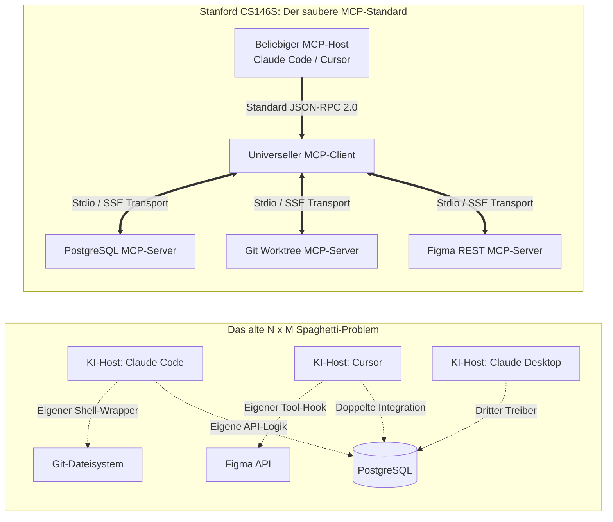
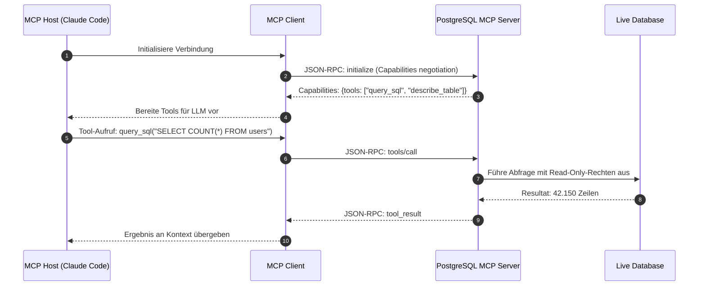

Willkommen zum dritten Teil unserer technischen Analyse der Stanford-Vorlesungsreihe **CS146S: The Modern Software Developer**.

In Vorlesung 1 behandelten wir den Wandel zum Dirigenten autonomer Agenten, in Vorlesung 2 das defensive Verifikations-Harness. In **Vorlesung 3 (Woche 2)** adressiert der Lehrplan den größten architektonischen Flaschenhals moderner KI-Systeme: **Wie können isolierte Basismodelle sicher, modular und standardisiert mit der Außenwelt interagieren?**

Vor 2024 erforderte die Anbindung eines LLMs an Datenbanken, Terminals oder GitHub-APIs maßgeschneiderten, fragilen Integrationscode. Aufbauend auf Anthropics offenem Standard und Stanfords Analyse verteilter Systeme analysiert diese Vorlesung das **Model Context Protocol (MCP)** — das universelle Bindeglied, das für KI-Agenten dieselbe revolutionäre Standardisierung leistet wie das **Language Server Protocol (LSP)** für moderne Code-Editoren.

{/* truncate */}

---

### 1. Die Fragmentierungskrise: Warum wir ein „LSP für KI“ brauchten

In der Anfangszeit der KI-Tools (Cursor, Claude Code, GitHub Copilot, Devin) versuchte jede Plattform auf proprietäre Weise, identische Unternehmensressourcen anzubinden: Git-Repositories, PostgreSQL-Cluster, Slack-Channels und Cloud-APIs.

Die Parallele zum Language Server Protocol (LSP) von Microsoft ist offensichtlich: Vor LSP benötigte jede IDE für jede Sprache ein eigenes Plugin ($N 	imes M$). LSP reduzierte die Komplexität auf $N + M$. **MCP tut exakt dasselbe für KI-Agenten und Entwicklungswerkzeuge.**

---

### 2. Die 3-Schichten-Architektur von MCP

Das Model Context Protocol definiert drei klare Systemrollen:

1. **MCP Host**: Die Anwendung, die den KI-Workflow koordiniert (z. B. Claude Code, Cursor, Claude Desktop).
2. **MCP Client**: Die interne Protokollschicht im Host, die Verbindungen zu MCP-Servern aufbaut, Tool-Fähigkeiten aushandelt und JSON-RPC-Nachrichten serialisiert.
3. **MCP Server**: Ein leichtgewichtiger Prozess, der spezifische Ressourcen oder Aktionen über standardisierte Schnittstellen bereitstellt (z. B. Dateisystem-Server, Git-Server, SQL-Server).

---

### 3. Transportmechanismen: Stdio vs. Streamable HTTP/SSE

MCP unterstützt zwei grundlegende Transportprotokolle:

| Transport | Funktionsweise | Typischer Einsatzbereich | Sicherheitscharakteristik |
| :--- | :--- | :--- | :--- |
| **Stdio (Standard Input/Output)** | Lokaler Subprozess; Kommunikation über stdin/stdout | Lokale Dateisysteme, lokale Git-Workspaces, CLI-Tools | Prozess-Isolation auf OS-Ebene; kein Netzwerk-Angriffsvektor |
| **Streamable HTTP / SSE** | Server-Sent Events über HTTP/HTTPS | Cloud-Datenbanken, Remote-Dev-Cluster, externe SaaS-APIs | Authentifizierung via OAuth2 / Bearer Token; TLS-Verschlüsselung |

Für lokale Entwicklungsagenten wie Claude Code ist **Stdio** der bevorzugte Standard: Es entstehen keine offenen Ports, keine Latenz durch Netzwerkhops und der Lebenszyklus des Servers ist direkt an den Host-Prozess gekoppelt.

---

### 4. Best Practices für sichere Tool-Nutzung

1. **Read-Only-Prinzip als Standard**: Externe Datenbank-MCP-Server sollten standardmäßig mit Lese-Rechten (`SELECT`) konfiguriert werden. Mutierende Abfragen (`UPDATE`, `DELETE`) erfordern explizite menschliche Bestätigung.
2. **Schema-Reduktion**: Übertragen Sie dem Modell nicht tausende irrelevante Tabellen, sondern nutzen Sie zielgerichtete Ressourcen-Filter (`resources/list`).
3. **Sandboxing für Dateizugriffe**: Dateisystem-Server müssen strikt auf das Projektverzeichnis begrenzt sein (Path-Traversal-Schutz gegen `../../etc/passwd`).

---

### 📌 Management Summary (3–5 Zeilen)
1. **LSP für KI-Agenten**: Das Model Context Protocol (MCP) löst das $N 	imes M$-Fragmentierungsproblem zwischen KI-Modellen und Entwicklerwerkzeugen durch einen offenen JSON-RPC 2.0-Standard.
2. **3-Schichten-Topologie**: Die Entkopplung von MCP Host, MCP Client und MCP Server sorgt für modulare Erweiterbarkeit und strikte Trennung von Verantwortlichkeiten.
3. **Transportprotokolle**: Stdio bietet maximale Sicherheit und Performance für lokale CLI-Tools, während HTTP/SSE Cloud-Ressourcen nahtlos integriert.
4. **Sicherheit im Fokus**: Das Least-Privilege-Prinzip (Read-Only-Default, Dateipfad-Sandboxing) schützt sensible Infrastruktur vor unkontrollierten Agenten-Aktionen.

### Referenzen & Kursmaterialien
- **Offizielle Vorlesungs-Playlist**: [Stanford CS146S: The Modern Software Development (YouTube Playlist)](https://www.youtube.com/playlist?list=PLxpwjSdVZQ95OWe3QvkVEcU1f1X-6NDj9)
- **Institution**: Stanford University, Department of Computer Science