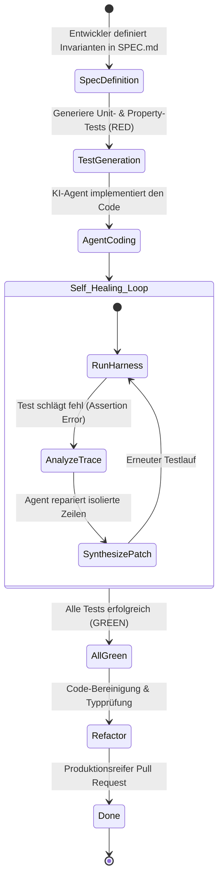

Willkommen zum vierten Teil unserer technischen Analyse der Stanford-Vorlesungsreihe **CS146S: The Modern Software Developer**.

In Vorlesung 1 analysierten wir den Wandel zum Dirigenten, in Vorlesung 2 die Funktionsweise von Coding-LLMs und in Vorlesung 3 das Model Context Protocol (MCP). In **Vorlesung 4 (Woche 3)** widmet sich das Curriculum der drängendsten praktischen Herausforderung von Softwareteams: **Wie bauen wir komplexe, vieltausendzeilige Softwaresysteme zuverlässig, wenn LLMs unvermeidlich halluzinieren, schleichende Regressionen einführen und von Produktanforderungen abweichen?**

Die naive Vorgehensweise — in sozialen Medien oft als „Vibe Coding“ oder dialogisches Prompt-and-Pray bezeichnet — versagt in produktionskritischen Umgebungen vollständig. Basierend auf Stanfords Software-Engineering-Laborexperimenten stellt diese Vorlesung das **Spec-Driven Development (SDD)** vor und zeigt, wie mit modernen Werkzeugen wie Claude Code und Cursor ein automatisiertes **Test-Harness** mit **selbstheilenden Feedback-Schleifen** implementiert wird.

{/* truncate */}

---

### 1. Der Trugschluss des „Vibe Coding“: Warum Prompting ohne Spezifikation verfällt

Wenn Entwickler rein dialogisch mit KI-Agenten interagieren, steigt die Systementropie mit jedem Konversationsschritt kontinuierlich an:

```mermaid
flowchart TD
    subgraph Vibe_Coding_Entropy ["Das Anti-Pattern: Conversational Vibe Coding"]
        V1["Vager Prompt: 'Füge Zahlungs-Checkout hinzu'"] --> V2["LLM generiert 300 Zeilen Code"]
        V2 --> V3["Entwickler überfliegt den Code (Sieht plausibel aus)"]
        V3 --> V4["Merge in den Main-Branch"]
        V4 --> V5["Nächster Prompt: 'Füge Rabattgutscheine hinzu'"]
        V5 --> V6["LLM überschreibt stillschweigend Zahlungsstatus-Logik"]
        V6 --> V7["Katastrophale Regression in der Produktion"]
    end

    subgraph Spec_Driven_Determinism ["Stanford CS146S: Spec-Driven Development (SDD)"]
        S1["Formale Spezifikation (PRD & Schnittstellenvertrag)"] --> S2["Deterministische Testsuite (Harness)"]
        S2 --> S3["KI-Codegenerierung (Claude Code / Cursor)"]
        S3 --> S4["Automatisierte Testausführung (pytest / vitest)"]
        S4 -->|Tests rot| S5["Selbstkorrekturschleife mit Fehlertraces"]
        S5 --> S3
        S4 -->|Alle Tests grün| S6["Verifizierter Merge ohne Regressionen"]
    end
```

„Vibe Coding“ scheitert, weil das Sprachmodell im Chatverlauf frühere Randbedingungen vergisst (*Attention Dilution*) und keine objektive Instanz existiert, die das Ergebnis prüft.

---

### 2. Das geschlossene Test-Harness: Der Red-Green-Refactor-Loop für Agenten

Im Spec-Driven Development fungiert das Test-Harness als deterministische Leitplanke:

#### Die drei goldenen Regeln des Harness-Engineerings:
1. **Tests zuerst schreiben**: Die Akzeptanzkriterien müssen definiert sein, bevor der Agent Implementierungszeilen erzeugt.
2. **Unveränderliche Testdateien**: Der Agent darf während der Selbstkorrektur nur die Implementierungsdateien anpassen — niemals die Testdateien selbst (*Test-Tampering Prevention*).
3. **Deterministisches Feedback**: Der Agent erhält standardisierte CLI-Exit-Codes (0 = Erfolg, ungleich 0 = Fehler mit exaktem Zeilentrace).

---

### 3. Praxis-Workflows mit Claude Code & Cursor

In der Stanford-Praxisübung implementierten Studierende einen Microservice mit Claude Code unter strikter SDD-Führung:
- **Konfigurationsdatei `CLAUDE.md`**: Definiert Build-Befehle, Testbefehle und Architektur-Regeln.
- **Subprozess-Ausführung**: Claude Code führt `pytest tests/test_payment.py` lokal im Terminal aus.
- **Iterative Reparatur**: Bei einem Fehlschlag liest Claude Code die Fehlermeldung selbstständig aus und passt die Datei gezielt an.

---

### 📌 Management Summary (3–5 Zeilen)
1. **Ende des Vibe Coding**: Unstrukturierte Chat-Prompts führen unweigerlich zu Systementropie und schleichenden Regressionen.
2. **Spec-Driven Development (SDD)**: Formale Spezifikationen und Akzeptanztests bilden die unverrückbare Grundlage erfolgreicher KI-Entwicklung.
3. **Selbstheilende Schleifen**: Durch geschlossene Feedbackzyklen (Testlauf $
ightarrow$ Fehleranalyse $
ightarrow$ atomarer Patch) reparieren Agenten Code autonom.
4. **Schutz vor Test-Manipulation**: Testdateien müssen strikt vor unberechtigten Änderungen durch das LLM geschützt werden.

### Referenzen & Kursmaterialien
- **Offizielle Vorlesungs-Playlist**: [Stanford CS146S: The Modern Software Development (YouTube Playlist)](https://www.youtube.com/playlist?list=PLxpwjSdVZQ95OWe3QvkVEcU1f1X-6NDj9)
- **Institution**: Stanford University, Department of Computer Science
