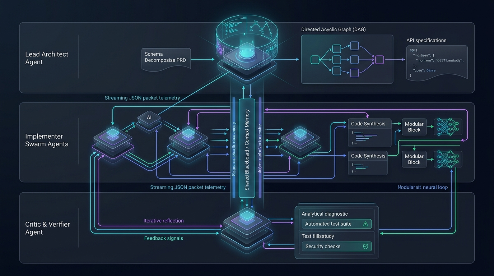
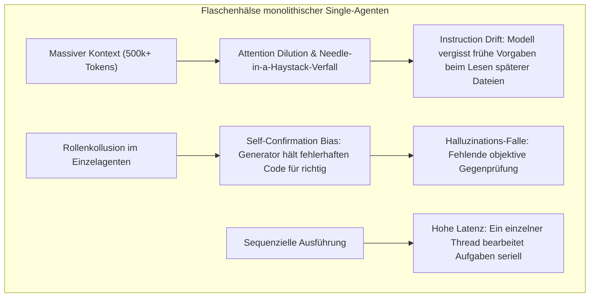
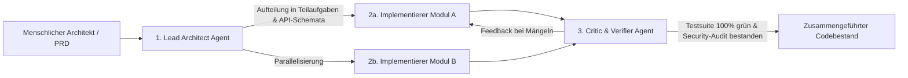

Willkommen zu Vorlesung 5 unserer technischen Analyse der Stanford-Vorlesungsreihe **CS146S: The Modern Software Developer**.

In den bisherigen Vorlesungen haben wir Prompt Engineering, Transformer-Mechanismen, das Model Context Protocol (MCP) und selbstheilende Test-Harnesses analysiert. All diese Paradigmen basierten auf einer gemeinsamen Annahme: einer **einzelnen primären LLM-Sitzung**, die mit einem Entwickler oder Workspace interagiert.

Sobald ein Softwareprojekt jedoch über einige tausend Zeilen Code und verteilte Microservices hinauswächst, bricht dieser monolithische Ansatz zusammen. Single-Agenten leiden unter **Kontextüberlastung, Aufmerksamkeitsverwässerung (*Attention Dilution*) und kognitiver Blockade**.

In dieser Vorlesung präsentieren die Stanford-Dozenten die Zukunft des AI-Native Engineerings: **Multi-Agenten-Systeme (MAS) und Swarm-Orchestrierung**. Wir untersuchen, wie die klare Aufgabenteilung in spezialisierte **Architekten, Implementierer und Kritiker** über strukturierte Message-Busses und Directed Acyclic Graphs (DAGs) Genauigkeit und Skalierbarkeit um ein Vielfaches steigert.

{/* truncate */}

---

### 1. Die Skalierungsgrenzen monolithischer Single-Agenten

Warum können wir nicht einfach ein 500.000 Zeilen umfassendes Enterprise-Repository in ein 1-Millionen-Token-Kontextfenster laden und das Modell bitten, „die gesamte Abrechnungspipeline zu refaktorisieren“?

Stanford-Forscher identifizieren drei fundamentale Flaschenhälse:

---

### 2. Das Architekt-Implementierer-Kritiker-Muster (AIC)

Die Lösung von Stanford CS146S ist die funktionale Entkopplung in drei spezialisierte Agenten-Rollen:

1. **Lead Architect Agent**: Analysiert das PRD, zerlegt das Gesamtproblem in einen gerichteten azyklischen Aufgabengraphen (DAG) und definiert strikte Schnittstellenverträge.
2. **Implementer Agents**: Mehrere spezialisierte Instanzen, die parallel und unabhängig voneinander einzelne Module implementieren.
3. **Critic & Verifier Agent**: Führt deterministische Sicherheitsprüfungen, Linter und Integrations-Tests durch. Da der Kritiker den Code nicht selbst geschrieben hat, ist er frei vom *Self-Confirmation Bias*.

---

### 3. Asynchrone DAG-Orchestrierung & Shared Memory

Damit Agenten ohne gegenseitiges Blockieren zusammenarbeiten können, setzt das System auf strukturierte JSON-Nachrichten und ein gemeinsames Shared Blackboard (Context Memory).

---

### 📌 Management Summary (3–5 Zeilen)
1. **Grenzen monolithischer Modelle**: Single-Context-Agenten leiden bei großen Repositories unter Attention Dilution und Self-Confirmation Bias.
2. **Architekt-Implementierer-Kritiker**: Funktionale Trennung ermöglicht parallele Entwicklung und unabhängige Qualitätskontrolle.
3. **DAG-Workflows**: Asynchrone Aufgabengraphen verhindern Blockaden und skalieren die Entwicklungsgeschwindigkeit massiv.
4. **Strukturierte Schnittstellen**: Strikte JSON-Schemata zwischen Agenten garantieren Konsistenz und deterministische Ergebnisse.

### Referenzen & Kursmaterialien
- **Offizielle Vorlesungs-Playlist**: [Stanford CS146S: The Modern Software Development (YouTube Playlist)](https://www.youtube.com/playlist?list=PLxpwjSdVZQ95OWe3QvkVEcU1f1X-6NDj9)
- **Institution**: Stanford University, Department of Computer Science