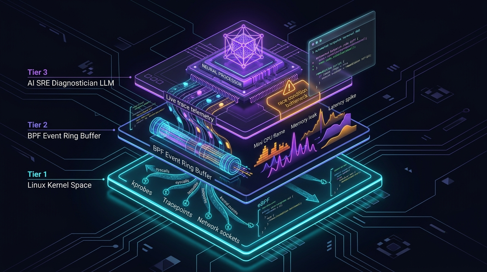
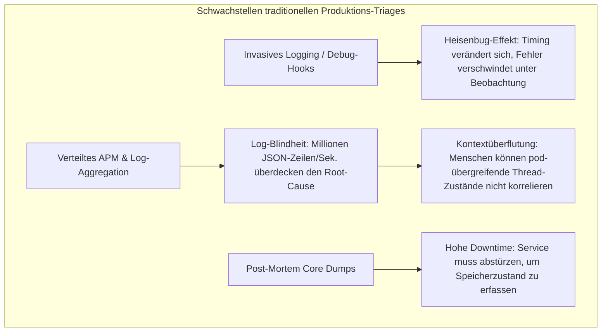
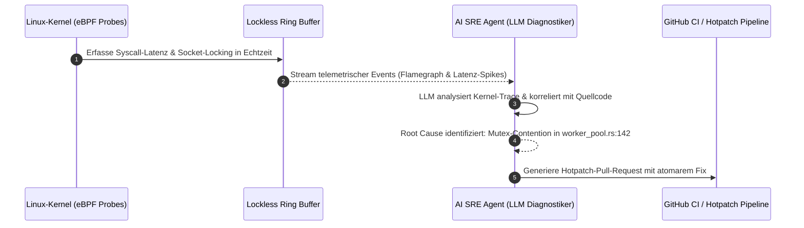

Willkommen zu Vorlesung 6 unserer technischen Analyse der Stanford-Vorlesungsreihe **CS146S: The Modern Software Developer**.

In der vorherigen Vorlesung behandelten wir die Multi-Agenten-Swarm-Orchestrierung zur Erstellung modularer Codebasen. Doch selbst die am sorgfältigsten getestete Software trifft früher oder später auf die unberechenbare Realität der Produktionsumgebung.

Um 3:00 Uhr morgens, wenn ein obskurer Concurrency-Deadlock einen verteilten Zahlungscluster blockiert oder ein unindexierter Datenbank-Query die Tail-Latenz auf 12 Sekunden ansteigen lässt, versagen traditionelle Debugging-Methoden. Statische Analysen können dynamische Race Conditions nicht vorhersehen, invasives `printf`-Logging verändert das Timing und maskiert den Fehler (*Heisenbug-Effekt*), und verteilte Logging-Systeme überfluten Site Reliability Engineers (SREs) mit Gigabytes unstrukturierter Log-Daten.

In dieser Vorlesung stellen Stanford-Dozenten die nächste Stufe softwaretechnischer Resilienz vor: **KI-gestütztes Debugging & Laufzeit-Profiling**. Durch die Verknüpfung von **extended Berkeley Packet Filters (eBPF)** mit spezialisierten **LLM-SRE-Diagnoseagenten** können Entwickler Kernel-Zustände ohne messbaren Overhead in Echtzeit erfassen, Ursachen automatisiert identifizieren und Hotfixes in Minuten statt Stunden bereitstellen.

{/* truncate */}

---

### 1. Das Dilemma traditionellen Produktions-Debuggings

Beim Ausfall von Hochdurchsatz-Microservices stehen Softwareingenieure vor drei bekannten Paradoxien:

---

### 2. Die Lösung: eBPF-Kernel-Observability + KI-Diagnostiker

eBPF ermöglicht es, sichere Bytecode-Programme direkt im Linux-Kernel auszuführen, ohne den Kernel neu zu kompilieren oder Module zu laden. Dadurch werden Netzwerk-Sockets, Syscalls und Kprobes mit nahezu 0 % Overhead überwacht.

---

### 📌 Management Summary (3–5 Zeilen)
1. **Grenzen traditionellen Debuggings**: Invasives Logging verändert Race-Condition-Timings (Heisenbugs) und APM-Tools überfluten Ingenieure mit Log-Rauschen.
2. **eBPF-Präzision**: Kernel-Level-Tracing fängt Systemaufrufe und Latenz-Spikes ohne Overhead und ohne Code-Modifikationen ab.
3. **Automatisierte Ursachenanalyse**: LLM-SRE-Agenten analysieren Ring-Buffer-Telemetrie und lokalisieren Concurrency-Engpässe im Quellcode präzise.
4. **Minutenschnelle Mitigation**: Vom automatisierten Trace-Parsing bis zur Synthese eines verifizierten Hotpatches wird die Incident-Dauer drastisch reduziert.

### Referenzen & Kursmaterialien
- **Offizielle Vorlesungs-Playlist**: [Stanford CS146S: The Modern Software Development (YouTube Playlist)](https://www.youtube.com/playlist?list=PLxpwjSdVZQ95OWe3QvkVEcU1f1X-6NDj9)
- **Institution**: Stanford University, Department of Computer Science
