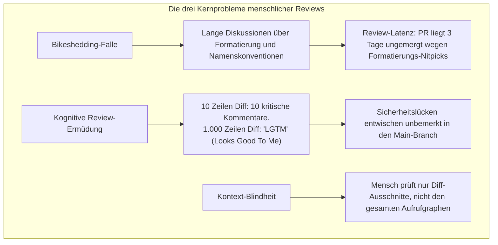
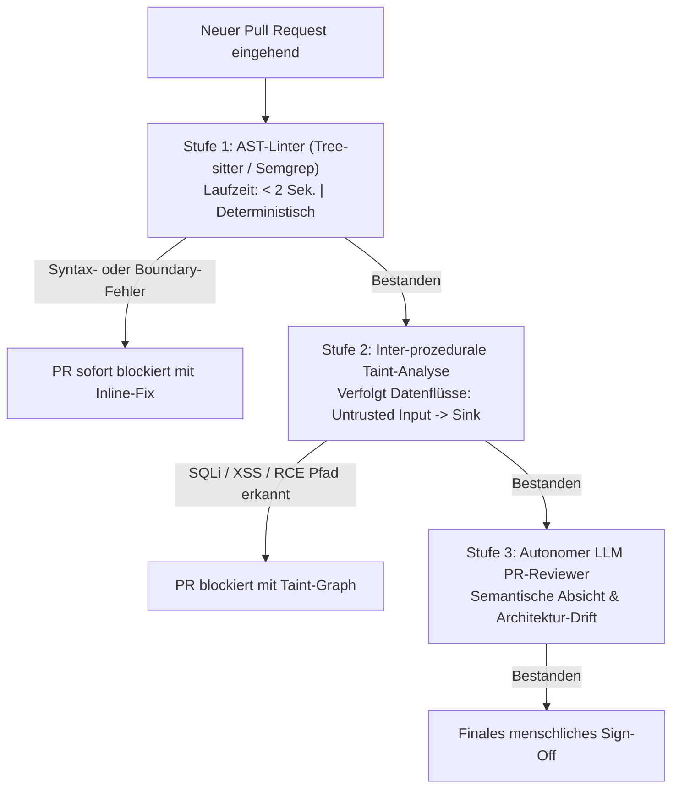

Willkommen zu Vorlesung 7 unserer technischen Analyse der Stanford-Vorlesungsreihe **CS146S: The Modern Software Developer**.

In der vorherigen Vorlesung behandelten wir die Behebung von Produktions-Incidents mittels eBPF und KI-SREs. Doch wie jede erfahrene technische Führungskraft weiß: Der kostengünstigste Fehler ist jener, der **gar nicht erst in den Main-Branch gemergt wird**.

In modernen Softwareorganisationen ist das Pull-Request-Code-Review (PR-Review) der zentrale Gatekeeper für Codequalität, architektonische Integrität und Sicherheit. Doch mit wachsenden Teams degeneriert das menschliche Code-Review oft zu einem massiven operativen Engpass. Senior Engineers verbringen 15 bis 20 Stunden pro Woche mit Diff-Inspektionen, ermüden bei stilistischen Kleinigkeiten (*Bikeshedding*) und übersehen bei riesigen 1.000-Zeilen-Änderungen aus Erschöpfung (*Review Fatigue*) kritische Concurrency-Races oder SQL-Injections.

In dieser Vorlesung präsentieren die Stanford-Dozenten den Bauplan für **Automatisiertes Code-Review im großen Maßstab**. Durch eine dreistufige Hierarchie aus **AST-Lintern (Tree-sitter, Semgrep)**, **statischer Taint-Analyse** und **autonomen LLM-PR-Reviewern** lassen sich 90 % der manuellen Review-Mühen eliminieren und Sicherheitslücken zuverlässig stoppen.

{/* truncate */}

---

### 1. Die Krise des manuellen Code-Reviews

Warum stößt das rein menschliche Peer-Review an Skalierungsgrenzen?

---

### 2. Die dreistufige automatisierte Review-Hierarchie

Stanford schlägt eine klare Arbeitsteilung vor:

1. **Stufe 1 (AST-Linter)**: Prüft Syntaxmuster und verbietet unsichere APIs deterministisch in Millisekunden.
2. **Stufe 2 (Taint-Analyse)**: Prüft, ob unvalidierte Benutzereingaben in kritische Ausführungssenken (SQL-Queries, `eval()`) gelangen.
3. **Stufe 3 (LLM PR-Reviewer)**: Bewertet semantische Logik, API-Vertragskonsistenz und Architekturschulden.

---

### 📌 Management Summary (3–5 Zeilen)
1. **Automatisierung gegen Ermüdung**: Reines menschliches Code-Review scheitert bei großen Diffs an kognitiver Erschöpfung und Bikeshedding.
2. **Dreistufige Verteidigung**: AST-Linter für Syntax, Taint-Analyse für Datensicherheit und semantische LLM-Reviewer für Architektur-Integrität.
3. **Drastische Latenzsenkung**: 90 % der mechanischen Review-Schritte werden sofort im CI-Lauf abgearbeitet.
4. **Fokus auf Architektur**: Menschliche Senior Engineers konzentrieren sich ausschließlich auf strategische Design- und Sicherheitsentscheidungen.

### Referenzen & Kursmaterialien
- **Offizielle Vorlesungs-Playlist**: [Stanford CS146S: The Modern Software Development (YouTube Playlist)](https://www.youtube.com/playlist?list=PLxpwjSdVZQ95OWe3QvkVEcU1f1X-6NDj9)
- **Institution**: Stanford University, Department of Computer Science
