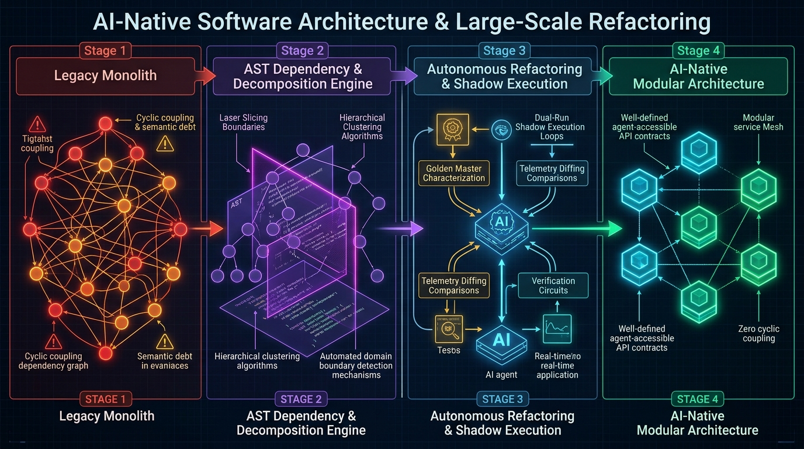
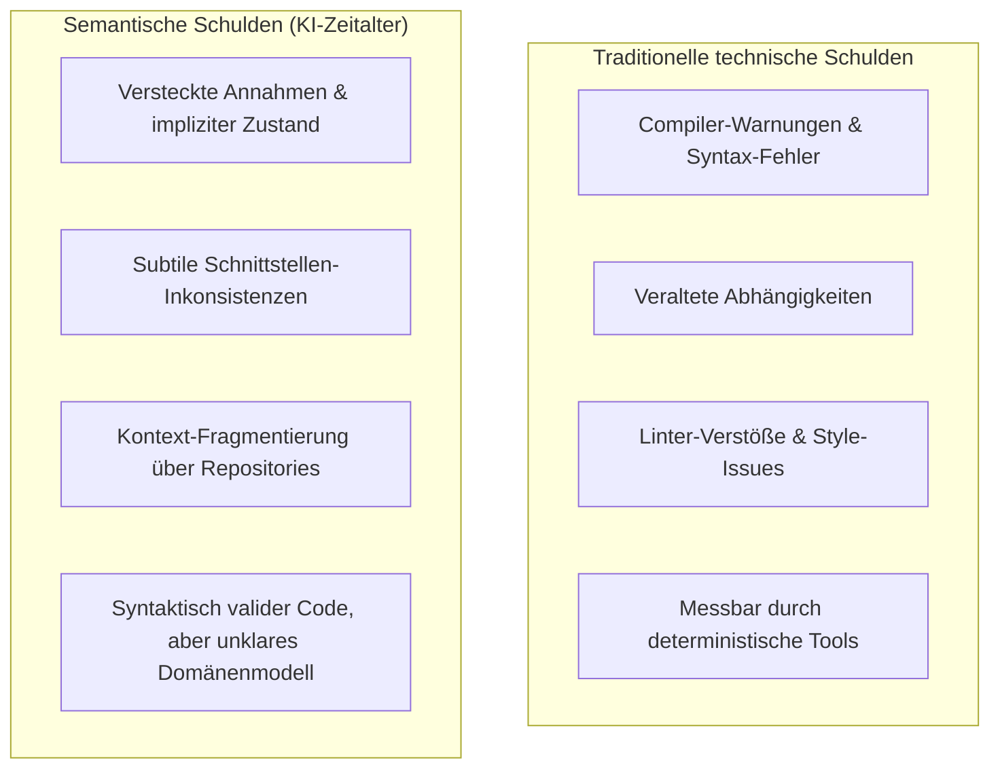
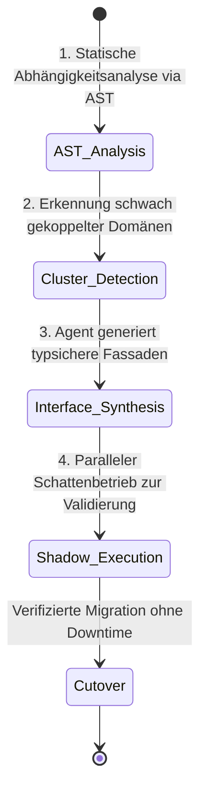

Willkommen zum achten Teil unserer technischen Analyse der Stanford-Vorlesungsreihe **CS146S: The Modern Software Developer**.

In den vorherigen Sitzungen haben wir Prompt-Engineering (Vorlesung 2), MCP-Werkzeuge (Vorlesung 3), selbstheilende Test-Harnesses (Vorlesung 4), Multi-Agenten-Swarms (Vorlesung 5), eBPF-Kernel-Tracing (Vorlesung 6) und automatisierte PR-Reviews (Vorlesung 7) untersucht.

In **Vorlesung 8** widmet sich der Lehrplan den systemischen Langzeitfolgen autonomer KI-Agenten: **Wie entwerfen wir Softwarearchitekturen, die KI-Agenten navigieren, verstehen und modifizieren können, ohne unter explodierender Komplexität zusammenzubrechen? Und wie nutzen wir KI-Agenten, um gewachsene Legacy-Monolithen sicher zu zerlegen?**

Traditionelle Softwarearchitekturen — geprägt von globalem veränderlichem Zustand, zyklischen Abhängigkeiten und 100.000-Zeilen-Monolithen — überfordern das logische Denkvermögen von Sprachmodellen. In dieser Vorlesung formalisieren Stanford-Informatiker das Konzept der **semantischen Schulden (*Semantic Debt*)**, definieren die Prinzipien **KI-nativer Architektur** und liefern eine praxiserprobte Anleitung zur **AST-gestützten Monolithen-Entkopplung**.

{/* truncate */}

---

### 1. Das Geschwindigkeitsparadoxon: Technische Schulden vs. Semantische Schulden

Klassische Softwaremetriken messen **technische Schulden**: veraltete Bibliotheken, unoptimierte Queries, fehlende Testabdeckung. Compiler und statische Linter erkennen diese deterministisch.

Wenn autonome KI-Agenten Code mit enormer Geschwindigkeit generieren, entsteht jedoch eine weitaus gefährlichere Fehlerquelle: **semantische Schulden (*Semantic Debt*)**.

Semantische Schulden entstehen, wenn Code zwar syntaktisch fehlerfrei kompiliert und alle Unittests besteht, aber die konzeptionelle Absicht so fragmentiert ist, dass kein KI-Modell mehr den gesamten Systemzusammenhang erfassen kann.

---

### 2. Prinzipien KI-nativer Softwarearchitektur

Um Systeme für autonome Agenten handhabbar zu halten, formuliert Stanford vier Architektur-Gebote:

1. **Strikte Hexagonale Architektur (Ports & Adapters)**: Die Geschäftslogik muss vollständig von Frameworks, Datenbanken und externen APIs entkoppelt sein. Ein Agent muss Kernlogik testen können, ohne eine Datenbank hochzufahren.
2. **Explizite Kontextbudgets**: Module dürfen maximal so groß sein, dass ihre vollständige Schnittstelle und Typdefinition in ein Viertel des aktuellen LLM-Kontextfensters passen.
3. **Deterministische Schnittstellenverträge**: Keine generischen `dict`- oder `JSON`-Objekte als Übergabeparameter. Jede Schnittstelle muss durch statische Schemata (Pydantic, Zod, Protobuf) abgesichert sein.
4. **Zyklusfreie Abhängigkeitsgraphen**: Zyklische Abhängigkeiten führen bei Agenten zu endlosen Refactoring-Schleifen.

---

### 3. Vorgehensmodell: AST-gestützte Monolithen-Zerlegung

Die sichere Migration eines Monolithen in modulare Services erfolgt in vier Phasen:

---

### 📌 Management Summary (3–5 Zeilen)
1. **Semantische Schulden erkennen**: Nicht kompilierbare Syntax ist das Problem von gestern; die größte Gefahr heute ist syntaktisch korrekter Code mit fragmentierter semantischer Logik.
2. **KI-Native Architektur**: Strikte Modularität, zyklenfreie Graphen und typsichere Schnittstellenverträge sind die Voraussetzung für erfolgreiche Agenten-Entwicklung.
3. **AST-gestützte Zerlegung**: Mittels AST-Aufrufgraphen identifizieren Agenten Modulgrenzen objektiv und generieren Entkopplungsfassaden.
4. **Schattenbetrieb schützt Produktion**: Vor dem endgültigen Schnitt stellt die parallele Schattenausführung die vollständige Verhaltensgleichheit sicher.

### Referenzen & Kursmaterialien
- **Offizielle Vorlesungs-Playlist**: [Stanford CS146S: The Modern Software Development (YouTube Playlist)](https://www.youtube.com/playlist?list=PLxpwjSdVZQ95OWe3QvkVEcU1f1X-6NDj9)
- **Institution**: Stanford University, Department of Computer Science