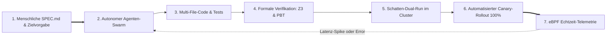

Willkommen zum **zehnten und finalen Teil** unserer umfassenden technischen Analyse der Stanford-Vorlesungsreihe **CS146S: The Modern Software Developer**.

Über die vergangenen neun Vorlesungen haben wir die traditionelle Softwareentwicklung schrittweise dekonstruiert:
- **Vorlesung 1**: Der Wandel vom Tastatur-Typisten zum System-Dirigenten.
- **Vorlesung 2**: Probabilistische Token-Mechanismen und Prompt-Engineering.
- **Vorlesung 3**: Standardisierte Werkzeugnutzung über das Model Context Protocol (MCP).
- **Vorlesung 4**: Spec-Driven Development (SDD) und selbstheilende Testschleifen.
- **Vorlesung 5**: Multi-Agenten-Swarms im Architekt-Implementierer-Kritiker-Muster.
- **Vorlesung 6**: eBPF-Kernel-Tracing und Incident-Mitigation zur Laufzeit.
- **Vorlesung 7**: AST-Linter und Sicherheits-Taint-Analyse in CI/CD.
- **Vorlesung 8**: KI-native modulare Architektur und Monolithen-Entkopplung.
- **Vorlesung 9**: Mathematische Beweisführung mit Z3 SMT-Solvern und PBT.

In diesem **Capstone-Finale** führt das Stanford-Curriculum diese Disziplinen zu einer geschlossenen Zukunftsvision zusammen: **Die autonome Software-Fabrik (*The Autonomous Software Factory*)**. Wir beleuchten, wie moderne High-Velocity-Organisationen Flotten hunderter paralleler Agenten steuern, berührungslose Continuous-Deployment-Pipelines etablieren und welche fundamentale Rolle der menschliche Ingenieur im Zeitalter automatisierter Intelligenz einnimmt.

{/* truncate */}

---

### 1. Die berührungslose Deployment-Pipeline: „Dark Factories“ für Software

In der industriellen Fertigung bezeichnet eine *„Dark Factory“* eine vollautomatisierte Produktionsstätte, die ohne menschliche Arbeitskräfte auf dem Fabrikboden auskommt — ohne Licht und ohne Heizung.

In der Softwaretechnik entsteht derzeit dasselbe Phänomen: **Zero-Human Continuous Deployment Highways**:

1. **Spezifikations-Aufnahme**: Der menschliche Chefarchitekt definiert funktionale und ethische Rahmenbedingungen.
2. **Autonome Implementierung**: Implementierer-Agenten erzeugen Code, Migrationen und Tests parallel.
3. **Formale & Deterministische Gates**: Z3-Solver und Property-Tests beweisen Korrektheit vor dem Merge.
4. **Automatisierter Canary-Rollout**: Die Pipeline deployt Software stufenweise (1% $
ightarrow$ 10% $
ightarrow$ 100%) und rollt bei kleinsten Anomalien autonom zurück.

---

### 2. Management von KI-Flotten: Governance und Budgetierung

Werden hunderte Agenten parallel eingesetzt, müssen Ingenieure strikte Kontrollmechanismen etablieren:

| Governance-Dimension | Herausforderung | Lösung von Stanford CS146S |
| :--- | :--- | :--- |
| **Token- & Kostenkontrolle** | Endlosschleifen verbrauchen tausende Dollar in Minuten | Strikte Token-Budgets pro Task mit Hard-Cutoff |
| **Sicherheitsgrenzen** | Agenten könnten gefährliche Systembefehle ausführen | Sandboxing & explizite menschliche Freigabe für destructive Actions |
| **Architektur-Drift** | Autonome Agenten erfinden inkonsistente Sub-Frameworks | Maschinell erzwungene Architektur-Guardrails im Linter |

---

### 3. Das unveränderliche Vermächtnis: Der menschliche System-Dirigent

Die Vorlesung schließt mit einem eindringlichen Fazit über die Zukunft des Softwareingenieurs:

> **„KI ersetzt keine Softwareingenieure. Aber Ingenieure, die autonome KI-Agenten dirigieren, ersetzen jene, die weiterhin Zeile für Zeile von Hand tippen.“**

Der menschliche Entwickler ist befreit von monotoner Tipparbeit und steigt auf in seine eigentliche Bestimmung: **System-Architekt, ethischer Wächter und Dirigent intelligenter Rechensysteme**.

---

### 📌 Management Summary (3–5 Zeilen)
1. **Die autonome Software-Fabrik**: Die Kombination aus Spezifikationen, Agenten-Swarms, Z3-Beweisen und eBPF ermöglicht berührungslose Zero-Human-Deployments.
2. **KI-Flottenmanagement**: Der Betrieb hunderter Agenten erfordert strikte Token-Budgets, Sandbox-Sicherheit und automatisierte Architektur-Schutzplanken.
3. **Vom Typisten zum Dirigenten**: Die Wertschöpfung verschiebt sich vollständig von manueller Syntax-Erzeugung hin zu strategischem Systemdesign und Verifikation.
4. **Informatik-Renaissance**: Fundierte Grundlagenkenntnisse in verteilten Systemen, Betriebssystemen und Logik sind wichtiger denn je.

### Referenzen & Kursmaterialien
- **Offizielle Vorlesungs-Playlist**: [Stanford CS146S: The Modern Software Development (YouTube Playlist)](https://www.youtube.com/playlist?list=PLxpwjSdVZQ95OWe3QvkVEcU1f1X-6NDj9)
- **Institution**: Stanford University, Department of Computer Science