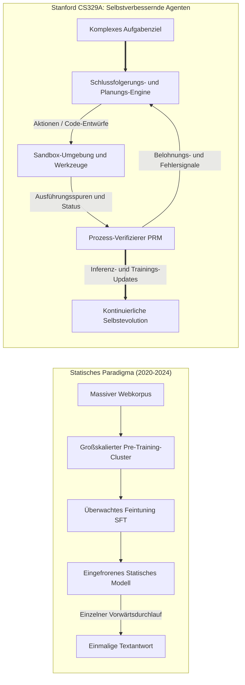

Willkommen zur detaillierten technischen Aufschlüsselung des Kurses **CS329A der Stanford University: Self-Improving AI Agents (Selbstverbessernde KI-Agenten, Herbst 2025)**.

In den vergangenen vier Jahren wurde die Landschaft der künstlichen Intelligenz von einem einzigen Dogma beherrscht: *Das Vortraining größerer Modelle auf immer gigantischeren Textkorpora führt zu kontinuierlich wachsenden kognitiven Fähigkeiten*. Während dieses Paradigma die moderne generative KI-Revolution entfachte – und Modelle wie GPT-4, Claude 3.5 und Gemini hervorbrachte –, hat die vorderste Front der Machine-Learning-Forschung einen entscheidenden Wendepunkt erreicht.

Statische Basismodelle (Static Foundation Models) weisen, ungeachtet astronomischer Parameterzahlen, fundamentale Grenzen auf: Sie sind passive, autoregressive Prädiktoren des nächsten Tokens, die in einem rückkopplungslosen Regime (Open-loop) agieren. Sobald ihre Gewichte nach dem Training eingefroren (frozen) sind, können sie schwierigen Problemen nicht dynamisch mehr Rechenleistung zuweisen, die sachliche Richtigkeit ihrer eigenen Ableitungen nicht autonom verifizieren und Fehler nicht auf Basis von Umgebungsrückmeldungen iterativ korrigieren.



Stanford CS329A widmet sich der Kernfrage des kommenden KI-Jahrzehnts: **Wie konstruieren wir Software-Agenten, die nicht bloß Text generieren, sondern ihr eigenes Denken und ihren Code kontinuierlich überprüfen, verifizieren, planen und eigenständig verbessern?**

In dieser Einführungsvorlesung analysieren wir die evolutionäre Flugbahn von Basis-LLMs zu Agentensystemen, formalisieren die Mathematik der Skalierungsgesetze und der Inferenzzeit-Rechenallokation, untersuchen die vier kanonischen Agenten-Workflow-Muster und isolieren den kritischen Flaschenhals autonomer Intelligenz: die **Generator-Verifizierer-Lücke (Generator-Verifier Gap)**.

{/* truncate */}

---

### 1. Der evolutionäre Bogen: Wie wir hierher gelangten

Um die Stoßrichtung selbstverbessernder Agenten zu verstehen, müssen wir die drei historischen Phasen des modernen Foundation-Model-Engineerings betrachten:

```
  Phase 1: Pre-Training (Selbstüberwachte Vorhersage des nächsten Tokens)
  [Web-Scraping / Billionen Tokens] ────> Basis-LLM (Autoregressiver Text-Vervollständiger)
                                                    │
  Phase 2: Post-Training Alignment                  ▼
  [Kuratierte Prompt-Antwort-Paare] ────> SFT (Instruktionsbefolgender Assistent)
  [Menschliche Präferenzen (RLHF/DPO)] ─> Ausgerichteter Konversations-Chatbot
                                                    │
  Phase 3: Die CS329A-Fronte                        ▼
  [Ausführungs-Feedback + PRM-Prüfung] ─> Autonomer Selbstverbessernder Agent
```

#### Phase 1: Unüberwachtes Pre-Training (Unsupervised Pre-Training)
Ein Basis-Sprachmodell wird auf Billionen von Tokens über das Maximum-Likelihood-Schätzungs-Kriterium (MLE) optimiert:
$$\mathcal{L}_{\text{MLE}}(\theta) = - \sum_{i=1}^{T} \log P_\theta(x_i \mid x_{1:i-1})$$
Dieses Ziel zwingt das Modell, Syntax, Weltwissen und semantische Assoziationen in hunderte Milliarden Parameter zu komprimieren. Dennoch bleibt das Basismodell ein uneingeschränkter probabilistischer Nachahmer. Auf den Prompt *"Was ist die Hauptstadt von Frankreich?"* antwortet es unter Umständen nicht mit der Lösung, sondern fährt fort mit *"Was ist die Hauptstadt von Deutschland?"*, da solche Listen im Web häufig koexistieren.

#### Phase 2: Instruktionstuning und RLHF (Das "ChatGPT-Rezept")
Um aus einem ungebändigten Textgenerator einen nützlichen Assistenten zu formen, etablierte die Industrie eine zweistufige Post-Training-Pipeline:
1. **Supervised Fine-Tuning (SFT):** Training auf hochwertigen Demonstrationspaaren, um dem Modell eine hilfsbereite Dialogrolle einzuprägen.
2. **Reinforcement Learning from Human Feedback (RLHF) / DPO:** Optimierung gegen ein Belohnungsmodell $r_\psi(x, y)$, welches menschliche Präferenzen abbildet:
$$\max_\theta \mathbb{E}_{(x, y) \sim \mathcal{D}} \left[ r_\psi(x, y) \right] - \beta \, \mathbb{D}_{\text{KL}}\left(\pi_\theta(y \mid x) \,||\, \pi_{\text{ref}}(y \mid x)\right)$$
Obwohl RLHF Konversationsgehorsam und Sicherheit herstellte, verlieh es den Modellen keine echte Autonomie bei der Problemlösung. Ein ausgerichteter Chatbot erzeugt seine Ausgabe nach wie vor in einem einzigen sequenziellen Durchlauf ohne deliberative Verifikation oder externe Werkzeugnutzung.

#### Phase 3: Die CS329A-Grenze — Autonome Agentenschleifen
Selbstverbessernde Agenten sprengen das Korsett des einzelnen Vorwärtsdurchlaufs. Durch die Einbettung externer Werkzeuge (Compiler, Web-Browser, Python-REPLs), strukturierter Speicherhierarchien und automatisierter Verifikationsschleifen verwandelt sich das System in einen aktiven Agenten: Es beobachtet die Umwelt, führt diskrete Handlungen aus, evaluiert Zwischenzustände und verfeinert seine internen Pläne, bis ein Ziel nachweisbar erfüllt ist.

---

### 2. Die Mathematik der Skalierungsgesetze: Trainings- vs. Inferenzzeit

Das Fundament des modernen Deep Learning ist die **Skalierungshypothese (Scaling Hypothesis)**. 2020 zeigten Kaplan et al. (OpenAI) und 2022 Hoffmann et al. (DeepMind Chinchilla), dass der Test-Kreuzentropie-Verlust $L$ eines autoregressiven Sprachmodells bezüglich Rechenbudget $C$, Parameteranzahl $N$ und Datensatzgröße $D$ einem Potenzgesetz folgt:

$$L(N, D) = E + \frac{A}{N^\alpha} + \frac{B}{D^\beta}$$

wobei $E$ die irreduzible Entropie natürlicher Sprache darstellt, $A, B$ Skalierungskoeffizienten sind und $\alpha \approx 0.34, \beta \approx 0.28$ empirische Skalierungsexponenten bezeichnen.

```
Kreuzentropie-Verlust L
 ▲
 │ ╲  10^21 FLOPs (GPT-2 Ära)
 │  ╲
 │   ╲  10^23 FLOPs (GPT-3 Ära)
 │    ╲
 │     ╲  10^25 FLOPs (GPT-4 Ära)
 │      └─── Pre-Training-Mauer (Datenerschöpfung und Leistungsgrenzen)
 └─────────────────────────────────────────────────────────────►
                       Rechenaufwand C (FLOPs)
```

Dennoch stößt das reine Skalieren des Pre-Trainings an physische und ökonomische Grenzen:
- **Die Datenmauer:** Hochwertige, von Menschen verfasste Texte im offenen Internet werden Schätzungen zufolge noch in diesem Jahrzehnt vollständig erschöpft sein.
- **Kapital- und Leistungsdichte:** Trainingscluster mit mehr als $10^{26}$ FLOPs erfordern dedizierte Gigawatt-Umspannwerke und Infrastrukturinvestitionen von hunderten Millionen Dollar.

#### Die zweite Front: Skalierung zur Inferenzzeit (Inference-Time Compute Scaling)
Statt zig Millionen Dollar für das Neuerlernen von Modellgewichten aufzuwenden: **Können wir überlegene Intelligenz freisetzen, indem wir während der Inferenz (Test-Time) mehr Rechenleistung investieren?**

Ein menschlicher Experte formuliert bei komplexen mathematischen Beweisen oder Softwarearchitekturen nicht sofort die perfekte Lösung; er skizziert Hypothesen, prüft Zwischenlemmata, erkennt Sackgassen und vollzieht Backtracking.

Bei der **Inferenzzeit-Skalierung** verteilen wir Test-FLOPs über drei fundamentale Achsen:
1. **Wiederholtes Sampling (Best-of-$N$ / Large Language Monkeys):** Paralleles Erzeugen von $N$ Lösungstrajektorien aus $\pi_\theta$ und Selektion der optimalen Antwort über einen Verifizierer. Die Wahrscheinlichkeit mindestens einer korrekten Lösung folgt der $\text{Pass@}k$-Metrik:
$$\text{Pass@}k = \mathbb{E}\left[ 1 - \frac{\binom{n - c}{k}}{\binom{n}{k}} \right]$$
wobei $n$ die Gesamtzahl der Samples und $c$ die Anzahl korrekter Trajektorien ist.
2. **Schrittweise Verifikation (PRM vs. ORM):** Outcome Reward Models (ORM) bewerten nur das Endergebnis $r(x, y)$, was die Lokalisierung von Zwischenfehlern unmöglich macht. Process-supervised Reward Models (PRM) weisen jedem einzelnen Gedankenschritt eine skalare Belohnung $r_t = R(x, y_{1:t})$ zu und ermöglichen so präzise Kreditzuweisung (Credit Assignment).
3. **Baumsuchalgorithmen (MCTS, Beam Search):** Erkundung des kombinatorischen Denkbaums mittels Monte-Carlo-Baumsuche, balanciert zwischen Ausbeutung vielversprechender Zustände (Exploitation) und Erkundung neuer Pfade (Exploration).

Wie Pionierarchitekturen (z. B. OpenAI o1, DeepSeek-R1) belegen, kann die Vervielfachung der Inferenzrechenzeit um den Faktor 100 bis 1.000 bei mathematischen Wettbewerben (IMO) und Programmier-Benchmarks (SWE-bench) Leistungsdimensionen eröffnen, die reines Parameterwachstum weit hinter sich lassen.

---

### 3. Die vier kanonischen Agenten-Workflow-Archetypen

Beim Bau autonomer Agentensysteme scheitert naives Prompting häufig an stochastischer Drift. Stanford CS329A formalisiert modulare Entwurfsmuster in vier Kernarchitekturen:

```mermaid
flowchart TD
    subgraph Muster1 ["1. Prompt-Verkettung (Prompt Chaining)"]
        P1_In[Aufgabeneingabe] --> P1_M1[Modell Schritt 1]
        P1_M1 -->|Zwischenergebnis| P1_M2[Modell Schritt 2]
        P1_M2 --> P1_Out[Finales Ergebnis]
    end

    subgraph Muster2 ["2. Dynamisches Routing (Dynamic Routing)"]
        P2_In[Benutzeranfrage] --> P2_Router{Absichts-Router}
        P2_Router -->|Mathematik| P2_Math[Symbolische Engine]
        P2_Router -->|Codebasis| P2_Code[SWE-Agent]
        P2_Router -->|Allgemein| P2_LLM[Standard-LLM]
    end

    subgraph Muster3 ["3. Parallelisierung (Parallelization)"]
        P3_In[Aufgabe] --> P3_A[Agent 1: Konservativ]
        P3_In --> P3_B[Agent 2: Kreativ]
        P3_In --> P3_C[Agent 3: Adversariell]
        P3_A --> P3_Agg[Konsens-Aggregator]
        P3_B --> P3_Agg
        P3_C --> P3_Agg
    end

    subgraph Muster4 ["4. Orchestrator-Worker (Orchestrator-Worker)"]
        P4_In[PRD-Spezifikation] --> P4_Orch[Zentraler Orchestrator]
        P4_Orch -->|Teilaufgabe 1| P4_W1[Fach-Worker 1]
        P4_Orch -->|Teilaufgabe 2| P4_W2[Fach-Worker 2]
        P4_W1 -->|Statusrückmeldung| P4_Orch
        P4_W2 -->|Statusrückmeldung| P4_Orch
        P4_Orch --> P4_Out[Integriertes Liefersystem]
    end
```



#### 1. Prompt-Verkettung (Prompt Chaining: Sequenzielle Zerlegung)
Zerlegt eine monolithische Aufgabe in deterministische Schritte, bei denen die Ausgabe von Schritt $k$ zum Eingabekontext für Schritt $k+1$ wird. Durch zwischengeschaltete Validierungstore (z. B. Gliederung erstellen $\to$ Vollständigkeit prüfen $\to$ Entwurf schreiben $\to$ Korrekturlesen) wird Fehlerkaskaden vorgebeugt.

#### 2. Dynamisches Routing (Dynamic Routing: Spezialisierung)
Klassifiziert eingehende Anfragen und leitet sie an spezialisierte Modelle oder Werkzeuge weiter. Mathematische Probleme wandern in eine Python-Sandbox, großflächige Code-Refactorings an einen spezialisierten SWE-Agenten.

#### 3. Parallelisierung (Parallelization: Aufteilung und Abstimmung)
- **Sektionierung (Sectioning):** Gleichzeitiges Bearbeiten unabhängiger Teilaufgaben durch mehrere Agenteninstanzen.
- **Voting-Ensemble (Voting):** Paralleles Erzeugen mehrerer Lösungen mit diversen Prompts oder Temperaturparametern zur Filterung stochastischer Anomalien durch Mehrheitsbeschluss.

#### 4. Orchestrator-Worker (Hierarchische Delegation)
Ein zentraler Planungsagent bricht ein übergeordnetes Ziel in einen gerichteten azyklischen Graphen (DAG) herunter, delegiert Teilaufgaben an spezialisierte Arbeiter-Agenten, überwacht Ausnahmen in Echtzeit und integriert die Einzelergebnisse.

---

### 4. Der kritische Flaschenhals: Die Generator-Verifizierer-Lücke

Warum ist die Entwicklung selbstverbessernder Agenten so herausfordernd?
Der Kern des Problems liegt in der **Asymmetrie zwischen Generierung und Verifikation**:

$$\text{Komplexität}(\text{Verifikation}) \ll \text{Komplexität}(\text{Generierung}) \quad \text{in geschlossenen formalen Domänen (Code, Mathe)}$$
$$\text{Komplexität}(\text{Verifikation}) \approx \text{Komplexität}(\text{Generierung}) \quad \text{in offenen natürlichsprachlichen Domänen}$$

```
Verifikationsfähigkeit
 ▲
 │   Formale Domänen (Mathematik, Python-Code, Lean 4)
 │   ┌────────────────────────────────────────────────────────┐
 │   │ Verifizierer (Compiler / Testsuite / Z3 SMT-Solver)    │
 │   │ Deterministisch, rechengünstig und 100% zuverlässig   │
 │   └────────────────────────────────────────────────────────┘
 │
 │   Offene Domänen (Aufsätze, Strategieberatung, Verhandlung)
 │   ┌────────────────────────────────────────────────────────┐
 │   │ Verifizierer (LLM als Richter)                         │
 │   │ Rauschanfällig, anfällig für Verbosity Bias & Schmeichelei │
 │   └────────────────────────────────────────────────────────┘
 └─────────────────────────────────────────────────────────────►
                     Generierungskomplexität
```

In formalen Umgebungen wie der Softwareentwicklung ist die Verifikation deterministisch: Der Code kompiliert fehlerfrei oder scheitert; Unit-Tests bestehen oder schlagen fehl. Hier funktioniert die Selbstverbesserung direkt: Kandidaten erzeugen, Tests laufen lassen, fehlerhafte Entwürfe verwerfen und funktionierende Patches übernehmen.

In offenen natürlichsprachlichen Domänen erfordert die **Bewertung, ob eine Antwort optimal ist, jedoch nahezu dieselbe kognitive Intelligenz wie ihre Neuerstellung**. Setzen wir ein LLM als Richter über ein anderes LLM ein, geraten wir in stochastische Zirkelschlüsse: Der Beurteiler bevorzugt weitschweifige Antworten (Verbosity Bias) und teilt die Halluzinationen des Generators.

Das Schließen dieser Lücke durch neuro-symbolische Übersetzung in formale Einschränkungen und die Verankerung in externen Ausführungsumgebungen bildet den wissenschaftlichen Kern von CS329A.

---

### 5. Stanford CS329A: Vierstufiger Lehrplan-Fahrplan

Das Curriculum von CS329A gliedert sich in vier progressive Schichten:

```
┌─────────────────────────────────────────────────────────────────────────────┐
│                    Stanford CS329A Architektur-Stack                        │
├─────────────────────────────────────────────────────────────────────────────┤
│  Teil 4 · Fronten (L13 - L17)                                               │
│  - Formale mathematische Beweise (AlphaProof, Lean 4)                       │
│  - Autonome Systemzuverlässigkeit und AI-Control-Grenzen                    │
│  - Multimodale und verkörperte Robotik-Agenten (VLA, RT-2, π0)              │
│  - Großes Finale: Offene Zukunftsfragen und Alignment-Erosion               │
├─────────────────────────────────────────────────────────────────────────────┤
│  Teil 3 · Agent Engineering (L10 - L12)                                     │
│  - Software-Engineering-Agenten (SWE-bench, ASI-Schnittstelle)              │
│  - Hierarchische Speicherarchitekturen (MemGPT, CacheBlend)                 │
│  - Langzeittask-Evaluation und ökonomischer Nutzen (METR Time Horizons)     │
├─────────────────────────────────────────────────────────────────────────────┤
│  Teil 2 · Training & Evolution (L6 - L9)                                    │
│  - Trainingszeit-Skalierung und RL (DeepSeekMath & GRPO)                    │
│  - Offene Selbstevolution und Architektursuche (ADAS, AlphaEvolve)          │
│  - Autonome Deep-Research-Workflows (AlphaCode, Search-o1)                  │
│  - Die Post-Training-Evolution: SFT -> RLHF -> RLVR -> Agent RL             │
├─────────────────────────────────────────────────────────────────────────────┤
│  Teil 1 · Grundlagen (L1 - L5)                                              │
│  - Inferenzzeit-Skalierung und rechenoptimale Frontiers                     │
│  - Prozessüberwachte Verifizierer (PRM800K)                                 │
│  - Werkzeugintegration und Code-Feedback-Schleifen (ReAct, RLEF)            │
│  - Mehrstufige Planung und Monte-Carlo-Baumsuche (LATS MCTS)                │
└─────────────────────────────────────────────────────────────────────────────┘
```

---

### 6. Wichtigste Erkenntnisse und Akademische Q&A

#### Wichtigste Erkenntnisse
1. **Der Paradigmenwechsel:** KI hat sich von der statischen Textgenerierung zu autonomen Rückkopplungsschleifen weiterentwickelt, in denen Ausführung, Prüfung und Reflexion kontinuierlich ineinandergreifen.
2. **Duale Skalierungsfronten:** Die Vergrößerung von Pre-Training-Parametern wird nun durch Inferenzzeit-Skalierung (Best-of-$N$, PRM-Verifikation, Baumsuche) ergänzt, wodurch kompakte Modelle durch überlegtes Denken Großmodelle schlagen können.
3. **Das universelle Rückgrat:** Jedes erfolgreiche Agentensystem implementiert den Dreiklang: **Generieren $\to$ Verifizieren $\to$ Iterieren**.
4. **Der Verifikationsflaschenhals:** Die Evolutionsrate eines Agenten wird strikt durch die Schärfe und Objektivität seines Verifikationssignals begrenzt.

---

#### Akademische Q&A

**F. Wie unterscheidet sich Inferenzzeit-Skalierung von standardmäßigem Prompt-Engineering oder Chain-of-Thought (CoT)?**
**A.** Standard-CoT generiert Gedankengänge in einer linearen, ungeprüften Sequenz. Unterläuft dem Modell in Schritt 2 ein Rechenfehler, pflanzt sich dieser unweigerlich fort. Inferenzzeit-Skalierung hingegen etabliert externe Suchbäume und Verifikations-Checkpoints: Jeder Schritt wird durch Prozessbelohnungsmodelle (PRM) oder Compiler bewertet. Dies erlaubt das aktive Vertiefen erfolgversprechender Pfade und das gezielte Zurückschneiden (Pruning) fehlerhafter Äste.

**F. Warum trainieren wir nicht einfach ein gigantisches LLM als universellen Prüfer für alle Aufgaben?**
**A.** Weil probabilistische neuronale Netze ihre eigenen stochastischen Irrtümer ohne eine objektive Verankerung in der realen Umwelt (Ground-truth Anchor) nicht korrigieren können. LLM-Richter neigen zu Schmeichelei und Bevorzugung langer Antworten. Eine belastbare Verifikation entsteht erst, wenn sprachliche Aussagen in deterministische Artefakte überführt werden: Kompilierbare Unittests, SQL-Transaktionen, Lean-4-Theoreme oder Sensorsignale physischer Roboter.

---

### Vorschau auf die nächste Vorlesung

In **Vorlesung 2** analysieren wir die tiefen mathematischen Mechanismen der **Inferenzzeit-Rechenskalierung (Test-Time Compute Scaling)**:
- Die rechenoptimalen Skalierungsgrenzen nach Snell et al.
- Der Trade-off zwischen Sampling-Abdeckung und sequenzieller Suchtiefe.
- Wie Architekturen wie *Archon* und *Large Language Monkeys* Rechenbudgets zwischen Generierung und Verifikation optimieren.

Begleiten Sie uns bei der Entschlüsselung des Bauplans selbstverbessernder künstlicher Intelligenz!