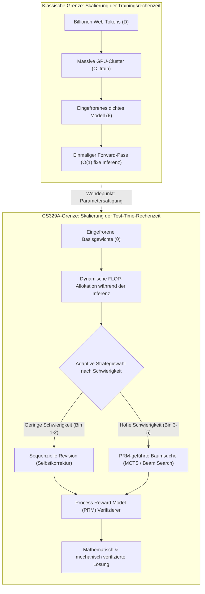
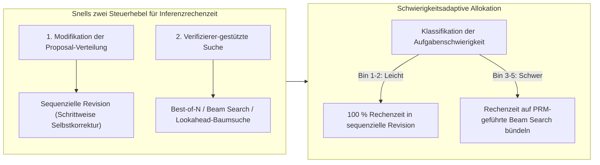
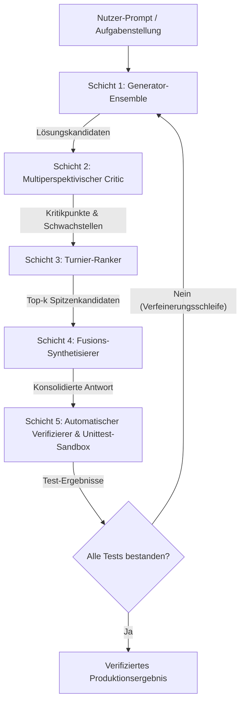

Willkommen zum zweiten Teil unserer fundierten ingenieurwissenschaftlichen Analyse des Hauptstudiums-Kurses der **Stanford University, CS329A: Self-Improving AI Agents (Herbst 2025)**.

In der Einführungsvorlesung haben wir den makroökonomischen Paradigmenwechsel von statischen autoregressiven Next-Token-Prädiktoren hin zu autonomen Agentenschleifen mit Umgebungs-Feedback nachgezeichnet. Heute widmen wir uns dem rechnerischen Fundament dieser Autonomie: **Test-Time Compute Scaling (Skalierung der Rechenzeit während der Inferenz)**.

Über ein halbes Jahrzehnt lang wurde die KI-Forschung von den Skalierungsgesetzen des Pre-Trainings beherrscht (Kaplan et al., Chinchilla): *massive GPU-Cluster aufbauen, die Modellparameter N in die Hunderte Milliarden treiben und zig Billionen Web-Tokens D verarbeiten*. Doch was geschieht, wenn wir uns nach dem Einfrieren der Modellgewichte θ weigern, eine hastige Greedy-Antwort innerhalb von 50 Millisekunden zu akzeptieren? Was passiert, wenn ein Agent stattdessen **10 Sekunden, 1 Minute oder 10 Minuten investiert, um Argumentationsbäume zu explorieren, Zwischenschritte zu verifizieren und Hypothesen zu revidieren**?

Anhand der bahnbrechenden empirischen Resultate von *Large Language Monkeys* (Brown et al., 2024), Snell et al.s *Compute-Optimal Scaling* (Stanford/UC Berkeley, 2024) und des modularen Archon-Architektur-Frameworks formalisieren wir mathematisch und systemtechnisch, wie der Austausch von Inferenz-FLOPs gegen Parameterkapazität die moderne KI revolutioniert.



{/* truncate */}

---

### 1. Klassische Skalierung vs. Inferenzrechenzeit: Der Paradigmenwechsel

Das moderne Deep Learning basiert auf der empirischen Erkenntnis, dass der Validierungsverlust als Potenzgesetz (Power Law) der Trainingsrechenzeit abnimmt:

```text
L(N, D) = E + A / N^α + B / D^β
```

wobei N die Anzahl der Nicht-Embedding-Parameter und D die Größe des Datensatzes in Tokens darstellt. Diese klassische Formulierung behandelt die Inferenzrechenzeit jedoch als triviale, statische Konstante: exakt 2 FLOPs pro Parameter pro generiertem Token während des autoregressiven Decodings.

#### Die physikalischen Grenzen der Trainingsskalierung
Als die Industrie Modelle über 10^26 FLOPs (GPT-4-Klasse) hinaus skalierte, stieß das Pre-Training auf drei unüberwindbare Barrieren:
1. **Die Erschöpfungsgrenze menschlicher Web-Daten:** Hochwertiger, von Menschen verfasster Text im Internet ist endlich (geschätzt auf ~10^14 Tokens). Das unkontrollierte Trainieren auf synthetischen Daten ohne deterministische Verifizierer führt zu Modellkollaps (Model Collapse) und Entropie-Degeneration.
2. **Exponentiell explodierende Investitionskosten:** Um die Benchmark-Genauigkeit am flachen Ende einer Potenzkurve um lediglich 1 % zu steigern, muss das 10-fache an Trainings-FLOPs investiert werden – was Hunderte Millionen Dollar an CAPEX erfordert.
3. **Der Trugschluss des statischen Forward-Passes:** Unabhängig davon, ob ein Modell 7 Milliarden oder 1 Billion Parameter besitzt, erzeugt das Standard-Decoding jeden Token t_i in einer festen Anzahl von Matrixmultiplikationen:

```text
t_i ~ Softmax( W_u · LayerNorm( h_L(t_{1:i-1}) ) )
```

Komplexe NP-vollständige mathematische Beweise, Multi-File-Software-Bugs und formale Programmverifikationen lassen sich schlichtweg nicht in einem rein linearen Durchlauf ohne Backtracking, Hypothesenbildung und Zwischenprüfung lösen.

---

### 2. Die Rückkehr des Infinite-Monkey-Theorems: Large Language Monkeys

In der klassischen Wahrscheinlichkeitsrechnung besagt Émile Borels *Infinite-Monkey-Theorem*, dass ein Affe, der unendlich lange zufällig auf einer Schreibmaschine tippt, mit an Sicherheit grenzender Wahrscheinlichkeit irgendwann die gesammelten Werke von William Shakespeare verfassen wird.

Ende 2024 untersuchten Forscher der UC Berkeley und von Google Research diese Hypothese an modernen Frontier-LLMs in ihrer Pionierarbeit: **《Large Language Monkeys: Scaling Inference Compute with Repeated Sampling》** (Brown et al., 2024).

```
Coverage (Pass@k %)
 ▲
100│                                     ┌────────────── Theoretische Pass@k-Obergrenze
 90│                                ┌────┘ (Erreicht 99 % bei MATH & CodeContests)
 80│                           ┌────┘
 70│                      ┌────┘
 60│                 ┌────┘ ◄── SWE-bench Lite: DeepSeek-Coder-V2 (k=250 -> 56.0%)
 50│            ┌────┘
 40│       ┌────┘   ◄── Claude 3.5 Sonnet Einzellauf (43.0%)
 30│  ┌────┘
 20│ ┌┘
 10│┌┘  ◄── Gemma-2B Pass@1 (0.02%)
  0└┴──────┬──────────┬──────────┬──────────┬──────────►
    k=1    k=10       k=100      k=1,000    k=10,000   (Anzahl generierter Samples k)
```

#### Mathematische Formulierung des unverzerrten pass@k-Schätzers
Werden N Lösungskandidaten unabhängig generiert, von denen exakt C Kandidaten eine automatisierte Test-Suite (z. B. Unittests) bestehen, ist der unverzerrte Schätzer mit minimaler Varianz (MVUE) für pass@k definiert als:

```text
Pass@k = (1 / P) · ∑_{i=1}^P [ 1 - C(N - C_i, k) / C(N, k) ]
```

wobei P die Gesamtanzahl der Aufgaben, C_i die Anzahl erfolgreicher Lösungen für Aufgabe i und C(n, r) den Binomialkoeffizienten bezeichnen. Um bei N = 10.000 Gleitkommaüberläufe zu verhindern, verwendet die Produktions-Pipeline folgende numerisch stabile Multiplikationsschleife:

```text
Pass@k = 1 - ∏_{j=0}^{k-1} ( 1 - C_i / (N - j) )
```

#### Empirische Durchbrüche: Kompakte Modelle schlagen Giganten
Die empirischen Resultate von Large Language Monkeys stellten traditionelle Evaluationsmetriken auf den Kopf:
* **SWE-bench Lite (Reale GitHub Software-Engineering-Bugs):**
  * Das Open-Source-Modell `DeepSeek-Coder-V2-Instruct` erzielte bei k=1 eine bescheidene Erfolgsrate von **15,9 %**.
  * Bei einer Erhöhung auf k=250 Samples katapultierte sich pass@250 auf **56,0 %**.
  * Dies übertraf das Ensemble aus GPT-4o und Claude 3.5 Sonnet (43,0 %) um **überragende 13 Prozentpunkte**.
* **CodeContests (Komplexe Wettbewerbsprogrammierung):**
  * Das leichtgewichtige Modell `Gemma-2B` wies ein pass@1 von nur **0,02 %** auf (praktisch null).
  * Bei einer Skalierung auf k=10.000 kletterte pass@10.000 auf **7,1 %** – eine **355-fache Leistungssteigerung** rein durch Inferenzrechenzeit.
* **Die wirtschaftliche Umkehrung:**
  * Das Erreichen von 29,62 % auf SWE-bench mit DeepSeek-Coder-V2 (k=5) kostete **10,80 $**.
  * Dagegen kostete ein Einzellauf von GPT-4o (24,0 %) **39,00 $ (3,6-mal teurer)**, und Claude 3.5 Sonnet (26,7 %) verbrauchte **51,00 $ (4,7-mal teurer)**.

```text
┌───────────────────────────────┬──────────┬────────────┬─────────────┐
│ Modell & Inferenzstrategie    │ SWE-bench│ Kosten ($) │ Multiplikator│
├───────────────────────────────┼──────────┼────────────┼─────────────┤
│ DeepSeek-Coder-V2 (k=5)       │ 29.62%   │ $10.80     │ 1.0x (Basis)│
│ GPT-4o (k=1 Greedy Einzellauf)│ 24.00%   │ $39.00     │ 3.6x Kosten │
│ Claude 3.5 Sonnet (k=1)       │ 26.70%   │ $51.00     │ 4.7x Kosten │
│ DeepSeek-Coder-V2 (k=250)     │ 56.00%   │ $540.00    │ Spitzenwert │
└───────────────────────────────┴──────────┴────────────┴─────────────┘
```

#### Die Coverage-Precision-Lücke: Die Wand des Verifizierers
Wiederholtes Sampling ohne intelligente Selektion stößt jedoch unweigerlich an die **Coverage-Precision-Lücke**.

In geschlossenen, formalen Domänen mit deterministischen Orakeln (wie Compilern oder Unittests) gilt: **Coverage ist gleich Erfolgsrate**. Wenn 1 von 250 Trajektorien alle Unittests besteht, wird sie mechanisch isoliert.

In offenen oder informellen Domänen ohne externe Compiler verkehrt sich die Situation:
* Auf dem MATH-Datensatz erreichte `Llama-3-8B-Instruct` bei k=10.000 eine Coverage von **98,44 %** (in 98 % der Fälle war die richtige Lösung im Pool vorhanden).
* Bei Anwendung von **Mehrheitsabstimmung (Majority Voting)** stieg die Genauigkeit jedoch nur von 40,5 % auf magere **41,41 %** (+0,9 %p).
* Die **Best-of-N-Auswahl** mittels Outcome Reward Model (ORM) stagnierte bei ca. k=100 und scheiterte daran, die verbleibenden 57 % korrekter Lösungen aufgrund von Verifizierer-Rauschen und False Positives zu extrahieren.

> **Ingenieur-Grundsatz:** Einfach nur mehr Samples zu ziehen, ohne über einen präzisen Verifizierer zu verfügen, vergrößert lediglich den Heuhaufen. Selbst wenn die Nadel mit 99 %iger Wahrscheinlichkeit im Heuhaufen liegt, nützt dies nichts, wenn man keinen Magneten (Verifizierer) besitzt, um sie herauszuziehen.

---

### 3. Snells rechenoptimale Skalierung: Parameter gegen FLOPs tauschen

Wie investiert ein Systementwickler ein festgelegtes Budget an Inferenz-FLOPs am effizientesten, anstatt blind 10.000-mal zu würfeln?

Ende 2024 veröffentlichten Charlie Snell, Jaehoon Seo, Hao Liu, Aviral Kumar und Sergey Levine (Stanford University & UC Berkeley) die bahnbrechende Arbeit: **《Scaling LLM Test-Time Compute Optimally can be More Effective than Scaling Model Parameters》**.



#### Die zwei Dimensionen der Inferenzrechenzeit
Snell et al. fassten alle Inferenzmethoden in zwei orthogonale Achsen zusammen:
1. **Modifikation der Proposal-Verteilung (Proposer):** Das Modell wird konditioniert, durch sequenzielle Revision von vornherein qualitativ bessere Gedankengänge zu erzeugen:
   ```text
   y_{t+1} ~ P_θ( y | x, y_1, ..., y_t, Critique_t )
   ```
2. **Verifizierer-gestützte Zustandssuche (Verifier):** Systematische Exploration von Zwischenschritten mithilfe von Process Reward Models (PRMs):
   ```text
   Score(Node_t) = PRM_ψ( x, y_{1:t} )
   ```

#### Das Umkehrprinzip der aufgabenadaptiven Allokation
Die entscheidende Erkenntnis des Stanford-Berkeley-Teams war, dass **die optimale Strategie je nach Schwierigkeitsgrad der Aufgabe exakt invertiert**:

```text
Schwierigkeit Bin 1-2 (Leichte Aufgaben) ───>  Sequenzielle Revision dominiert
Schwierigkeit Bin 3-5 (Schwere Aufgaben) ───>  PRM-geführte Beam Search dominiert
```

1. **Leichte Aufgaben (Bins 1–2):** 
   * Bei einfachen Aufgaben liegt bereits der erste Versuch des Basismodells nahe an der korrekten Lösung.
   * Der Einsatz komplexer Baumsuchen fügt hier lediglich Verifizierer-Rauschen hinzu, was zu Überoptimierung (Over-optimization) und Fehlentscheidungen führt.
   * **Optimale Strategie:** Die sequenzielle Revision (Aufforderung an das Modell, Tippfehler oder Vorzeichenfehler zu beheben) erreicht maximale Genauigkeit bei minimalem Rechenaufwand.
2. **Schwere Aufgaben (Bins 3–5):**
   * Bei extrem anspruchsvollen Mathematik-Wettbewerbsaufgaben scheitert lineare Selbstkorrektur, da der initiale Lösungsweg in eine irreversible Logikfalle geraten ist.
   * **Optimale Strategie:** Beam Search, geführt von einem schrittweisen PRM, schneidet fehlerhafte Gedankengänge frühzeitig ab.
3. **Die Recheneffizienz-Dividende:**
   * Eine adaptive Richtlinie, die leichten Aufgaben Revision und schweren Aufgaben PRM-Beam-Search zuweist, erreicht dieselbe Genauigkeit wie Best-of-N bei einem **um das 4-Fache geringeren Rechenaufwand (4x Ersparnis)**.

#### Die 14x-Parameter-Äquivalenz
Der spektakulärste Vergleich in Snells Untersuchung war das Duell: **Pre-Training-Parameter um das 14-Fache vergrößern** gegenüber **einem kleinen Modell das 14-Fache an Inferenzrechenzeit bereitstellen**:

```text
Modell mit 14x Parametern (Greedy Decoding)   vs.   1x Basismodell + 14x Inferenzrechenzeit
```

* Bei leichten bis mittelschweren Aufgaben auf MATH und GSM8K zog das kompakte Modell mit optimaler Inferenzrechenzeit mit dem 14-mal größeren dichten Riesen gleich oder übertraf diesen sogar.
* Bei extremen Aufgaben (Bin 5) blieben die vortrainierten Parameter jedoch unersetzlich: Wenn dem Basismodell die elementare semantische Repräsentation zur Formulierung einer Hypothese fehlt, verkommt jede Inferenzsuche zu unbegründeter Halluzination.

---

### 4. Systemtechnik: Modulare Multi-Agenten-Architektur mit Archon

Wie lassen sich diese theoretischen Inferenzgesetze in robuste Produktionssoftware überführen, ohne auf fragile Prompt-Basteleien zurückzugreifen?

Das **Archon**-Framework (arxiv:2409.15254) löst dies, indem es funktionale LLM-Bausteine in **schichtweise Software-Pipelines** modularisiert:



#### Die fünf Architekturschichten von Archon
1. **Generator-Schicht:** Erzeugt vielfältige Lösungskandidaten durch variierte Sampling-Temperaturen (T=0,2 bis 0,8) oder den Einsatz heterogener Modelle (z. B. Claude 3.5 Sonnet + DeepSeek-V2).
2. **Critic-Schicht:** Analysiert die erzeugten Trajektorien gezielt auf mathematische Lücken, logische Widersprüche oder Randwertprobleme.
3. **Ranker-Schicht:** Führt paarweise Turniervergleiche zwischen den Kandidaten anhand strukturierter Bewertungsrubriken durch.
4. **Fuser-Schicht:** Rekombiniert die stärksten logischen Argumente der bestplatzierten Kandidaten zu einer überlegenen Gesamtlösung (+8,9 % Benchmark-Zuwachs).
5. **Verifier-Schicht:** Lässt ein LLM 5 bis 10 Unittests für Randfälle generieren und führt den Code in einer isolierten Sandbox (Docker/gVisor) aus (+56 % Genauigkeit bei Programmieraufgaben).

Mittels **Bayesscher Optimierung (Bayesian Optimization)** traversiert Archon einen Architektursuchraum von **9.576 Pipeline-Konfigurationen** und ermittelt für jedes Latenz- und Kostenbudget die Pareto-optimale Agentenarchitektur.

---

### 5. Architektur-Fallstudie: Demystifizierung von OpenAI o1 & Reasoning-Modellen

Die Vorlesung 2 der Stanford CS329A erklärt präzise die internen Abläufe moderner Reasoning-Modelle wie OpenAI o1 und DeepSeek-R1:

```
┌────────────────────────────────────────────────────────────────────────┐
│                   Hinter dem "Thinking"-Trace von o1                   │
├────────────────────────────────────────────────────────────────────────┤
│ 1. Verborgene Deliberation (Test-Time Tokens):                         │
│    Das Modell erzeugt Tausende verdeckte Chain-of-Thought-Tokens,      │
│    bevor das erste sichtbare Zeichen ausgegeben wird.                  │
│                                                                        │
│ 2. Integrierte PRM-Bewertung & Backtracking:                           │
│    Trainiert mit Reinforcement Learning (RL) auf Prozessbelohnungen, um│
│    Sackgassen selbstständig zu erkennen und zurückzuspringen.          │
│                                                                        │
│ 3. Autonome Korrekturschleife (Snell Revision):                         │
│    Formulierungen wie "Moment, das scheint falsch zu sein..." sind     │
│    Manifestationen gelernter sequenzieller Revisionsrichtlinien.       │
└────────────────────────────────────────────────────────────────────────┘
```

Der sichtbare Denkprozess ist keine magische Blackbox: Er ist die vollständige neuronale Implementierung der **Inferenzzeit-Skalierung**, die sequenzielle Revision, PRM-Verifikation und adaptive Suche in einer einzigen Modellarchitektur vereint.

---

### 6. Zusammenfassung und zentrale Ingenieur-Lehren

1. **Zwei orthogonale Dimensionen:** Die Skalierung von KI-Systemen hängt nicht mehr allein vom Pre-Training ab. Die Inferenzrechenzeit bietet eine unabhängige Achse, mit der kompakte Modelle selbst schwerste Industriemodelle schlagen können.
2. **Das Coverage-Precision-Prinzip:** Wiederholtes Sampling (pass@k) steigert die Lösungs-Coverage massiv (DeepSeek-Coder-V2 von 15,9 % auf 56,0 %), erfordert jedoch hochpräzise Verifizierer (PRM), um diese Erfolge auch zu bergen.
3. **Snells Gesetz der optimalen Allokation:** Adaptive Rechenzeitverteilung spart das 4-Fache an Rechenressourcen ein: Nutzen Sie sequenzielle Revision für einfache Aufgaben und PRM-Beam-Search für komplexe Problemstellungen.
4. **Modulare Softwarearchitektur:** Wie Archon beweist, ist die Software-Pipeline – das Zusammenspiel aus Generatoren, Kritikern, Rankern und Test-Sandboxes – für das Endergebnis mindestens genauso entscheidend wie die Parametergröße des Modells.

---

### Vorschau auf Stanford CS329A Vorlesung 3:
In **Vorlesung 3** betreten wir das Herzstück autonomer Agenten: **《Robust Verification: Process Reward Models (PRM), Ensembles und skalierbare Aufsicht (Scalable Oversight)》**. Wir werden im Detail untersuchen, wie Verifizierer gebaut werden, die immun gegen Reward-Hacking sind und mathematische Beweise ohne menschliche Aufsicht verifizieren. Bleiben Sie dran!
