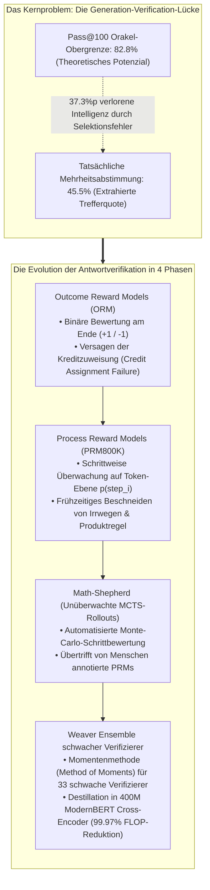
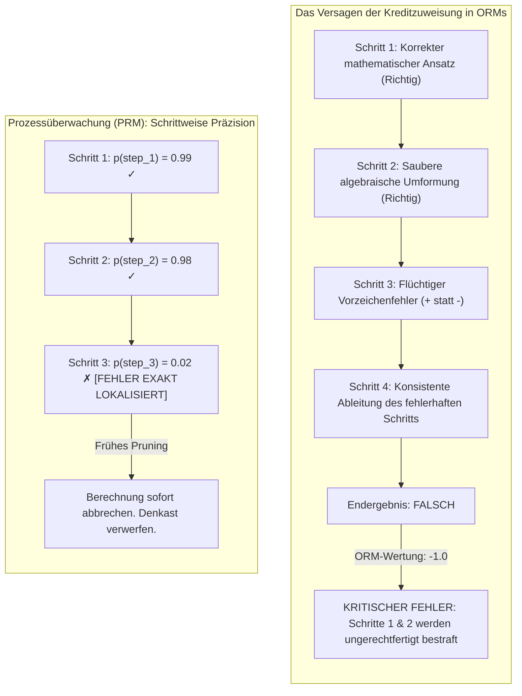
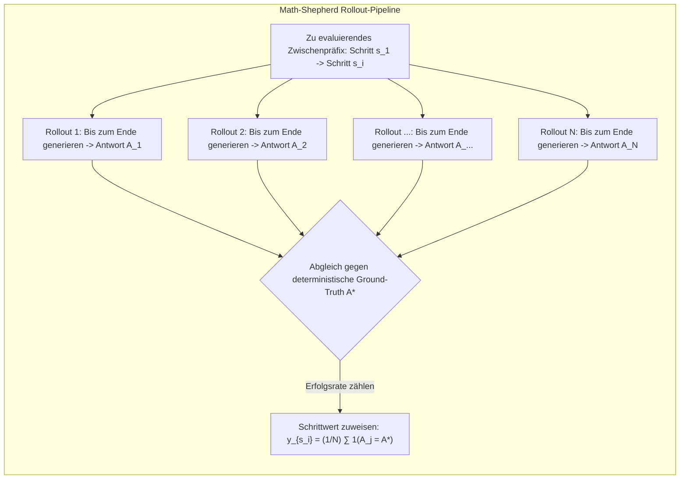
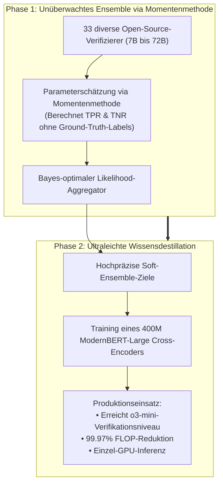

Willkommen zum dritten Teil unserer vertiefenden technischen Analyse des Hauptstudiumskurses der **Stanford University, CS329A: Self-Improving AI Agents (Herbst 2025)**.

In Vorlesung 2 haben wir die Mechanismen der Test-Time-Rechenzeitskalierung untersucht und eine fundamentale Erkenntnis gewonnen: Das Ziehen von Tausenden von Lösungskandidaten ($pass@k$) treibt zwar die theoretische Lösungsabdeckung über 99 %, doch dieses Potenzial bleibt ohne einen hochpräzisen Verifizierer (Verifier) unbrauchbar. Bei naiver Mehrheitsabstimmung (Majority Voting) stagniert die tatsächliche Trefferquote rasch auf einem Plateau.

Heute widmen wir uns dem architektonischen Kernsystem, das diesen Flaschenhals durchbricht: **Robuste Verifikation (Robust Verification)**.

Menschliche Mathematiker und Ingenieure lösen anspruchsvolle Probleme selten in einem ununterbrochenen Vorwärtsdurchlauf; sie notieren einen Zwischenschritt, prüfen dessen algebraische Konsistenz, korrigieren Vorzeichenfehler und vollziehen bei Bedarf ein Backtracking, bevor sie den nächsten Deduktionsschritt wagen. Standardmäßige autoregressive Sprachmodelle generieren Text hingegen ausschließlich vorwärtsgerichtet. Unterläuft ihnen in einer frühen Phase ein logischer Fehler, erfinden sie nachfolgend immer komplexere Halluzinationen, um ihren ursprünglichen Irrtum zu rechtfertigen.

Wie können wir unabhängige Verifizierer konstruieren, die Zwischenschritte analysieren, logische Trugschlüsse isolieren und Agenten zu mathematisch bewiesenen Lösungen leiten – ohne Millionen Dollar für manuelle Annotationen auszugeben?

Anhand der Pionierarbeiten von Cobbe et al. (GSM8K, OpenAI, 2021), der Prozessüberwachung von Lightman et al. (PRM800K, 2023), der automatisierten Monte-Carlo-Schrittannotation (*Math-Shepherd*, Yu et al., 2023) und des aktuellen *Weaver*-Ensemble-Frameworks (NeurIPS 2025) erarbeiten wir die Grundlagen der modernen **Verifizierer-Technik (Verifier Engineering)**.



{/* truncate */}

---

### 1. Die Generation-Verification-Lücke: Mathematische Definition des Flaschenhalses

Bevor wir spezifische Verifizierer-Architekturen untersuchen, müssen wir die Diskrepanz zwischen dem, was ein Modell generieren kann, und dem, was ein Agent verlässlich extrahiert, formalisieren:

```text
Gap(K) = Pass@K - Actual_Success_Rate
```

Auf modernen Benchmarks wie GPQA Diamond erzielen Open-Weights-Modelle wie `Llama-3.3-70B-Instruct` einen $Pass@100$ von **82,8 %**. Dies belegt, dass bei über 8 von 10 Aufgaben mindestens ein fehlerfreier Lösungsweg im Pool der 100 generierten Kandidaten enthalten ist.

Wendet man auf dieselben 100 Kandidaten jedoch die übliche **Mehrheitsabstimmung (Majority Voting)** an, bricht die tatsächlich gemessene Genauigkeit auf **45,5 %** ein.

```
Genauigkeit (%)
 ▲
100│                                     ┌────────────── Pass@100 Orakel-Grenze (82.8%)
 90│                                ┌────┘
 80│                           ┌────┘
 70│                      ┌────┘
 60│                 ┌────┘
 50│            ┌────┘ ◄── 37.3%p verlorene Intelligenz
 40│  ──────────┴──────────────────────── Plateau der Mehrheitsabstimmung (45.5%)
 30│
 20│
 10│
  0└┴────────────────────────────────────────────────► Sample-Budget K
```

Ganze **37,3 Prozentpunkte kognitiven Potenzials gehen verloren**, schlicht weil das System nicht in der Lage ist, die richtige Lösung auszuwählen. Wenn mehrere fehlerhafte Denkpfade auf dieselbe plausible Scheinantwort (Plausible Distractor) konvergieren, wählt eine frequenzbasierte Heuristik unweigerlich ein False Positive.

#### Der Ursprung unabhängiger Verifizierer: Cobbe et al. (GSM8K, 2021)
Um diese Kluft zu überwinden, stellte das OpenAI-Team um Karl Cobbe den GSM8K-Benchmark vor und führte das Konzept des **unabhängigen Verifizierers** ein:

1. **Entkoppelte Gewichte:** Generator und Verifizierer teilen sich während der Inferenz keine Gewichte. Der Generator wird lediglich 2 Epochen lang trainiert, um die Sampling-Entropie zu bewahren; der Verifizierer lernt auf den generierten Lösungspfaden.
2. **Wert-Köpfe auf Token-Ebene:** Anstatt nur am Sequenzende einen Skalar auszugeben, wird an jeder Token-Position des Transformers ein linearer Kopf angebracht, der die Erfolgswahrscheinlichkeit schätzt:
   ```text
   V(t_i) = W_v · h_L(t_i) + b_v
   ```
   Die Verlustfunktion kombiniert Sprachmodellierungs-Kreuzentropie mit dem mittleren quadratischen Fehler (MSE):
   ```text
   L_total = L_LM(θ) + λ · || V(t_end) - y_true ||^2
   ```
3. **Die 30x-Parameter-Dividende:**
   * Ein kompakter **Verifizierer mit nur 6B Parametern**, der den besten aus 100 Kandidaten auswählte, erzielte dieselbe Genauigkeit wie ein ungelenktes **175B-Riesenmodell**.
   * Die bloße Trennung von Generierung und Verifikation erbrachte einen **30-fachen Effizienzgewinn bezüglich der Modellparameter**.

---

### 2. Outcome- vs. Prozessüberwachung: Lightman et al. (PRM800K)

Obgleich Cobbes Verifizierer bahnbrechend war, blieb er auf **Ergebnisüberwachung (Outcome Reward Models, ORMs)** beschränkt.

Im Mai 2023 veröffentlichte Hunter Lightman mit dem OpenAI-Team die richtungsweisende Arbeit: **《Let's Verify Step by Step》** (Lightman et al., 2023).



#### Das Problem der Kreditzuweisung (Credit Assignment Problem)
Betrachten wir einen 10-stufigen mathematischen Beweis:
* **Das Dilemma des False Negative:** Das Modell schlussfolgert in den Schritten 1 bis 6 meisterhaft. In Schritt 7 unterläuft ihm ein kleiner Rechenfehler, der das Endergebnis verfälscht.
  * *ORM-Urteil:* Weist $-1$ zu. Die exzellenten Deduktionen der Schritte 1 bis 6 werden aktiv abgestraft, was das Trainingssignal verfälscht.
* **Das Dilemma des False Positive (Glückstreffer):** In Schritt 3 begeht das Modell einen gravierenden Logikfehler, macht in Schritt 8 jedoch einen zweiten kompensierenden Fehler und trifft zufällig das richtige Endergebnis.
  * *ORM-Urteil:* Weist $+1$ zu. Das Modell wird für fehlerhafte Logik belohnt, was Reward Hacking begünstigt.

Dieses Versagen temporaler Kreditzuweisung begrenzt die Skalierung ergebnisbasierter Verifizierer drastisch.

#### Die Mathematik der Process Reward Models (PRMs)
Lightman et al. erstellten **PRM800K**, einen Datensatz aus 800.000 schrittweisen menschlichen Annotationen über 75.000 Lösungen zu MATH-Aufgaben. Jeder Zwischenschritt (getrennt durch Zeilenumbrüche) wurde als positiv, negativ oder neutral klassifiziert.

Um Kosten zu sparen, etablierten sie die **First-Error Termination Rule**: Sobald der erste logische Fehler auftrat, wurde die Annotation abgebrochen, da nachfolgende Schritte einer falschen Prämisse keinen epistemischen Wert besitzen.

Das PRM prognostiziert die Wahrscheinlichkeit, dass Schritt $s_i$ logisch korrekt ist:

```text
p(s_i) = σ( W_p · h_L( Token_{\text{newline}, i} ) )
```

Die Gesamtwertung für den gesamten Lösungspfad $S = (s_1, s_2, ..., s_M)$ wird über die **Produktregel (Product Rule)** berechnet:

```text
Score_PRM(S) = ∏_{i=1}^M p(s_i \text{ is correct})
```

#### Empirische Überlegenheit der PRMs
Auf dem anspruchsvollen MATH-Datensatz unter Best-of-N-Suche bis $N = 1.860$:

```text
┌───────────────────────────────┬──────────────┬──────────────┬─────────────┐
│ Selektionsstrategie           │ Best-of-1    │ Best-of-100  │ Best-of-1860│
├───────────────────────────────┼──────────────┼──────────────┼─────────────┤
│ Mehrheitsabstimmung           │ 52.4%        │ 68.3%        │ 69.6%       │
│ Outcome Reward Model (ORM)    │ 52.4%        │ 70.1%        │ 72.4%       │
│ Process Reward Model (PRM)    │ 52.4%        │ 74.8%        │ 78.2%       │
└───────────────────────────────┴──────────────┴──────────────┴─────────────┘
```

1. **Divergierende Skalierungskurven:** Während Mehrheitsabstimmung und ORM bei $N = 100$ stagnieren, steigt die Genauigkeit des PRM bis in den Bereich von Tausenden von Kandidaten kontinuierlich an.
2. **Negative Alignment Tax:** Während klassisches Sicherheits-RLHF oft mathematische Fähigkeiten einbüßt (die sogenannte "Alignment Tax"), steigert die Prozessüberwachung Nachvollziehbarkeit und Robustheit, während gleichzeitig die Problemlösekompetenz wächst.

---

### 3. Automatisierte Prozessüberwachung: Math-Shepherd Monte-Carlo-Rollouts

Trotz der Stärke von PRM800K blieb ein entscheidender Nachteil: **800.000 Schritte von Hand zu annotieren, ist wirtschaftlich nicht skalierbar**.

Ende 2023 stellten Yu, Shen, Zhou et al. **Math-Shepherd** vor – ein automatisiertes Annotationsverfahren, inspiriert von Monte-Carlo Tree Search (MCTS).



#### Grundlegende algorithmische Intuition
Wie AlphaGo die Stellung bewertet, beurteilt die Maschine Zwischenschritte autonom:
> Wenn ein Zwischenschritt $s_i$ mathematisch solide ist, führt das Fortführen der Rechnung aus diesem Zustand heraus häufig zur richtigen Lösung $A^*$. Beinhaltet $s_i$ jedoch einen fatalen Fehler, führen Folge-Rollouts fast nie zu $A^*$.

#### Hard vs. Soft Estimation
Math-Shepherd formalisiert zwei Bewertungsfunktionen:

1. **Hard Estimation (HE):** Weist $+1$ zu, wenn mindestens einer der $N$ Rollouts die richtige Antwort erreicht, andernfalls $0$:
   ```text
   y^{HE}_{s_i} = 1( ∃ j \in {1, ..., N} : A_j = A^* )
   ```
2. **Soft Estimation (SE):** Berechnet die relative Häufigkeit der korrekten Rollouts als stetige Wahrscheinlichkeit:
   ```text
   y^{SE}_{s_i} = (1 / N) · ∑_{j=1}^N 1( A_j = A^* )
   ```

#### Der Durchbruch: Maschinen-Labels schlagen menschliche Experten
Math-Shepherd generierte **1,7 Millionen annotierte Schritte** (mehr als das Doppelte von PRM800K) bei null Dollar Annotationskosten.

* **Mensch vs. Maschine:** Auf offenen LLaMA-Modellen übertraf ein mit Math-Shepherd trainiertes PRM **das von Menschen annotierte PRM800K auf dem MATH-Datensatz**.
* **Ursache des Vorsprungs:** PRM800K evaluierte ausschließlich GPT-4-Antworten und kannte die spezifischen Fehlermodi offener Modelle nicht. Math-Shepherd hingegen sampelte direkt aus der nativen Verteilung des Zielmodells.
* **RL mit Prozessbelohnungen:** Unter PPO-Reinforcement-Learning kletterte `Mistral-7B` auf MATH von 28,6 % auf **43,5 %**.

---

### 4. Ensemble-Theorie: Das Weaver-Framework (NeurIPS 2025)

Selbst mit Math-Shepherd weisen einzelne kompakte Verifizierer (7B/13B) verbleibende Fehlerraten auf. Der parallele Betrieb von 70B-Modellen in der Produktion ist jedoch extrem teuer.

Forscher der Stanford University und der UW-Madison präsentierten auf der NeurIPS 2025 eine mathematisch elegante Lösung: **《Weaver: Shrinking the Generation-Verification Gap with Weak Verifiers》** (Zhang et al., 2025).



#### Unüberwachte Verifizierer-Aggregation mittels Momentenmethode
Weaver bündelt 33 schwache Verifizierer (7B bis 72B). Wie bestimmt man in einer Testumgebung ohne Labels, **welchem Verifizierer man vertrauen kann?**

Weaver modelliert das Problem als **Latent Variable Naive Bayes**:
* Die tatsächliche Korrektheit `Y in {0, 1}` ist eine unbeobachtete latente Variable.
* Jeder Verifizierer `k` besitzt eine unbekannte Sensitivität (``w_{k,1}``) und Spezifität (``w_{k,0}``):
  ```text
  `w_{k,1}` = P(S_k = 1 | Y = 1), \quad `w_{k,0}` = P(S_k = 0 | Y = 0)
  ```
* Unter Annahme bedingter Unabhängigkeit bei gegebenem $Y$ lässt sich die gemeinsame Wahrscheinlichkeit paarweiser Urteile algebraisch ausdrücken.

Über die **Momentenmethode (Method of Moments)** invertiert Weaver die Kovarianzgleichungen und **ermittelt die exakten Genauigkeitsgewichte ``(`w_{k,1}`, `w_{k,0}`)`` aller 33 Verifizierer ohne ein einziges Label**.

Die resultierende Bayes-optimale Posterior-Wahrscheinlichkeit lautet:

```text
P( Y=1 | S_1, ..., S_K ) = 1 / ( 1 + exp( - ( l_0 + ∑_{k=1}^K l_k(S_k) ) ) )
```

#### Resultate
1. **Überflügelung von OpenAI o3-mini:**
   * In Kombination mit `Llama-3.3-70B-Instruct` erzielte das Weaver-Ensemble auf anspruchsvollen STEM-Aufgaben **87,7 %**.
   * Damit übertraf es Spitzenmodelle wie **OpenAI o3-mini (86,7 %) und GPT-4o (69,0 %)**.
2. **Destillation in 400M Cross-Encoder:**
   * Das Team destillierte die Ensemble-Vorhersagen in einen kompakten **`ModernBERT-Large`-Cross-Encoder mit nur 400M Parametern**.
   * Dieses Schülermodell bewahrte **98,7 % der Ensemble-Präzision** bei einer **FLOP-Reduktion um 99,97 %**, wodurch Inferenz auf einer einzigen Consumer-GPU realisierbar wurde.

---

### 5. Architektur-Leitfaden: Checkliste für Produktions-Verifizierer

Ingenieurtechnische Best Practices basierend auf Vorlesung 3:

```text
┌────────────────────────────────────────────────────────────────────────┐
│             Checkliste für industrielle Verifizierer-Systeme           │
├────────────────────────────────────────────────────────────────────────┤
│ 1. Formale geschlossene Domänen (Code, mathematische Beweise):         │
│    • Compiler und Unittest-Harnesses als deterministische Orakel.      │
│    • ORMs gekoppelt an isolierte Ausführungsumgebungen (gVisor).       │
│                                                                        │
│ 2. Offene Argumentationsdomänen (Finanzanalyse, Recht, Planung):       │
│    • PRMs basierend auf automatisierten Rollouts (Math-Shepherd).      │
│    • Bewertung mittels Produktregel (Product Rule).                    │
│    • Frühzeitiges Pruning von Schritten mit p < 0.2.                   │
│                                                                        │
│ 3. Latenz- und Kostenoptimierung:                                      │
│    • Offline-Ensemble mittels Momentenmethode (Weaver).                │
│    • Destillation in Cross-Encoder unter 1B Parametern.                │
│    • Sub-10ms-Filterung auf einer einzelnen Edge-GPU.                  │
└────────────────────────────────────────────────────────────────────────┘
```

---

### 6. Zusammenfassung und Kernleitsätze

1. **Selektion entscheidet über Intelligenz:** Die Begrenzung kognitiver Systeme liegt nicht mehr in der Generierung, sondern in der Verifikation. Zur Überwindung der 30 %-Lücke sind unabhängige Verifizierer unverzichtbar.
2. **Kreditzuweisung ist der Schlüssel:** ORMs scheitern an komplexen Ketten; nur schrittweise PRMs ermöglichen effektives Best-of-N-Scaling über Tausende von Kandidaten.
3. **Automatisierte Aufsicht:** Manuelle Annotation ist überholt. Monte-Carlo-Rollouts (Math-Shepherd) liefern fehlerfreie, perfekt angepasste Labels zum Nulltarif.
4. **Ensemble & Destillation:** Die Momentenmethode schlägt monolithische Riesenmodelle, und die 400M-Destillation senkt den Rechenaufwand um 99,97 %.

---

### Ausblick auf Stanford CS329A Vorlesung 4:
In **Vorlesung 4** erweitern wir die Textverifikation um unbestechliches Feedback aus der realen Rechenumgebung: **《Tool Use & Code Feedback: Compiler, Sandboxes und geschlossene Selbstkorrekturschleifen》**. Wir untersuchen, wie Agenten mit Terminals und Unittests interagieren, um fehlerhaften Code autonom zu reparieren. Bis zum nächsten Mal!